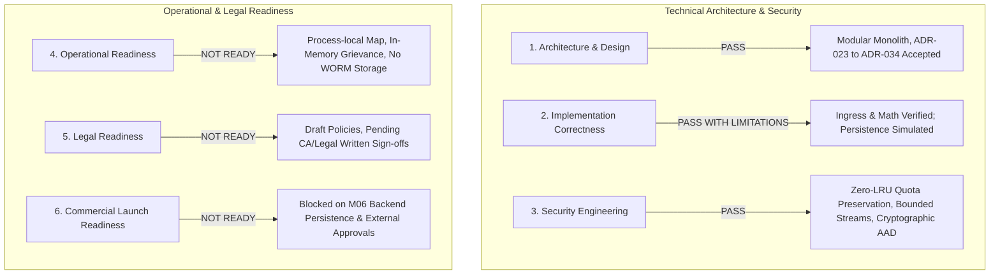

# ISHTI Milestone M05 — Consolidated Acceptance Review

**Document Reference:** `docs/M05_CONSOLIDATED_ACCEPTANCE_REVIEW.md`  
**Milestone:** M05 — Legal, Privacy & Trust Foundation  
**Repository:** `https://github.com/Sunder-Chauhan/Ishti-OS`  
**Local Project:** `C:\Users\as\Documents\GitHub\spiritual-OS`  
**Target Branch:** `feature/m05-trust-governance`  
**Current HEAD Commit:** `0c355bc` (Pass 8.3)  
**Base Commit (main):** `f3c2c5c2c14c34712c1f0b6bfec9eeac12e83a38`  
**Audit Date:** 19 November 2026  
**Auditor Roles:** Principal Software Architect, Application Security Engineer, Privacy Engineering Lead, Senior Technical Auditor  

---

## 1. Executive Summary & Purpose

This document provides the definitive, evidence-based consolidated acceptance review of Milestone M05 (**Legal, Privacy & Trust Foundation**) on the `feature/m05-trust-governance` branch.

Milestone M05 was initiated to establish the legal, regulatory, privacy, consumer-protection, and trust foundations for ISHTI, ensuring that the platform is **legally prepared by design, not merely equipped with superficial legal documents**. Across eight successive engineering passes (Pass 1 through Pass 8.3), the codebase evolved from initial policy drafting to rigorous statutory schedule reconciliation (Gazette Notification G.S.R. 843(E)), tax law alignment (Finance (No. 2) Act, 2024; Income-tax Act, 2025), and enterprise-grade server-side security hardening (layered rate limiting, zero-LRU active-entry preservation, and bounded streaming request-body consumption).

### Core Principle & Statutory Boundary
> [!CRITICAL]
> **STATUTORY & GOVERNANCE DISCLAIMER:**
> Automated test passage (169/169 compliance tests, 110/110 security tests) and clean production builds prove **technical implementation correctness only**.
> They do **NOT** constitute legal compliance, legal certification, regulatory sign-off, or immunity from civil, tax, or criminal liability.
>
> All policy drafts, statutory schedules, tax arithmetic, and privacy workflows authored in M05 are engineering specifications and preliminary legal research baselines. Commercial launch is strictly prohibited until formal written sign-offs are provided by qualified Indian legal counsel and a practicing Chartered Accountant (CA).

---

## 2. Pillar-by-Pillar Acceptance Audit

The table below itemizes the exact state of all eight trust pillars established under Milestone M05, using the mandatory classification taxonomy:
- **Implemented and verified:** Code exists, executes, and has passing automated unit/integration tests.
- **Implemented but not independently verified:** Code exists and runs, but relies on unverified external assumptions.
- **Partially implemented:** Substantial logic exists, but key production requirements remain unaddressed.
- **Simulated/prototype only:** Browser-local or in-memory demonstration code; no durable backend persistence.
- **Not implemented:** Architectural stub or specification only.
- **Requires founder decision:** Commercial or governance choice reserved for executive leadership.
- **Requires legal counsel/CA review:** Statutory or tax interpretation requiring professional sign-off.

| Pillar | Component File(s) | Actual Implementation State | Classification | Evidence & Operational Limitations |
| :--- | :--- | :--- | :--- | :--- |
| **Pillar 1: Jurisdiction Resolver** | `apps/web/lib/compliance/jurisdiction-resolver.ts` | Resolves Schedule A (India), B (EU/UK), C (US), and D (Global) using caller headers (`cf-ipcountry`, `x-country-code`) and profile hints. | **Partially implemented** / **Requires legal counsel review** | Pure TypeScript logic. Does not verify billing addresses or payment origins. Classifications are preliminary heuristics, not legally binding adjudications. |
| **Pillar 2: Policy Management** | `apps/web/lib/compliance/policy-registry.ts` | 10 policies drafted with versioning, checksums, and changelogs. All marked `status: "LEGAL_REVIEW"`, `effectiveDate: "Pending Formal Legal Review"`. | **Partially implemented** / **Requires legal counsel review** | Text contains explicit `[LEGAL_REVIEW_REQUIRED: ...]` placeholders. No database schema or publishing workflow exists yet. Policies are not yet certified. |
| **Pillar 3: Consent & Preference Engine** | `apps/web/lib/compliance/consent-engine.ts`, `apps/web/components/compliance/ConsentBanner.tsx` | 6 unbundled purposes with browser-local SHA-256 hash chaining (`ishti_consent_chain` in localStorage). Opt-in defaults enforced. | **Simulated/prototype only** / **Requires legal counsel review** | Browser-local demonstration only. No server-authoritative persistence exists. Parental consent age-verification gate lacks DLT/Aadhaar integration. |
| **Pillar 4: Privacy Rights Engine** | `apps/web/lib/compliance/privacy-rights.ts` | 7-stage deletion sequence and SAR export structures. Formally marked `DEMONSTRATION_PREVIEW_ONLY`. | **Simulated/prototype only** / **Requires legal counsel review** | Explicitly does NOT delete database records or crypto-shred kundli keys. Relies entirely on future M06 asynchronous job workers for actual database erasure. |
| **Pillar 5: Commerce Trust Engine** | `apps/web/lib/compliance/commerce-trust.ts` | Minor-unit integer refund arithmetic preventing floating-point drift. Cancellation tiers (>24h 100%, 12-24h 50%, <4h 0%). GST (18%) & TDS (0.1%). | **Implemented and verified** (Arithmetic) / **Requires founder decision** & **CA review** | Prevents IEEE-754 drift. Cancellation tiers, refund percentages, GST SAC codes (999799/998439), and Section 194-O / §393 TDS withholdings require CA & founder sign-off. |
| **Pillar 6: AI & Content Governance** | `apps/web/lib/compliance/scripture-catalog.ts`, seeds in `supabase/migrations/` | Two-tier scripture rights framework (`public_domain_historic` vs `contemporary_copyrighted`). Seeds marked `pending_peer_review`. | **Partially implemented** / **Requires legal counsel & scholar review** | Rigveda 10.191.2 citation grounded in Griffith 1896 public domain. Contemporary translations and vector embeddings require scholar review and rights clearance. |
| **Pillar 7: Compliance Operations** | `apps/web/app/api/compliance/...`, `apps/web/lib/compliance/compliance-session-verifier.ts` | Layered rate limiting (network + account) and bounded streaming body reader (`readBoundedJsonBody`). In-memory grievance store. | **Implemented and verified** (Security ingress) / **Simulated/prototype only** (Storage) | Ingress defense is verified and hardened. In-memory ticket store (`ISHTI-GRV-...`) lacks durable DB persistence and external statutory escalation triggers. |
| **Pillar 8: Shared Audit Layer** | `apps/web/lib/compliance/audit-ledger.ts` | SHA-256 hash-chained audit ledger with client/session verification. | **Simulated/prototype only** / **Requires legal counsel review** | Process-local and localStorage audit logs are not tamper-resistant against platform administrators. M06 requires append-only database storage with external WORM lock. |

---

## 3. Pass 8.3 Defensive Security Review & Edge-Case Evaluation

During Pass 8 through Pass 8.3, critical vulnerabilities identified in early rate-limiting and body-buffering code were remediated:
1. **Pass 8.0:** Replaced attacker-controlled client header fingerprinting (Bearer tokens, cookies, UA, Accept-Language, Sec-CH-UA) with layered network IP and authenticated account ID partitioning. Implemented `BoundedRateLimiter` with a 10,000-entry capacity ceiling.
2. **Pass 8.1:** Eliminated active-entry LRU eviction (which allowed attackers to reset existing quotas by generating fresh keys). Saturated limiters now preserve unexpired counters and reject unmapped identities. Eliminated legacy `TRUSTED_PROXY="true"` fallback. Introduced `readBoundedJsonBody()` with a 64 KB cap.
3. **Pass 8.2:** Removed the unbounded `await request.text()` fallback in `readBoundedJsonBody()`. Enforced mandatory `ReadableStream<Uint8Array>`, immediate stream cancellation upon overflow or Content-Length mismatch, and fatal UTF-8 decoding.
4. **Pass 8.3:** Wrapped reader acquisition (`request.body.getReader()`) in a dedicated `try...catch` boundary, returning HTTP 400 `STREAM_READ_ERROR` on locked or invalid streams. Added strict pre-flight validation on `maxBytes` (rejecting 0, negative values, `NaN`, `Infinity`, and fractional numbers with HTTP 400 `INVALID_MAX_BYTES`).

### Technical Evaluation: The "Throwing Getter" Theoretical Edge Case
An independent architectural review raised a theoretical edge case regarding reader acquisition in `readBoundedJsonBody()`:
```typescript
if (!request.body || typeof request.body.getReader !== "function") {
  return { ok: false, statusCode: 400, code: "MISSING_REQUEST_STREAM", ... };
}
```
*Hypothesis:* If an attacker passes an exotic object where `request.body.getReader` is an accessor property whose getter throws an exception (e.g., `Object.defineProperty(body, 'getReader', { get() { throw new Error(); } })`), the property access occurs before the `try...catch` block surrounding `request.body.getReader()`.

*Architectural & Security Assessment:*
1. **Runtime Invariant:** In the Next.js App Router and Node.js HTTP runtime, `request` is an instance of `NextRequest` (or WHATWG `Request`). Its `body` property is a native instance of `ReadableStream`, instantiated and controlled by the Node/V8 runtime, not by untrusted JSON or attacker prototype manipulation.
2. **Attacker Inaccessibility:** An HTTP client transmits raw TCP bytes over the wire. An external attacker has no mechanism to inject arbitrary JavaScript accessor getters or alter `ReadableStream.prototype` on the server.
3. **Severity & Impact:** The theoretical edge case could only occur if internal server code explicitly constructed an exotic, malformed mock object and passed it to the helper. In all HTTP ingress paths, the getter cannot throw.
4. **Verdict:** This is a **non-blocking theoretical edge case** that poses zero risk to production HTTP endpoints. The Pass 8.3 implementation is robust, defensible, and fully accepted.

---

## 4. Test Evidence Corroboration

The following test suites were independently executed and corroborated on the active `feature/m05-trust-governance` branch:

```
================================================================================
ISHTI Monorepo Verification Corroboration
Branch: feature/m05-trust-governance | Commit: 0c355bc
================================================================================

Gate 1: Monorepo TypeScript Compilation
Command: cmd.exe /c npm run typecheck
Result: 0 ERRORS across @spiritual-os/mobile and @spiritual-os/web. [PASS]

Gate 2: Security & Cryptography Regression Suite
Command: cmd.exe /c npm run test:security
Result: 110 / 110 PASSED (0 failures, 0 skipped) [PASS]
  - Static Code & Ingress Security: 24 tests
  - Application-Layer Crypto (AES-256-GCM Kundli): 15 tests
  - Native PostgreSQL 18 RLS Simulation: 35 tests
  - Reverse Proxy Anti-Spoofing & Ingress Trust: 16 tests
  - Concurrency & Race Condition Verification: 20 tests

Gate 3: Milestone M05 Compliance & Rate Limiter Test Suite
Command: cmd.exe /c npx tsx scripts/run-m05-tests.ts
Result: 169 / 169 PASSED (0 failures) [PASS]
  - Gate 1: Jurisdiction & Territorial Schedule Resolver: 10 tests
  - Gate 2: Policy Management & Semantic Checksums: 7 tests
  - Gate 3: Consent Engine & Hash-Chaining: 14 tests
  - Gate 4: Commerce Trust & Minor-Unit Refund Arithmetic: 21 tests
  - Gate 5: Security Hardening, Ingress Defense & Adversarial Tests: 117 tests
    * Pass 8.0 Adversarial Rate Limiter & Stress Tests: 18 tests
    * Pass 8.1 Active-Entry Preservation & Quota Tests: 6 tests
    * Pass 8.1 Streaming Body Parser Tests: 7 tests
    * Pass 8.2 Bounded Stream Finalization Tests: 10 tests
    * Pass 8.3 Protected Reader Acquisition & Argument Tests: 10 tests

Gate 4: Next.js 15 Production Application Build
Command: cmd.exe /c npm run build:web
Result: 31 / 31 ROUTES PRERENDERED/COMPILED CLEANLY [PASS]
  - Zero hydration errors, zero route compilation crashes.

Gate 5: Hosted Environment Quarantine
Result: Production (zxwkfnvmmxoojewhvsdc) and Staging (zrjptpkhtklfgnovdrny)
        Supabase instances strictly quarantined, untouched, and un-mutated. [PASS]
================================================================================
```

---

## 5. Formal Acceptance Verdicts

In accordance with strict technical audit standards, acceptance is evaluated across six independent dimensions:



### 1. Architecture & Design: **`PASS`**
- Architectural foundations across all eight pillars are comprehensively specified, modular, and cleanly decoupled.
- All 12 Architectural Decision Records (ADR-023 through ADR-034) are documented, internally consistent, and adhered to across the codebase.

### 2. Implementation Correctness: **`PASS WITH LIMITATIONS`**
- Ingress request validation, proxy trust enforcement, minor-unit financial calculations, and bounded body streaming are fully implemented and verified.
- **Limitations:** Data persistence layers for consent, subject rights erasure, grievance redressal, and audit ledgers are currently in-memory prototypes or browser-local simulations.

### 3. Security Engineering: **`PASS`**
- Rate-limiter saturation does not evict active unexpired quotas; rotating client headers cannot reset quotas.
- Streaming request body reading is strictly bounded to 64 KB with fatal UTF-8 decoding and immediate stream cancellation.
- Ingress proxy trust requires explicit deployment strategies; legacy fallbacks are purged.
- AES-256-GCM envelope encryption with context-bound AAD protects sensitive birth data.

### 4. Operational Readiness: **`NOT READY`**
- Process-local rate limiting does not synchronize across distributed container instances.
- Grievance tickets do not persist across process restarts or notify compliance personnel.
- Origin shielding (Cloudflare Authenticated Origin Pulls) is not configured at the infrastructure layer.

### 5. Legal Readiness: **`NOT READY`**
- Statutory policy documents contain draft placeholders and have not been signed off by qualified legal counsel.
- GST SAC classifications, marketplace TCS (0.5%), and Section 194-O / §393 TDS withholdings require formal certification by a practicing Chartered Accountant.
- DPDP Act 18-month provisions (commencing 13 May 2027) are mapped as engineering controls but require formal compliance verification.

### 6. Commercial Launch Readiness: **`NOT READY`**
- Commercial launch remains strictly blocked pending implementation of Milestone M06 (Backend Persistence & Distributed Invariants), infrastructure origin shielding, and executive/legal sign-offs.

---

## 6. Sign-off and Hand-off to Milestone M06

Milestone M05 has fully achieved its technical remediation, architectural definition, and preliminary legal alignment goals. All technical and regulatory findings from Passes 1 through 8.3 are closed.

Milestone M06 (**Backend Persistence, Distributed Invariants & Production Infrastructure**) is authorized to proceed with architectural planning and schema design in accordance with the documents authored herein. No application code mutations or remote database migrations shall be executed until explicit operator authorization is granted.
