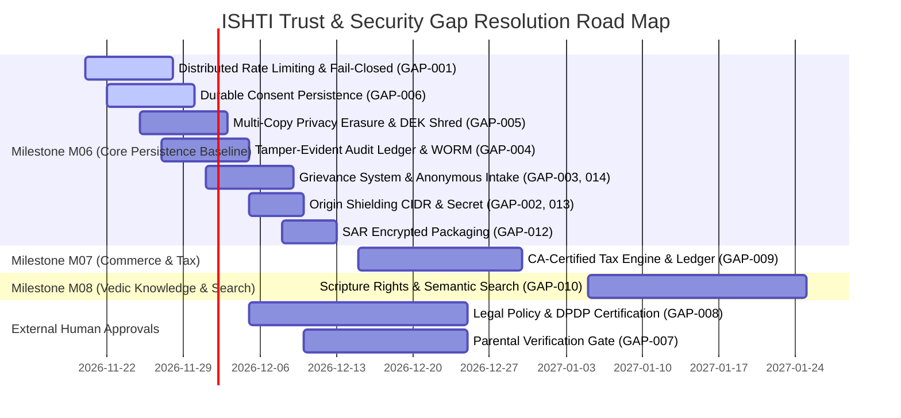

# ISHTI Milestone M05 — Final Gap Register (Revised)

**Document Reference:** `docs/M05_FINAL_GAP_REGISTER.md`  
**Milestone:** M05 — Legal, Privacy & Trust Foundation  
**Branch:** `feature/m05-trust-governance`  
**Commit Baseline:** `0c355bc`  
**Revision Date:** 19 November 2026  
**Auditor Roles:** Principal Software Architect, Application Security Engineer & Privacy Engineering Lead  

---

## 1. Overview & Objectives

This register provides an exhaustive, itemized inventory of all technical, operational, regulatory, and legal gaps identified upon the conclusion of Milestone M05. 

In accordance with ISHTI governance principles, no simulated prototype, in-memory cache, or heuristic estimation is classified as "complete" or "production-ready." Every gap identified below has been assigned a risk assessment, severity rating, target resolution milestone, and accountable owner.

---

## 2. Itemized Gap Register

| Gap ID | Pillar / Area | Description of Gap | Risk / Exposure | Severity | Target Milestone | Responsible Role |
| :--- | :--- | :--- | :--- | :--- | :--- | :--- |
| **GAP-M05-001** | Ingress & Security | **Process-Local Rate Limiting:** `BoundedRateLimiter` maintains an in-memory `Map`. Quotas do not synchronize across container instances. Silent local fallback on sensitive routes enables distributed brute force. | Distributed abuse; burst attacks bypassing rate limits across multiple container replicas. | **HIGH** | Milestone M06 (M06.1) | Backend Architect |
| **GAP-M05-002** | Ingress & Network | **Unshielded Direct Origin Risk:** `compliance-session-verifier.ts` validates `CF-Connecting-IP` when `TRUSTED_PROXY_STRATEGY="cloudflare"`, but cannot prevent an attacker who discovers origin IP from forging headers if direct traffic is permitted. | Attacker forges client IP if origin is directly addressable without Cloudflare edge proxying. | **HIGH** | Milestone M06 (M06.6) | DevOps / Cloud Infrastructure Lead |
| **GAP-M05-003** | Operations & Redressal | **In-Memory Grievance Storage:** Triage and grievance tickets (`ISHTI-GRV-...`) are held in process memory. Container restarts destroy unpersisted tickets. Lacks dual-clock SLA monitoring (24h ack, 7d disposal under IT Rules). | Loss of grievance records; violation of IT Rules Rule 3(2) statutory mandates. | **CRITICAL / BLOCKER** | Milestone M06 (M06.5) | Backend Lead & Privacy Engineer |
| **GAP-M05-004** | Audit & Evidence | **Client-Side / Local Memory Audit Ledger:** Audit events are recorded via SHA-256 chaining in local memory and browser storage. Lacks database triggers, Merkle tree verification, and external WORM object lock. | Inability to prove audit trail integrity in legal proceedings; vulnerable to tampering by privileged operators. | **HIGH** | Milestone M06 (M06.4) | Security Architect |
| **GAP-M05-005** | Subject Rights | **Simulated Privacy Erasure & Multi-Copy Persistence:** `apps/web/lib/compliance/privacy-rights.ts` is `DEMONSTRATION_PREVIEW_ONLY`. Does not execute DB cascading deletion, per-profile DEK shredding, or multi-copy purge across 15 stores. | Failure to execute statutory erasure under DPDP Act §12(3) / GDPR Art 17; simulated SAR export lacks secure delivery. | **CRITICAL / BLOCKER** | Milestone M06 (M06.3) | Backend Lead & Cryptography Engineer |
| **GAP-M05-006** | Consent Engine | **Browser-Local Consent Persistence:** Consent records are stored in browser `localStorage` (`ishti_consent_chain`). The backend lacks an authenticated, immutable `consent_records` table with DPDP §6(4) withdrawal workflows. | Inability to demonstrate verifiable consent before the Data Protection Board under DPDP Act §6; consent lost on device wipe. | **CRITICAL / BLOCKER** | Milestone M06 (M06.2) | Backend Architect & Frontend Lead |
| **GAP-M05-007** | Age Assurance | **Simulated Parental Consent Gate:** Consent engine provides a self-declaration age checkbox. Lacks integration with verifiable parental consent mechanisms (e.g. Government DLT, Aadhaar token) mandated by DPDP Act §9. | Unlawful processing of personal data of children; statutory liability up to ₹200 crore under DPDP Act §33 Schedule Item 3. | **HIGH** | Pre-Launch Compliance | Privacy Engineering Lead & Legal Counsel |
| **GAP-M05-008** | Policy Management | **Draft Legal Policy Placeholders:** All 10 policies in `policy-registry.ts` are marked `status: "LEGAL_REVIEW"` and contain `[LEGAL_REVIEW_REQUIRED: ...]` placeholders. Policies are not yet certified by qualified legal counsel. | Unenforceable terms of service, invalid privacy notices, and consumer disputes regarding spiritual disclaimers. | **CRITICAL / BLOCKER** | Pre-Launch (Founder Sign-off) | Founder & Legal Counsel |
| **GAP-M05-009** | Commerce & Taxation | **Uncertified Tax & Commerce Baselines:** Cancellation tiers (100% >24h, 50% 12-24h, 0% <4h), GST SAC codes (999799/998439), 0.5% TCS (§52), and 0.1% TDS (§194-O / §393) are engineering baselines requiring CA certification. | Tax withholding penalties, misclassified GST liabilities, and consumer disputes. Deferred to Milestone M07. | **HIGH** | Milestone M07 | Practicing Chartered Accountant & Founder |
| **GAP-M05-010** | Content Governance | **Scripture Copyright & Translation Clearance:** Contemporary translations and commentary for scriptural texts lack formal rights clearance. Deferred to Milestone M08. | Intellectual property infringement claims from modern publishers or copyright holders. | **HIGH** | Milestone M08 | Vedic Scholar & Legal Counsel |
| **GAP-M05-011** | Security Engineering | **Theoretical Throwing Getter Edge-Case:** `readBoundedJsonBody()` tests `typeof request.body.getReader !== "function"` prior to reader acquisition. Non-blocking in Node HTTP runtime, but theoretical edge case in mock harnesses. | Zero production risk (Node runtime controls `request.body`). | **LOW** | Milestone M06 (M06.1) | Application Security Engineer |
| **GAP-M05-012** | Subject Rights | **SAR Export Packaging & Delivery:** Subject Access Request (SAR) export generates raw JSON in memory. Lacks AES-256 encrypted archive packaging and time-limited signed download link delivery. | Unencrypted exposure of personal data during data portability downloads; potential PII interception. | **MEDIUM** | Milestone M06 (M06.3) | Application Security Engineer |
| **GAP-M05-013** | Hosting Infrastructure | **Vercel Pro Incompatibility with Cloudflare AOP (mTLS):** Standard Vercel Pro does not support custom client certificates. Direct origin shielding must rely on Cloudflare CIDR firewall allowlisting and shared proxy secret. | Potential origin bypass if direct IP is discovered and firewall rules are misconfigured. | **HIGH** | Milestone M06 (M06.6) | DevOps / Cloud Infrastructure Lead |
| **GAP-M05-014** | Ingress Security | **Controlled Anonymous Public Intake Pathway:** Grievances and early access require server-mediated intake without exposing direct database write access to the PostgREST `anon` role. | Uncontrolled direct table access or vulnerability to spam floods if anonymous intake is unmediated. | **HIGH** | Milestone M06 (M06.5) | Backend Architect & Security Lead |

---

## 3. Prioritized Resolution Road Map

