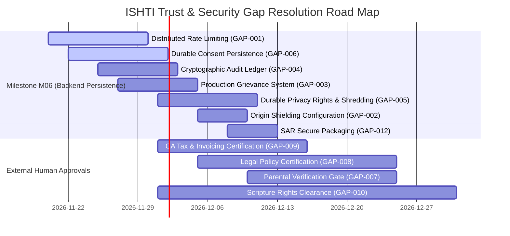

# ISHTI Milestone M05 — Final Gap Register

**Document Reference:** `docs/M05_FINAL_GAP_REGISTER.md`  
**Milestone:** M05 — Legal, Privacy & Trust Foundation  
**Branch:** `feature/m05-trust-governance`  
**Commit Baseline:** `0c355bc`  
**Date:** 19 November 2026  
**Auditor Roles:** Principal Software Architect, Application Security Engineer, Privacy Engineering Lead  

---

## 1. Overview & Objectives

This register provides an exhaustive, itemized inventory of all technical, operational, regulatory, and legal gaps identified upon the conclusion of Milestone M05. 

In accordance with ISHTI governance principles, no simulated prototype, in-memory cache, or heuristic estimation is classified as "complete" or "production-ready." Every gap identified below has been assigned a risk assessment, severity rating, target resolution milestone, and accountable owner.

---

## 2. Itemized Gap Register

| Gap ID | Pillar / Area | Description of Gap | Risk / Exposure | Severity | Target Milestone | Responsible Role |
| :--- | :--- | :--- | :--- | :--- | :--- | :--- |
| **GAP-M05-001** | Ingress & Security | **Process-Local Rate Limiting:** `BoundedRateLimiter` maintains an in-memory `Map`. When deployed across multiple Next.js instances or serverless workers, quotas do not synchronize, allowing round-robin requests to multiply allowable burst limits. | Distributed abuse; burst attacks bypassing rate limits across multiple container replicas. | **HIGH** | Milestone M06 (M06.1) | Backend Architect |
| **GAP-M05-002** | Ingress & Network | **Unshielded Direct Origin Risk:** `compliance-session-verifier.ts` validates `CF-Connecting-IP` when `TRUSTED_PROXY_STRATEGY="cloudflare"`, but cannot prevent an attacker who discovers the origin IP from forging headers if direct traffic is permitted. | Attacker forges client IP if origin is directly addressable without Cloudflare Authenticated Origin Pulls (AOP). | **HIGH** | Milestone M06 (M06.7) | DevOps / Cloud Infrastructure Lead |
| **GAP-M05-003** | Operations & Redressal | **In-Memory Grievance Storage:** Triage and grievance tickets (`ISHTI-GRV-...`) are held in process memory. Process restarts or container redeployments destroy all unpersisted grievance records. No automated statutory email/SMS acknowledgement occurs. | Loss of grievance records; violation of IT Rules Rule 3(2) 24h acknowledgement and 7d resolution mandates. | **CRITICAL / BLOCKER** | Milestone M06 (M06.4) | Backend Lead & Privacy Engineer |
| **GAP-M05-004** | Audit & Evidence | **Client-Side / Local Memory Audit Ledger:** Audit events are recorded via SHA-256 chaining in local memory and browser storage. There is no remote, append-only database table with write-once-read-many (WORM) storage. | Inability to prove audit trail integrity in legal proceedings; vulnerable to tampering by privileged system operators. | **HIGH** | Milestone M06 (M06.3) | Security Architect |
| **GAP-M05-005** | Subject Rights | **Simulated Privacy Rights Erasure & SAR:** `apps/web/lib/compliance/privacy-rights.ts` is explicitly marked `DEMONSTRATION_PREVIEW_ONLY`. It does not execute cascading database row deletion, nor does it cryptographically shred AES-256 kundli encryption keys. | Failure to execute statutory erasure under DPDP Act §12(3) / GDPR Art 17; simulated SAR export lacks secure authenticated distribution. | **CRITICAL / BLOCKER** | Milestone M06 (M06.2) | Backend Lead & Cryptography Engineer |
| **GAP-M05-006** | Consent Engine | **Browser-Local Consent Persistence:** Consent records are stored in browser `localStorage` (`ishti_consent_chain`). The backend lacks an authenticated, immutable `consent_records` table linked to user identities with verifiable withdrawal workflows. | Inability to demonstrate verifiable consent before the Data Protection Board under DPDP Act §6; consent state lost on device change. | **CRITICAL / BLOCKER** | Milestone M06 (M06.2) | Backend Architect & Frontend Lead |
| **GAP-M05-007** | Age Assurance | **Simulated Parental Consent Gate:** Consent engine provides a self-declaration age checkbox. It lacks integration with verifiable parental consent mechanisms (e.g. Government DLT, Aadhaar token, or parental verification flow) mandated by DPDP Act §9. | Unlawful processing of personal data of children; statutory liability up to ₹200 crore under DPDP Act Section 33 Schedule Item 3. | **HIGH** | Pre-Launch Compliance | Privacy Engineering Lead & Legal Counsel |
| **GAP-M05-008** | Policy Management | **Draft Legal Policy Placeholders:** All 10 policies in `policy-registry.ts` are marked `status: "LEGAL_REVIEW"` and contain `[LEGAL_REVIEW_REQUIRED: ...]` placeholders. Policies are not yet certified by qualified legal counsel. | Unenforceable terms of service, invalid privacy notices, and consumer disputes regarding spiritual guarantees. | **CRITICAL / BLOCKER** | Pre-Launch (Founder Sign-off) | Founder & Legal Counsel |
| **GAP-M05-009** | Commerce & Taxation | **Uncertified Tax & Commerce Baselines:** Cancellation tiers (100% >24h, 50% 12-24h, 0% <4h), GST SAC codes (999799/998439), 0.5% TCS (§52), and 0.1% TDS (§194-O / §393) are engineering implementations requiring formal CA certification. | Tax withholding penalties, misclassified GST liabilities, and consumer protection complaints under Consumer Protection (E-Commerce) Rules. | **CRITICAL / BLOCKER** | Pre-Launch (Finance Sign-off) | Practicing Chartered Accountant & Founder |
| **GAP-M05-010** | Content Governance | **Scripture Copyright & Translation Clearance:** Contemporary translations and commentary for scriptural texts (beyond historic public-domain English translations from Griffith 1896 / Müller 1879) lack formal rights clearance. | Intellectual property infringement claims from modern publishers, translators, or copyright holders. | **HIGH** | Pre-Beta / Ongoing | Vedic Scholar & Legal Counsel |
| **GAP-M05-011** | Security Engineering | **Theoretical Throwing Getter Edge-Case:** `readBoundedJsonBody()` tests `typeof request.body.getReader !== "function"` prior to reader acquisition. While safe in native Node/Next.js runtime, an exotic mock object with a throwing accessor getter could bypass structured 400. | Zero production risk (Node HTTP runtime controls `request.body`), but represents a theoretical edge case in non-standard test harnesses. | **LOW** | Milestone M06 (M06.1) | Application Security Engineer |
| **GAP-M05-012** | Subject Rights | **SAR Export Packaging & Delivery:** Subject Access Request (SAR) export generates raw JSON in memory. It lacks asymmetric encryption, password protection, and signed temporary download link delivery. | Unencrypted exposure of personal data during data portability downloads; potential PII interception. | **MEDIUM** | Milestone M06 (M06.2) | Application Security Engineer |

---

## 3. Prioritized Resolution Road Map

---

## 4. Acceptance Criteria for Gap Closure

1. **Architecture & Engineering Gaps (GAP-001 through GAP-006, GAP-011, GAP-012):**
   - Closed exclusively via verified code implementations, passing unit/integration tests, zero schema drift, and clean TypeScript compilation in Milestone M06.
2. **Infrastructure Gaps (GAP-002):**
   - Closed via verified Terraform/Cloudflare configuration enforcing mutual TLS (mTLS) or Authenticated Origin Pulls, verified via automated staging penetration test.
3. **Legal & Tax Gaps (GAP-007, GAP-008, GAP-009, GAP-010):**
   - Closed exclusively upon receipt of formal written, dated, and signed legal opinions and Chartered Accountant certificates archived in `docs/legal/signed/`.
