# ISHTI M05 — G0.1: Trust & Governance Architecture Refinement Report (Reconciled Baseline)

**Document Reference:** `docs/M05_G0_1_ARCHITECTURE_REFINEMENT_REPORT.md`  
**Milestone:** M05 — Global Legal, Privacy & Trust Foundation  
**Gate:** G0.1 — Trust & Governance Architecture Refinement  
**Git Baseline Commit:** `f3c2c5c2c14c34712c1f0b6bfec9eeac12e83a38` (`main`, remote synchronized)  
**Tracked Working Tree:** Unchanged (0 modifications to tracked files; documentation deliverables untracked)  
**Research & Reconciliation Date:** 17 November 2026  
**Execution Boundary:** Strictly Read-Only Architecture & Primary Source Legal-Tech Research  
**Author Roles:** Senior Global Privacy Architect, Legal-Technology Researcher, Application Security Architect, SaaS Governance Engineer  

---

## 1. Executive Summary

ISHTI is being architected as a global spiritual ecosystem. Its platform architecture supports spiritual seekers across India, the global Indian diaspora (including Non-Resident Indians across North America, Europe, the Middle East, Southeast Asia, and Australasia), and international seekers exploring Vedic scriptures, sacred chants, temple pujas, Panchang calendars, classical Jyotish (astrology), and expert consultations.

### The G0.1 Paradigm Shift: The Shared Trust & Governance Engine
The initial G0 discovery deliverable correctly recognized that ISHTI cannot operate under an India-only legal lens. However, G0 treated compliance as a fragmented collection of isolated UI toggles, unverified assumptions, and disconnected domain checks.

This G0.1 refinement replaces that fragmented posture with a centralized, modular **Trust and Governance Engine**. This engine serves as a shared infrastructure layer utilized identically across all platform domains—Puja, Astro, Bhakti, Panchang, Experts, and Community. Privacy rules, consent verification, cross-border safeguards, and audit ledgers are never implemented in domain silos; they are governed centrally through uniform services.

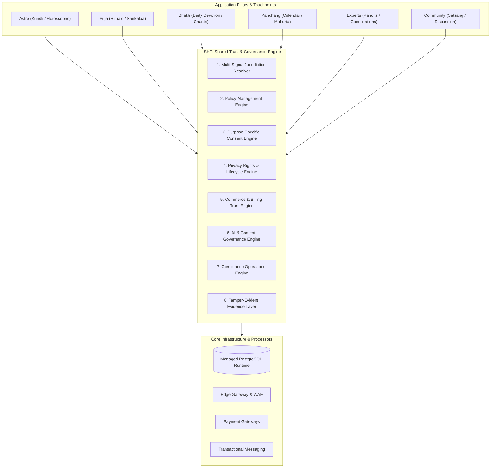

### Essential Legal, Regulatory & Technical Reconciliations
1. **Server-Side Application Encryption Verified:** Inspection of `apps/web/lib/crypto/kundli-encryption.ts` demonstrates that encryption is executed **server-side** (`import "server-only"`) using a server-managed environment key (`KUNDLI_ENCRYPTION_KEY_V1`), not client-side in the browser. The Next.js server runtime has full access to decrypted plaintext during computation. G0 claims of "client-side zero-knowledge encryption" were factually incorrect and are formally retracted.
2. **Contextual Special-Category Classification & Statutory Divergence:**
   - **GDPR Art. 9:** Astrological birth data (date, time, place) is not intrinsically religious data. The legal question under GDPR is whether processing *reveals* religious or philosophical beliefs. When processed purely for mathematical planetary ephemeris, it is standard personal data. When combined with deity focus, sampradaya lineages, or puja sankalpa intentions, it triggers Art. 9 protections. Furthermore, Art. 9 contains multiple statutory exceptions (e.g. manifestly made public under Art. 9(2)(e), legitimate activities of religious bodies under Art. 9(2)(d), legal claims under Art. 9(2)(f)), not solely explicit consent.
   - **India DPDP Act 2023:** India's DPDP Act **does not utilize the GDPR's special-category classification system at all**. It applies a uniform standard to all digital personal data, establishing heightened requirements specifically for children's data (§9), persons with disabilities (§9), and Significant Data Fiduciaries (§10), rather than a separate "sensitive personal data" tier.
3. **Primary Source Statutory Thresholds & Realities:**
   - **India IT Rules Grievance Redressal (February 2026 Amendment):** The February 2026 amendment to the Information Technology (Intermediary Guidelines and Digital Media Ethics Code) Rules, 2021 establishes that intermediaries must **acknowledge grievances within 24 hours** (shortened from 48 hours) and **resolve/dispose of grievances within 7 calendar days** (shortened from 15 days), with a separate **36-hour expedited window** for specified content removal orders under Rule 3(1)(b).
   - **India DPDP Act Commencement Schedule (G.S.R. 843(E)):** Under Gazette Notification G.S.R. 843(E) dated 13 November 2025, DPDP implementation is staggered across a 3-tier timeline: Day 1 (Board setup, definitions in Nov 2025), 1-Year (Section 6(9) and Section 27(1)(d) commenced **13 November 2026** — *currently in effect*; Sections 6(7) and 6(8) do not commence here), and 18-Month (Sections 3–5, 6(1)–(8) and (10), 7–10, 11–17, 27 (except (1)(d)), 28–34, 36, 37, and 44(2) commencing **13 May 2027**).
   - **United States CCPA/CPRA Threshold:** Effective **January 1, 2025**, the California Privacy Protection Agency (CPPA) adjusted the statutory annual gross revenue threshold to **$26.625 million** (up from \$25 million) pursuant to Cal. Civ. Code § 1798.140(d). Alternative threshold tests require buying, selling, or sharing personal information of **100,000 or more consumers or households** (not generic database records), or deriving **50%+ revenue from selling/sharing personal data**.
   - **Canada:** Bill C-27 (Digital Charter Implementation Act) **died on the Order Paper on January 6, 2025** upon parliamentary prorogation. PIPEDA (*Personal Information Protection and Electronic Documents Act*) remains the governing federal private-sector privacy law.
   - **United Kingdom:** The legacy DPDI Bill fell in 2024; the UK Parliament enacted the **Data (Use and Access) Act 2025 (DUAA)** on June 19, 2025 (c. 18).
4. **Tailored Financial Retention & Modernized Tax Law:** Rejected the unsupported assertion of a universal "7-year financial retention rule". Accounted for the **Income-tax Act, 2025** (effective 1 April 2026, Section 62 and Rule 46 of Income-tax Rules, 2026: 7 tax years, with Rule 46(8) mandating daily electronic backups in India) and its transitional savings under Section 536 preserving the 1961 Act (Section 44AA / Rule 6F: 6 years from assessment year) for assessment periods prior to 1 April 2026. Explicitly segregated commercial/tax records from user personal data, establishing an exhaustive statutory retention matrix with legal counsel checkpoints.
5. **Tamper-Evident Evidence Architecture:** Replaced technically inaccurate claims of "database immutability" with **append-only, access-restricted, tamper-evident evidence ledgers** utilizing SHA-256 cryptographic hash chaining, strict RLS triggers, and data minimization.
6. **Multi-Signal Jurisdiction Evidence Model:** Replaced rigid single-country rankings with an evidence-based multi-signal model supporting concurrent multi-jurisdictional compliance.
7. **Decoupled Commercial Policies:** Removed arbitrary commercial refund cutoffs (24-hour, 50%) as pseudo-statutory mandates; structured them as configurable policy parameters reserved for operator and legal counsel determination.

---

## 2. Scope and Non-Scope

### In-Scope
- Technical and architectural specification of the eight Trust & Governance Engine pillars.
- Systematic audit of the existing M02 database schema (`supabase/migrations/20261114000000_initial_schema.sql`) and M04.6 application layer.
- Formal legal-technology research of official primary sources across eight jurisdictions as of 17 November 2026.
- Comprehensive data inventory, contextual classification framework, and data-flow mapping.
- End-to-end privacy rights, data retention, and cryptographic deletion lifecycle design.
- Vendor and subprocessor inventory with evidentiary confidence statuses.
- Cross-border data transfer impact assessment (*Schrems II*, SCCs, UK IDTA).
- Governance frameworks for AI interactions, religious intellectual property, and child protection.
- Identification of decision gates requiring operator approval versus qualified legal counsel sign-off.

### Non-Scope (Strictly Enforced)
- Writing or modifying application source code (`apps/web/`, `apps/mobile/`, `packages/`).
- Authoring, editing, or applying database migrations.
- Connecting to, querying, or mutating either the staging database (`zrjptpkhtklfgnovdrny`) or the quarantined production database (`zxwkfnvmmxoojewhvsdc`).
- Modifying environment files (`.env`, `.env.local`) or production credentials.
- Deploying services or packages.
- Staging, committing, or pushing Git changes.
- Providing formal legal advice or issuing legal certifications.

---

## 3. Repository Baseline and Read-Only Verification

Prior to conducting this architecture refinement, the repository state was independently verified via read-only Git commands:

```bash
$ git rev-parse HEAD
f3c2c5c2c14c34712c1f0b6bfec9eeac12e83a38

$ git status --short
?? docs/M05_DISCOVERY_AND_ARCHITECTURE_REPORT.md
?? docs/M05_G0_1_ARCHITECTURE_REFINEMENT_REPORT.md
```

### Baseline Verification Confirmation
- **Target Baseline Commit:** `f3c2c5c2c14c34712c1f0b6bfec9eeac12e83a38` (Matches accepted M04.6 closure).
- **Branch Synchronization:** Local `main` is in exact synchronisation with `origin/main`.
- **Tracked Working Tree State:** Completely clean and unmodified. The two untracked files are the M05 documentation deliverables.
- **Environment Isolation:** Zero network connections were made to any database. Quarantined production Supabase instance `zxwkfnvmmxoojewhvsdc` remains untouched.

---

## 4. Existing M04 / M04.6 Capabilities to Reuse

ISHTI's established foundational layers from M01–M04.6 provide robust infrastructure that will be directly reused by the Trust & Governance Engine, avoiding duplicate systems:

| Existing Asset | Location | Capabilities Reused by M05 |
| :--- | :--- | :--- |
| **Accessibility Engine** | `apps/web/lib/a11y/` | WCAG 2.2 AA compliant focus trapping, live announcements (`announce()`), screen-reader friendly dialog primitives, high-contrast tokens, and keyboard navigation. All legal policies, consent banners, and rights modals will reuse these primitives. |
| **Localization Infrastructure** | `apps/web/lib/i18n/` | Bilingual core (English & Hindi) dictionaries, missing-key fallback pipeline, and scaffolding for 8 additional Indian languages (Tamil, Telugu, Kannada, Malayalam, Bengali, Marathi, Gujarati, Odia). Used for statutory multilingual notices under DPDP Act Schedule 8. |
| **Design Tokens & Theme** | `apps/web/app/design-tokens.css` | Accessible color contrasts, typography scaling (`100%`, `150%`, `200%`), calm spiritual aesthetic, responsive modal layouts, and accessible form switches. |
| **Distributed Rate Limiter** | `apps/web/lib/security/rate-limiter.ts` | HMAC-SHA-256 identifier hashing, atomic sliding-window rate limiting via PostgreSQL RPC, fail-closed security for sensitive endpoints, and trusted edge proxy header extraction. Used to protect privacy export and deletion endpoints from brute-force enumeration. |
| **Error Handling & Presentation** | `apps/web/lib/errors/` | Safe human-readable error transformation layer preventing internal database or backend leaks from reaching client UI. |

---

## 5. Existing M02 Schema Assessment

A comprehensive audit of the 11 tables defined in `supabase/migrations/20261114000000_initial_schema.sql` revealed critical structural strengths and architectural liabilities:

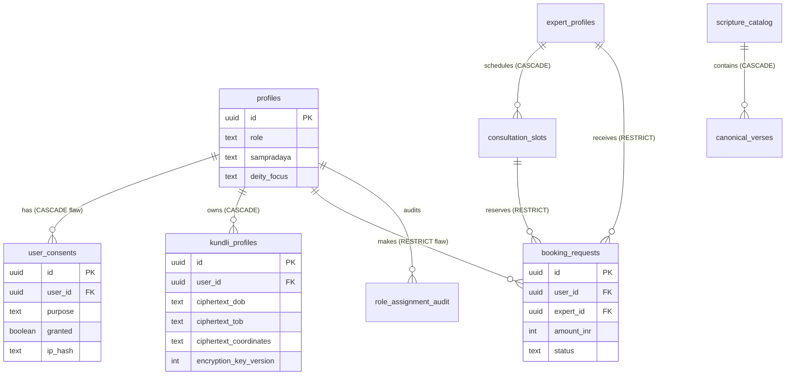

### Table-by-Table Architectural Evaluation

1. **`public.profiles`:**
   - *Contents:* User identity, role (`devotee`, `acharya`, `admin`), `sampradaya` lineage, `deity_focus`.
   - *Governance Assessment:* Captures religious/philosophical beliefs directly. Currently lacks fields for declared jurisdiction, country of residence, age verification status, or deletion status (soft-delete flag).
2. **`public.user_consents`:**
   - *Contents:* `user_id`, `purpose`, `granted`, `consent_version`, `ip_hash`, `user_agent`, `granted_at`, `revoked_at`.
   - *Critical Flaw 1 (CASCADE Deletion):* Defined with `user_id UUID REFERENCES public.profiles(id) ON DELETE CASCADE`. If a user profile is deleted, their statutory consent and withdrawal evidence is instantly destroyed, violating statutory audit obligations under GDPR and DPDP.
   - *Critical Flaw 2 (Coarse Modeling):* Hardcoded check constraint restricts purposes to `('kundli_astrology', 'expert_consultation', 'marketing_updates', 'analytics')`. Lacks legal basis separation, jurisdiction context, data category specification, and re-consent trigger mechanisms.
3. **`public.kundli_profiles`:**
   - *Contents:* `ciphertext_dob`, `ciphertext_tob`, `ciphertext_coordinates`, `encryption_key_version`, `encryption_iv`, `encryption_auth_tag`.
   - *Governance Assessment:* Strong database-at-rest protection. However, key management relies on server environment variables (`KUNDLI_ENCRYPTION_KEY_V1`), meaning server runtime administrators can decrypt records.
4. **`public.booking_requests`:**
   - *Contents:* `user_id`, `expert_id`, `slot_id`, `service_type`, `status`, `amount_inr`, `payment_status`.
   - *Critical Flaw 1 (RESTRICT Deletion Block):* Defined with `user_id UUID REFERENCES public.profiles(id) ON DELETE RESTRICT`. A user who has made a booking cannot exercise their Right to Erasure without triggering database constraint violations.
   - *Critical Flaw 2 (Single Currency & Commercial Rigidity):* Hardcoded `amount_inr INTEGER`. Cannot support international currencies (USD, EUR, GBP, AED, SGD), regional tax/GST breakdowns, refund timestamps, or dispute escrow states.
5. **`public.role_assignment_audit`:**
   - *Contents:* Tamper-evident log of RBAC role escalations. Security definer triggers prevent unauthorized mutation. Reusable pattern for the M05 Audit & Evidence Layer.
6. **`public.rate_limit_events`:**
   - *Contents:* Distributed sliding-window rate limit ledger using HMAC-SHA-256 hashed identifiers.
7. **`public.scripture_catalog` & `public.canonical_verses`:**
   - *Contents:* Sacred scriptures, verses, traditions, source editions, and translations.
   - *Governance Assessment:* Currently lacks copyright status classification (public domain vs licensed modern commentary) and translator attribution metadata.
8. **`public.early_access_subscribers`:**
   - *Contents:* Pre-launch waitlist collecting `email`, `phone`, `preferred_tradition`, and `interested_in`.
   - *Governance Assessment:* Collects religious preference data at intake without an explicit privacy policy link or statutory consent record.

---

## 6. Global Jurisdiction and Legal Applicability Matrix

*Research Date: 17 November 2026. All sources verified against official government gazettes, legislation portals, and regulatory guidance.*

| Jurisdiction & Instrument | Relevant Articles / Sections | Applicability Conditions | Classification | Official Source & URL | Effective / Notification Status |
| :--- | :--- | :--- | :--- | :--- | :--- |
| **India: Digital Personal Data Protection Act, 2023** | §4, §5, §6 (Notice & Consent), §8 (Fiduciary Obligations), §9 (Children & Persons with Disabilities), §10 (SDFs), §12–§14 (Data Principal Rights), §16 (Cross-border) | Processing digital personal data within India; or outside India if offering goods/services to Indian data principals. | **Confirmed Obligation** | [MeitY Gazette / India Code](https://www.meity.gov.in/content/digital-personal-data-protection-act-2023) | Act enacted August 2023. **Commencement Notification G.S.R. 843(E) dated 13 Nov 2025**; phased rollout across 2025–2027. |
| **India: Information Technology (Intermediary Guidelines) Rules, 2021 (as amended Feb 2026)** | Rule 3(1)(a), Rule 3(1)(b), Rule 3(2) (Grievance Redressal Mechanism) | Any digital intermediary providing web/mobile platform services in India. | **Confirmed Obligation** | [Ministry of I&B / MeitY Amendment](https://www.mib.gov.in/sites/default/files/2026-05/it-rules-2021-2.pdf) | **Amended Feb 2026**: Mandates **24-hour acknowledgement** and **7-day resolution**; 36-hr expedited removal window for specified unlawful content. |
| **India: Consumer Protection (E-Commerce) Rules, 2020** | Rule 4, Rule 5 (Platform transparency, refund & cancellation disclosure) | E-commerce entities offering digital or physical goods/services to Indian consumers. | **Confirmed Obligation** | [Department of Consumer Affairs](https://consumeraffairs.nic.in/acts-and-rules/consumer-protection) | Fully in force; mandates disclosure of refund terms, ticket numbers, and contact channels. |
| **EU: General Data Protection Regulation (Regulation 2016/679)** | Art. 3(2) (Territorial scope), Art. 6 (Lawfulness), Art. 9 (Special Category), Art. 27 (EU Representative), Art. 44–49 (Transfers) | Targeting goods/services to individuals in the EU; processing data *revealing* religious or philosophical beliefs. | **Conditional Obligation** (Triggers when targeting EU residents with religious profiling or paid bookings) | [EUR-Lex Regulation 2016/679](https://eur-lex.europa.eu/eli/reg/2016/679/oj) | Fully in force since 25 May 2018. Art. 9 contains multiple exceptions (consent, religious bodies, legal claims); Chapter V requires SCCs for India transfers. |
| **EU: Consumer Rights Directive (Directive 2011/83/EU)** | Art. 9 (Right of withdrawal), Art. 14, Art. 16(m) (Exceptions for digital content) | B2C contracts concluded with consumers in the EU for digital content or online services. | **Conditional Obligation** (Applies when selling digital horoscopes or paid bookings to EU consumers) | [EUR-Lex Directive 2011/83/EU](https://eur-lex.europa.eu/eli/dir/2011/83/oj) | Fully in force. Requires express consumer consent and acknowledgment to waive 14-day withdrawal for instant downloads. |
| **EU: Artificial Intelligence Act (Regulation 2024/1689)** | Art. 50 (Transparency for AI systems), Annex III (High-risk systems) | Providers or deployers placing AI systems on the EU market or whose outputs affect EU persons. | **Conditional Obligation** (Applies if ISHTI deploys AI chatbots or generative spiritual guides to EU users) | [EUR-Lex Regulation 2024/1689](https://eur-lex.europa.eu/eli/reg/2024/1689/oj) | Entered into force 1 Aug 2024. Transparency rules for user-facing AI (Art. 50) applicable from mid-2026. |
| **UK: Data (Use and Access) Act 2025 & UK GDPR / DPA 2018** | UK GDPR Art. 3(2), Art. 9; DUAA 2025 provisions on legitimate interest & automated processing | Offering goods/services to individuals located in the UK. | **Conditional Obligation** (Triggers upon targeting UK market) | [UK Legislation Portal / DUAA 2025](https://www.legislation.gov.uk/ukpga/2025/18/contents) | UK GDPR & DPA 2018 in force. **DUAA 2025 received Royal Assent on 19 June 2025 (c. 18)**, reforming UK data laws. |
| **US: California Consumer Privacy Act / CPRA (Cal. Civ. Code § 1798.100 et seq.)** | § 1798.140(d) (Adjusted business thresholds), § 1798.121 (Sensitive Personal Information) | For-profit entities doing business in CA meeting revenue (\$26.625M+) or consumer volume (100k+ consumers/households). | **Recommended Practice / Future Conditional** | [CPPA CPI Threshold Adjustment](https://cppa.ca.gov/regulations/cpi_adjustment.html) | Enacted and enforced. **CPI-adjusted threshold is $26.625M effective Jan 1, 2025**. Does not bind early-stage ventures below statutory thresholds. |
| **US: Restore Online Shoppers' Confidence Act (ROSCA - 15 U.S.C. § 8401)** | 15 U.S.C. § 8403 | Charging consumers on the Internet through recurring subscription or negative-option billing. | **Conditional Obligation** (Triggers when recurring spiritual memberships or subscriptions are offered) | [Federal Trade Commission / US Code](https://www.ftc.gov) | In force; requires clear disclosure of terms before billing, express consent, and simple cancellation. |
| **Canada: Personal Information Protection and Electronic Documents Act (PIPEDA)** | Schedule 1, Principles 4.3 (Consent), 4.7 (Safeguards), 4.9 (Individual Access) | Collection, use, or disclosure of personal information in the course of commercial activities across Canada. | **Confirmed Obligation** (If engaging in commercial transactions with Canadian residents) | [Office of the Privacy Commissioner / Laws Lois](https://laws-lois.justice.gc.ca/eng/acts/P-8.6/) | PIPEDA remains in force. **Bill C-27 died on Order Paper on 6 Jan 2025 upon prorogation**; not law. |
| **Australia: Privacy Act 1988 (as amended by 2024 Reforms)** | Australian Privacy Principles (APPs 1, 3, 5, 8, 11); Privacy & Other Legislation Amendment Act 2024 | Entities with an Australian link having annual turnover > AUD \$3M, or trading in personal information. | **Conditional Obligation** | [Federal Register of Legislation (Cth)](https://www.legislation.gov.au) | Privacy Act 1988 in force. **2024 Amendment Act received Royal Assent on 10 Dec 2024** (statutory tort & automated decision rules). |
| **UAE: Federal Decree-Law No. 45/2021 on Personal Data Protection** | Art. 4, Art. 5, Art. 12 (Special category data), Art. 22 (Cross-border transfer) | Processing personal data of UAE subjects by controllers located inside or outside the UAE. | **Conditional Obligation** (Triggers when serving significant UAE diaspora community) | [UAE Federal Legislation Portal](https://uaelegislation.gov.ae) | Enacted. Requires strict controls for sensitive personal data and cross-border transfer authorizations. |
| **Singapore: Personal Data Protection Act 2012 (PDPA)** | Part III (General rules), Part VI (Care of personal data), Part IX (Access & correction) | Collection, use, or disclosure of personal data in Singapore by any organization. | **Confirmed Obligation** (If offering services to Singapore residents) | [Personal Data Protection Commission (PDPC)](https://sso.agc.gov.sg/Act/PDPA2012) | In force. Requires appointment of DPO, purpose specification, and mandatory breach notification within 3 calendar days. |

### Detail: India DPDP Act 2023 Commencement Schedule (G.S.R. 843(E))
Pursuant to Gazette Notification G.S.R. 843(E), dated 13 November 2025 (published in the Gazette of India, Extraordinary, Part II, Section 3, Sub-section (i)):

1. **Immediate Commencement (13 November 2025):**
   - Section 1(2) (Commencement powers)
   - Section 2 (Definitions)
   - Sections 18 to 26 (Establishment, composition, terms of office, procedures, and staff of the Data Protection Board of India - DPBI)
   - Sections 35, 38, 39, 40, 41, 42, 43 (Central Government powers, protection for action taken in good faith, exemptions, rule-making)
   - Section 44(1) and Section 44(3) (General statutory savings and operational provisions).
2. **One-Year Commencement (13 November 2026 — CURRENTLY IN EFFECT as of 17 November 2026):**
   - **Sub-section (9) of Section 6** (Registration of Consent Managers with the Board and technical/governance standards).
   - **Clause (d) of sub-section (1) of Section 27** (Powers of the Board to call for information and conduct inquiries into Consent Managers).
   - *Statutory Boundary Clarification:* Sections 6(7) and 6(8) (appointing or withdrawing consent through a Consent Manager) are **not** commenced under this one-year notification; they fall under the 18-month commencement list.
3. **Eighteen-Month Commencement (Scheduled: 13 May 2027):**
   - Exact provision list from Gazette Notification G.S.R. 843(E):
     - **Sections 3 to 5** (Application of Act, grounds for processing, and mandatory multilingual notice).
     - **Sub-sections (1) to (8) and Sub-section (10) of Section 6** (Consent standards, withdrawals, and Consent Manager appointment by data principals).
     - **Sections 7 to 10** (Certain legitimate uses, general data fiduciary duties, processing of children's and disabled persons' data, and Significant Data Fiduciaries).
     - **Sections 11 to 17** (Data principal rights: access, correction, erasure, grievance redressal, nomination; and data principal duties).
     - **Section 27 (except clause (d) of sub-section (1))** (General inquiry and investigation powers of the Board).
     - **Sections 28 to 34** (Board hearings, inspection, interim orders, voluntary undertakings, financial penalties, and appeal to Appellate Tribunal / TDSAT).
     - **Sections 36, 37** (Power to call for information from fiduciaries and block public access in specified national interest scenarios).
     - **Sub-section (2) of Section 44** (Consequential amendments to other legislation).

---

## 7. Data Inventory and Data-Flow Map

### Data-Flow Topology

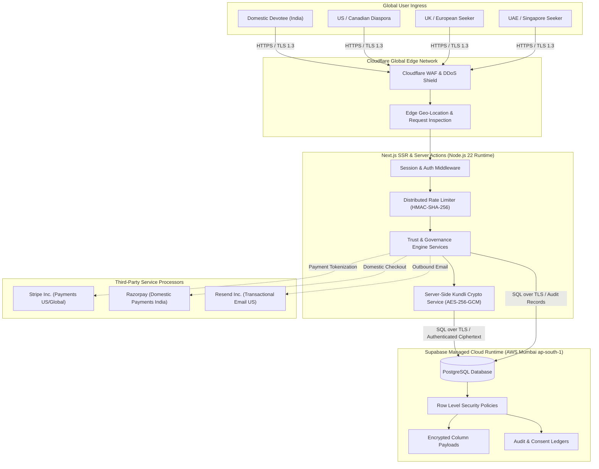

### Comprehensive Data Inventory

| Data Domain | Specific Data Fields | Ingress Touchpoint | Primary Storage Entity | Legal Classification | Lifecycle Retention Rule |
| :--- | :--- | :--- | :--- | :--- | :--- |
| **Identity & Account** | Name, email address, mobile number, avatar URL, auth user ID, hashed password. | `/auth`, early access form | `auth.users`, `public.profiles` | Standard Personal Data | Retained until account deletion; soft-deleted for 30 days before purge. |
| **Religious Preferences** | `sampradaya` lineage (e.g. Vaishnava, Shaiva, Smarta), `deity_focus`, puja sankalpa intentions. | Profile settings, Puja booking modal | `public.profiles`, `public.booking_requests` | **Special Category (GDPR Art. 9) / Personal Data (DPDP Act)** | Purged immediately upon account deletion or consent revocation. |
| **Astrological Parameters** | Date of birth, time of birth, place of birth, geographic latitude & longitude, timezone, ayanamsha. | `/astro`, Kundli generation form | `public.kundli_profiles` (Ciphertext fields) | **Contextual Sensitive Data** (Encrypted application-layer) | Rendered cryptographically unreadable upon key destruction. |
| **Consultation & Booking** | Service type, scheduled slot time, Pandit/Expert notes, consultation recording links, chat transcripts. | `/experts`, consultation rooms | `public.booking_requests`, `public.consultation_slots` | Confidential Commercial & Personal Communications | Retained 180 days post-consultation for dispute resolution, then archived. |
| **Commercial & Billing** | Booking amount, currency, transaction reference, payment status, invoice ID, tax/GST identifier. | Payment checkout flow | `public.booking_requests`, billing tables | Financial / Accounting Data | **Statute-Specific Retention:** Retained per applicable tax statutes (Section 12); PII pseudonymized upon user deletion. |
| **AI Spiritual Prompts** | Devotee spiritual questions, AI-generated reflections, scripture query logs. | AI Satsang Assistant | `public.ai_interaction_logs` (Proposed) | Confidential / User Communications | Retained 30 days for quality assurance; excluded from third-party model training. |
| **Security & Telemetry** | IP HMAC hash, user-agent, session identifiers, rate limit event counters, consent timestamps. | Edge gateway, RPC triggers | `public.rate_limit_events`, `public.user_consents` | Security & Compliance Audit Data | Rotating rolling retention: 30 days for rate limits; permanent tamper-evident retention for consent audit. |

---

## 8. Data Classification Framework

To eliminate the oversimplified G0 assumption that all astrological calculations are automatically religious data, ISHTI adopts a **Four-Tier Contextual Classification Framework**:

```mermaid
quadrantChart
    title ISHTI Contextual Data Classification Matrix
    x-axis Low Technical Sensitivity --> High Technical Sensitivity
    y-axis General Data --> Special Category / Highly Sensitive
    quadrant-1 Tier 3: Special Category Religious Data
    quadrant-2 Tier 4: Highly Confidential & Cryptographic
    quadrant-3 Tier 1: Public & Canonical Data
    quadrant-4 Tier 2: Standard Personal & Operational
    "Canonical Scripture Texts": [0.15, 0.20]
    "General Panchang Tithis": [0.20, 0.15]
    "User Account Profile (Name/Email)": [0.45, 0.35]
    "Rate Limit IP Hashes": [0.40, 0.25]
    "Mathematical Ephemeris (DOB/TOB)": [0.65, 0.45]
    "Deity Focus & Sampradaya": [0.60, 0.85]
    "Puja Sankalpa Ritual Intentions": [0.75, 0.90]
    "Encrypted Kundli Ciphertext": [0.85, 0.70]
    "Server Encryption Keys": [0.95, 0.95]
    "Payment Gateway Tokens": [0.90, 0.80]
```

### Classification Definitions

1. **Tier 1: Public & Canonical Data (Open Access)**
   - *Scope:* Root Sanskrit verses, IAST transliterations, public temple festival calendars, astronomical planetary positions (ephemeris tables), public pandit profiles.
   - *Controls:* Read-only caching, public CDN distribution, integrity hashing to prevent doctrinal tampering.
2. **Tier 2: Standard Personal & Operational Data**
   - *Scope:* User name, email, phone number, UI language preference, general session cookies, account status.
   - *Legal Basis:* Performance of a contract (GDPR Art. 6(1)(b)) or legitimate interest (Art. 6(1)(f)).
   - *Controls:* Standard RLS policies, TLS 1.3 in transit, PostgreSQL storage encryption at rest.
3. **Tier 3: Contextual Sensitive / Special-Category Personal Data**
   - *Religious Beliefs (GDPR Art. 9 Special Category / CCPA SPI):* Selection of personal deity (`deity_focus`), spiritual tradition (`sampradaya`), puja sankalpa personal prayers.
     - *GDPR Legal Basis:* **Explicit Affirmative Consent** (Art. 9(2)(a)), with evaluation of other exceptions (e.g. Art. 9(2)(d) for religious bodies; Art. 9(2)(e) for manifestly public data).
     - *India DPDP Position:* Governed under general data fiduciary obligations (§8) and consent standards (§6), without a separate special-category classification.
   - *Astrological Birth Coordinates (Contextual Sensitivity):*
     - *Context A (Astronomical Calculation):* Processing DOB/TOB/Coordinates solely to compute planetary longitude degrees. Evaluated as personal data requiring contractual necessity.
     - *Context B (Spiritual Profiling / Counseling):* Combining birth charts with spiritual guidance, life predictions, or religious remedies. Treated contextually as sensitive spiritual information.
4. **Tier 4: Highly Confidential & Cryptographic Data**
   - *Scope:* Server encryption keys (`KUNDLI_ENCRYPTION_KEY_V1`), HMAC salt secrets, payment gateway webhook secrets, database connection pooler strings.
   - *Controls:* Restricted server-only environment injection, zero client-bundle exposure, zero database persistence.

---

## 9. Controller / Processor Responsibility Model

The operational platform involves multiple actors whose legal roles must be delineated:

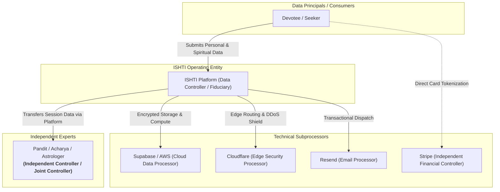

### Legal Role Allocations

1. **ISHTI Platform Operating Entity:**
   - *Role:* **Data Controller** (under GDPR/UK GDPR) / **Data Fiduciary** (under India DPDP Act).
   - *Responsibilities:* Determines the purposes and means of processing for user registration, platform security, astrological calculation, algorithm orchestration, content hosting, and commercial billing.
2. **Pandits, Astrologers, and Sacred Experts:**
   - *Role Evaluation:* **Independent Controllers** for professional spiritual counseling and personalized astrology consultations; **Joint Controllers** regarding session scheduling and booking communications.
   - *Governance Boundary:* Experts must execute an **Expert Data Processing and Code of Conduct Agreement**. Experts may only access devotee birth charts during an active, confirmed consultation window. They are strictly prohibited from copying, exporting, or storing devotee data outside the ISHTI platform.
3. **Infrastructure Processors (Supabase, Cloudflare, Resend):**
   - *Role:* **Data Processors** (GDPR Art. 28) / **Data Processors** (DPDP Act).
   - *Responsibilities:* Process personal data strictly on documented instructions from ISHTI. Must maintain robust Data Processing Addendums (DPAs) incorporating standard contractual clauses.
4. **Payment Gateways (Stripe, Razorpay):**
   - *Role:* **Independent Controllers** for payment processing, cardholder data compliance (PCI-DSS Level 1), anti-fraud monitoring, and banking statutory compliance.

---

## 10. Eight-Pillar Trust & Governance Engine Architecture

Rather than a serial pipeline, the eight engines operate in a decoupled, shared service topology:

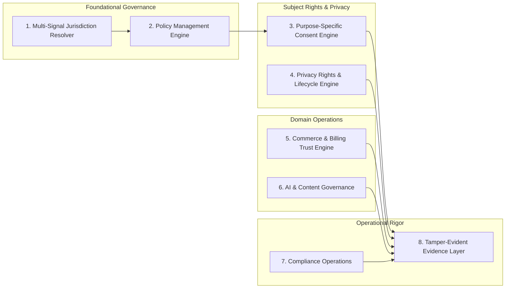

### Detailed Engine Specifications

### Pillar 1: Multi-Signal Jurisdiction & Applicability Resolver
- **Architectural Purpose:** Evaluates multi-factor evidence signals to determine applicable legal regimes without relying solely on fragile Geo-IP lookups or a rigid single-country ranking.
- **Evidence Signal Matrix:**
  - *Signal A: Declared Residence:* Explicit country selected by user during onboarding or profile editing. Primary indicator for consumer rights and data protection expectations.
  - *Signal B: Payment Instrument / Issuing Bank:* Issuing bank country of active credit card/UPI. Essential for consumer tax (VAT/GST/Sales Tax) and merchant banking rules.
  - *Signal C: Billing Address:* Explicit commercial address provided at checkout.
  - *Signal D: Location at Interaction (Geo-IP):* Cloudflare `CF-IPCountry` header; used strictly as a preliminary default and for edge routing, never as definitive legal domicile proof.
  - *Signal E: Entity & Service Location:* Determines the statutory baseline for the data controller/merchant.
- **Concurrent Jurisdiction Resolution:** When signals span multiple jurisdictions (e.g. an EU citizen using an Indian service with a US payment card), the resolver determines **concurrent compliance requirements** (e.g. enforcing GDPR Art. 9 safeguards for devotional data while applying Indian GST and RBI payment rules).

### Pillar 2: Policy Management Engine
- **Architectural Purpose:** Governs publication, versioning, localization, and binding acceptance of legal documents.
- **Modular Policy Structure:**
  - *Master Terms of Service & Privacy Notice:* Global baseline rules.
  - *Schedule A — India Rider:* DPDP Act 2023, IT Rules Grievance Redressal (24-hr/7-day rules), Consumer Protection (E-Commerce) Rules.
  - *Schedule B — EU/EEA & UK Rider:* GDPR/UK GDPR rights, Art. 9 special category terms, SCCs, 14-day digital waiver.
  - *Schedule C — United States Rider:* CCPA/CPRA disclosures ($26.625M threshold context), ROSCA recurring billing rules.
  - *Schedule D — Rest of World Rider:* PIPEDA, APPs, PDPL, PDPA jurisdictional variations.
- **Versioning Architecture:** Documents are assigned immutable semantic versions (e.g., `v2026.1`). Material updates trigger automated re-consent workflows upon user login.

### Pillar 3: Purpose-Specific Consent Engine
- **Architectural Purpose:** Replaces the single boolean with a multi-dimensional, purpose-specific, verifiable consent registry.
- **Core Record Structure:**
  - `purpose_id`: Specific granular processing goal (`astro_ephemeris_calc`, `religious_deity_profiling`, `expert_chart_share`, `marketing_communications`, `telemetry_analytics`).
  - `data_category`: Standard personal, religious special-category, precise geolocation.
  - `legal_basis`: Explicit consent (Art. 9), Contractual necessity (Art. 6(1)(b)), Legitimate interest (Art. 6(1)(f)).
  - `consent_status`: `granted`, `withheld`, `revoked`, `expired`.
  - `evidence_payload`: Salted SHA-256 IP hash, user agent, policy version, timestamp.

### Pillar 4: Privacy Rights & Lifecycle Engine
- **Architectural Purpose:** Manages end-to-end statutory rights workflows (Access, Rectification, Portability, Restriction, Erasure).
- **Subject Access Request (SAR):** Generates an authenticated, machine-readable JSON bundle containing profile details, consent history, booking records, and decrypted astrological records.
- **Multi-Tier Erasure Workflow:** Detailed in Section 12.

### Pillar 5: Commerce & Billing Trust Engine
- **Architectural Purpose:** Provides transparent, multi-currency commercial infrastructure with statutory consumer protections.
- **Capabilities:**
  - Multi-currency abstraction (`amount_cents`, `currency_code: INR | USD | EUR | GBP | AED | SGD`).
  - Digital content statutory waiver integration (EU Directive 2011/83/EU Art. 16(m)).
  - Configurable cancellation and refund parameter engine (Section 13).
  - Dispute escrow hold management.

### Pillar 6: AI & Content Governance Engine
- **Architectural Purpose:** Enforces doctrinal integrity, AI transparency, and spiritual safety boundaries.
- **Capabilities:**
  - Clear visual demarcation between human pandits and AI assistants.
  - Non-medical / non-legal spiritual advice disclaimers.
  - Canonical scripture provenance protection (Section 14).
  - Model boundary enforcement (zero-retention, zero-training commitments).

### Pillar 7: Compliance Operations Engine
- **Architectural Purpose:** Manages formal compliance escalations, statutory officer assignments, and breach notifications.
- **Capabilities:**
  - Indian Grievance Officer ticketing with **amended statutory SLAs** (24-hr acknowledgment, 7-day resolution under February 2026 IT Rules amendment).
  - DPO and EU/UK Representative contact dispatch.
  - Subprocessor registry tracking and change notifications.
  - Security incident response logging.

### Pillar 8: Tamper-Evident Evidence Layer
- **Architectural Purpose:** Provides a tamper-evident, append-only record of all compliance-relevant transactions.
- **Capabilities:**
  - Cryptographic hash chaining (`previous_record_hash`) across security-critical audit events.
  - Database-level protection via triggers blocking `UPDATE` and `DELETE`.
  - Data minimization (storing salted hashes of IP addresses rather than raw network identifiers).

---

## 11. Consent and Legal-Basis Architecture

### Separation of Legal Basis from Consent

A fundamental defect of naive compliance systems is treating consent as the universal legal basis. ISHTI explicitly models legal basis separately across processing activities:

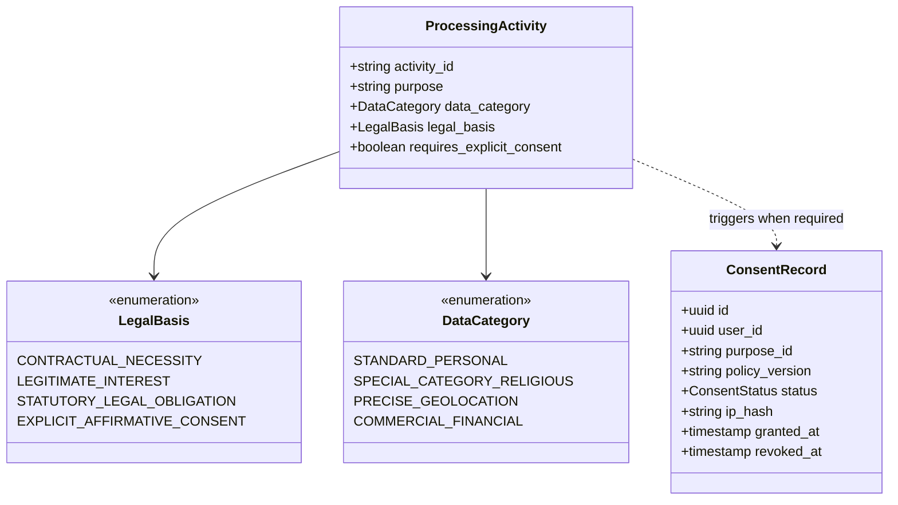

### Processing Purpose Mapping

| Purpose Key | Processing Activity | Data Category | Governing Legal Basis | Consent Type Required |
| :--- | :--- | :--- | :--- | :--- |
| `account_management` | Authenticating users, maintaining login sessions, displaying profiles. | Standard Personal | Contractual Necessity (GDPR Art. 6(1)(b)) | Inherent to contract acceptance |
| `astro_ephemeris_calc` | Calculating astronomical planetary longitudes from birth coordinates. | Personal / Mathematical | Contractual Necessity (GDPR Art. 6(1)(b)) | Unbundled explicit checkbox |
| `religious_profiling` | Storing deity devotion (`deity_focus`) and sampradaya lineage. | **Special Category (GDPR Art. 9) / DPDP Fiduciary Data** | **Explicit Consent** (GDPR Art. 9(2)(a), DPDP §6) | **Strict Opt-in, Unbundled** |
| `expert_sharing` | Transmitting birth chart and ritual sankalpa to officiating pandit. | Special Category / Confidential | **Explicit Consent** (Art. 9(2)(a)) | Session-specific confirmation |
| `transaction_billing` | Processing payment, issuing invoices, accounting records. | Financial & Identity | Legal Obligation (Tax law) & Contract | Inherent to commercial transaction |
| `service_telemetry` | Error tracking, edge latency optimization, rate limiting. | Anonymized / Hashed IP | Legitimate Interest (GDPR Art. 6(1)(f)) | Cookie banner opt-out (EU opt-in) |
| `marketing_updates` | Sending festival, muhurta, and tithi notifications. | Contact Identifiers | Consent | Voluntary opt-in |

---

## 12. Privacy Rights, Deletion Lifecycle & Master Data Retention Matrix

Account deletion cannot be solved by simply destroying an application encryption key or executing a cascading database delete. ISHTI establishes a **Seven-Stage Privacy Rights & Deletion Lifecycle**:

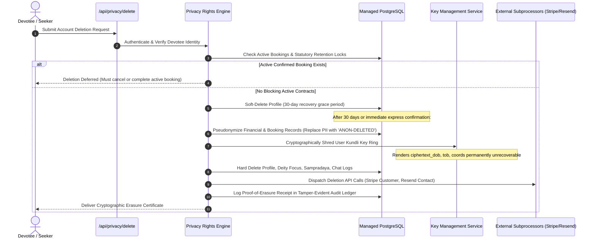

### Statute-Specific Retention Architecture & The Income-tax Act, 2025

Financial, tax, and commercial accounting records cannot be subjected to a universal, blanket 7-year rule. Nor can tax record retention rules be misapplied to generic user personal data. The legal retention framework is partitioned by exact statute and record category:

#### 1. The Modernized Indian Tax Framework: Income-tax Act, 2025 (Effective 1 April 2026)
- **Repeal of the 1961 Act:** The Income-tax Act, 2025 (Act No. 2 of 2025) officially took effect on **1 April 2026**, replacing the legacy Income-tax Act, 1961.
- **Section 62 (Maintenance of Books of Account):** Replaces legacy Section 44AA. It mandates that every entity carrying on business or profession whose gross receipts or income cross prescribed limits must keep and maintain books of account and other documents.
- **Rule 46 of Income-tax Rules, 2026 (Prescribed Retention Period):** Taxpayers must retain books of account, registers, invoices, and vouchers for **seven tax years** from the end of the relevant tax year.
- **Rule 46(8) (Digital Records & Mandatory Indian Backup):** Explicitly governs electronic accounting, ERP, and cloud database records:
  - Electronic records must be accessible and readable in India at all times.
  - Entities utilizing cloud infrastructure or SaaS providers hosted outside India or across global multi-region deployments must ensure that **daily backups are maintained on servers physically located in India**.
- **Reopened Assessment Extension:** Where an assessment or legal proceeding has been reopened under the Act, all books of account and documents must be retained **until the reopened assessment is finalized and closed**.
- **Section 441 Penalty:** Failure to maintain or retain required books attracts a statutory penalty of ₹25,000.

#### 2. Transitional Treatment for Earlier Assessment Periods (Section 536 Repeal and Savings)
- **Section 536(1) & (2):** Repeals the Income-tax Act, 1961 while preserving accrued rights, obligations, and liabilities under Section 6 of the General Clauses Act, 1897.
- **Section 536(2)(c) Savings Rule:** Any proceeding pending on 1 April 2026, or initiated on or after 1 April 2026 in respect of **any assessment year beginning before 1 April 2026** (including AY 2025–26, AY 2024–25, etc.), continues to be governed by the substantive and procedural provisions of the **Income-tax Act, 1961** (such as legacy Section 44AA and Rule 6F: **6 years from the end of the relevant assessment year**).
- **Assessment Year 2026–27 Transition:** Because the income-earning previous year concluded prior to 1 April 2026, Assessment Year 2026–27 remains governed by the 1961 Act framework. Tax Year 2026–27 onwards (for income earned on or after 1 April 2026) operates under the Income-tax Act, 2025.

#### 3. Strict Boundary: Accounting Retention Never Applies to Generic Personal Data
- In compliance with GDPR Art. 5(1)(e) (Storage limitation) and DPDP Act 2023 §8(7), accounting retention requirements apply strictly to commercial invoices, tax calculations, and books of account.
- User personal data (such as profile details, spiritual traditions, deity devotion, birth data, and private consultation messages) **must be erased upon user request**.
- Commercial records in `public.booking_requests` are **pseudonymized** (`ANON-USER-DELETED`), unlinking the financial transaction from the user's personal identity while preserving the statutory books of account.

---

### Master Statutory & Operational Data Retention Matrix

*Every platform record type is mapped to its exact responsible entity, statutory provision, trigger, retention period, and counsel review status:*

| Data Category & Record Type | Responsible Legal Entity | Governing Legal Authority & Provision | Retention Trigger | Retention Period | Classification | Statutory Exceptions & Extensions | Expiration / Erasure Action | Counsel Review Status |
| :--- | :--- | :--- | :--- | :--- | :--- | :--- | :--- | :--- |
| **Commercial Tax Invoices & Billing Records** (Amounts, invoice IDs, GST/tax line items, payment timestamps) | ISHTI Operating Entity (Merchant of Record) | • Income-tax Act, 2025 §62 & Rule 46<br/>• Income-tax Act, 1961 §44AA & Rule 6F (Transitional §536(2)(c))<br/>• CGST Act, 2017 §36<br/>• Companies Act, 2013 §128(5) | End of the relevant tax / financial year | • **7 Tax Years** (Income-tax Act 2025)<br/>• **6 Years from AY** (1961 Act transitional)<br/>• **72 Months** (CGST Act)<br/>• **8 Financial Years** (Companies Act) | **Statutory Mandate** | Reopened tax assessment under IT Act 2025; ongoing tax audit, appeal, or litigation under CGST §36 proviso (retained until 1 year post-disposal). | Direct personal identifiers pseudonymized (`ANON-USER-DELETED`); commercial records retained until longest applicable statutory period expires. | **Confirmed Baseline**; Counsel review required to formalize 7-yr vs 8-yr company law retention schedule. |
| **Electronic Accounting Cloud Backups** (Database snapshots of billing tables) | ISHTI Operating Entity | Income-tax Rules, 2026, Rule 46(8) | Daily generation timestamp | Rolling retention for the duration of the books of account retention period | **Statutory Mandate** | Reopened tax assessments. | Rolling overwrite; daily backup must reside on physical servers in India. | **Confirmed Requirement**; Counsel sign-off on cloud backup architecture. |
| **User Account Profile Data** (Name, email, phone, avatar, hashed password in `profiles`) | ISHTI Operating Entity (Data Controller / Fiduciary) | • GDPR Art. 17(1)<br/>• DPDP Act 2023 §12(3)<br/>• PIPEDA Principle 4.5.3 | User account deletion request, or 3 years continuous inactivity | 30-day soft-delete recovery grace period, followed by immediate hard purge | **Statutory Mandate (Data Minimization)** | Deferred if user has active confirmed bookings or open financial chargeback disputes. | Complete hard deletion from active database; unlinking of foreign keys via `ON DELETE SET NULL`. | **Confirmed**. |
| **Spiritual Preferences & Devotional Data** (`deity_focus`, `sampradaya`, puja sankalpa intentions) | ISHTI Operating Entity (Data Controller) | • GDPR Art. 9(2)(a)<br/>• DPDP Act 2023 §6(6)<br/>• CCPA § 1798.121 | Devotee withdrawal of consent, field clearance, or account erasure | Immediate purge upon consent withdrawal or account deletion | **Statutory Mandate** | **None.** Religious/devotional data is exempt from commercial tax retention overrides. | Immediate SQL `NULL` overwrite / deletion from database tables. | **Confirmed**. |
| **Astrological Birth Records** (Encrypted DOB, TOB, coordinates in `kundli_profiles`) | ISHTI Operating Entity | • GDPR Art. 17<br/>• DPDP Act 2023 §12<br/>• Platform Terms of Service | Devotee profile deletion or account deletion request | Immediate deletion on request; persistent during active account life | **Contractual / Statutory** | None. | Hard deletion of table rows + cryptographic shredding of user profile encryption key context. | **Confirmed**. |
| **Consultation Notes & Session Transcripts** (Private chat, astrologer notes, video URLs) | ISHTI Operating Entity & Independent Expert (Joint/Indep. Controllers) | • Expert Code of Conduct Agreement<br/>• Consumer Protection (E-Commerce) Rules 2020 | Conclusion of scheduled consultation session | **180 Calendar Days** post-session | **Contractual / Operational Policy** | Active consumer dispute, consumer commission notice, or formal misconduct grievance. | Hard purge of chat logs and video links from database storage. | **Marked for Legal Counsel Review** (to confirm 180-day window satisfies limitation periods under Consumer Protection Act 2019). |
| **Payment Gateway Tokens & Charge References** (Stripe charge ID, Razorpay order ID, last-4) | Stripe Inc. / Razorpay (Independent PCI Controllers) & ISHTI Entity | • PCI-DSS v4.0 Requirement 3<br/>• RBI Payment Aggregator Guidelines | Transaction settlement date | Active booking lifecycle + **180 Days** dispute buffer | **Statutory & Contractual Mandate** | Formal cardholder chargeback arbitration. | Token unlinking, archiving, and deletion of ephemeral references. | **Confirmed**. |
| **Card Scheme Dispute & Chargeback Records** (Dispute notices, evidence filings) | ISHTI Operating Entity | Visa Core Rules / Mastercard Dispute Resolution Rules | Date dispute is formally closed by card network | **13 to 24 Months** from dispute resolution date | **Contractual / Scheme Rule Mandate** | Ongoing financial arbitration or civil commercial litigation. | Secure digital shredding. | **Confirmed Scheme Requirement**. |
| **Statutory Consent & Withdrawal Ledgers** (Policy version, purpose, timestamp, salted IP hash) | ISHTI Operating Entity (Data Fiduciary / Controller) | • GDPR Art. 7(1)<br/>• DPDP Act 2023 §6(10)<br/>• UK GDPR Art. 7(1) | Account deletion or statutory consent revocation | Preserved for **3 Years** post-account closure | **Statutory Evidentiary Mandate** | Formal investigation or inquiry initiated by DPBI or data protection authority. | Rolling purge after limitation expiry; records unlinked from user identity. | **Marked for Legal Counsel Review** (to confirm exact limitation periods across EU, UK, and Indian authorities). |
| **Grievance Redressal Records** (Ticket, complainant info, resolution report) | ISHTI Grievance Officer & Operating Entity | IT Rules 2021 (as amended Feb 2026) Rule 3(2); Consumer Protection Rules 2020 | Date of formal grievance disposal | **3 Years** from date of resolution | **Statutory Mandate** | Pending appeal before Grievance Appellate Committee (GAC) or High Court / Consumer Commission. | Secure digital archive. | **Confirmed Intermediary Requirement**. |
| **Security & Edge Telemetry Logs** (Rate limit counters, WAF logs, salted IP hashes) | ISHTI Operating Entity | • CERT-In Directions under §70B IT Act<br/>• ISO 27001 / SOC 2 Type II audit rules | Creation timestamp | • **30 Days** for rate-limiting counters<br/>• **180 Days** for firewall / WAF access logs | **Statutory & Security Mandate** | Active cybersecurity incident investigation or formal CERT-In reporting requirement. | Automated database table partitioning truncation / rotation. | **Confirmed CERT-In Requirement**. |

---

## 13. Refund and Cancellation Governance

### Decoupled Policy Model
Commercial cancellation rules are not universal statutory truths. ISHTI architecturally models refund rules as **Configurable Policy Parameters**, separating mandatory consumer rights from contractual business rules:

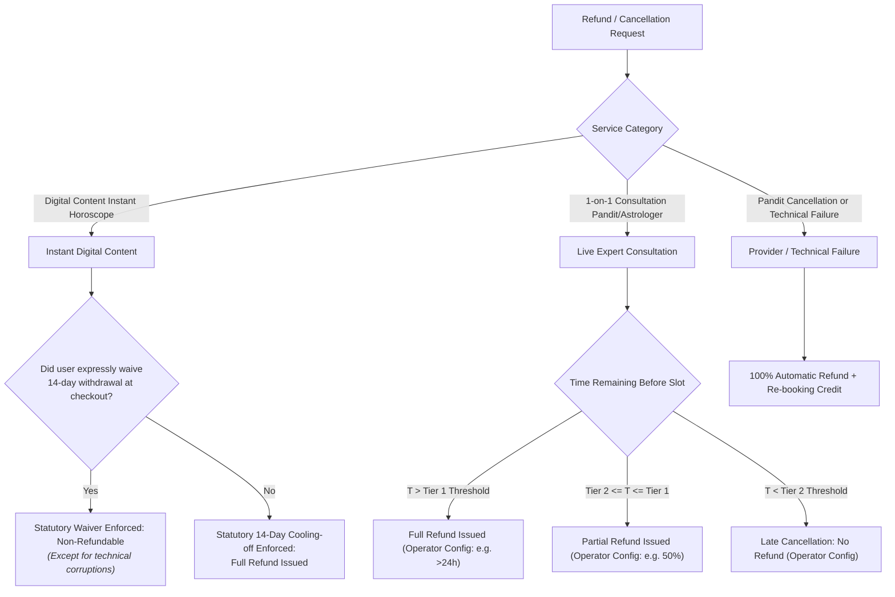

### Configurable Parameter Register (Reserved for Operator Approval)

| Parameter Key | Description | Proposed Baseline Range | Approval Status |
| :--- | :--- | :--- | :--- |
| `CONSULTATION_CANCEL_TIER1_HOURS` | Full refund cancellation cutoff window prior to scheduled slot. | 24 to 48 Hours | **Pending Operator Approval** |
| `CONSULTATION_CANCEL_TIER2_HOURS` | Partial refund cancellation window cutoff. | 2 to 12 Hours | **Pending Operator Approval** |
| `CONSULTATION_PARTIAL_REFUND_PCT` | Refund percentage issued for late cancellation in Tier 2 window. | 50% to 75% | **Pending Operator Approval** |
| `DIGITAL_CONTENT_DEFECT_WINDOW_DAYS`| Window to report corrupt, incomplete, or unrendered horoscopes. | 14 to 30 Days | **Pending Operator Approval** |
| `EXPERT_DISPUTE_ESCROW_HOLD_HOURS` | Hold duration on consultation payout to permit seeker dispute review. | 24 to 48 Hours | **Pending Operator Approval** |

---

## 14. AI and Religious-Content Governance

### AI Interaction & Spiritual Transparency
1. **Mandatory Identity Clarity:** AI assistants (e.g. conversational scripture query tools or automated horoscope interpretations) must prominently display an **"AI Spiritual Companion"** badge. Under EU AI Act Art. 50 and FTC guidelines, AI systems must never deceive users into believing they are conversing with an accredited human Pandit or living Guru.
2. **Spiritual Guidance Disclaimer:** All algorithmic interpretations must be bound by clear disclaimers:
   > *"Vedic insights, planetary readings, and spiritual reflections provided by ISHTI are derived from classical astrological algorithms and traditional philosophical texts for personal contemplation. They do not constitute licensed medical, psychiatric, financial, or legal advice. Critical life decisions should always be made in consultation with qualified professional advisors."*
3. **Doctrinal Guardrails & Canonical Protection:** The AI system must prevent generating unvetted ritual mantras or altering canonical verses. Verse citations must link directly to the verified `public.canonical_verses` table with explicit provenance tracking.
4. **Zero-Training / Data Isolation Commitments:** Under external AI processor agreements, user prompts containing personal spiritual struggles, birth coordinates, or family details must be strictly isolated from vendor model training pools (`data_retention: false`, zero-day retention configurations).

### Religious Content Intellectual Property Governance
Privacy rights do not confer copyright clearance. ISHTI establishes an explicit **Corpus IP Framework**:

| Corpus Asset Type | Provenance & Legal Rights Status | Governance Rule |
| :--- | :--- | :--- |
| **Root Sanskrit Verses** | Ancient public domain (Vedas, Upanishads, Gita, classical Puranas). | Public domain. Stored verbatim in IAST and Devanagari in `canonical_verses`. |
| **Modern Translations** | Copyrighted by individual translators or publishing trusts unless >60/70 years post-mortem. | Must have documented license or written publisher agreement before commercial inclusion. |
| **Scholarly Commentaries** | Intellectual property of modern spiritual organizations or scholars. | Restricted to attributed commentary excerpts under statutory fair-dealing/fair-use rules, or licensed. |
| **Bhajans, Stotram Audio** | Sound recording copyright and musical composition copyright. | Requires explicit master recording and publishing synchronization licenses; never scraped. |
| **Sacred Artwork & Yantras** | Modern iconographic artists hold individual graphic copyrights. | Commissioned work-for-hire or licensed vector assets with commercial redistribution rights. |

---

## 15. Vendor / Subprocessor Inventory with Confidence Status

To eliminate unverified vendor assumptions, ISHTI's subprocessor register classifies all third-party dependencies by **Evidentiary Verification Status**:

| Vendor / Provider | Category | Verified Evidentiary Status in Codebase | Processing Location | Data Categories Shared | Required Safeguard & Contractual Evidence |
| :--- | :--- | :--- | :--- | :--- | :--- |
| **Supabase Inc. / AWS** | Managed Database & Auth | **CONFIRMED IN CODE** (`@supabase/supabase-js`, `@supabase/ssr`) | Mumbai, India (`ap-south-1`) | All database records, user IDs, encrypted payloads. | Customer Data Processing Addendum (DPA), AWS SOC 2 Type II, ISO 27001. |
| **Cloudflare Inc.** | Edge CDN, DNS & WAF | **CONFIGURED BUT NOT VERIFIED** (Referenced in rate-limiter headers) | Global Anycast Network | IP addresses, request headers, TLS session metadata. | Cloudflare Global DPA, Standard Contractual Clauses (SCCs). |
| **Stripe Inc.** | International Payments | **PLANNED** (Architecture approved; packages not yet installed) | United States / Global | Cardholder data, billing address, transaction amount. | PCI-DSS Level 1 Service Provider DPA, Tokenization Agreement. |
| **Razorpay Software** | Domestic Indian Payments | **PLANNED** (Referenced in early schemas; no active SDK) | India | UPI IDs, Indian mobile numbers, netbanking references. | Reserve Bank of India (RBI) Payment Aggregator compliance, DPA. |
| **Resend Inc.** | Transactional Email | **PLANNED** (Architecture planned for notifications) | United States | User email addresses, notification message text. | Resend DPA, EU/UK Standard Contractual Clauses. |
| **AI LLM Providers** | Generative AI Reasoning | **PROPOSED ONLY** (No contract or integration exists) | TBD (US / EU) | Anonymized scripture prompts, astrological queries. | Enterprise Business Agreement with Zero Data Retention & Training Opt-Out. |
| **Video Telephony** | Live Pandit Video Rooms | **PROPOSED ONLY** (No video SDK in `package.json`) | TBD | WebRTC audio/video streams, consultation metadata. | HIPAA/GDPR-compliant WebRTC vendor DPA, End-to-End Encryption. |

---

## 16. International Data-Transfer Assessment

### The *Schrems II* & Cross-Border Challenge
ISHTI’s primary database infrastructure is hosted in **AWS Mumbai (`ap-south-1`)** via Supabase. Under the European Court of Justice *Schrems II* ruling (Case C-311/18) and UK GDPR:
- Personal data transfers from individuals located in the EU/UK to a third country lacking an Adequacy Decision (such as India) are strictly prohibited unless governed by **Appropriate Safeguards** (GDPR Art. 46) and **Supplementary Technical Measures**.
- Contractual mechanisms alone (such as Standard Contractual Clauses) are legally insufficient if local law permits disproportionate governmental access to personal data.

```mermaid
flowchart TD
    EU_USER["EU / UK Seeker"] -->|Personal Data Ingress| EDGE["Cloudflare Global Edge"]
    EDGE -->|Encrypted Transit (TLS 1.3)| COMPUTE["Next.js Application Compute"]
    COMPUTE -->|Application AES-256-GCM Encryption| CRYPT["Encrypted Payload Generation"]
    CRYPT -->|Cross-Border Transmission| MUMBAI["Supabase AWS Mumbai (ap-south-1)"]

    subgraph Legal_Transfer_Safeguards ["Mandatory Safeguard Framework"]
        SCC["EU Standard Contractual Clauses (2021/914/EU Module 1 & 2)"]
        IDTA["UK International Data Transfer Agreement (IDTA)"]
        TIA["Transfer Impact Assessment (TIA) Documentation"]
    end

    subgraph Technical_Supplementary_Measures ["Technical Supplementary Measures (ENISA Guidelines)"]
        ENC_REST["AES-256 Storage Encryption at Rest"]
        ENC_APP["Server-Side AEAD Application-Layer Encryption"]
        ZERO_PT["Separation of Database Vault from Application Key Ring"]
    end

    Legal_Transfer_Safeguards -.-> MUMBAI
    Technical_Supplementary_Measures -.-> MUMBAI
```

### Required Safeguards & Supplementary Technical Measures
1. **Contractual Architecture:** Execution of the **EU Standard Contractual Clauses (Commission Implementing Decision (EU) 2021/914, Module 1: Controller-to-Controller and Module 2: Controller-to-Processor)** and the **UK Information Commissioner's Office IDTA / Addendum**.
2. **Transfer Impact Assessment (TIA):** A documented assessment evaluating Indian surveillance laws (Information Technology Act 2000 §69, IT Procedure and Safeguards for Interception Rules 2009) against the EU Essential Guarantees.
3. **Technical Supplementary Measures:**
   - *Application-Layer Encryption:* Astrological birth records are encrypted before database insertion with AES-256-GCM. The database host cannot read birth details even in the event of an unauthenticated database dump.
   - *Transport Layer Security:* Enforced TLS 1.3 with forward secrecy for all external client connections and internal database pooler traffic.
   - *Pseudonymization:* Profile identifiers separated from financial and commercial ledgers.

---

## 17. Security and Tamper-Evident Evidence Architecture

### Fact-Checked Encryption Evaluation
- **Application Encryption Fact:** Evaluated from `apps/web/lib/crypto/kundli-encryption.ts`. Encryption uses Node.js native `crypto.createCipheriv("aes-256-gcm", key, iv)`. Additional Authenticated Data (AAD) cryptographically binds ciphertext to `userId`, `profileId`, `fieldName`, and `keyVersion`.
- **Key Storage Reality:** Keys are loaded via server environment variables (`KUNDLI_ENCRYPTION_KEY_V1`). The application server possesses the key and decrypts the payload during request execution. The system does not provide client-side zero-knowledge secrecy, but provides robust defense-in-depth against database storage exposure.
- **Backup Encryption:** Database backups taken via Supabase CLI (`pg_dump`) contain ciphertext in the astrological columns. Plaintext birth details are never written to database backup archives.

### Append-Only, Tamper-Evident Evidence Architecture
Ordinary PostgreSQL tables are mutable by database administrators and superusers. To satisfy statutory evidentiary standards without making misleading claims of "inherent database immutability", ISHTI specifies a **Tamper-Evident Evidence Architecture**:

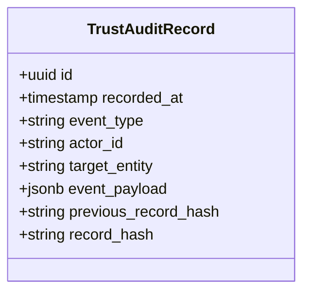

1. **Strict Table-Level Access Controls:** Operational service roles are granted `INSERT` and `SELECT` privileges only on `trust_audit_ledger`. Privileges for `UPDATE`, `DELETE`, and `TRUNCATE` are revoked at the schema level.
2. **PostgreSQL Tamper-Detection Triggers:** Security definer `BEFORE UPDATE OR DELETE` triggers raise fatal exceptions, blocking modification attempts even from administrative application roles.
3. **Cryptographic Hash Chaining:** Each audit entry calculates a SHA-256 hash across its fields combined with the `record_hash` of the immediately preceding record:
   $$\text{record\_hash}_n = \text{SHA-256}(\text{id}_n \parallel \text{event\_type}_n \parallel \text{payload}_n \parallel \text{record\_hash}_{n-1})$$
   Any retroactive alteration or deletion breaks the cryptographic chain, providing verifiable tamper evidence.
4. **Data Minimization:** Salted HMAC-SHA-256 hashes (`ip_hash`) are recorded rather than raw IP addresses, respecting data minimization while maintaining verifiable evidence.

---

## 18. Children and Vulnerable-User Safeguards

Spiritual platforms attract multigenerational families registering birth charts for children, infants, and grandchildren. ISHTI establishes a strict **Child & Minor Protection Framework**:

### Jurisdictional Age Thresholds

| Jurisdiction | Minor Age Boundary | Statutory Legal Source | Mandatory Safeguard |
| :--- | :--- | :--- | :--- |
| **India** | Under 18 Years | DPDP Act 2023 §9 | Verifiable parental consent; strict prohibition on behavioral monitoring, targeted ads, or tracking of children. |
| **United States** | Under 13 Years | Children's Online Privacy Protection Act (COPPA) | Verifiable parental consent before collecting personal info from children under 13. |
| **European Union** | Under 16 Years (or 13–16 by Member State) | GDPR Art. 8 | Parental consent for information society services offered directly to children. |
| **United Kingdom** | Under 18 Years | Age Appropriate Design Code (Children's Code) | High-privacy default settings; no profiling; transparent age-appropriate language. |

### Architectural Protections
1. **Parental / Guardian Registration Workflow:** Minors cannot independently register personal accounts. Birth charts for children must be registered under a verified parent or legal guardian's devotee account.
2. **Absolute Profiling Ban for Minors:** Kundli profiles flagged with a birth date indicating age under the jurisdictional threshold are automatically excluded from automated recommendations, commercial marketing notifications, and AI spiritual chat interactions.
3. **Proportionate Age Assurance:** Registration forms collect the birth year during onboarding. High-friction, invasive identity verification (such as government ID scanning) is rejected as disproportionate; age declaration combined with parental account binding provides the balanced safeguard.

---

## 19. Proposed Database Entities and Relationships

To implement the Trust & Governance Engine without breaking existing M02 structures, the following candidate entities are specified for phased implementation:

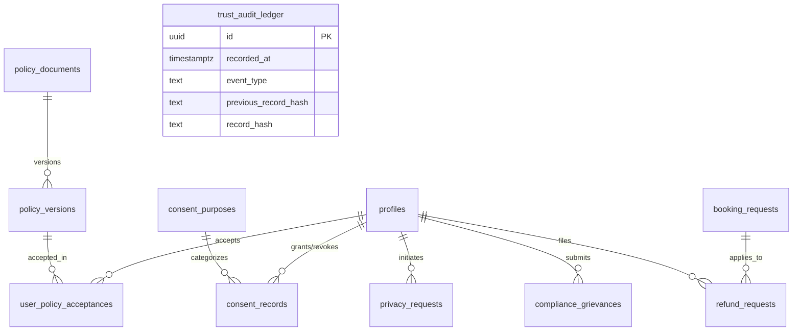

### Candidate Entity Specifications

#### 1. `public.policy_documents` & `public.policy_versions`
- **Business Purpose:** Centralized management of Master Terms, Regional Schedules (A–D), and Privacy Notices.
- **Why Existing Tables Insufficient:** No legal document storage or versioning exists in the schema.
- **Core Fields:** `id`, `slug` (`master_terms`, `privacy_notice`, `schedule_a_india`), `title`, `current_version_id`. Versions table: `id`, `document_id`, `version_number` (e.g. `v2026.1`), `content_markdown`, `effective_date`, `is_material_change`.
- **Access Control:** Public read for active versions; admin-only write.
- **Phase:** Gate G1.

#### 2. `public.user_policy_acceptances`
- **Business Purpose:** Verifiable record of which policy version each user accepted.
- **Why Existing Tables Insufficient:** `public.user_consents` conflates feature consent with general terms acceptance.
- **Core Fields:** `id`, `user_id` (REFERENCES `profiles(id)` ON DELETE SET NULL), `policy_version_id`, `accepted_at`, `ip_hash`, `jurisdiction_resolved`.
- **Phase:** Gate G1.

#### 3. `public.consent_purposes` & `public.consent_records`
- **Business Purpose:** Multi-dimensional, granular consent management replacing the hardcoded 4-purpose check constraint.
- **Why Existing Tables Insufficient:** Existing `user_consents` table lacks legal basis modeling and cascades on user deletion.
- **Core Fields:** `consent_records`: `id`, `user_id` (ON DELETE SET NULL to preserve audit trail), `purpose_id`, `status` (`granted`, `withheld`, `revoked`), `legal_basis`, `data_category`, `granted_at`, `revoked_at`, `evidence_hash`.
- **Phase:** Gate G2.

#### 4. `public.privacy_requests`
- **Business Purpose:** Tracks Subject Access Requests (SAR), data export generation, and deletion tickets.
- **Why Existing Tables Insufficient:** No tracking infrastructure exists for user privacy rights.
- **Core Fields:** `id`, `user_id`, `request_type` (`export`, `delete`, `rectify`, `restrict`), `status` (`submitted`, `processing`, `completed`, `rejected`), `statutory_deadline`, `completed_at`, `export_download_url`, `rejection_reason`.
- **Phase:** Gate G3.

#### 5. `public.refund_requests` & `public.dispute_cases`
- **Business Purpose:** Manages consultation cancellations, digital content defects, and dispute resolution escrow.
- **Why Existing Tables Insufficient:** `booking_requests` only has static `payment_status` without dispute tracking.
- **Core Fields:** `id`, `booking_id`, `user_id`, `reason_code`, `status` (`pending_review`, `approved`, `rejected`), `refund_amount_cents`, `currency`, `dispute_evidence_text`, `processed_at`.
- **Phase:** Gate G4.

#### 6. `public.compliance_grievances`
- **Business Purpose:** Statutory grievance ticketing under Indian IT Rules 2021 (as amended Feb 2026) and DPDP Act §13.
- **Why Existing Tables Insufficient:** No grievance tracking exists in the application.
- **Core Fields:** `id`, `ticket_number` (e.g. `GRI-2026-0001`), `user_id` (nullable for non-users), `complainant_name`, `complainant_email`, `category` (`privacy`, `content`, `expert_conduct`, `billing`), `status` (`acknowledged`, `investigating`, `resolved`), `acknowledged_at` (**24-hr SLA**), `resolved_at` (**7-day SLA**), `resolution_summary`.
- **Phase:** Gate G5.

#### 7. `public.trust_audit_ledger`
- **Business Purpose:** Append-only, hash-chained evidence ledger for high-impact security and compliance actions.
- **Why Existing Tables Insufficient:** `role_assignment_audit` is limited strictly to RBAC escalations.
- **Core Fields:** `id`, `recorded_at`, `event_type`, `actor_id`, `target_entity_id`, `event_payload` (JSONB), `previous_record_hash`, `record_hash`.
- **Phase:** Gate G5.

---

## 20. Application Route and UX Map

To ensure transparent compliance without disrupting the serene spiritual user experience, the following accessible routes are specified:

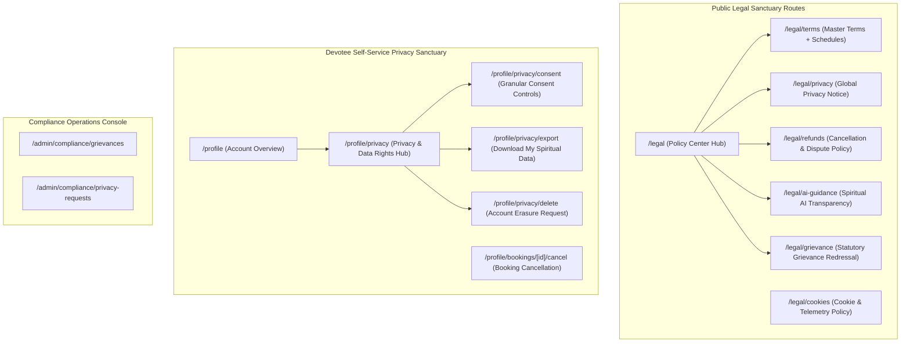

### Accessibility & UX Standards
- All legal and privacy routes inherit the existing **M04.6 Universal Accessibility Foundation** (`apps/web/lib/a11y/`).
- Consent toggles use accessible `role="switch"` markup with persistent `aria-checked` attributes and keyboard focus management.
- Color contrasts meet WCAG 2.2 Level AA requirements (contrast ratio $\ge 4.5:1$ for normal body prose; $\ge 3:1$ for large titles).
- Modals implement native `<dialog>` primitives with automatic background inertness, focus trapping, and focus restoration to the triggering button.

---

## 21. Operational Workflows and Responsible Roles

Compliance requires human accountability. ISHTI establishes explicit operational workflows:

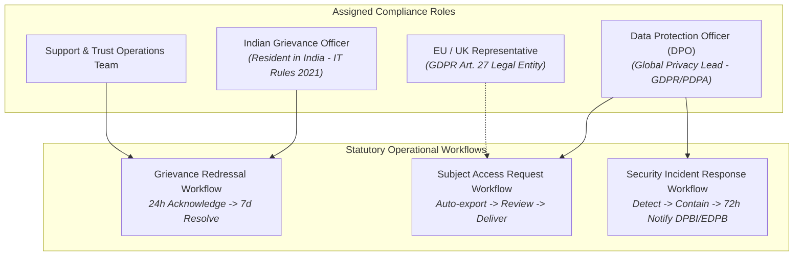

### Statutory Officer Profiles

1. **Grievance Officer for India (IT Rules 2021 Rule 3(2) as amended Feb 2026 & DPDP Act §13):**
   - *Status:* Mandatory. Must be an individual resident in India.
   - *Public Disclosures:* Name, official email address (`grievance@ishti.app`), and postal address published on `/legal/grievance`.
   - *Statutory SLAs:* **Acknowledge complaint within 24 hours**; **resolve within 7 calendar days** (with 36-hr expedited removal for specified unlawful content).
2. **Data Protection Officer (DPO) (GDPR Art. 37–39 & Singapore PDPA):**
   - *Status:* Mandatory if processing special-category religious data on a large scale.
   - *Responsibilities:* Oversee Privacy Impact Assessments (DPIAs), monitor data protection compliance, act as contact point for data protection authorities and data subjects (`dpo@ishti.app`).
3. **EU & UK Representatives (GDPR Art. 27 / UK GDPR Art. 27):**
   - *Status:* Conditional upon commercial volume targeting EU/UK residents without an established EU/UK corporate subsidiary. Appointed via external legal mandate to represent ISHTI before supervisory authorities.

---

## 22. Implementation Phases and Dependency Graph

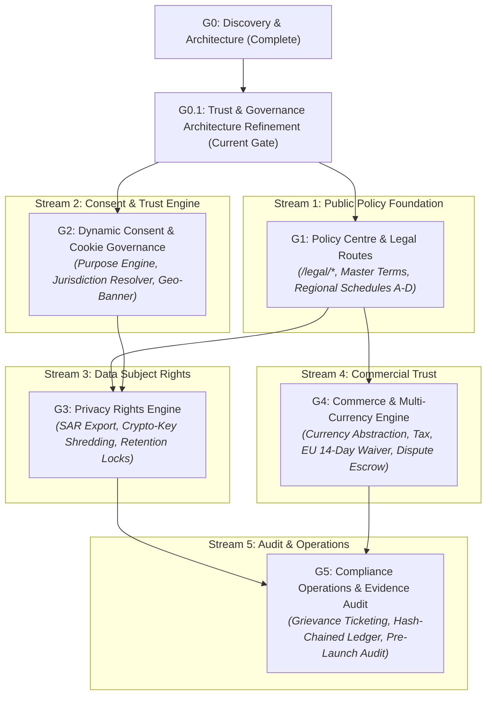

### Phase Breakdown

- **Gate G0: Discovery & Regulatory Research [COMPLETE]**
  - Read-only exploration of database and regulatory frameworks.
- **Gate G0.1: Architecture Refinement [CURRENT GATE - PENDING FORMAL ACCEPTANCE]**
  - Formalization of the 8-pillar Trust & Governance Engine, factual corrections, contextual data classification, and primary legal register.
- **Gate G1: Policy Centre Foundation & Public Routes**
  - Draft and publish Master Terms, Global Privacy Notice, Schedules A–D, Refund Policy, and AI Disclaimer at `/legal/*`.
  - Implement accessible footer navigation and breadcrumb routing.
- **Gate G2: Dynamic Consent & Cookie Governance**
  - Deploy Jurisdiction & Applicability Resolver and Consent Engine.
  - Implement unbundled consent modals (Religious Data, Astrological Processing, Marketing).
  - Integrate privacy-first cookie management banner.
- **Gate G3: Privacy Rights Engine (SAR & Cryptographic Deletion)**
  - Implement `/api/privacy/export` (machine-readable SAR package).
  - Implement `/api/privacy/delete` (soft-delete, financial pseudonymization, cryptographic key destruction).
  - Build devotee self-service privacy portal in `/profile/privacy`.
- **Gate G4: Commerce, Refunds & Billing Governance**
  - Expand booking schema to support multi-currency pricing (`amount_cents`, `currency_code`).
  - Integrate EU Directive 2011/83/EU 14-day digital content withdrawal waiver.
  - Implement configurable consultation cancellation and dispute escrow hold engine.
- **Gate G5: Compliance Operations, Evidence & Incident Workflows**
  - Deploy Indian Grievance ticketing system (`/legal/grievance`).
  - Implement append-only, hash-chained `trust_audit_ledger`.
  - Conduct full accessibility and security regression audit prior to operator sign-off.

---

## 23. Risks, Unresolved Questions, and Legal-Counsel Checkpoints

### A. Decisions Requiring Operator Approval
1. **Operating Corporate Entity:** Corporate registration details, registered office address, and jurisdiction of incorporation to be printed on `/legal/terms`.
2. **Statutory Officer Designations:** Formal appointment of the individual to act as the Indian Grievance Officer and Data Protection Officer.
3. **Commercial Refund Parameters:** Approval of cancellation time thresholds ($T_1, T_2$), late cancellation deduction percentages, and dispute escrow hold durations (Section 13).
4. **Third-Party Subprocessor Approvals:** Formal authorization to onboard Stripe for global multi-currency payments and Resend for transactional emails.
5. **International Market Launch Priorities:** Approval of the target territorial rollout sequence based on documented operational readiness.

### B. Matters Requiring Qualified Legal Counsel Sign-Off
1. **Arbitration & Governing Law Clauses:** Enforceability of cross-border dispute resolution, choice of law (e.g. New Delhi vs Delaware vs London), and class-action waiver enforceability.
2. **GDPR Article 9 Exceptions & Phrasing:** Counsel review of the exact statutory consent text and alternative exceptions (e.g. Art. 9(2)(d)) for devotional and sampradaya data.
3. **Transfer Impact Assessment (TIA) & SCC Formalization:** Execution of Standard Contractual Clauses (2021/914/EU) and UK IDTA governing personal data transfers to AWS Mumbai.
4. **Consumer Rights Directive (CRD) 14-Day Digital Waiver:** Legal validation of the express consent checkbox text extinguishing the 14-day cooling-off period upon instant horoscope generation.
5. **Expert Legal Classification:** Review of whether Pandits and Astrologers operate as Independent Contractors / Controllers or Data Processors under Indian and European law.
6. **Harmonization of Company Law & Tax Retention:** Legal counsel review to harmonize the 7-year retention rule under Income-tax Rules, 2026 with the 8-year books of account requirement under Companies Act, 2013 §128(5).

---

## 24. Acceptance Criteria for Future Implementation Gates

To ensure rigorous quality control, each future gate is governed by objective pass/fail criteria:

| Gate | Acceptance Criteria |
| :--- | :--- |
| **G1: Policy Centre** | 1. All seven `/legal/*` routes render with WCAG 2.2 Level AA accessibility (0 axe-core errors).<br/>2. Master Terms and Regional Schedules A–D display complete legal entity details.<br/>3. Keyboard navigation and screen reader announcements verified across all policy pages. |
| **G2: Consent Engine** | 1. Jurisdiction Resolver correctly processes multi-signal evidence without single-country assumptions.<br/>2. Unbundled checkboxes for religious data processing and marketing function independently.<br/>3. Database consent records accurately log `purpose_id`, `policy_version`, and salted `ip_hash`. |
| **G3: Privacy Rights** | 1. Authenticated user can download complete machine-readable SAR JSON within 3 seconds.<br/>2. Account deletion successfully pseudonymizes financial records (preserving statute-specific tax locks).<br/>3. Key shredding renders encrypted Kundli ciphertext permanently unrecoverable.<br/>4. Consent evidence is preserved and unlinked (no CASCADE deletion flaw). |
| **G4: Commerce Engine** | 1. Schema supports multi-currency booking transactions (`amount_cents`, `currency_code`).<br/>2. Digital horoscope checkout blocks download until 14-day withdrawal waiver is checked.<br/>3. Cancellation calculation correctly applies approved operator cutoff tiers. |
| **G5: Compliance & Audit**| 1. Grievance form generates a tracking ticket number and automated 24-hr acknowledgment email.<br/>2. Audit ledger demonstrates append-only access controls with valid SHA-256 hash chains.<br/>3. Comprehensive security test runner passes with 100% success rate. |

---

## 25. Official Legal Source Register

*Primary legal authorities researched, verified, and reconciled as of 17 November 2026:*

| Jurisdiction | Instrument Title & Number | Official Publishing Authority | Exact Official Primary URL | Enactment / Notification Date | Effective / Implementation Status |
| :--- | :--- | :--- | :--- | :--- | :--- |
| **India** | Digital Personal Data Protection Act, 2023 (Act No. 22 of 2023) | Ministry of Law and Justice / MeitY | `https://www.meity.gov.in/content/digital-personal-data-protection-act-2023` | 11 August 2023 | Enacted; phased rollout across 2025–2027 following commencement notifications. |
| **India** | Commencement Notification under DPDP Act, 2023 (G.S.R. 843(E)) | Ministry of Electronics and Information Technology (MeitY) | `https://egazette.gov.in/WriteReadData/2025/267650.pdf` | 13 November 2025 | Notified; establishes 3-tier timeline: Immediate (Board setup, definitions), 1-Year (**13 Nov 2026 - In Force** for §6(9) and §27(1)(d)), 18-Month (**13 May 2027** for core Fiduciary duties, notices, rights, penalties). |
| **India** | Digital Personal Data Protection Rules, 2025 (G.S.R. 846(E)) | Ministry of Electronics and Information Technology (MeitY) | `https://www.meity.gov.in` | 13 November 2025 | Notified; operationalizes Board procedures, Consent Manager technical framework, and fiduciary safeguards. |
| **India** | Income-tax Act, 2025 (Act No. 2 of 2025) | Ministry of Law and Justice / CBDT | `https://incometaxindia.gov.in` | 2025 | **Effective 1 April 2026**; repeals 1961 Act. §62 governs books of account; §536 preserves 1961 Act procedures for pre-2026 assessment years. |
| **India** | Income-tax Rules, 2026 (Rule 46) | Central Board of Direct Taxes (CBDT) | `https://incometaxindia.gov.in` | 2026 | Effective 1 April 2026; **Rule 46 prescribes 7 tax years retention**; **Rule 46(8) mandates daily cloud accounting backups on servers in India**. |
| **India** | Information Technology (Intermediary Guidelines and Digital Media Ethics Code) Rules, 2021 (as amended Feb 2026) | Ministry of Electronics and Information Technology / MIB | `https://www.mib.gov.in/sites/default/files/2026-05/it-rules-2021-2.pdf` | February 2026 | In force; **Rule 3(2) amended to 24-hr acknowledgement and 7-day resolution**; 36-hr expedited removal window for specified unlawful content. |
| **India** | Central Goods and Services Tax Act, 2017 (§36) | Ministry of Finance, Department of Revenue | `https://cbic.gov.in` | 12 April 2017 | In force; mandates retaining books of account and records for **72 months (6 years)** from annual return due date. |
| **India** | Companies Act, 2013 (§128(5)) | Ministry of Corporate Affairs | `https://www.mca.gov.in` | 29 August 2013 | In force; mandates preserving books of account and vouchers for not less than **8 financial years**. |
| **India** | Consumer Protection (E-Commerce) Rules, 2020 | Ministry of Consumer Affairs, Food and Public Distribution | `https://consumeraffairs.nic.in/acts-and-rules/consumer-protection` | 23 July 2020 | Fully in force; governs refund, cancellation, and ticket disclosures. |
| **European Union** | Regulation (EU) 2016/679 (General Data Protection Regulation) | European Parliament and Council of the European Union | `https://eur-lex.europa.eu/eli/reg/2016/679/oj` | 27 April 2016 | Fully in force since 25 May 2018; Art. 9 governs religious/philosophical belief processing. |
| **European Union** | Directive 2011/83/EU on Consumer Rights | European Parliament and Council of the European Union | `https://eur-lex.europa.eu/eli/dir/2011/83/oj` | 25 October 2011 | Fully in force; Art. 16(m) governs digital content withdrawal exceptions. |
| **European Union** | Regulation (EU) 2024/1689 (Artificial Intelligence Act) | European Parliament and Council of the European Union | `https://eur-lex.europa.eu/eli/reg/2024/1689/oj` | 12 July 2024 | Entered into force 1 Aug 2024; Art. 50 AI transparency rules applicable mid-2026. |
| **European Union** | Commission Implementing Decision (EU) 2021/914 (Standard Contractual Clauses) | European Commission | `https://eur-lex.europa.eu/eli/dec_impl/2021/914/oj` | 4 June 2021 | Fully in force; governs international data transfers to third countries. |
| **United Kingdom** | Data (Use and Access) Act 2025 (c. 18) | Parliament of the United Kingdom | `https://www.legislation.gov.uk/ukpga/2025/18/contents` | 19 June 2025 | Royal Assent on 19 June 2025; enacts reforms to UK GDPR and DPA 2018. |
| **United Kingdom** | Data Protection Act 2018 (c. 12) | Parliament of the United Kingdom | `https://www.legislation.gov.uk/ukpga/2018/12/contents` | 23 May 2018 | In force; governing UK data protection along with UK GDPR. |
| **United Kingdom** | Consumer Rights Act 2015 (c. 15) | Parliament of the United Kingdom | `https://www.legislation.gov.uk/ukpga/2015/15/contents` | 26 March 2015 | Fully in force; governs statutory rights for digital content and services. |
| **United States** | California Consumer Privacy Act (Cal. Civ. Code § 1798.100 et seq. / CPRA) | California State Legislature / CPPA | `https://cppa.ca.gov/regulations/cpi_adjustment.html` | Effective 1 Jan 2025 (CPI Adjustment) | In force; **§ 1798.140(d) gross revenue threshold adjusted to $26.625 million**; 100k consumers/households test. |
| **United States** | Restore Online Shoppers' Confidence Act (15 U.S.C. § 8401–8405) | United States Congress / FTC | `https://www.ftc.gov` | 29 December 2010 | In force; mandates clear disclosures and simple cancellation for recurring billing. |
| **Canada** | Personal Information Protection and Electronic Documents Act (S.C. 2000, c. 5) | Parliament of Canada / OPC | `https://laws-lois.justice.gc.ca/eng/acts/P-8.6/` | 13 April 2000 | In force. (**Bill C-27 died on Order Paper on 6 January 2025 upon prorogation**). |
| **Australia** | Privacy Act 1988 (Cth) / Privacy and Other Legislation Amendment Act 2024 | Parliament of Australia / OAIC | `https://www.legislation.gov.au` | Royal Assent 10 December 2024 | Privacy Act in force; 2024 reforms introduce statutory tort and ADM transparency. |
| **UAE** | Federal Decree-Law No. 45/2021 on Personal Data Protection | UAE Federal Government / UAE Data Office | `https://uaelegislation.gov.ae` | 20 September 2021 | Enacted; governs processing and cross-border transfer of UAE personal data. |
| **Singapore** | Personal Data Protection Act 2012 (No. 26 of 2012) | Parliament of Singapore / PDPC | `https://sso.agc.gov.sg/Act/PDPA2012` | 20 November 2012 | In force; mandates DPO appointment, purpose limitation, and breach notification. |

---

## 26. Verification and Boundary Confirmation

This architecture refinement report was produced strictly within the non-negotiable boundaries established for Milestone M05 Gate G0.1:
- **Application Source Code:** 0 files modified in `apps/web/`, `apps/mobile/`, or `packages/`.
- **Database Migrations:** 0 migrations created, edited, or executed.
- **Supabase Instances:** 0 database connections opened; staging (`zrjptpkhtklfgnovdrny`) and quarantined production (`zxwkfnvmmxoojewhvsdc`) were untouched.
- **Environment & Deployments:** Zero changes to `.env` files, credentials, or deployments.
- **Git State:** Tracked working tree remains clean and unchanged; commit `f3c2c5c2c14c34712c1f0b6bfec9eeac12e83a38` is HEAD.

*Milestone M05 Gate G0.1 architecture refinement report is complete and reconciled. Acceptance is pending formal operator review. Zero G1 implementation has begun.*
