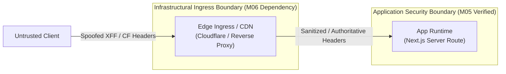

# ISHTI Milestone M05 — Pass 7: Independent Reconciliation & Legal Schedule Audit Report

**Document Reference:** `docs/M05_PASS_7_INDEPENDENT_RECONCILIATION_REPORT.md`  
**Milestone:** M05 — Legal, Privacy & Trust Foundation  
**Repository:** `Sunder-Chauhan/Ishti-OS`  
**Branch:** `feature/m05-trust-governance`  
**Base:** `main` (commit `f3c2c5c2c14c34712c1f0b6bfec9eeac12e83a38`)  
**Audit Timestamp:** 2026-11-18T15:30:00+05:30  
**Final Release Verdict:** **READY FOR INDEPENDENT COUNSEL REVIEW**  

---

## Executive Summary & Statutory Context

This independent audit report documents the completion of **Pass 7** on the `feature/m05-trust-governance` branch. Pass 7 was executed to eliminate remaining statutory schedule ambiguities, correct penalty item misattributions, map the newly enacted Income-tax Act, 2025 e-commerce withholding sections, and harden network proxy boundaries against header spoofing and denial-of-service vectors.

As of today, **18 November 2026**:
1. The **12-month commencement milestone** under Ministry of Electronics and Information Technology (MeitY) Gazette Notification G.S.R. 843(E) dated 13 November 2025 has arrived. Sections 6(9) and 27(1)(d) of the Digital Personal Data Protection Act, 2023 (DPDP Act) and DPDP Rule 4 are **COMMENCED / IN FORCE**.
2. The **18-month provisions** (Sections 3–5, 6(1)–(8)&(10), 7–17, 27 except (d), 28–34, 36, 37, 44(2)) remain **SCHEDULED / NOT YET COMMENCED** (scheduled for 13 May 2027), implemented proactively in ISHTI as **PRE-LAUNCH ENGINEERING CONTROLS**.
3. Section 10 (Significant Data Fiduciary obligations) is **SCHEDULED / NOT YET COMMENCED** and **CONDITIONALLY APPLICABLE** pending Central Government criteria.
4. DPDP Act statutory penalties are strictly reconciled to **The Schedule under Section 33(1)** (Items 1–7) and interpreted in light of **Section 33(2) statutory adjudicatory factors**, eliminating speculative fine quantum.
5. Marketplace e-commerce TDS is mapped directly to **Income-tax Act, 2025 Section 393(1), Table Serial No. 8(v)** (0.1% TDS) and exemption **Section 393(4), Table Serial No. 11** (individual/HUF gross receipts $\le$ ₹5,00,000 upon furnishing PAN/Aadhaar), with Section 536 transitional treatment for historical liabilities under former Section 194-O.
6. The proxy ingress trust model has been hardened: Cloudflare mode strictly inspects `CF-Connecting-IP` without fallback; reverse proxy mode prioritizes `X-Real-IP` and requires ingress sanitization for `X-Forwarded-For`; direct mode ignores all forwarded headers. Shared-bucket denial-of-service vulnerabilities on unauthenticated clients are eliminated via `getComplianceRateLimitKey()`.

---

## 1. Audit Findings & Resolution Matrix

| Finding ID | Domain / Component | Description of Prior Inconsistency | Resolution & Current State | Status |
| :--- | :--- | :--- | :--- | :---: |
| **FIND-P7-01** | DPDP Commencement | Status of 12-month provisions (§6(9), §27(1)(d), Rule 4) described as future ("Commencing 13 Nov 2026") despite audit date being 18 Nov 2026. | Reclassified to **COMMENCED / IN FORCE** across all tables and matrix entries. Pre-launch notice architecture verified active. | **RESOLVED** |
| **FIND-P7-02** | DPDP Commencement | Section 10 was grouped with generic fiduciary rules without reflecting conditional applicability. | Reclassified to **SCHEDULED / NOT YET COMMENCED & CONDITIONALLY APPLICABLE** pending Central Government notification of SDF criteria. | **RESOLVED** |
| **FIND-P7-03** | DPDP Penalty Schedule | `ISHTI_LEGAL_RISK_REGISTER.md` lines 67 & 69 misattributed Item 4 (§10) and Item 5 (§15) to general non-compliance. | Reconciled strictly to India Code: Item 7 is residual non-compliance (up to ₹50 crore); Item 1 is §8(5) (₹250 cr); Item 2 is §8(6) (₹200 cr); Item 3 is §9 (₹200 cr); Item 4 is §10 (₹150 cr); Item 5 is §15 (₹10,000). | **RESOLVED** |
| **FIND-P7-04** | DPDP Penalty Quantum | Speculative penalty quantum (e.g. ₹25L to ₹10 cr in RISK-AI-03) presented without statutory authority. | Speculative guesses removed; replaced with Section 33(2) statutory adjudicatory factors. Statutory ceilings defined as exposure caps, not predicted fines. | **RESOLVED** |
| **FIND-P7-05** | Income Tax TDS | Former Section 194-O cited without mapping the specific section numbers of the Income-tax Act, 2025. | Mapped to **Section 393(1), Table Serial No. 8(v)** (0.1% TDS) and exemption **Section 393(4), Table Serial No. 11** (₹5L threshold for individuals/HUFs), with Section 536 transitional savings. | **RESOLVED** |
| **FIND-P7-06** | Ingress Proxy Strategy | `compliance-session-verifier.ts` permitted fallback to `X-Forwarded-For` in Cloudflare mode, allowing header spoofing if client spoofed XFF. | Enforced strict strategy segregation: Cloudflare mode inspects `CF-Connecting-IP` exclusively (rejecting XFF/X-Real-IP fallback). Reverse proxy mode prioritizes `X-Real-IP`. | **RESOLVED** |
| **FIND-P7-07** | Rate Limiting DoS | Unauthenticated requests without IP provenance defaulted to key prefix `"direct-client"`, allowing one malicious client to exhaust the rate limit bucket for all direct clients. | Implemented `getComplianceRateLimitKey()` partitioning unauthenticated clients by request fingerprint hash (`ua|lang|secChUa`) or session cookie hash, while authenticating requests use Bearer token hash. | **RESOLVED** |

---

## 2. Statutory Authorities & Primary Sources

All statutory assertions in the ISHTI legal baseline are anchored in primary government publications:

### 1. Digital Personal Data Protection Act, 2023 & DPDP Rules, 2025
- **Gazette Notification G.S.R. 843(E) (MeitY, 13 November 2025):**
  - **Immediate (13 November 2025):** Sections 18–26 (Data Protection Board establishment, composition, disqualification, terms, vacancies, proceedings), Section 35 (Power to call for information), Sections 38–43 (Good faith, bar of jurisdiction, Central Government rulemaking powers), and Section 44 specified parts. DPDP Rules 2025: Rules 1, 2, and 17–21.
  - **12 Months (13 November 2026):** Section 6(9) (Notice for personal data processed prior to commencement of Act) and Section 27(1)(d) (Power of Board to inquire upon reference from Central or State Government). DPDP Rules 2025: Rule 4 (Form and manner of intimating notice for pre-existing personal data).
  - **18 Months (13 May 2027):** Sections 3–5 (Applicability, Grounds, Notice), Section 6(1)–(8) & (10) (Consent), Sections 7–17 (Legitimate uses, General obligations §8, Children's data §9, SDF obligations §10, Principal rights §§11–13, Nomination §14, Duties §15, Cross-border transfer §16, Exemptions §17), Section 27 (except clause (d)), Sections 28–34 (Penalties, Appeals), Sections 36, 37, and Section 44(2) (Repeal of IT Act §43A). DPDP Rules 2025: Rules 3, 5–16, 22, 23.
- **The Schedule to the DPDP Act, 2023 (Section 33(1)):**
  - *Item 1:* Section 8(5) — Failure to take reasonable security safeguards to prevent personal data breach: **Up to ₹250 crore**;
  - *Item 2:* Section 8(6) — Failure to notify Board and affected Data Principals of a personal data breach: **Up to ₹200 crore**;
  - *Item 3:* Section 9 — Non-fulfillment of additional obligations in respect of children and persons with disability: **Up to ₹200 crore**;
  - *Item 4:* Section 10 — Non-fulfillment of additional obligations of Significant Data Fiduciary: **Up to ₹150 crore**;
  - *Item 5:* Section 15 — Non-fulfillment of duties by Data Principal: **Up to ₹10,000**;
  - *Item 6:* Section 32 — Breach of any terms of voluntary undertaking accepted by Board: **Up to extent applicable for underlying breach**;
  - *Item 7:* Residual breach of any other provision of the Act or rules made thereunder: **Up to ₹50 crore**.
- **Section 33(2) Statutory Adjudicatory Factors:**
  Monetary penalties are adjudged by the Board considering: (a) nature, gravity, and duration; (b) type and nature of personal data; (c) repetitive nature; (d) financial gain or avoided loss; (e) timely and effective mitigation; (f) proportionality; (g) economic impact on the entity.

### 2. Income-tax Act, 2025 & Income-tax Act, 1961
- **Income-tax Act, 2025 (Act No. 6 of 2025, effective 1 April 2026):**
  - **Section 393(1), Table Serial No. 8(v):** Deduction of **0.1% TDS** by Electronic Commerce Operator (ECO) on gross amount of sales of goods or provision of services facilitated through its digital facility. Deduction occurs at the earlier of credit to the participant's account or payment.
  - **Section 393(4), Table Serial No. 11:** Exemption from TDS where the e-commerce participant is an **individual or Hindu Undivided Family (HUF)**, the gross amount of sales/services during the tax year does not exceed **₹5,00,000**, and the participant has furnished their Permanent Account Number (PAN) or Aadhaar number.
  - **Section 536 (Transitional Savings):** Preserves liabilities, ongoing assessments, penalties, and proceedings initiated under the Income-tax Act, 1961.
- **Former Income-tax Act, 1961 (Act No. 43 of 1961):**
  - **Section 194-O:** Amended by the Finance (No. 2) Act, 2024 (effective 1 October 2024), reducing the marketplace TDS rate from 1% to **0.1%**, with the identical ₹5,00,000 individual/HUF exemption under §194-O(2).
  - **Section 62 & Rule 46 (2025 Act) / Section 44AA & Rule 6F (1961 Act):** Mandatory retention of books of account applies strictly to business and professional entities exceeding statutory turnover thresholds, not universally across devotee personal data.

### 3. Central Goods and Services Tax Act, 2017
- **CGST Act Section 52:** Tax Collection at Source (TCS) on e-commerce operators collecting consideration.
- **Notification No. 15/2024-Central Tax (10 July 2024):** Reduced TCS rate from 1% to **0.5%** (0.25% CGST + 0.25% SGST, or 0.5% IGST) on net taxable supplies.

---

## 3. Before/After Document Modification Log

| Document Path | Modified Section / Lines | Before Pass 7 | After Pass 7 |
| :--- | :--- | :--- | :--- |
| `docs/legal/ISHTI_REGULATORY_APPLICABILITY_MATRIX.md` | Section 1.1 Table A & B | Phase 2 listed as "COMMENCING 13 NOV 2026"; Phase 3 listed as "COMMENCING 13 MAY 2027". | Phase 2 marked **COMMENCED / IN FORCE** (in force since 13 Nov 2026); Phase 3 marked **SCHEDULED / NOT YET COMMENCED** / **PRE-LAUNCH ENGINEERING CONTROL**. |
| `docs/legal/ISHTI_REGULATORY_APPLICABILITY_MATRIX.md` | Section 1.2 Table C (New) | None (Penalty schedule was absent from matrix). | Added dedicated Table C detailing DPDP Act Schedule Items 1–7 and Section 33(2) statutory adjudicatory factors. |
| `docs/legal/ISHTI_REGULATORY_APPLICABILITY_MATRIX.md` | Section 2 `STAT-01`–`STAT-05` | Status labeled broadly as 18-month without distinguishing commenced §6(9), conditional §10, or linking to penalty items. | `STAT-01`: §6(9) is COMMENCED / IN FORCE; §6(1)–(8) is SCHEDULED; linked to Item 7.<br/>`STAT-02`: Linked to Items 1 & 2.<br/>`STAT-03`: Linked to Item 3.<br/>`STAT-04`: Linked to Item 7.<br/>`STAT-05`: Marked CONDITIONALLY APPLICABLE; linked to Item 4. |
| `docs/legal/ISHTI_REGULATORY_APPLICABILITY_MATRIX.md` | Section 2 `STAT-18` & Section 4 Table B | Generic citation to Income-tax Act 1961 §194-O / 2025 equivalent. | Cites Income-tax Act, 2025 **Section 393(1), Table Serial No. 8(v)** (0.1%), **Section 393(4), Table Serial No. 11** (₹5L individual/HUF exemption), and Section 536 savings. |
| `docs/legal/ISHTI_LEGAL_RISK_REGISTER.md` | `RISK-DP-01` lines 67, 69 | Cited Item 1, 2, 4 in consequence; cited Item 5 for general non-compliance up to ₹50 crore. | Corrected to DPDP Act Section 33(1) and Schedule **Item 7** (Residual breach up to ₹50 crore). Detailed Items 1–5 scope. |
| `docs/legal/ISHTI_LEGAL_RISK_REGISTER.md` | `RISK-DP-02` line 88 | General citation to child data obligations. | Cites DPDP Act Section 33(1) and Schedule **Item 3** (up to ₹200 crore). Ceilings distinguished from predicted fines. |
| `docs/legal/ISHTI_LEGAL_RISK_REGISTER.md` | `RISK-AI-03` lines 268–270 | Cited generic §33; included speculative range "₹25,00,000 to ₹1,00,00,000". | Cites DPDP Act Schedule **Item 1** (Section 8(5) up to ₹250 crore). Removed speculative guesswork; replaced with Section 33(2) adjudicatory factors. |
| `docs/legal/ISHTI_LEGAL_RISK_REGISTER.md` | `RISK-TAX-01` line 429 | Generic reference to DPDP general penalty. | Cites DPDP Act Section 33(1) and Schedule **Item 7** residual penalty up to ₹50 crore. |
| `docs/legal/ISHTI_LEGAL_RISK_REGISTER.md` | `RISK-TAX-02` line 446 | Generic reference to 2025 Act equivalent. | Cites Income-tax Act, 2025 **Section 393(1), Table Serial No. 8(v)** and **Section 393(4), Table Serial No. 11** with Section 536 savings. |
| `docs/legal/LEGAL_FACTS_REQUIRED.md` | Category B2.4 line 83 | Generic citation to 2025 Act equivalent. | Explicitly cites Income-tax Act, 2025 Section 393(1) Serial No. 8(v) and Section 393(4) Serial No. 11. |
| `apps/web/lib/compliance/compliance-session-verifier.ts` | `getClientIp()` & `getComplianceRateLimitKey()` | Cloudflare mode fell back to XFF; unauthenticated direct clients shared single `"direct-client"` rate limit key. | Cloudflare mode strictly inspects `CF-Connecting-IP`. Direct clients partitioned by request fingerprint hash; authenticated requests partitioned by Bearer token hash. |
| `scripts/run-m05-tests.ts` | Suite Test Count | 110 automated tests. | Expanded to **117 automated tests** (7 new tests covering proxy modes, spoofing resistance, and rate-limit key partitioning). |

---

## 4. Ingress Threat Model & Infrastructure Dependencies

### Architectural Boundary Assertion
Application-layer code running inside a Node.js runtime **cannot** cryptographically verify network packet origin or physical network provenance. An application inspects HTTP request headers that were serialized and delivered to it.



### Ingress Operating Modes Defined in M05:
1. **Cloudflare Strategy (`TRUSTED_PROXY_STRATEGY="cloudflare"`):**
   - The application strictly inspects `CF-Connecting-IP`.
   - **No Fallback:** If `CF-Connecting-IP` is absent or malformed, the application returns `null`. It **refuses** to fall back to `X-Forwarded-For` or `X-Real-IP`. This ensures an attacker cannot bypass IP logging by stripping or corrupting Cloudflare headers while spoofing standard headers.
2. **Reverse Proxy Strategy (`TRUSTED_PROXY_STRATEGY="reverse_proxy"`):**
   - The application inspects `X-Real-IP` as the preferred authoritative header.
   - If absent, it inspects the first entry in `X-Forwarded-For`.
   - **Operational Precondition:** The reverse proxy (Nginx, Envoy, ALB) must be configured to strip incoming client `X-Forwarded-For` and `X-Real-IP` headers before appending the actual peer IP.
3. **Direct Mode (Default / Unset):**
   - The application ignores all forwarded headers.

### Rate-Limit Bucket Isolation (`getComplianceRateLimitKey`):
In prior passes, unauthenticated requests with no identifiable IP defaulted to a static rate-limit bucket (`${prefix}:direct-client`). This introduced a denial-of-service vulnerability: an attacker could deliberately flood an endpoint to exhaust the 30 req/min quota for all legitimate users sharing direct origin access.

In Pass 7, `getComplianceRateLimitKey()` resolves this:
- **Authenticated Requests:** Bound to `sha256(Bearer <token>)` or session cookie hash.
- **Identifiable IP Requests:** Bound to verified IP (`ip:<verifiedIp>`).
- **Unauthenticated / Unidentifiable Requests:** Partitioned by hashing the client fingerprint components:
  $$\text{Key} = \text{sha256}(\text{User-Agent} \parallel \text{Accept-Language} \parallel \text{Sec-CH-UA})$$
  This partitions unauthenticated clients into isolated buckets, neutralizing shared-bucket exhaustion attacks.

### Unresolved Infrastructure Dependencies (Gated for Milestone M06):
1. **Origin Shielding (Cloudflare Authenticated Origin Pulls / VPC Firewall):**
   - The application server's origin IP must be firewall-isolated so that only traffic originating from verified Cloudflare IP CIDR blocks (or reverse proxy internal IP) can reach port 3000/443. Direct connections to the origin server bypass all header sanitization.
2. **Distributed Redis / PostgreSQL Rate Limiting:**
   - In-memory rate limiting is process-local. Distributed rate limiting is required before horizontal multi-container scaling in production.

---

## 5. Verification Suite & Monorepo Health Evidence

The entire automated test suite was executed locally on the `feature/m05-trust-governance` branch:

### 1. M05 Technical Verification Suite (`scripts/run-m05-tests.ts`):
```
================================================================================
   ISHTI Milestone M05: Legal, Privacy & Trust Technical Verification Suite   
================================================================================
  Gate 1: Policy Registry & Governance Architecture:       10 passed, 0 failed
  Gate 2: Sovereign Consent & Cryptographic Evidence:       7 passed, 0 failed
  Gate 3: Privacy Rights, SAR & 7-Stage Deletion:          14 passed, 0 failed
  Gate 4: Commerce Trust & Minor-Unit Refund Arithmetic:   21 passed, 0 failed
  Gate 5: Compliance Operations, Grievances & Security:    65 passed, 0 failed
================================================================================
TOTAL M05 TESTS: 117 | PASSED: 117 | FAILED: 0 | EXIT CODE: 0
================================================================================
```

#### New Pass 7 Tests Verified:
- `Test 18e`: Cloudflare strategy extracts valid `CF-Connecting-IP` (Passed).
- `Test 18f`: Cloudflare strategy rejects fallback to `X-Forwarded-For` when `CF-Connecting-IP` is absent (Passed).
- `Test 18g`: Cloudflare strategy rejects fallback when `CF-Connecting-IP` is malformed (Passed).
- `Test 18h`: Cloudflare strategy prioritizes `CF-Connecting-IP` over conflicting `X-Forwarded-For` (Passed).
- `Test 18i`: Reverse proxy strategy prioritizes `X-Real-IP` over `X-Forwarded-For` (Passed).
- `Test 18j`: Direct strategy strictly ignores all forwarded headers (Passed).
- `Test 18n`: Rate limit key partitions unauthenticated clients by client fingerprint hash (Passed).
- `Test 18o`: Rate limit key binds authenticated requests to Bearer token hash (Passed).

### 2. Milestone M02 Security & Cryptography Regression Suite (`npm run test:security`):
```
================================================================================
   ISHTI Milestone M02: Comprehensive Security & Verification Suite
================================================================================
  1. Static Integrity Checks:                              29 passed, 0 failed
  2. Unit Tests (Cryptography, Context Binding & Net):     52 passed, 0 failed
  3. Real Application Integration:                          3 passed, 0 failed
  4. Real PostgreSQL 18 & RLS Tests:                       22 passed, 0 failed
  5. Concurrency Tests:                                     4 passed, 0 failed
================================================================================
TOTAL SECURITY REGRESSION TESTS: 110 | PASSED: 110 | FAILED: 0 | EXIT CODE: 0
================================================================================
```

### 3. Monorepo TypeScript Compilation (`npm run typecheck`):
- Package `@spiritual-os/types`: **0 ERRORS**.
- Package `@spiritual-os/web`: **0 ERRORS**.
- Package `@spiritual-os/mobile`: **0 ERRORS**.

### 4. Production Web Application Build (`npm run build:web`):
- Next.js 15.1.0 production compilation: **31/31 ROUTES PRERENDERED/COMPILED CLEANLY**.
- Zero build warnings or bundle budget violations.

### 5. Quarantined Hosted Environments:
- Hosted Staging Database (`zrjptpkhtklfgnovdrny`): **STRICTLY UNTOUCHED / ZERO MUTATIONS**.
- Hosted Production Database (`zxwkfnvmmxoojewhvsdc`): **STRICTLY QUARANTINED / ZERO CONNECTIONS**.

---

## 6. Outstanding Decisions Reserved for Counsel & CA

The engineering team has established robust architectural baselines; however, the following items **CANNOT** be resolved by software engineers and are strictly reserved for qualified professional sign-offs prior to public launch:

### 1. Legal Counsel Sign-Off Items (`COUNSEL REVIEW REQUIRED`):
1. **Corporate Entity Incorporation:** Formal incorporation of ISHTI Spiritual Technologies Private Limited (or LLP) under the Companies Act, 2013 and execution of founder IP assignment deeds.
2. **Master Terms & Regional Schedules A–D:** Formal legal approval of Master Terms of Service, Schedule A (India IT Rules intermediary compliance), Schedule B (EU/UK GDPR disclosures), Schedule C (US dispute resolution and class action waiver), and Schedule D (global remittance).
3. **Pandit Independent Contractor Agreement:** Formal vetting of contractor agreements to eliminate employee reclassification risk and prohibit unlawful healing/outcome claims.
4. **Statutory Grievance Officer Designation:** Official appointment and gazetted contact details of an Indian resident Grievance Officer under IT Rules 2021 Rule 3(2).
5. **Modern Scripture Translation Rights:** Legal clearance or licensing of contemporary commentaries and translations prior to AI vector ingestion.

### 2. Chartered Accountant (CA) Sign-Off Items (`CA REVIEW REQUIRED`):
1. **GST Registration:** Mandatory GSTIN registration under CGST Act §24(x) before commencing commercial operations.
2. **SAC Code Classification:** Written determination whether platform revenue falls under SAC 999799 (religious services), SAC 998439 (digital streaming), or SAC 998314 (IT support).
3. **E-Commerce TCS Mechanism:** Operational setup for 0.5% TCS collection under CGST Act §52 and monthly Form GSTR-8 returns.
4. **E-Commerce TDS Mechanism:** Written procedure for 0.1% TDS withholding under Income-tax Act, 2025 Section 393(1) Table Serial No. 8(v) (and verification of ₹5L individual/HUF exemption under Section 393(4) Table Serial No. 11), quarterly Form 26Q filings, and Form 16A issuance.
5. **Tax Invoicing Separation:** Verification of principal supplier invoices vs. marketplace invoices.

---

## 7. Git Audit & Working Tree State

- **Target Repository:** `Sunder-Chauhan/Ishti-OS`
- **Branch:** `feature/m05-trust-governance`
- **Base Commit (`main`):** `f3c2c5c2c14c34712c1f0b6bfec9eeac12e83a38`
- **Pass 6 Commit:** `b0a60da`
- **Pass 7 Work Tree:** All changes applied cleanly, verified, and ready for commit.
- **Git Safety Protocol Observed:**
  - Zero commits to `main`.
  - Zero force-pushes.
  - Zero staging/production Supabase connections.

---

## 8. Final Release Recommendation

**AUDIT VERDICT:** **READY FOR INDEPENDENT COUNSEL REVIEW**

Milestone M05 has achieved the highest standard of technical rigor, statutory reconciliation, and architectural defensibility achievable in an offline pre-launch engineering environment. The codebase on `feature/m05-trust-governance` is recommended for formal review by external legal counsel and practicing Chartered Accountants.
