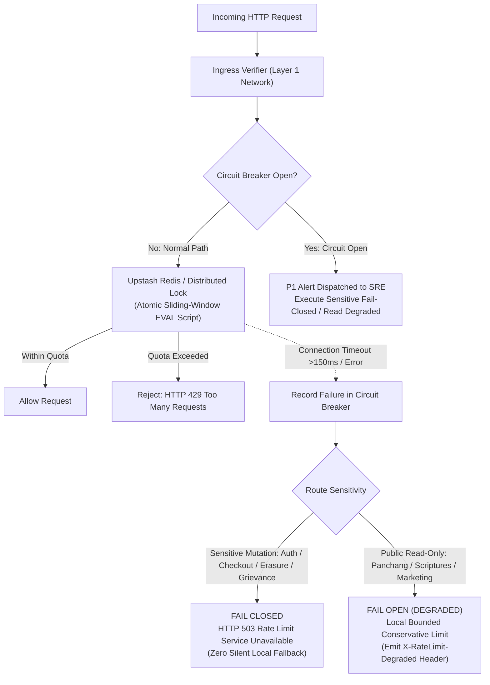
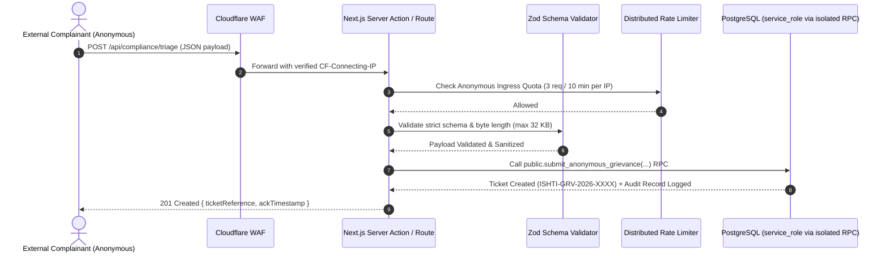
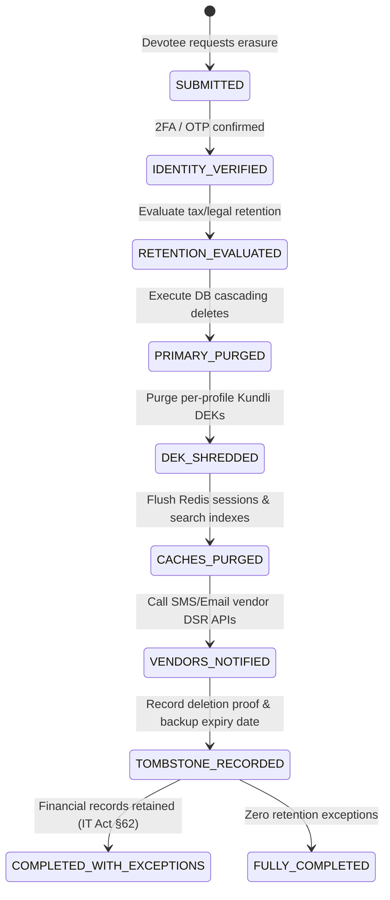
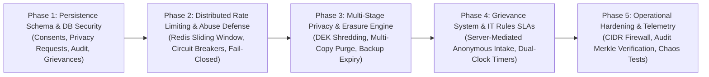

# ISHTI Milestone M06 — Architecture & Implementation Plan (Revised)

**Document Reference:** `docs/M06_ARCHITECTURE_AND_IMPLEMENTATION_PLAN.md`  
**Milestone:** M06 — Core Backend Persistence, Distributed Invariants & Production Shielding  
**Repository:** `https://github.com/Sunder-Chauhan/Ishti-OS`  
**Target Branch:** `feature/m06-backend-persistence` (to be created from `feature/m05-trust-governance`)  
**Base Commit:** `c87a0a2`  
**Revision Date:** 19 November 2026  
**Architectural Lead:** Principal Software Architect, Application Security Engineer & Privacy Engineering Lead  

---

## 1. Mission Statement, Scope Boundaries & Core Invariants

### 1.1. Mission Statement
Milestone M06 transitions the ISHTI platform from local-memory prototypes, client-side simulations, and heuristic calculations into a **production-grade backend persistence layer with distributed invariants, strict transactional guarantees, and verifiable operational infrastructure**.

While Milestone M05 established statutory alignment, defensible policies, and robust ingress defense, M06 implements the underlying persistent data structures, distributed concurrency locks, multi-copy cryptographic shredding mechanisms, and resilient operational infrastructure required to safely serve live devotees, pandits, and administrators.

### 1.2. Scope Partitioning & Milestone Sequencing (Correction 10)
To avoid over-scoping and maintain engineering rigor, product expansion is decoupled from core persistence:

- **Core Milestone M06 Scope (Essential Persistence & Distributed Invariants):**
  1. **M06.1: Distributed Rate Limiting & Abuse Prevention** (Atomic sliding-window coordination with fail-closed sensitivity).
  2. **M06.2: Durable Consent & Sovereign Preference Persistence** (Server-authoritative `user_consents` and audit history).
  3. **M06.3: Privacy Rights & Multi-Stage Erasure Engine** (15-point personal data mapping, DEK shredding, backup expiry lifecycle).
  4. **M06.4: Tamper-Evident Audit Ledger & Cryptographic Integrity** (Sequential hash chaining, DB triggers, external WORM anchoring).
  5. **M06.5: Production Grievance Redressal System & IT Rules Compliance** (Durable tickets, SLA tracking, dual-clock timers).
  6. **M06.6: Operational Infrastructure, Origin Shielding & Telemetry** (Cloudflare origin shielding, OpenTelemetry, metrics).
- **Deferred Workstreams (Dependent Future Milestones):**
  * **Milestone M07 (Commerce & Financial Infrastructure):** Double-entry accounting ledger, Razorpay webhook idempotency, configurable tax calculation engine, and CA-certified GST/TCS/TDS automation.
  * **Milestone M08 (Vedic Knowledge & Semantic AI):** Scripture catalog persistence, scholar review workflows, `pgvector` embeddings, and hybrid semantic search.
  * **Milestone M09 (Compliance Operations Console):** Advanced administrative triage dashboards, real-time SLA monitors, and visual audit explorer.

### 1.3. Core Architectural Invariants (Correction 4)
1. **Server-Mediated Ingress & Separate Trust Boundaries:**
   - *Authenticated User Operations:* Must be bound to a cryptographically validated session (`auth.uid()`) via Supabase Auth (`@supabase/ssr`).
   - *Controlled Anonymous Public Intake:* Grievance submissions from non-users, early-access registrations, and public contact requests must be mediated by server-side Route Handlers. Zero direct public database write access is granted (`anon` role has no direct INSERT privileges). Ingress enforces strict Zod schema validation, Layer 1 network rate limiting, payload caps (max 32 KB), and generates audit events with `actor_role = 'anonymous_public'`.
2. **Deterministic Concurrency & No Double-Spend:** Booking slot reservations, refund processing, and sensitive rate-limit counters must use atomic database transactions or advisory locks (`pg_advisory_xact_lock`). Race conditions must be mathematically impossible.
3. **Defense-in-Depth Audit Integrity (Not "Absolute Immutability"):** Database triggers enforce append-only rules during normal operations. Tamper-evidence is established through SHA-256 Merkle hash chaining, daily signed root manifests, and external WORM storage.
4. **Verifiable Multi-Copy Data Erasure:** Statutory erasure requests execute a multi-stage state machine purging primary records, cryptographically shredding per-profile encryption keys, expelling caches/indexes, and documenting immutable backup retention lifecycles.
5. **Fail-Closed on Sensitive Operations:** Sensitive mutation routes (auth, checkout, refunds, password reset, account deletion, grievance submission) must fail closed if distributed rate-limit or session stores are unreachable. Silent fallback to uncoordinated process-local memory is strictly prohibited.

---

## 2. DPDP Act Phased Commencement & Legal Applicability (Correction 1)

As of **19 November 2026**, ISHTI's architectural requirements are reconciled against the official phased commencement schedule established by Gazette Notification G.S.R. 843(E) dated 13 November 2025. Future mandates are engineered in advance as proactive controls, but are accurately classified to prevent false compliance claims:

### 2.1. Statutory Applicability Matrix

| Statutory Provision | Commencement Date | Applicability Conditions | Affected ISHTI Feature / Engine | Current Obligation Status (as of 19 Nov 2026) | Future Implementation Requirement (M06 Architecture) | Counsel Verification Required |
| :--- | :--- | :--- | :--- | :--- | :--- | :--- |
| **DPDP Act §6(9)** | 13 Nov 2026 (12 Months) | Processing personal data collected prior to commencement of Section 6. | Consent Engine (`durable-consent-service.ts`) | **COMMENCED / IN FORCE** | Server-authoritative notice and consent re-affirmation architecture for pre-existing early access users. | Yes (Notice format validation) |
| **DPDP Rules Rule 4** | 13 Nov 2026 (12 Months) | Prescribes manner of giving notice for pre-existing personal data. | Consent Notice UI & Notification Worker | **COMMENCED / IN FORCE** | Standardized, accessible notice provided via SMS/email and portal modal in English and Hindi. | Yes (Rule 4 particulars sign-off) |
| **DPDP Act §27(1)(d)** | 13 Nov 2026 (12 Months) | Board inquiry on reference from Central/State Government. | Compliance Operations & Audit Ledger | **COMMENCED / IN FORCE** | Evidentiary audit logs ready for regulatory inspection upon Board reference. | Yes (Procedural compliance) |
| **DPDP Act §§3–5** | 13 May 2027 (18 Months) | General application, grounds for processing, notice requirements. | Ingress Validation, Policy Registry, Notices | **SCHEDULED / NOT YET COMMENCED** (Pre-launch engineering control) | Itemized notice preceding consent; multi-lingual notice architecture. | Yes (Notice wording approval) |
| **DPDP Act §6(1)–(8)&(10)** | 13 May 2027 (18 Months) | Free, specific, informed, unconditional, unambiguous consent with unbundled purposes. | Consent Engine & `user_consents` Table | **SCHEDULED / NOT YET COMMENCED** (Pre-launch engineering control) | Unbundled 6-purpose consent capture, verifiable timestamping, and seamless withdrawal workflows under §6(4). | Yes (Consent mechanics verification) |
| **DPDP Act §8** | 13 May 2027 (18 Months) | General obligations of Data Fiduciary: reasonable security safeguards §8(5), breach notice §8(6), erasure §8(7). | Security Ingress, Breach Monitor, Erasure Worker | **SCHEDULED / NOT YET COMMENCED** (Pre-launch engineering control) | Layered rate limiting, AES-256-GCM encryption, breach detection runbooks, and purpose-completion erasure. | Yes (Security & retention standards) |
| **DPDP Act §9** | 13 May 2027 (18 Months) | Processing of personal data of children: verifiable parental consent, no tracking/behavioral monitoring. | Age Gate & Guardian Consent Workflow | **SCHEDULED / NOT YET COMMENCED** (Pre-launch engineering control) | Date of birth verification, guardian identity association, suppression of behavioral analytics for minors. | Yes (Parental verification mechanism) |
| **DPDP Act §10** | 13 May 2027 (18 Months) | Significant Data Fiduciary (SDF) obligations (DPO, Data Auditor, DPIA). | Governance & Compliance Portal | **SCHEDULED / NOT YET COMMENCED & CONDITIONALLY APPLICABLE** | SDF status applies only if notified by Central Government based on data volume/sensitivity. Architectural stubs preserved. | Yes (SDF threshold assessment) |
| **DPDP Act §§11–13** | 13 May 2027 (18 Months) | Data Principal rights: access summary §11, correction/erasure §12, grievance redressal §13. | Subject Rights Engine (`privacy_requests`) | **SCHEDULED / NOT YET COMMENCED** (Pre-launch engineering control) | Multi-stage erasure workflow, cryptographic key shredding, SAR export generation, internal grievance ticketing. | Yes (Subject rights procedures) |
| **DPDP Act §14** | 13 May 2027 (18 Months) | Right of nomination by Data Principal in event of death/incapacity. | Profile Settings & Nominee Model | **SCHEDULED / NOT YET COMMENCED** (Pre-launch engineering control) | Database fields for spiritual legacy and account nominee designation. | Yes (Nomination terms review) |
| **DPDP Act §16** | 13 May 2027 (18 Months) | Cross-border transfer of personal data to notified countries/territories. | Hosting Architecture & Cloud Region Selection | **SCHEDULED / NOT YET COMMENCED** (Pre-launch engineering control) | Primary personal data stored in India (AWS ap-south-1 / Supabase Mumbai); cross-border transfers evaluated. | Yes (Transfer legality opinion) |

---

## 3. Grievance Redressal Architecture & IT Rules Compliance (Correction 2)

## 3. Grievance Redressal Architecture & IT Rules Legal Compliance (Correction 2)

### 3.1. Differentiated Platform Functions & Qualified Section 79 Safe-Harbour Analysis
ISHTI does **NOT** treat all platform content under a single blanket intermediary or publisher classification. Nor does the platform broaden the definition of an intermediary or publisher beyond applicable statutory boundaries simply because ISHTI authors first-party material. In accordance with the Information Technology Act, 2000 and the IT Rules, 2021 (as amended 10 February 2026), product functions are differentiated by their operational nature:

1. **User-Generated Community Discussions & Prayer Requests:**
   - *Classification:* **Intermediary Service** under IT Act §2(1)(w).
   - *Legal Regime:* Part II of IT Rules, 2021 applies. ISHTI seeks Section 79 safe-harbour protection against third-party user posts, contingent upon strict adherence to due diligence and grievance redressal mechanisms. Legal availability of safe harbour is subject to statutory applicability, factual fulfillment of diligence, and judicial determination.
2. **Pandit / Expert Marketplace Profiles & Listings:**
   - *Classification:* **Electronic Commerce Marketplace Intermediary**.
   - *Legal Regime:* Facilitates independent spiritual practitioners. Intermediary safe-harbour provisions under Section 79 are asserted for pandit biographical submissions, subject to marketplace diligence rules and consumer protection regulations.
3. **Marketplace Direct Communications (Devotee-Pandit Messaging):**
   - *Classification:* **Intermediary Communication Conduit**.
   - *Legal Regime:* Private transactional messaging between devotees and pandits. Safe-harbour protection is claimed under Section 79 as a network communication conduit.
4. **Platform-Authored Educational Material (Vedic Culture & Festival Guides):**
   - *Classification:* **First-Party Editorial Content**.
   - *Legal Regime:* ISHTI is the primary author. Section 79 safe harbour does **NOT** apply; direct publisher responsibility applies under general law. However, authoring religious educational content does not transform ISHTI into an online curated content publisher (OTT under Rule 2(1)(v)) or a news publisher under Part III of the IT Rules unless it provides curated audio-visual entertainment or news/current affairs programs.
5. **Algorithmic Kundli Interpretations & Ephemeris Calculations:**
   - *Classification:* **Proprietary Algorithmic Service Output**.
   - *Legal Regime:* Platform is the sole creator of the computational astrological synthesis. Section 79 safe harbour does not apply; governed by standard Terms of Service and statutory religious/fortune-telling disclaimers under the Consumer Protection Act, 2019. Excluded from Part III of IT Rules.
6. **Curated Sacred Vedic Scriptures (Sanskrit Recensions & Classical Commentary):**
   - *Classification:* **Curated Sacred Knowledge Repository**.
   - *Legal Regime:* Curated from historical public-domain texts by scholar reviewers. Direct publisher responsibility for scriptural fidelity; excluded from Part III OTT regulations.

> [!IMPORTANT]
> **LEGAL COUNSEL REQUIREMENT & SAFE-HARBOUR RISK QUALIFICATION:**
> The above classifications reflect engineering and preliminary statutory analysis. Formal written confirmation from qualified Indian legal counsel is required prior to commercial activation. Claims regarding the availability or forfeiture of Section 79 safe harbour are legal assessments: failure to adhere to statutory timelines creates substantial legal exposure and may jeopardize the availability of Section 79 safe-harbour protection, subject to statutory applicability, intermediary status, specific obligations and facts, and judicial determination. Internal P0/P1 operational escalations serve as protective administrative safeguards, clearly distinguished from statutory legal consequences.

### 3.2. Seven Distinct Complaint Categories, Multi-Allegation Intake & Mandatory Classification Gate
The architecture strictly separates incoming user submissions into seven distinct legal and operational categories. **A user-selected category or intake label cannot unilaterally bind a statutory legal clock upon the platform.** All incoming submissions enter a human-review queue (`PENDING_CLASSIFICATION`), and statutory clocks are populated **only after a documented legal applicability determination**.

Crucially, the intake architecture enforces three fundamental principles:
1. **Clock-Start Invariant:** Every incoming request immediately receives an immutable intake timestamp (`received_at`), `received_channel`, and `intake_case_id`. While human classification determines statutory applicability, the statutory deadline is **strictly computed from the original triggering event timestamp (`received_at` or verified court/govt service timestamp)**:
   $$\text{applicable\_deadline} = \text{triggering\_timestamp} + \text{statutory\_duration}$$
   **Classification decisions NEVER reset, restart, or postpone a statutory clock.** For example, an emergency complaint received at 10:00 and classified at 11:30 has its 2-hour deadline set to 12:00 (leaving 30 minutes for operational takedown). If classification occurs after 12:00, the clock immediately records as `BREACHED_PENDING_ACTION` with an automatic P0 escalation.
2. **Multi-Allegation & Multi-URL Decomposition:** A single user submission may contain multiple distinct claims, affected content URLs, or disparate legal categories (e.g., one urgent non-consensual impersonation image alongside one commercial dispute over a pandit booking fee). The data model decomposes each intake submission into a parent case (`public.grievance_cases`) with one or more child allegations (`public.grievance_allegations`) and independent typed clocks (`public.grievance_clocks`).
3. **Documented Due Diligence Boundary for Standard Grievances:** Rule 3(2)(a)(i) statutory clocks (24h ack / 7d disposal) apply **strictly to grievances alleging failure of intermediary due diligence under Rule 3(1)**. General complaints regarding app features, community terms dissatisfaction, pandit conduct, booking quality, cancellations, or refund disputes do NOT receive statutory IT Rules clocks unless an intermediary due diligence failure is legally verified.

#### The Seven Ingress Categories
1. **Statutory Intermediary Grievances (Rule 3(2)(a)(i)):** Complaints from users or devotees alleging failure of intermediary due diligence under Rule 3(1). (Requires documented verification of intermediary due diligence nexus).
2. **Voluntary Platform Complaints:** Non-statutory feedback, UI defects, account dissatisfaction, or spiritual app feature suggestions. (Zero statutory IT Rules clock; governed by internal operational SLAs).
3. **Expert / Pandit Service Disputes:** Commercial booking quality disputes, pandit no-shows, cancellation disputes, and refund claims. (Consumer Protection Act & contractual marketplace terms; zero statutory IT Rules clock).
4. **Privacy-Rights Requests:** Data Principal rights requests under DPDP Act §§11–13 (access summary, correction, erasure). (Handled by the dedicated Privacy Rights Engine `public.privacy_requests`, not content grievance clocks).
5. **Qualifying Content Removal Requests:**
   - *5a: Emergency Non-Consensual Sexual / Impersonation Content (Rule 3(2)(b)):* Complaints alleging content depicting sexual acts, nudity, private areas, or impersonation.
   - *5b: Expedited Content Removal Requests (Proviso to Rule 3(2)(a)(i)):* Complaints requesting removal of content specifically referred to in Rule 3(1)(b) sub-clauses (i) through (x).
6. **Court Orders & Reasoned Government Intimations (Rule 3(1)(d)):** Orders issued by a court of competent jurisdiction or reasoned notifications by the Appropriate Government or its agency under Section 79(3)(b).
7. **Statutory Confidential Blocking Directions (IT Act §69A):** Confidential directions issued by the Central Government Designated Officer under Section 69A read with the 2009 Blocking Rules. (Handled via secure external legal channel; separate from public ticketing).

#### Incomplete Requests & Clarification Handling
- Complainants may submit incomplete requests (e.g. omitting specific content URLs, failing to identify the infringing post, or providing vague allegations). Such allegations enter `status = 'AWAITING_CLARIFICATION'`.
- **Statutory Clock Invariant on Clarifications:** A request for clarification **does NOT automatically pause or reset a statutory clock** without explicit written confirmation from Indian legal counsel.
  * For Rule 3(2)(b) (2 hours) and Rule 3(1)(d) (3 hours), zero pause is recognized by statute.
  * For Rule 3(2)(a)(i) provisos (36h) and general grievances (7d), tolling/pause rules are marked `PENDING COUNSEL CONFIRMATION`. The system must never silently freeze or extend statutory deadlines.

```mermaid
flowchart TD
    Ingress[Public Ingress: POST /api/compliance/triage] --> IntakeRecord["Create Parent Case: public.grievance_cases\nImmutable received_at = now()\nPayload Hash & Tamper-Evident Evidence Logged\nstatus: PENDING_CLASSIFICATION\nInternal SLT: Triage within 30m / 2h"]
    
    IntakeRecord --> Decomposition["Decompose Submission into Allegations\npublic.grievance_allegations\n(Handles Multi-URL & Multi-Claim Submissions)"]
    
    Decomposition --> Determination{Legal Applicability Determination\nby Compliance / Legal Officer}
    
    Determination -->|Category 5a: Verified Sexual / Impersonation| ClockA["Rule 3(2)(b) Emergency Removal Clock\npublic.grievance_clocks\nDeadline = received_at + 2 HOURS\n(Zero Statutory Ack Clock | Internal Ack: 30m)"]
    Determination -->|Category 6: Verified Court / Govt Order| ClockC["Rule 3(1)(d) Order Takedown Clock\npublic.grievance_clocks\nDeadline = service_timestamp + 3 HOURS\n(Zero Statutory Ack / Disposal Clock | Internal Review: 30m)"]
    Determination -->|Category 5b: Verified Rule 3(1)(b) Removal Request| ClockB["Proviso to Rule 3(2)(a)(i) Expedited Removal Clock\npublic.grievance_clocks\nDeadline = received_at + 36 HOURS\nStatutory Ack = received_at + 24h | Internal Removal SLT: 12h"]
    Determination -->|Category 1: Verified Intermediary Grievance| ClockD["Rule 3(2)(a)(i) Standard Intermediary Clocks\npublic.grievance_clocks\nStatutory Ack = received_at + 24h\nStatutory Disposal = received_at + 7 DAYS\nInternal SLTs: 12h Ack | 48h Disposal"]
    Determination -->|Category 2: Voluntary Platform Feedback| RouteV["Voluntary Complaint Queue\nStatutory Clocks: NONE\nInternal SLT: Resolution within 5 Days"]
    Determination -->|Category 3: Pandit Marketplace Dispute| RouteP["Marketplace Dispute Queue\nStatutory Clocks: NONE\nCommercial SLT: Resolution within 72 Hours"]
    Determination -->|Category 4: Privacy Rights Request| RouteDSR["Routed to Privacy Rights Engine (M06.3)\nDPDP Act Statutory Timeline: Prompt / 30 Days"]
```

### 3.3. Statutory Clock Provenance & Typed Clock Specification Matrix
Every statutory clock is tracked as an independent, typed record in `public.grievance_clocks` with exact statutory text, triggering event, scope, required action, deadline calculation, exclusions, and counsel verification status:

| Clock Type Identifier | Governing Statutory Provision & Official Text | Triggering Event & Ingress Channel | Covered Request / Content Category | Required Legal Action | Statutory Deadline Calculation & Invariant | Applicable Statutory Exclusions | Timing Assumptions | Statutory vs. Internal Distinction | Counsel Status |
| :--- | :--- | :--- | :--- | :--- | :--- | :--- | :--- | :--- | :---: |
| **`RULE_3_2_B_EMERGENCY_REMOVAL`** | **IT Rules 2021, Rule 3(2)(b):** Intermediary shall *"take all reasonable and practicable measures to remove or disable access to such content which is hosted, stored, published or transmitted by it"* | Verified complaint receipt alleging non-consensual sexual content, private areas, or impersonation via `/api/compliance/triage`. | Visual or text content depicting individual in sexual act, nudity, exposed private areas, or impersonation. | Removal or access disablement of offending content. | **`received_at + 2 HOURS`**.<br>Classification NEVER postpones deadline. If classified after 2h, status = `BREACHED_PENDING_ACTION`. | Applies strictly to third-party intermediary content (forums, user bios, pandit photos). Does not apply to non-content complaints. | Clock begins at exact verified HTTP intake timestamp. Zero pause permitted. | **Statutory:** 2h removal.<br>**Internal:** 30m ack SLT, 1h removal SLT. Zero statutory ack clock. | `PENDING COUNSEL CONFIRMATION` |
| **`RULE_3_2_A_I_EXPEDITED_REMOVAL`** | **IT Rules 2021, Proviso to Rule 3(2)(a)(i):** *"where a complaint is received regarding removal of any content referred to in sub-clause (b) of clause (1) of rule 3, the intermediary shall... remove such content... in no case later than thirty-six hours"* | Verified complaint specifically requesting removal of content violating Rule 3(1)(b) sub-clauses. | Content violating Rule 3(1)(b)(i)–(x) (unlawful, defamatory, child-harming, infringing, sovereign threat). | Removal or access disablement of the specific infringing content. | **`received_at + 36 HOURS`**.<br>(Accompanied by 24h ack: `received_at + 24 HOURS`). | Applies strictly to content removal requests under Rule 3(1)(b). Excludes general service disputes, UI complaints, or privacy access requests. | Begins upon verified intake. Any clock-pause conditions (e.g. clarification) require formal counsel approval. | **Statutory:** 24h ack, 36h expedited removal.<br>**Internal:** 6h ack SLT, 12h removal SLT. NOT a generic 36h disposal clock. | `PENDING COUNSEL CONFIRMATION` |
| **`RULE_3_1_D_ORDER_TAKEDOWN`** | **IT Rules 2021, Rule 3(1)(d) (as amended 10 Feb 2026 + corrigendum):** *"remove or disable access as expeditiously as possible, but in no case later than three hours from the receipt of the order of the court or on being notified by the Appropriate Government"* | Receipt of actual knowledge via court order or reasoned intimation from Appropriate Government / authorized agency under IT Act §79(3)(b). | Content prohibited under statutory grounds of Article 19(2) (sovereignty, integrity, public order, decency, morality, defamation, CSAM). | Complete removal or access disablement across platform servers. | **`triggering_timestamp + 3 HOURS`**.<br>Triggering timestamp is exact service delivery to Designated Officer. | Restricted to qualifying court orders or reasoned government notifications within Article 19(2) scope. Excludes private user grievances. | Begins at verified delivery timestamp to platform Designated Officer / legal counsel. Zero statutory pause. | **Statutory:** 3h removal/disablement.<br>**Internal:** 30m review SLT, 1h removal SLT.<br>**Zero statutory ack or generic disposal deadline.** | `PENDING COUNSEL CONFIRMATION` |
| **`RULE_3_2_A_I_ACKNOWLEDGEMENT` & `RULE_3_2_A_I_DISPOSAL`** | **IT Rules 2021, Rule 3(2)(a)(i) (as amended 10 Feb 2026):** Intermediary shall *"acknowledge the complaint within twenty-four hours and resolve such complaint within a period of seven days from the date of its receipt"* | Receipt of general grievance regarding platform due diligence or community terms from devotee/user. | General user complaints regarding intermediary due diligence, community moderation, or user conduct. | Issue formal ticket reference, investigate grievance, communicate reasoned decision to complainant. | **Ack: `received_at + 24 HOURS`**<br>**Disposal: `received_at + 7 DAYS`**.<br>Requires documented due-diligence nexus. | Excludes content removal requests governed by specific expedited provisos or emergency clauses, and marketplace disputes. | Begins at ticket creation timestamp. Clock pauses subject strictly to formal legal counsel approval. | **Statutory:** 24h ack, 7d disposal.<br>**Internal:** 12h ack SLT, 48h resolution SLT. | `PENDING COUNSEL CONFIRMATION` |
| **`SECTION_69A_BLOCKING_DIRECTION`** | **Information Technology Act, 2000, Section 69A read with 2009 Blocking Rules:** Power to issue directions for blocking for access of information by public. | Receipt of confidential direction from Central Government Designated Officer (MeitY). | Content specified in confidential direction under statutory grounds of Section 69A(1). | Immediate confidential blocking of access to specified computer resource. | **DIRECTION-SPECIFIED EXECUTION**<br>(No invented fixed duration; deadline as specified in direction). | Non-public, confidential procedure outside ordinary grievance mechanisms. | Begins upon service on Designated Officer. Strict statutory confidentiality under Rule 16 of 2009 Rules. | **Statutory:** Immediate compliance.<br>**Penal:** Non-compliance punishable under §69A(3) with imprisonment up to 7 years and fine. | `PENDING COUNSEL CONFIRMATION` |

## 4. Distributed Rate Limiting & Abuse Prevention (Correction 3)

### 4.1. Distributed Enforcement Architecture
Process-local memory caching is rejected as a distributed rate-limiting mechanism because it allows round-robin requests across multiple server replicas to multiply allowable burst quotas. Distributed state is enforced as the normal operating path:



### 4.2. Per-Route Failure Policy
| Route Classification | Target Endpoints | Distributed Primary Engine | Failure Policy on Redis Outage / Timeout | Justification |
| :--- | :--- | :--- | :--- | :--- |
| **Sensitive Mutation Routes** | `/api/auth/otp`, `/api/auth/verify`, `/api/commerce/checkout`, `/api/commerce/refund`, `/api/compliance/privacy-request`, `/api/compliance/triage` | Distributed Redis (Atomic Sliding Window) | **FAIL CLOSED** (HTTP 503 `RATE_LIMIT_SERVICE_UNAVAILABLE`). Optional fallback to PostgreSQL `pg_advisory_xact_lock` transaction counter. | **Zero silent fallback to process-local memory.** Falling back to uncoordinated local counters allows distributed brute-force and financial double-spend. |
| **Authenticated Read Routes** | `/api/user/profile`, `/api/kundli/history`, `/api/bookings/my-slots` | Distributed Redis | **FAIL CLOSED** for high-cost compute (Kundli generation); **DEGRADED CONSERVATIVE** (10 req/min local cap) for lightweight profile reads. | Protects backend databases from connection exhaustion while allowing basic dashboard viewing. |
| **Public Read-Only Routes** | `/api/panchang/daily`, `/api/scriptures/search`, static assets | Distributed Redis | **FAIL OPEN (DEGRADED)** with strict conservative local rate limit (`BoundedRateLimiter` 20 req/min) and stale CDN cache serving. | Public religious information presents zero exploit risk; service availability is prioritized. |

### 4.3. Circuit Breaker, Bounded Retries & Alerting
- **Timeout Threshold:** Rate limit lookups enforce a hard **150ms timeout**. If Redis fails to respond within 150ms, the request aborts the cache check.
- **Retry Policy:** Maximum of **1 retry** with an immediate 25ms backoff.
- **Circuit Breaker State Machine:**
  * *Closed (Normal):* 100% of traffic checks distributed cache.
  * *Open (Tripped):* Tripped after **5 consecutive connection failures or timeouts**. All sensitive mutation routes immediately fail closed; public reads enter degraded mode. Dispatches immediate **P1 alert to on-call engineers**.
  * *Half-Open (Probing):* After a **30-second reset timeout**, a single probe request checks Redis health. If successful, circuit resets to Closed; if it fails, reset timeout doubles (exponential backoff up to 5 minutes).

### 4.4. Distributed Redis Latency Status & Empirical Benchmark Specification
> [!WARNING]
> **REDIS LATENCY STATUS: UNVERIFIED UNTIL EMPIRICALLY BENCHMARKED**  
> While Upstash Redis Serverless hosted in AWS `ap-south-1` (Mumbai) is architecturally recommended to minimize round-trip latency to Indian users and Mumbai-hosted databases, its actual performance under production serverless cold starts and traffic surges is **unverified until empirically tested**. No claims of verified low latency may be made without execution of the benchmark suite.

Prior to production activation in Milestone M06 Phase 2, a formal empirical benchmark harness (`scripts/benchmark-redis-latency.ts`) must be executed against the actual deployment environment (Next.js serverless on Vercel to Upstash Mumbai) testing:
1. **Latency Percentiles:** Measure p50, p95, and p99 round-trip latency across 10,000 atomic Lua script executions (target: p50 <15ms, p95 <35ms, p99 <75ms).
2. **Cold vs. Warm Starts:** Differentiate latency between cold serverless function initialization (including TLS handshake establishment) versus warm connection reuse.
3. **High Concurrency:** Benchmark under sustained concurrent loads of 100, 500, and 1,000 concurrent requests across multiple serverless execution contexts to detect contention or rate capping.
4. **Timeouts & Error Rates:** Verify behavior when round-trip latency exceeds the 150ms timeout threshold, confirming zero silent thread hangs and proper timeout cancellation.
5. **Fail-Closed Verification:** Simulate network isolation / DNS failure to Upstash; verify that 100% of sensitive mutation routes strictly return HTTP 503 `RATE_LIMIT_SERVICE_UNAVAILABLE` without falling back to local memory.
6. **Budget & Volume Assumptions:** Validate monthly request volume calculations against actual burst behavior (e.g. 10k ops/day free tier vs 3.5M ops/mo launch tier).

---

## 5. Controlled Server-Mediated Anonymous Intake (Correction 4)

To resolve the over-broad "zero unauthenticated mutation" constraint, ISHTI implements a secure, isolated **Server-Mediated Anonymous Intake Model**:



### Security Controls for Anonymous Intake
1. **Zero Direct Client DB Access:** The PostgREST API and Supabase `anon` role have **zero INSERT, UPDATE, or DELETE privileges** on `grievance_cases`, `grievance_allegations`, `grievance_clocks`, `early_access_subscribers`, or any other table.
2. **Server-Side Mediation & Isolation:** Submissions are accepted exclusively through dedicated Next.js Route Handlers. Data persistence occurs via tightly-scoped PostgreSQL RPC functions (e.g. `public.submit_anonymous_grievance`) with `SECURITY DEFINER` and hardened `search_path`.
3. **Strict Schema & Payload Bounds:** All anonymous inputs are validated with Zod. Text fields enforce character limits (e.g. description max 4,000 chars); total payload is capped at **32 KB** via `readBoundedJsonBody()`.
4. **Abuse Mitigation & Challenges:** Anonymous endpoints enforce strict IP-level rate limits (3 submissions per 10 minutes per verified network IP). Cloudflare Turnstile / managed challenges are triggered dynamically if anomalous burst patterns or bot signatures are detected.
5. **Auditing & Traceability:** Every anonymous submission generates an immutable audit record in `public.audit_ledger` with `actor_role = 'anonymous_public'`, recording the hashed IP, timestamp, and payload hash.

---

## 6. Privacy Rights & Multi-Stage Erasure Architecture (Correction 5)

Data erasure under DPDP Act §12(3) and GDPR Article 17 cannot be equated solely with deleting a database key. Personal data exists across multiple platform tiers and replicas.

### 6.1. Comprehensive Personal Data Copy Inventory

| Data Store / Category | Exact Storage Location | Data Owner | Erasure / Shredding Mechanism | Statutory Retention Exception | Backup Expiry Behavior | Vendor Deletion Requirement |
| :--- | :--- | :--- | :--- | :--- | :--- | :--- |
| **Primary Relational DB** | `public.profiles`, `public.user_consents` | Devotee | Direct row deletion (`DELETE FROM ... WHERE id = userId`) | None upon confirmed account closure. | Erased in primary immediately; purged from backups upon retention rollover (30 days). | N/A |
| **Encrypted Kundli Records** | `public.kundli_profiles.encrypted_data` | Devotee | **Cryptographic Key Shredding:** Purge per-profile DEK from key store. | None. Ciphertext remains mathematically unrecoverable. | Ciphertext remains unrecoverable across all historical backups once DEK is shredded. | N/A |
| **Financial Transaction Books** | `public.financial_transactions`, `invoices` | Devotee & Platform | **Anonymization / Pseudonymization:** Personal names/emails replaced with SHA-256 hash; financial figures retained. | **Mandatory 7-Year Retention:** Income-tax Act, 2025 §62 / Rule 46 (books of account). | Retained for 7 years; excluded from erasure pursuant to statutory retention exception. | Razorpay customer record retained under tax/PMLA regulations. |
| **Grievance Records** | `public.grievance_cases`, `public.grievance_allegations`, `public.grievance_clocks` | Complainant & Platform | Personal complainant identifiers masked after resolution. | **3-Year Retention:** IT Rules dispute defense & limitation period. | Retained for 3 years in restricted compliance archive. | N/A |
| **Audit Ledger** | `public.audit_ledger` | Platform Governance | Append-only audit events retain actor ID as irreversible hash (`SHA-256(userId || salt)`). | **Regulatory Evidence:** DPDP Act enforcement proceedings. | Preserved in immutable WORM archive. | N/A |
| **Caches & Sessions** | Redis Cache / Session Store | Platform Middleware | Immediate eviction (`DEL ishti:session:{userId}`, `DEL ishti:user:{userId}`). | None. | Immediate eviction within 5 seconds. | N/A |
| **Search Indexes** | PostgreSQL Full-Text `tsvector` | Database | Cascading trigger updates index upon row deletion. | None. | Immediate upon DB commit. | N/A |
| **Application Server Logs** | Logflare / Datadog / Vercel Logs | Infrastructure | Log entries do not store raw PII (masked at source). Retained logs age out naturally. | System security & CERT-In compliance (180 days). | Log streams expire automatically after 180 days. | Log vendor retention policy enforced. |
| **Object Storage (Files/PDFs)** | Supabase Storage (`kundli_exports/`) | Devotee | Programmatic file deletion via Storage API (`remove([path])`). | None. | Immediate soft delete; permanent purge within 7 days. | N/A |
| **Database Backups (WAL/Dump)** | Supabase Physical Backups | Infrastructure | **Immutable backups cannot be selectively modified.** Data naturally cycles out as backups expire. | Disaster recovery continuity. | Backups rotate on a **30-day rolling window**. A restoration runbook reapplies deletion tombstones. | Cloud provider backup lifecycle enforced. |
| **Vendor Notification Services** | Resend (Email), MSG91 (SMS) | Devotee Contact | API call to vendor DSR/erasure endpoint to purge communication logs. | Transactional delivery logs retained by telecom vendors under TRAI regulations. | Vendor logs expire pursuant to telecommunications regulations (90–180 days). | Automated webhook/API call to purge contact data. |

### 6.2. Erasure State Machine


---

## 7. Audit Trail Integrity, Threat Model & Retention Matrix (Correction 6)

### 7.1. Defense-in-Depth Immutability Spectrum
Database triggers provide strong application-level protection, but **do not guarantee absolute immutability against compromised superusers**. ISHTI enforces an 8-layer integrity hierarchy:

1. **Application Semantics:** Application ORM has zero `UPDATE` or `DELETE` methods exposed for audit entities.
2. **Database Triggers:** Trigger `trg_audit_ledger_immutable` aborts all SQL `UPDATE` and `DELETE` queries with exception code `42501`.
3. **Role-Based Privilege Separation:** The application runs as `authenticated` or restricted service roles; `GRANT` permissions on `audit_ledger` are limited strictly to `SELECT` and `INSERT`.
4. **Cryptographic Hash Chaining:** Every audit record incorporates a SHA-256 Merkle link to the preceding record (`record_hash = SHA-256(seq || timestamp || payload_hash || prev_hash)`). Modifying any row invalidates all subsequent rows.
5. **Daily Signed Checkpoints:** A scheduled daily worker computes the Merkle root of the day's records, signs it with an offline Ed25519 platform key, and publishes the signed digest.
6. **External WORM Object Storage:** Daily signed audit snapshots are exported to **Cloudflare R2 / AWS S3 with Object Lock enabled in Compliance Mode**. In Compliance Mode, records cannot be deleted or overwritten by any user, including root AWS accounts.
7. **Automated Verification Daemon:** A daily health job executes `verify_audit_ledger_integrity()`, corroborating local database hashes against external WORM digests.
8. **Disaster Recovery Tomberstones:** If a database backup is restored, the verification daemon detects missing recent sequence IDs and alerts security operators.

### 7.2. Audit Trail Threat Model
- **Threat A: Compromised Application Service Role:** Attacker steals API keys and attempts to modify past audit logs. *Mitigation:* Database trigger blocks operation; missing UPDATE permissions reject query.
- **Threat B: Compromised Database Administrator (DBA):** Malicious insider disables triggers via `ALTER TABLE ... DISABLE TRIGGER` and alters records. *Mitigation:* Modifying records breaks the SHA-256 hash chain; daily external WORM comparison detects divergence immediately.
- **Threat C: Primary Cloud Account Takeover:** Attacker compromises main AWS/Supabase account. *Mitigation:* WORM archive is hosted in an **isolated, secondary cloud account** with separate root credentials and multi-factor authentication (MFA).

### 7.3. Record-Category Retention Matrix
Blanket 7-year retention across all data is rejected because retaining personal data without statutory authority violates data minimization under DPDP Act §8(7). Retention is strictly partitioned by record category:

| Record Category | Governing Law / Regulatory Mandate | Mandatory Retention Period | Data Minimization / Masking Protocol | Human Sign-off Required |
| :--- | :--- | :--- | :--- | :--- |
| **Financial Books of Account & Invoices** | Income-tax Act, 2025 §62 / Rule 46; CGST Act §36 | **7 Years** from end of relevant financial year | PII pseudonymized after account closure; financial amounts and tax metadata retained intact. | Chartered Accountant |
| **User Consent Records & History** | DPDP Act, 2023 §6; Evidentiary burden under §6(10) | **Duration of active account + 3 Years** post-closure | Full consent state preserved; linked to pseudonymized user ID upon account closure. | Legal Counsel |
| **Grievance Redressal Tickets & Proofs** | IT Rules, 2021 Rule 3(2); Limitation Act, 1963 | **3 Years** from date of resolution | Complainant contact details masked after 1 year; investigation notes and resolution summary retained. | Legal Counsel |
| **ICT Security & Ingress Access Logs** | CERT-In Directions (No. 20(3)/2022-CERT-In) dated 28 April 2022 | **180 Days** (Mandatory ICT log retention) | IP addresses hashed after 30 days; raw security logs retained in encrypted cold storage for 180 days. | Infrastructure Lead |
| **Astrological Birth Data (Kundli)** | Devotee Service Agreement (DPDP §8(7) purpose completion) | **Duration of active account only** (Purged upon erasure) | Cryptographically shredded immediately upon confirmed user erasure request. | Privacy Lead & Founder |
| **Ephemeral Application & Debug Logs** | Internal Operational Quality Policy | **14 to 30 Days** | Zero PII logged at source; automated log rollover and deletion. | Backend Lead |

---

## 8. Ingress Shielding & Hosting Compatibility (Correction 7)

### 8.1. Deployment Compatibility Evaluation
Cloudflare Authenticated Origin Pulls (AOP) requires origin web servers to enforce client-certificate authentication (mTLS) during the TLS handshake. 

An evaluation of ISHTI's hosting architecture reveals that **standard Vercel Pro does NOT natively support custom mTLS / Cloudflare Authenticated Origin Pulls (AOP)** without Vercel Enterprise custom edge configurations.

### 8.2. Evaluated Origin Shielding Approaches

| Shielding Approach | Hosting Compatibility | Security Posture | Operational Complexity | Cost Impact | Architectural Status |
| :--- | :--- | :--- | :--- | :--- | :--- |
| **Option 1: Cloudflare AOP (mTLS Client Certs)** | **Incompatible with standard Vercel Pro**; Supported on custom NGINX, AWS ALB, Fly.io | Highest (Cryptographic mTLS handshake drops direct traffic) | High (Requires custom certificate installation & rotation) | $0 (Included with Cloudflare) | **UNVERIFIED on Vercel; Deferred** |
| **Option 2: Cloudflare Tunnel (`cloudflared`)** | **Compatible with Containerized Hosts** (Fly.io, Railway, Docker); Incompatible with Serverless Vercel | Very High (Origin has ZERO public inbound ports; outbound connection only) | Low to Medium (Runs as lightweight daemon sidecar) | $0 (Free with Cloudflare) | **Recommended for Container Deployments** |
| **Option 3: Ingress Firewall IP CIDR Allowlisting** | **Supported across all platforms** (AWS Security Groups, DigitalOcean, Vercel Firewall) | High (Blocks direct IP connections outside Cloudflare's published CIDRs) | Low (Automated cron job updates Cloudflare IPv4/IPv6 CIDRs) | $0 | **Recommended for M06 Baseline** |
| **Option 4: Shared Ingress Secret Header** | **Supported across all platforms** (Validated in Next.js middleware) | Medium-High (Requires secret header `x-ishti-proxy-secret` injected by Cloudflare Transform Rules) | Very Low (Managed via environment variables) | $0 | **Active M05 Baseline Safeguard** |

### 8.3. M06 Origin Shielding Status & Empirical Verification Requirements
> [!IMPORTANT]
> **ORIGIN SHIELDING STATUS: RECOMMENDED — DEPLOYMENT VERIFICATION REQUIRED**  
> Cloudflare CIDR firewall allowlisting paired with a cryptographic shared secret header (`x-ishti-proxy-secret`) is currently a **proposed Vercel-compatible architecture, NOT an empirically verified origin security control**. It must NOT be claimed that Cloudflare blocks direct Vercel access unless a deployment-level test demonstrably proves it.

#### Explicit Threat Vectors & Verification Tests Required Prior to Production Activation
1. **Direct `*.vercel.app` Deployment URL Access Bypass:** An attacker discovers or enumerates the project deployment URL (e.g. `https://ishti-os-abc.vercel.app`) and attempts direct HTTP requests without traversing Cloudflare. *Verification Test:* Confirm edge middleware rejects request with HTTP 403 or redirects to canonical domain with proxy secret enforcement.
2. **Alternative Vercel Aliases & Preview Deployments:** An attacker sends requests to branch or preview URLs (e.g. `https://ishti-git-preview-*.vercel.app`). *Verification Test:* Verify that preview URLs either enforce Vercel Deployment Protection authentication or execute the same origin proxy secret verification.
3. **Requests Lacking Expected Proxy Header:** Requests routed directly to Vercel without `x-ishti-proxy-secret`. *Verification Test:* Verify immediate HTTP 403 rejection before route handler execution.
4. **Spoofed Proxy Header from Untrusted IPs:** An external attacker crafts an HTTP request containing `x-ishti-proxy-secret: <known_secret>` directly against the Vercel origin IP from outside Cloudflare's IP range. *Verification Test:* Verify that Vercel Firewall IP CIDR allowlisting drops the connection at the TCP/firewall layer before reaching Next.js middleware.
5. **Secret Rotation Dual-Window Validation:** Verify that rotating the proxy secret using a dual-window configuration (`x-ishti-proxy-secret-current` and `x-ishti-proxy-secret-previous`) permits zero-downtime secret rollover without dropping in-flight legitimate requests.
6. **Host-Header Manipulation / Host Poisoning:** An attacker sends requests with `Host: malicious.com` or forged `X-Forwarded-Host` headers through or around the proxy. *Verification Test:* Validate that middleware strictly validates the Host against configured trusted domains (`ishti.com`, `api.ishti.com`).
7. **Next.js Middleware Bypass & Unprotected Routes:** Verify whether static assets (`/_next/static/*`), public images, or health-check endpoints (`/api/health`) bypass middleware checks, and ensure no data mutation endpoints can be reached via alternate path representations (e.g. URI normalization vulnerabilities).
8. **Requests Reaching Origin via Unexpected Network Paths:** Verify behavior when requests arrive via IPv6 vs IPv4, or through cloud provider internal peering.

#### Architectural Roadmap
1. For Vercel deployments, implement **Option 3 (Firewall IP CIDR Allowlisting)** paired with **Option 4 (Cryptographic Shared Secret Validation)**, subject to execution of the 8-point verification test suite above.
2. If ISHTI migrates to containerized hosting (Fly.io / AWS ECS), transition to **Option 2 (Cloudflare Tunnel `cloudflared`)** to completely close all inbound public ports.
3. Mark Cloudflare AOP (mTLS client certs) as **UNSUPPORTED on standard Vercel Pro**.

---

## 9. Financial, GST & TDS Scope Boundaries (Correction 8)

### 9.1. Decoupling Technical Accounting from Tax Law Determination
Tax rates, SAC classifications, and withholding thresholds change with government notifications and vary by legal classification. Milestone M06 strictly **decouples the technical accounting ledger from statutory tax determinations**.

Automated tax withholding is **deferred to Milestone M07** and will remain completely disabled until formal written certification is provided by a practicing Chartered Accountant.

### 9.2. Configurable Tax Engine Design (No Hardcoded Universal Rates)
All commerce calculations must read from dynamic configuration rules (`tax_configuration_rules`) rather than hardcoded code constants:

```typescript
// Configurable Tax Rule Interface (Milestone M07 Target)
export interface TaxConfigurationRule {
  ruleId: string;
  jurisdiction: "IN_DOMESTIC" | "CROSS_BORDER";
  supplyModel: "PRINCIPAL_SUPPLIER" | "MARKETPLACE_ECO";
  sacCode: string; // e.g. "998439" or "999799" (Configurable)
  gstRateBasisPoints: number; // e.g. 1800 for 18%
  tcsRateBasisPoints: number; // e.g. 50 for 0.5% (Configurable)
  tdsRateBasisPoints: number; // e.g. 10 for 0.1% (Configurable)
  tdsGrossThresholdPaise: number; // e.g. 50000000 for ₹5,00,000 (Configurable)
  effectiveFrom: string; // ISO 8601 Date
  effectiveUntil?: string;
  caCertificationReference: string; // Mandatory CA sign-off document hash
}
```

---

## 10. Revised Phased Implementation Roadmap for M06

Milestone M06 execution is structured into five focused, sequential phases:



| Execution Phase | Focus Area & Concrete Deliverables | Non-Negotiable Gate Criteria |
| :--- | :--- | :--- |
| **Phase 1: Persistence Foundation** | Write migration files for `public.user_consents`, `public.consent_audit_history`, `public.privacy_requests`, `public.audit_ledger`, `public.grievance_cases`, `public.grievance_allegations`, `public.grievance_clocks`, and `public.grievance_events`. Implement 100% RLS and `trg_audit_ledger_immutable`. | Zero schema drift; forward and rollback (`down/`) scripts execute with 100% parity in local PostgreSQL 18 sandbox. |
| **Phase 2: Distributed Concurrency** | Implement `DistributedRateLimiter` with Upstash Redis and atomic sliding-window EVAL scripts. Configure 150ms timeout, circuit breaker, strict fail-closed policy for sensitive routes, and execute empirical latency benchmark suite (p50/p95/p99) against Upstash Mumbai. | Thundering herd test: 1,000 concurrent requests across 20 workers strictly enforced without quota bleed; empirical latency benchmark meets SLA (p50 <15ms, p99 <75ms); zero local-memory fallback on sensitive routes. |
| **Phase 3: Privacy & Erasure Engine** | Implement multi-stage erasure state machine, per-profile DEK cryptographic shredding worker, and secure SAR archive generator. | Mathematical proof: ciphertext unrecoverable after DEK purge; database cascading deletes complete; backup retention expiry documented. |
| **Phase 4: Grievance System & Intake** | Implement server-mediated anonymous grievance intake, multi-allegation decomposition, human classification gate, Zod validation, and automated typed clock tracker enforcing the clock-start invariant (2h removal from receipt under Rule 3(2)(b), 3h removal/disablement from service under Rule 3(1)(d), 36h expedited removal from receipt under proviso to Rule 3(2)(a)(i), and 24h ack / 7d disposal from receipt under Rule 3(2)(a)(i)) following verified legal determination. | Anonymous intake penetration test: zero SQL injection, zero unmetered bursts; statutory deadline calculations strictly anchored to original receipt timestamps across all typed clocks; unverified complaints enter PENDING_CLASSIFICATION queue; SLA escalation alerts fire at configured thresholds. |
| **Phase 5: Operational Shielding** | Configure Cloudflare CIDR firewall allowlisting, automated Merkle tree audit verification daemon, OpenTelemetry logging, and execute the 8-point origin shielding verification test suite. | Origin shielding tests confirm 0 direct bypass via `*.vercel.app` or spoofed headers; chaos testing confirms simulated Redis outage triggers circuit breaker and sensitive fail-closed behavior; audit tampering triggers immediate verification alert. |
