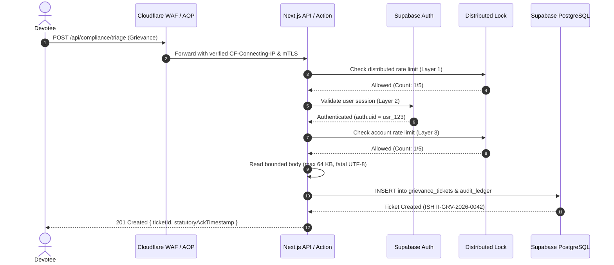

# ISHTI Milestone M06 — Architecture & Implementation Plan

**Document Reference:** `docs/M06_ARCHITECTURE_AND_IMPLEMENTATION_PLAN.md`  
**Milestone:** M06 — Backend Persistence, Distributed Invariants & Production Infrastructure  
**Repository:** `https://github.com/Sunder-Chauhan/Ishti-OS`  
**Target Branch:** `feature/m06-backend-persistence` (to be branched from `feature/m05-trust-governance`)  
**Base Commit:** `0c355bc`  
**Date:** 19 November 2026  
**Architectural Lead:** Principal Software Architect & Application Security Lead  

---

## 1. Mission Statement & Scope

Milestone M06 transitions the ISHTI platform from local-memory prototypes, client-side simulations, and heuristic calculations into a **production-grade, distributed, verifiable backend persistence engine**.

While Milestone M05 established statutory alignment, defensible policies, and robust ingress defense, M06 implements the underlying persistent data structures, distributed concurrency locks, cryptographic shredding mechanisms, and resilient operational infrastructure required to safely serve live devotees, pandits, and administrators.

### Core Architectural Invariants
1. **Zero Unauthenticated Mutation:** Every database mutation must be bound to a cryptographically validated session (`auth.uid()`) or executed by isolated, non-client-facing background workers using `service_role`.
2. **Deterministic Concurrency & No Double-Spend:** Financial refunds, booking slot assignments, and rate-limit counters must use atomic database transactions or advisory locks. Race conditions must be impossible by design.
3. **Immutable Audit Trails:** Audit events and compliance records are append-only. Platform administrators, database superusers, and application bugs cannot silently alter historical logs without breaking cryptographic hash chains.
4. **Verifiable Data Minimization & Cryptographic Erasure:** When a devotee invokes statutory data erasure (DPDP Act §12(3) / GDPR Art 17), personal data must be permanently erased and envelope encryption keys must be cryptographically shredded.
5. **Fail-Closed on Trust Ambiguity:** If reverse proxy provenance cannot be verified, or if rate-limit storage is unreachable, the system must fail-closed on sensitive mutation endpoints to prevent unmetered exploitation.

---

## 2. Target System Architecture (Modular Monolith)

ISHTI maintains a clean **Modular Monolith** architecture within the Next.js 15 App Router, backed by PostgreSQL 18 (via Supabase), distributed memory caching, and edge network shielding.

```mermaid
flowchart TD
    subgraph Edge Layer [Cloudflare Ingress & CDN]
        CF["Cloudflare Edge\n(DDoS, WAF, Bot Management)"]
        AOP["Authenticated Origin Pulls (mTLS)"]
    end

    subgraph App Layer [Next.js 15 App Router]
        Ingress["Session & Ingress Verifier\n(Layer 1 Network Rate Limit)"]
        Auth["Auth & Session Boundary\n(@supabase/ssr auth.getUser())"]
        Router["App Router\n(Server Actions & Route Handlers)"]
        
        subgraph Domain Engines [Isolated Domain Modules]
            M1["Rate Limiter Engine\n(Distributed Sliding Window)"]
            M2["Consent & Privacy Engine\n(Crypto Shredding & SAR)"]
            M3["Grievance Redressal Engine\n(IT Rules SLA Tracker)"]
            M4["Financial & Tax Engine\n(TCS/TDS Minor-Unit Ledger)"]
            M5["Scripture Catalog Engine\n(pgvector & Full-Text Search)"]
        end
    end

    subgraph Distributed State [Distributed Storage & Queue]
        Redis["Distributed Cache / Lock\n(Upstash Redis or Valkey)"]
        Queue["Background Job Queue\n(PgBoss / BullMQ)"]
    end

    subgraph Persistence Layer [Supabase PostgreSQL 18]
        DB[("PostgreSQL 18 Database")]
        RLS["Row Level Security (RLS)\n& SECURITY DEFINER Functions"]
        AuditLog[("Append-Only Audit Ledger\n(Cryptographic SHA-256 Chains)")]
        Pgcrypto["pgcrypto & Envelope Keys"]
    end

    subgraph Remote WORM [Immutable Compliance Storage]
        WORM["AWS S3 Object Lock / Cloudflare R2\n(WORM Retention 7 Years)"]
    end

    CF --> AOP --> Ingress --> Auth --> Router
    Router --> Domain Engines
    Domain Engines --> Redis
    Domain Engines --> Queue
    Domain Engines --> RLS --> DB
    DB --> AuditLog
    AuditLog -.->|Daily Cryptographic Digest| WORM
```

---

## 3. Detailed Workstream Specifications

### Workstream M06.1: Distributed Rate Limiting & Abuse Prevention
- **Objective:** Replace process-local `BoundedRateLimiter` with an atomic, distributed sliding-window counter synchronized across all Next.js server instances.
- **Components:**
  - `apps/web/lib/security/distributed-rate-limiter.ts`: High-performance rate limiting using atomic Redis EVAL scripts (or PostgreSQL advisory transaction locks if running database-native).
  - Multi-tier quotas:
    * Anonymous Ingress: 60 req/min per verified network IP.
    * Authenticated Devotee: 300 req/min per account ID (`auth.uid()`).
    * Sensitive Endpoints (Auth OTP, Checkout, Grievance, Deletion): 5 req/min per account/IP.
  - Fail-safe fallback: If distributed cache becomes unreachable, fallback dynamically to local `BoundedRateLimiter` (with safe saturation quota preservation) while emitting P1 alerts.
  - Ingress verification: Hardened integration with Cloudflare Authenticated Origin Pulls (AOP) to guarantee `CF-Connecting-IP` authenticity.

### Workstream M06.2: Durable Consent & Subject Rights Engine
- **Objective:** Transition browser-local consent and simulated deletion into a legally defensible server-side privacy engine.
- **Components:**
  - `apps/web/lib/compliance/durable-consent-service.ts`: Server-authoritative recording of consent decisions linked to `auth.users.id`.
  - Database schema: `public.user_consents` and `public.consent_audit_history`.
  - Consent withdrawal: Under DPDP Act §6(4), devotees can withdraw non-essential consent at any time; triggers immediate downstream suppression of analytics, marketing, and third-party sync.
  - Cryptographic Deletion Worker:
    * Asynchronous job triggered upon confirmed deletion request.
    * Executes **cryptographic shredding**: purges user-specific DEKs (Data Encryption Keys) from `kundli_encryption_keys` table, rendering existing encrypted astrological birth data mathematically irrecoverable.
    * Executes cascading deletion of personal profiles, communication history, and device tokens.
    * Preserves financial transaction logs with anonymized pointers to satisfy Income-tax Act §62 / Rule 46 7-year statutory retention without violating data minimization.
  - Subject Access Request (SAR) Packager: Assembles all user data into an AES-256 encrypted archive, accessible only via a time-limited, signed Supabase Storage URL.

### Workstream M06.3: Tamper-Resistant Audit Trail & WORM Storage
- **Objective:** Create an immutable, cryptographically verifiable audit trail proving regulatory compliance to external adjudicators.
- **Components:**
  - `apps/web/lib/compliance/tamper-resistant-audit.ts`: SHA-256 Merkle/hash-chained ledger persisted in `public.audit_ledger`.
  - Database triggers: Enforce absolute append-only rules. `UPDATE` and `DELETE` operations on `public.audit_ledger` throw database exceptions even for superusers (`prevent_audit_log_tampering`).
  - Daily Compliance Manifest Worker:
    * Runs at 00:00 UTC via scheduled worker.
    * Computes root hash of the day's audit entries.
    * Signs hash with platform Ed25519 compliance key.
    * Ships signed audit snapshot to an external S3/R2 bucket with **Object Lock (Compliance Mode)** enabled for 7 years.

### Workstream M06.4: Production Grievance Redressal System
- **Objective:** Replace in-memory grievance tickets with a durable ticketing system enforcing IT Rules statutory timelines.
- **Components:**
  - Database schema: `public.grievance_tickets` and `public.grievance_events`.
  - Statutory SLA Monitor:
    * **24-Hour Acknowledgement:** Automatically dispatches email and SMS acknowledgement containing unique ticket ID (`ISHTI-GRV-YYYY-XXXX`) within minutes of submission (IT Rules Rule 3(2)(a)(i)).
    * **7-Day Disposal Clock:** Real-time SLA tracker alerting compliance officers at 48h, 96h, and 120h to guarantee resolution within 7 days.
    * **Emergency 24-Hour Expedited Queue:** Content flagged for non-consensual imagery or impersonation triggers immediate P0 alert for 24h removal under Rule 3(2)(b).
  - Triage Portal API: Authenticated admin endpoints allowing designated Grievance Officers to review evidence, log investigation notes, and communicate resolutions.

### Workstream M06.5: Financial Ledger, Invoicing & Tax Engine
- **Objective:** Production-grade commerce engine with double-entry accounting integrity, tax compliance, and atomic refunds.
- **Components:**
  - Database schema: `public.financial_transactions`, `public.invoices`, and `public.refund_records`.
  - Atomic Minor-Unit Arithmetic: Minor-unit (paise) integer calculations preventing floating-point rounding errors.
  - Statutory Withholding Automation:
    * Marketplace Pandit Consultations: Deducts 0.5% GST TCS under CGST Act §52; applies 0.1% TDS under Section 194-O (or Income-tax Act, 2025 Section 393(1) Serial 8(v)) for pandits exceeding the ₹5,00,000 threshold.
    * Platform Subscriptions: Issues GST-compliant tax invoices with SAC Code 998439 (Online Information and Database Access/Retrieval) or SAC 999799, reflecting 18% forward-charge GST.
  - Razorpay Webhook Idempotency: Webhook events stored in `public.payment_webhook_events` with unique event ID constraint; signature verified using HMAC-SHA-256 before processing.
  - Atomic Cancellation & Refund Worker:
    * Calculates cancellation fee based on booking timestamp.
    * Initiates partial or full refund via payment gateway API.
    * Commits refund record inside a database transaction, releasing the pandit's calendar slot for re-booking.

### Workstream M06.6: Scripture Catalog Persistence & Search Engine
- **Objective:** Durable repository for sacred Vedic texts, mantras, and translations with scholar review workflows and vector embeddings.
- **Components:**
  - Schema: `public.scripture_catalog`, `public.canonical_verses`, and `public.verse_translations`.
  - Row Level Security: Uncurated or unverified verses are strictly hidden from public queries; only accredited scholars (`is_scholar()`) and admins (`is_admin()`) can curate or annotate texts.
  - Semantic Search: Hybrid search combining PostgreSQL full-text search (`tsvector` with Sanskrit/Hindi analyzers) and `pgvector` embeddings generated from verified translations.
  - Rights & Attribution Tracking: Explicit metadata fields for license type, translator attribution, and provenance documentation.

### Workstream M06.7: Operational Hardening, Observability & Admin Console
- **Objective:** Production infrastructure shielding, secret rotation, and operational telemetry.
- **Components:**
  - Cloudflare Authenticated Origin Pulls (AOP): NGINX/ALB ingress configured with Cloudflare CA certificate to block direct IP traffic.
  - OpenTelemetry & Structured Logging: PII-masked JSON logging with trace context propagation across server actions and background queues.
  - Prometheus/Grafana Dashboards: Real-time tracking of rate-limit rejections, grievance SLA countdowns, payment webhook failures, and database lock contention.
  - Role-Based Admin Portal: Protected back-office interface for Compliance Officers, Grievance Officers, and Support Engineers.

---

## 4. System Interfaces & API Specifications



### Core API Endpoints Specification

1. **`POST /api/compliance/consent`**
   - *Auth:* Required (`Bearer <token>` or session cookie).
   - *Payload:* `{ consents: { purpose_analytics: boolean, purpose_marketing: boolean, ... }, policyVersion: string }`
   - *Response:* `200 OK { success: true, recordedAt: string, consentHash: string }`
   - *Error:* `400 BAD_REQUEST`, `429 TOO_MANY_REQUESTS`.

2. **`POST /api/compliance/privacy-request`**
   - *Auth:* Required.
   - *Payload:* `{ requestType: "ERASURE" | "SAR_EXPORT" | "RECTIFICATION", justification?: string }`
   - *Response:* `202 Accepted { requestId: string, estimatedCompletion: string }`
   - *Behavior:* Enqueues async job for cryptographic shredding or data export archive generation.

3. **`POST /api/compliance/triage`**
   - *Auth:* Optional for external complainants; recommended for authenticated users.
   - *Payload:* `{ category: string, description: string, evidenceUrls?: string[], complainantEmail: string }`
   - *Response:* `201 Created { ticketId: string, ackDeadline: string, disposalDeadline: string }`
   - *Behavior:* Persists to `grievance_tickets`, dispatches 24h statutory acknowledgement, triggers SLA monitor.

4. **`POST /api/commerce/refund`**
   - *Auth:* Admin or Devotee with active booking.
   - *Payload:* `{ bookingId: string, reason: string }`
   - *Response:* `200 OK { refundId: string, amountPaise: number, penaltyPaise: number, status: string }`
   - *Behavior:* Acquires transaction advisory lock, executes minor-unit refund calculation, calls Razorpay refund API, releases booking slot.

---

## 5. Phased Execution Roadmap for M06

| Phase | Scope & Deliverables | Dependencies |
| :--- | :--- | :--- |
| **Phase 1: Persistence Foundation** | Supabase migration authoring: `user_consents`, `audit_ledger`, `grievance_tickets`, `financial_transactions`. RLS policies and trigger functions. | M05 baseline accepted |
| **Phase 2: Distributed Concurrency** | Integration of Upstash Redis (or PostgreSQL advisory locking fallback) for distributed sliding-window rate limiting. | Phase 1 schema |
| **Phase 3: Privacy & Erasure Engine** | Asynchronous cryptographic shredding worker, SAR archive generator, durable consent withdrawal workflows. | Phase 1 & 2 |
| **Phase 4: Commerce & Grievance Systems**| IT Rules SLA tracking daemon, Razorpay webhook idempotency handler, double-entry financial ledger and refund worker. | Phase 1 & 3 |
| **Phase 5: Operational Hardening** | Cloudflare Authenticated Origin Pulls (AOP), OpenTelemetry integration, end-to-end concurrency and penetration testing. | Phase 1–4 |
