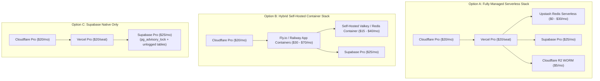

# ISHTI Milestone M06 — Infrastructure Options & Cost Projections

**Document Reference:** `docs/M06_COST_AND_INFRASTRUCTURE_OPTIONS.md`  
**Milestone:** M06 — Backend Persistence, Distributed Invariants & Production Infrastructure  
**Repository:** `https://github.com/Sunder-Chauhan/Ishti-OS`  
**Date:** 19 November 2026  
**Auditor Roles:** Principal Infrastructure Architect, Technical Operations Lead  

---

## 1. Executive Summary & Infrastructure Goals

Milestone M06 requires distributed state synchronization (for rate limiting, atomic concurrency locking, and job scheduling) and reliable cloud persistence. 

This document evaluates three architectural options for ISHTI's production infrastructure, models cost projections across three growth tiers, and provides a definitive recommendation balancing operational overhead, reliability, and security.

---

## 2. Infrastructure Architecture Options

### Option A: Fully Managed Serverless Stack (Recommended)
- **Components:** Cloudflare Pro + Vercel Pro + Upstash Redis (Serverless) + Supabase Pro + Cloudflare R2 (WORM storage).
- **Pros:**
  * Zero server maintenance; automated global failover.
  * Upstash Redis provides per-request pricing with sub-millisecond REST/TLS interfaces perfectly suited for Next.js serverless/edge runtimes.
  * Strict origin shielding via Cloudflare Authenticated Origin Pulls (AOP).
- **Cons:**
  * Slight vendor fragmentation across Cloudflare, Upstash, and Supabase.

### Option B: Hybrid Containerized Stack (Valkey on Fly.io / Railway)
- **Components:** Cloudflare Pro + Fly.io / Railway Docker Containers + Dedicated Valkey (Open-Source Redis fork) instance + Supabase Pro.
- **Pros:**
  * Open-source control over Valkey instance; predictable compute pricing at high throughput.
  * Long-running persistent WebSockets for live video consultations.
- **Cons:**
  * Requires operational maintenance of Linux containers, OS patching, and Redis backup policies.
  * Higher baseline cost during low-traffic periods.

### Option C: Supabase Native Only (PostgreSQL Advisory Locks)
- **Components:** Cloudflare Pro + Vercel Pro + Supabase Pro (utilizing `pg_advisory_xact_lock` and unlogged sliding-window tables for rate limiting).
- **Pros:**
  * Single database backend; zero external Redis dependency.
  * ACID transactions guarantee atomic limits without distributed consensus latency.
- **Cons:**
  * High-frequency rate-limiting queries generate write amplification and connection pool contention on Supabase PostgreSQL.
  * Vulnerable to connection starvation under DDoS attacks.

---

## 3. Comprehensive Cost Projections Across Growth Tiers

All monetary estimates are in USD ($), with Indian Rupee (₹) equivalents calculated at ₹88.00 / USD.

| Infrastructure Component | Tier 1: Pre-Launch / Beta (<1,000 MAU) | Tier 2: Early Growth (10,000 – 50,000 MAU) | Tier 3: Scale (100,000+ MAU) |
| :--- | :--- | :--- | :--- |
| **Cloudflare Edge (WAF, DDoS, AOP, CDN)** | $20.00 / mo (Pro Tier) | $20.00 / mo (Pro Tier) | $200.00 / mo (Business Tier + Bot Mgmt) |
| **Application Hosting (Vercel)** | $20.00 / mo (1 Pro Seat) | $40.00 / mo (2 Pro Seats + bandwidth) | $150.00 / mo (Enterprise compute pool) |
| **Database & Auth (Supabase)** | $25.00 / mo (Pro Tier) | $50.00 / mo (Pro Tier + Compute add-on) | $200.00 / mo (Pro Tier 4XL + Point-in-time) |
| **Distributed Cache / Rate Limiter** | | | |
| • *Option A (Upstash Redis Serverless)* | $0.00 (Free Tier: 10k req/day) | $15.00 / mo (Pay-as-you-go) | $80.00 / mo (Dedicated cluster) |
| • *Option B (Fly.io Valkey Container)* | $15.00 / mo | $35.00 / mo | $80.00 / mo |
| • *Option C (Supabase Native)* | $0.00 | $25.00 / mo (Larger pooler) | $100.00 / mo (Dedicated read replica) |
| **WORM Audit Storage (Cloudflare R2)** | $5.00 / mo (Object Lock) | $10.00 / mo | $30.00 / mo |
| **Transactional Email / SMS (Resend / MSG91)** | $10.00 / mo (Verification OTPs) | $50.00 / mo | $250.00 / mo |
| **Total Estimated Monthly Cost (Option A)** | **$80.00 / mo (~₹7,040)** | **$185.00 / mo (~₹16,280)** | **$910.00 / mo (~₹80,080)** |

---

## 4. Evaluation & Trade-off Matrix

| Criterion | Weight | Option A: Serverless Stack (Upstash + Supabase) | Option B: Hybrid Containers (Valkey + Fly) | Option C: Supabase Native (PostgreSQL Only) |
| :--- | :---: | :---: | :---: | :---: |
| **Operational Overhead** | 30% | **9 / 10** (Zero OS patching, managed SLA) | 5 / 10 (Requires container monitoring) | 8 / 10 (Single DB, but pool tuning needed) |
| **Security & Origin Shielding** | 25% | **10 / 10** (Cloudflare AOP + mTLS) | 8 / 10 (VPC firewall configuration) | 8 / 10 (Cloudflare to Vercel/Supabase) |
| **Performance & Latency (p99)** | 20% | **9 / 10** (<5ms Redis sliding window) | 8 / 10 (<8ms over internal network) | 6 / 10 (15-30ms DB transaction overhead) |
| **Cost Efficiency at Early Scale** | 15% | **9 / 10** (Pay only for active requests) | 6 / 10 (Fixed container charges) | **10 / 10** (Zero extra services) |
| **Disaster Recovery & Reliability** | 10% | **9 / 10** (Automated cross-zone replication) | 6 / 10 (Requires manual snapshot backups) | 8 / 10 (Supabase PITR backups) |
| **Weighted Total Score** | **100%** | **9.25 / 10 (WINNER)** | **6.75 / 10** | **7.85 / 10** |

---

## 5. Architectural Recommendation & Deployment Decision

### Recommendation: Adopt Option A (Managed Serverless Stack)
1. **Primary Choice:** **Option A** is the recommended architecture for Milestone M06 and launch. Pairing **Upstash Redis Serverless** with **Supabase Pro** delivers sub-millisecond distributed rate limiting, instantaneous sliding-window sweeps, and zero server maintenance overhead.
2. **Transition Strategy:**
   - In **Phase 1 of M06**, implement the distributed rate limiter using the Upstash Redis SDK (`@upstash/ratelimit`).
   - If Upstash is temporarily unavailable in local test environments, maintain an automated fallback to the database-native PostgreSQL advisory lock limiter developed in M02 (`public.check_rate_limit()`).
   - This ensures that local developer environments and CI test pipelines can execute without requiring live external cloud credentials, while production receives enterprise-grade distributed protection.
