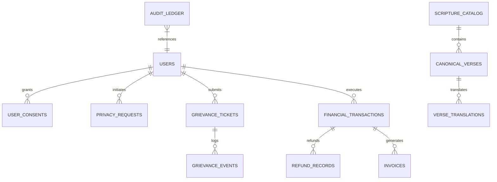

# ISHTI Milestone M06 — Database & Migration Plan

**Document Reference:** `docs/M06_DATABASE_AND_MIGRATION_PLAN.md`  
**Milestone:** M06 — Backend Persistence, Distributed Invariants & Production Infrastructure  
**Repository:** `https://github.com/Sunder-Chauhan/Ishti-OS`  
**Target Migration Directory:** `supabase/migrations/`  
**Date:** 19 November 2026  
**Lead Authors:** Database Architect, Application Security Engineer  

---

## 1. Scope & Database Architecture Overview

Milestone M06 introduces persistent, audited, and encrypted database entities into PostgreSQL 18 (hosted on Supabase).

All tables enforce **100% Row Level Security (RLS)**, search_path-hardened `SECURITY DEFINER` helper functions, immutable cryptographic triggers, and minor-unit financial types. 

### Database Safety Non-Negotiables
1. **Zero Destructive Operations:** No `DROP TABLE`, `DROP COLUMN`, or `TRUNCATE` operations on existing M02/M03 tables.
2. **Strict RLS By Default:** Every newly created table must execute `ALTER TABLE <name> ENABLE ROW LEVEL SECURITY;` immediately following table creation.
3. **Append-Only Immutability:** Audit trails and grievance history tables have database triggers that strictly block `UPDATE` and `DELETE` commands.
4. **Isolated Migration Steps:** DDL operations are broken into atomic, idempotent migration files with corresponding verified rollback scripts.

---

## 2. Target Schema Definitions



### 2.1. Consent & Preference Management

```sql
-- Table: public.user_consents
CREATE TABLE public.user_consents (
    id UUID PRIMARY KEY DEFAULT gen_random_uuid(),
    user_id UUID NOT NULL REFERENCES auth.users(id) ON DELETE CASCADE,
    purpose_analytics BOOLEAN NOT NULL DEFAULT false,
    purpose_marketing BOOLEAN NOT NULL DEFAULT false,
    purpose_third_party_sync BOOLEAN NOT NULL DEFAULT false,
    purpose_spiritual_profiling BOOLEAN NOT NULL DEFAULT true,
    policy_version TEXT NOT NULL,
    consent_hash TEXT NOT NULL, -- SHA-256(user_id || purposes || policy_version || captured_at)
    captured_at TIMESTAMPTZ NOT NULL DEFAULT now(),
    ip_hash TEXT NOT NULL,
    user_agent_hash TEXT NOT NULL,
    updated_at TIMESTAMPTZ NOT NULL DEFAULT now(),
    CONSTRAINT uq_user_consent_user UNIQUE (user_id)
);

-- Table: public.consent_audit_history (Append-Only)
CREATE TABLE public.consent_audit_history (
    id UUID PRIMARY KEY DEFAULT gen_random_uuid(),
    consent_id UUID NOT NULL REFERENCES public.user_consents(id) ON DELETE CASCADE,
    user_id UUID NOT NULL REFERENCES auth.users(id) ON DELETE CASCADE,
    action TEXT NOT NULL CHECK (action IN ('GRANTED', 'WITHDRAWN', 'UPDATED')),
    previous_state JSONB,
    new_state JSONB NOT NULL,
    consent_hash TEXT NOT NULL,
    recorded_at TIMESTAMPTZ NOT NULL DEFAULT now()
);
```

### 2.2. Privacy Rights & Erasure Engine

```sql
-- Table: public.privacy_requests
CREATE TABLE public.privacy_requests (
    id UUID PRIMARY KEY DEFAULT gen_random_uuid(),
    user_id UUID NOT NULL REFERENCES auth.users(id) ON DELETE CASCADE,
    request_type TEXT NOT NULL CHECK (request_type IN ('ERASURE', 'SAR_EXPORT', 'RECTIFICATION')),
    status TEXT NOT NULL DEFAULT 'PENDING' CHECK (status IN ('PENDING', 'PROCESSING', 'COMPLETED', 'REJECTED')),
    verification_token TEXT NOT NULL,
    verification_confirmed BOOLEAN NOT NULL DEFAULT false,
    export_archive_url TEXT,
    export_expires_at TIMESTAMPTZ,
    shredded_at TIMESTAMPTZ,
    rejection_reason TEXT,
    created_at TIMESTAMPTZ NOT NULL DEFAULT now(),
    completed_at TIMESTAMPTZ
);
```

### 2.3. Tamper-Resistant Audit Ledger

```sql
-- Table: public.audit_ledger (Append-Only with Cryptographic Chaining)
CREATE TABLE public.audit_ledger (
    sequence_id BIGSERIAL PRIMARY KEY,
    event_id UUID NOT NULL UNIQUE DEFAULT gen_random_uuid(),
    event_timestamp TIMESTAMPTZ NOT NULL DEFAULT now(),
    actor_id UUID REFERENCES auth.users(id),
    actor_role TEXT NOT NULL DEFAULT 'anonymous',
    action_type TEXT NOT NULL,
    resource_type TEXT NOT NULL,
    resource_id TEXT,
    payload_hash TEXT NOT NULL, -- SHA-256(payload_json)
    previous_record_hash TEXT NOT NULL, -- Cryptographic hash of previous sequence_id
    record_hash TEXT NOT NULL -- SHA-256(sequence_id || timestamp || action || payload_hash || previous_record_hash)
);

-- Database Trigger: Enforce Immutability on Audit Ledger
CREATE OR REPLACE FUNCTION public.prevent_audit_ledger_mutation()
RETURNS TRIGGER AS $$
BEGIN
    RAISE EXCEPTION 'CRITICAL SECURITY VIOLATION: public.audit_ledger is strictly append-only. UPDATE and DELETE are prohibited.'
    USING ERRCODE = '42501';
END;
$$ LANGUAGE plpgsql SECURITY DEFINER SET search_path = public, pg_temp;

CREATE TRIGGER trg_audit_ledger_immutable
BEFORE UPDATE OR DELETE ON public.audit_ledger
FOR EACH ROW EXECUTE FUNCTION public.prevent_audit_ledger_mutation();
```

### 2.4. Grievance Redressal System

```sql
-- Table: public.grievance_tickets
CREATE TABLE public.grievance_tickets (
    id UUID PRIMARY KEY DEFAULT gen_random_uuid(),
    ticket_reference TEXT NOT NULL UNIQUE, -- 'ISHTI-GRV-YYYY-XXXX'
    complainant_user_id UUID REFERENCES auth.users(id),
    complainant_email TEXT NOT NULL,
    complainant_phone TEXT,
    category TEXT NOT NULL CHECK (category IN ('CONTENT', 'PRIVACY', 'FRAUD', 'PANDIT_CONDUCT', 'ACCESS_ISSUE', 'OTHER')),
    priority TEXT NOT NULL DEFAULT 'STANDARD' CHECK (priority IN ('STANDARD', 'EXPEDITED_SEXUAL_CONTENT', 'CRITICAL_LEGAL')),
    status TEXT NOT NULL DEFAULT 'SUBMITTED' CHECK (status IN ('SUBMITTED', 'ACKNOWLEDGED', 'UNDER_INVESTIGATION', 'RESOLVED', 'REJECTED')),
    description TEXT NOT NULL,
    evidence_urls TEXT[],
    assigned_officer_id UUID REFERENCES auth.users(id),
    submitted_at TIMESTAMPTZ NOT NULL DEFAULT now(),
    ack_deadline TIMESTAMPTZ NOT NULL, -- submitted_at + 24 hours (IT Rules Rule 3(2))
    acknowledged_at TIMESTAMPTZ,
    disposal_deadline TIMESTAMPTZ NOT NULL, -- submitted_at + 7 days (Feb 2026 Amendment)
    resolved_at TIMESTAMPTZ,
    resolution_summary TEXT
);

-- Table: public.grievance_events (Append-Only Event Sourcing)
CREATE TABLE public.grievance_events (
    id UUID PRIMARY KEY DEFAULT gen_random_uuid(),
    ticket_id UUID NOT NULL REFERENCES public.grievance_tickets(id) ON DELETE CASCADE,
    actor_id UUID REFERENCES auth.users(id),
    event_type TEXT NOT NULL CHECK (event_type IN ('ACKNOWLEDGED', 'INTERNAL_NOTE', 'STATUS_CHANGE', 'COMMUNICATION_SENT', 'RESOLVED')),
    event_details JSONB NOT NULL,
    created_at TIMESTAMPTZ NOT NULL DEFAULT now()
);
```

### 2.5. Financial Ledger & Invoicing

```sql
-- Table: public.financial_transactions (Minor-Unit Integer Arithmetic)
CREATE TABLE public.financial_transactions (
    id UUID PRIMARY KEY DEFAULT gen_random_uuid(),
    transaction_reference TEXT NOT NULL UNIQUE,
    user_id UUID NOT NULL REFERENCES auth.users(id),
    gateway_payment_id TEXT UNIQUE,
    gateway_order_id TEXT,
    booking_id UUID REFERENCES public.bookings(id),
    model_type TEXT NOT NULL CHECK (model_type IN ('PRINCIPAL_SUPPLIER', 'MARKETPLACE_ECO')),
    gross_amount_paise BIGINT NOT NULL CHECK (gross_amount_paise >= 0),
    gst_rate_basis_points INTEGER NOT NULL DEFAULT 1800, -- 18.00%
    gst_amount_paise BIGINT NOT NULL CHECK (gst_amount_paise >= 0),
    tcs_rate_basis_points INTEGER DEFAULT 50, -- 0.50% (CGST §52)
    tcs_amount_paise BIGINT DEFAULT 0 CHECK (tcs_amount_paise >= 0),
    tds_rate_basis_points INTEGER DEFAULT 10, -- 0.10% (IT Act §194-O / 2025 Act §393)
    tds_amount_paise BIGINT DEFAULT 0 CHECK (tds_amount_paise >= 0),
    net_pandit_payout_paise BIGINT CHECK (net_pandit_payout_paise >= 0),
    currency TEXT NOT NULL DEFAULT 'INR',
    status TEXT NOT NULL DEFAULT 'INITIATED' CHECK (status IN ('INITIATED', 'AUTHORIZED', 'CAPTURED', 'FAILED', 'REFUNDED', 'PARTIALLY_REFUNDED')),
    created_at TIMESTAMPTZ NOT NULL DEFAULT now(),
    completed_at TIMESTAMPTZ
);

-- Table: public.refund_records
CREATE TABLE public.refund_records (
    id UUID PRIMARY KEY DEFAULT gen_random_uuid(),
    transaction_id UUID NOT NULL REFERENCES public.financial_transactions(id),
    gateway_refund_id TEXT UNIQUE,
    refund_amount_paise BIGINT NOT NULL CHECK (refund_amount_paise > 0),
    cancellation_fee_paise BIGINT NOT NULL DEFAULT 0 CHECK (cancellation_fee_paise >= 0),
    cancellation_tier TEXT NOT NULL CHECK (cancellation_tier IN ('FULL_REFUND_GT_24H', 'PARTIAL_REFUND_12_24H', 'NO_REFUND_LT_4H', 'ADMIN_EXCEPTIONAL')),
    reason TEXT NOT NULL,
    status TEXT NOT NULL DEFAULT 'PENDING' CHECK (status IN ('PENDING', 'PROCESSED', 'FAILED')),
    initiated_by UUID NOT NULL REFERENCES auth.users(id),
    created_at TIMESTAMPTZ NOT NULL DEFAULT now(),
    processed_at TIMESTAMPTZ
);
```

---

## 3. Row Level Security (RLS) Policy Specifications

### 3.1. Policy Matrix

| Table | Target Role | Action | Policy Condition (`USING` / `WITH CHECK`) | Justification |
| :--- | :--- | :--- | :--- | :--- |
| `user_consents` | `authenticated` | SELECT | `auth.uid() = user_id` | Devotees can view their own consent state. |
| `user_consents` | `authenticated` | UPDATE / INSERT | `auth.uid() = user_id` | Devotees can update their own consent preferences. |
| `privacy_requests` | `authenticated` | SELECT | `auth.uid() = user_id OR public.is_admin()` | Devotees view their own requests; admins audit. |
| `privacy_requests` | `authenticated` | INSERT | `auth.uid() = user_id` | Devotees can initiate erasure or SAR requests. |
| `audit_ledger` | `authenticated` | SELECT | `public.is_admin()` | Only authorized compliance administrators can query audit logs. |
| `audit_ledger` | `service_role` | INSERT | `true` | System services record immutable audit entries. |
| `grievance_tickets` | `authenticated` | SELECT | `auth.uid() = complainant_user_id OR public.is_grievance_officer()` | Complainants view their tickets; officers manage queue. |
| `financial_transactions` | `authenticated` | SELECT | `auth.uid() = user_id OR public.is_admin()` | Devotees view receipts; finance admins audit ledger. |

### 3.2. Administrative Security Helper Functions

```sql
-- Grievance Officer Checker Function
CREATE OR REPLACE FUNCTION public.is_grievance_officer()
RETURNS BOOLEAN AS $$
BEGIN
    RETURN EXISTS (
        SELECT 1 FROM public.profiles
        WHERE id = auth.uid() AND role IN ('admin', 'grievance_officer')
    );
END;
$$ LANGUAGE plpgsql SECURITY DEFINER SET search_path = public, pg_temp;

REVOKE EXECUTE ON FUNCTION public.is_grievance_officer() FROM PUBLIC;
GRANT EXECUTE ON FUNCTION public.is_grievance_officer() TO authenticated;
```

---

## 4. Indexing & Performance Strategy

1. **Audit Ledger Scalability (BRIN vs B-Tree):**
   - Because `audit_ledger` is strictly append-only with monotonically increasing timestamps, create a **BRIN (Block Range Index)** on `event_timestamp` (`CREATE INDEX idx_audit_ledger_timestamp_brin ON public.audit_ledger USING BRIN (event_timestamp);`).
   - Requires 95% less disk space than B-Tree and accelerates range queries over millions of historical events.
2. **Partial Unique Indexes for Concurrency:**
   - Active booking slots: `CREATE UNIQUE INDEX idx_unique_active_slot ON public.bookings (slot_id) WHERE status NOT IN ('cancelled', 'refunded');`
   - Active pending privacy requests: `CREATE UNIQUE INDEX idx_unique_pending_erasure ON public.privacy_requests (user_id) WHERE request_type = 'ERASURE' AND status IN ('PENDING', 'PROCESSING');`
3. **Foreign Key Performance:**
   - Explicit B-Tree indexes created on all relational foreign keys (`user_consents(user_id)`, `grievance_tickets(complainant_user_id)`, `financial_transactions(booking_id)`).

---

## 5. Zero-Downtime Migration Sequence & Rollback Plan

### Phased Migration Sequence (Executed only in M06)
1. **Migration `20261120000000_m06_enums_and_types.sql`:** Add new enumerated types and domains.
2. **Migration `20261120000001_m06_consent_and_privacy.sql`:** Create `user_consents`, `consent_audit_history`, `privacy_requests` with RLS.
3. **Migration `20261120000002_m06_immutable_audit.sql`:** Create `audit_ledger`, triggers, and BRIN indexes.
4. **Migration `20261120000003_m06_grievance_redressal.sql`:** Create `grievance_tickets` and `grievance_events`.
5. **Migration `20261120000004_m06_financial_ledger.sql`:** Create `financial_transactions` and `refund_records`.

### Rollback DDL Architecture
Every migration file will be paired with an exact reverse script (`down/`) that tears down newly created objects in reverse dependency order without dropping pre-existing M02 tables:
```sql
-- Sample Down Migration: down_20261120000002_m06_immutable_audit.sql
DROP TRIGGER IF EXISTS trg_audit_ledger_immutable ON public.audit_ledger;
DROP FUNCTION IF EXISTS public.prevent_audit_ledger_mutation();
DROP TABLE IF EXISTS public.audit_ledger CASCADE;
```
