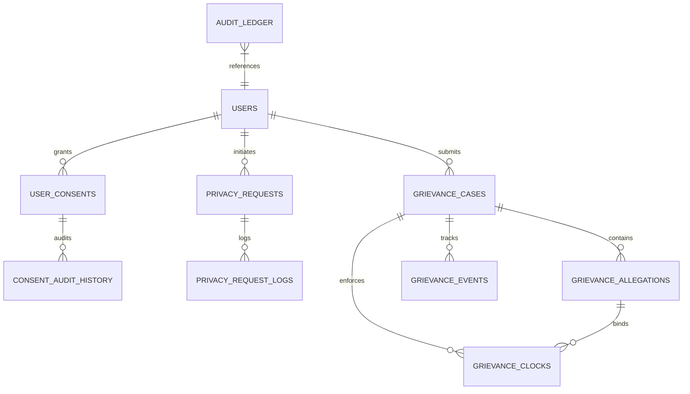

# ISHTI Milestone M06 — Database & Migration Plan (Revised)

**Document Reference:** `docs/M06_DATABASE_AND_MIGRATION_PLAN.md`  
**Milestone:** M06 — Core Backend Persistence, Distributed Invariants & Production Shielding  
**Repository:** `https://github.com/Sunder-Chauhan/Ishti-OS`  
**Target Migration Directory:** `supabase/migrations/`  
**Revision Date:** 19 November 2026  
**Lead Authors:** Database Architect, Application Security Engineer & Privacy Engineering Lead  

---

## 1. Scope Partitioning & Database Safety Principles

Milestone M06 introduces persistent, audited, and encrypted database entities into PostgreSQL 18 (hosted on Supabase).

### 1.1. Core M06 vs. Deferred Milestone Schemas (Correction 10)
In accordance with architectural review, database schemas are decoupled into focused milestones:
- **Core Milestone M06 Schemas (Persistence Baseline):**
  * Consent Management: `public.user_consents` and `public.consent_audit_history`.
  * Subject Rights & Erasure: `public.privacy_requests` and `public.privacy_request_logs`.
  * Tamper-Evident Audit: `public.audit_ledger` (with Merkle chaining and append-only trigger).
  * Grievance Redressal: `public.grievance_cases`, `public.grievance_allegations`, `public.grievance_clocks`, and `public.grievance_events`.
  * Distributed Lock Coordination: `public.rate_limit_coordination` (fallback unlogged lock table).
- **Milestone M07 Target Schemas (Deferred - Commerce & Tax):**
  * `public.financial_transactions`, `public.invoices`, `public.refund_records`, and `public.tax_configuration_rules`.
- **Milestone M08 Target Schemas (Deferred - Vedic Knowledge & AI):**
  * `public.scripture_catalog`, `public.canonical_verses`, `public.verse_translations`, and `pgvector` indexes.

### 1.2. Database Safety Invariants
1. **Zero Destructive Operations:** No `DROP TABLE`, `DROP COLUMN`, or `TRUNCATE` operations on existing M02/M03 tables.
2. **Strict RLS By Default:** Every newly created table must execute `ALTER TABLE <name> ENABLE ROW LEVEL SECURITY;` immediately following table creation.
3. **No Direct Anonymous Table Grants (Correction 4):** The PostgREST API `anon` role is granted **zero direct INSERT, UPDATE, or DELETE permissions**. Controlled anonymous intake executes exclusively through server-mediated RPC functions with strict parameter sanitization.
4. **Append-Only Immutability Defense-in-Depth (Correction 6):** Database triggers enforce append-only rules during normal operations (`prevent_audit_ledger_mutation`). Merkle hash chains and external WORM backups provide tamper-evidence against privileged database administrators.
5. **Nuanced Migration Rollback Architecture:** Forward DDL migrations are categorized by reversibility (reversible schema-only, data-preserving rollback, irreversible data transformation, destructive, backup restoration, forward-fix). Naive assumptions that every production change can be cleanly reversed with a down script are rejected; backup and restore verification is mandatory before any state-altering operations.

---

## 2. Core M06 Schema Definitions



### 2.1. Consent & Sovereign Preference Management (Workstream M06.2)

```sql
-- Table: public.user_consents
-- Purpose: Records active consent preferences per user under DPDP Act §6
CREATE TABLE public.user_consents (
    id UUID PRIMARY KEY DEFAULT gen_random_uuid(),
    user_id UUID NOT NULL REFERENCES auth.users(id) ON DELETE CASCADE,
    purpose_analytics BOOLEAN NOT NULL DEFAULT false,
    purpose_marketing BOOLEAN NOT NULL DEFAULT false,
    purpose_third_party_sync BOOLEAN NOT NULL DEFAULT false,
    purpose_spiritual_profiling BOOLEAN NOT NULL DEFAULT true,
    policy_version TEXT NOT NULL,
    consent_hash TEXT NOT NULL, -- SHA-256(user_id || purposes || policy_version || captured_at)
    captured_at TIMESTAMPTZ NOT NULL DEFAULT now(),
    ip_hash TEXT NOT NULL,
    user_agent_hash TEXT NOT NULL,
    updated_at TIMESTAMPTZ NOT NULL DEFAULT now(),
    CONSTRAINT uq_user_consent_user UNIQUE (user_id)
);

-- Table: public.consent_audit_history (Append-Only)
-- Purpose: Immutable history of consent grants, updates, and withdrawals under DPDP §6(4)
CREATE TABLE public.consent_audit_history (
    id UUID PRIMARY KEY DEFAULT gen_random_uuid(),
    consent_id UUID NOT NULL REFERENCES public.user_consents(id) ON DELETE CASCADE,
    user_id UUID NOT NULL REFERENCES auth.users(id) ON DELETE CASCADE,
    action TEXT NOT NULL CHECK (action IN ('GRANTED', 'WITHDRAWN', 'UPDATED')),
    previous_state JSONB,
    new_state JSONB NOT NULL,
    consent_hash TEXT NOT NULL,
    ip_hash TEXT NOT NULL,
    recorded_at TIMESTAMPTZ NOT NULL DEFAULT now()
);

CREATE INDEX idx_consent_audit_history_user ON public.consent_audit_history(user_id);
```

### 2.2. Subject Rights & Multi-Stage Erasure Engine (Workstream M06.3) (Correction 5)

```sql
-- Table: public.privacy_requests
-- Purpose: Tracks end-to-end multi-stage privacy workflows under DPDP Act §§11-13 & GDPR Art 17
CREATE TABLE public.privacy_requests (
    id UUID PRIMARY KEY DEFAULT gen_random_uuid(),
    user_id UUID NOT NULL REFERENCES auth.users(id) ON DELETE CASCADE,
    request_type TEXT NOT NULL CHECK (request_type IN ('ERASURE', 'SAR_EXPORT', 'RECTIFICATION')),
    status TEXT NOT NULL DEFAULT 'PENDING_VERIFICATION' CHECK (
        status IN (
            'PENDING_VERIFICATION',
            'VERIFIED',
            'RETENTION_EVALUATED',
            'PRIMARY_PURGED',
            'DEK_SHREDDED',
            'CACHES_PURGED',
            'VENDORS_NOTIFIED',
            'COMPLETED_WITH_EXCEPTIONS',
            'FULLY_COMPLETED',
            'REJECTED'
        )
    ),
    verification_token TEXT NOT NULL,
    verification_confirmed BOOLEAN NOT NULL DEFAULT false,
    verified_at TIMESTAMPTZ,
    
    -- Multi-Copy Tracking Fields
    primary_purged_at TIMESTAMPTZ,
    dek_shredded_at TIMESTAMPTZ,
    shredded_dek_fingerprint TEXT, -- Cryptographic proof that DEK was purged
    caches_purged_at TIMESTAMPTZ,
    vendors_notified_at TIMESTAMPTZ,
    
    -- Lawful Retention Documentation (Income-tax Act §62, IT Rules, etc.)
    retained_records_summary JSONB, -- Documents lawful retention exceptions
    backup_expiry_target_at TIMESTAMPTZ, -- Date when rolling database backups cycle out
    
    -- SAR Export Delivery
    export_archive_url TEXT,
    export_expires_at TIMESTAMPTZ,
    
    rejection_reason TEXT,
    created_at TIMESTAMPTZ NOT NULL DEFAULT now(),
    completed_at TIMESTAMPTZ
);

CREATE UNIQUE INDEX idx_unique_active_erasure 
ON public.privacy_requests (user_id) 
WHERE request_type = 'ERASURE' AND status NOT IN ('FULLY_COMPLETED', 'COMPLETED_WITH_EXCEPTIONS', 'REJECTED');
```

### 2.3. Tamper-Evident Audit Ledger (Workstream M06.4) (Correction 6)

```sql
-- Table: public.audit_ledger
-- Purpose: Cryptographically chained, append-only log of security and compliance events
CREATE TABLE public.audit_ledger (
    sequence_id BIGSERIAL PRIMARY KEY,
    event_id UUID NOT NULL UNIQUE DEFAULT gen_random_uuid(),
    event_timestamp TIMESTAMPTZ NOT NULL DEFAULT now(),
    actor_id UUID REFERENCES auth.users(id),
    actor_role TEXT NOT NULL DEFAULT 'anonymous', -- 'devotee', 'pandit', 'admin', 'anonymous_public'
    action_type TEXT NOT NULL, -- e.g. 'AUTH_LOGIN', 'CONSENT_UPDATE', 'GRIEVANCE_SUBMISSION'
    resource_type TEXT NOT NULL,
    resource_id TEXT,
    payload_hash TEXT NOT NULL, -- SHA-256(payload_json)
    previous_record_hash TEXT NOT NULL, -- Merkle chain link to preceding sequence_id
    record_hash TEXT NOT NULL -- SHA-256(sequence_id || timestamp || action || payload_hash || previous_record_hash)
);

-- BRIN Index for Append-Only Time-Series Performance
CREATE INDEX idx_audit_ledger_timestamp_brin ON public.audit_ledger USING BRIN (event_timestamp);

-- Database Trigger: Enforce Immutability during standard operations
CREATE OR REPLACE FUNCTION public.prevent_audit_ledger_mutation()
RETURNS TRIGGER AS $$
BEGIN
    RAISE EXCEPTION 'CRITICAL SECURITY VIOLATION: public.audit_ledger is append-only. UPDATE and DELETE are prohibited.'
    USING ERRCODE = '42501';
END;
$$ LANGUAGE plpgsql SECURITY DEFINER SET search_path = public, pg_temp;

CREATE TRIGGER trg_audit_ledger_immutable
BEFORE UPDATE OR DELETE ON public.audit_ledger
FOR EACH ROW EXECUTE FUNCTION public.prevent_audit_ledger_mutation();
```

### 2.4. Production Grievance Redressal, Multi-Allegation Intake & Typed Clocks (Workstream M06.5) (Corrections 2 & 4)

```sql
-- Table: public.grievance_cases
-- Purpose: Root parent submission for incoming complaints, preserving immutable receipt timestamps, intake hashes, and triage status
CREATE TABLE public.grievance_cases (
    id UUID PRIMARY KEY DEFAULT gen_random_uuid(),
    case_reference TEXT NOT NULL UNIQUE, -- 'ISHTI-CASE-YYYY-XXXX'
    received_at TIMESTAMPTZ NOT NULL DEFAULT now(), -- Immutable intake receipt timestamp
    received_channel TEXT NOT NULL CHECK (
        received_channel IN (
            'WEB_ROUTE_HANDLER',
            'EMAIL_DESIGNATED_OFFICER',
            'POSTAL_COURT_SERVICE',
            'API_PARTNER'
        )
    ),
    complainant_user_id UUID REFERENCES auth.users(id), -- NULL for anonymous public intake
    complainant_email TEXT NOT NULL,
    complainant_phone TEXT,
    
    -- Intake Claims & Raw Preservation
    intake_category TEXT NOT NULL CHECK (
        intake_category IN (
            'STATUTORY_INTERMEDIARY_GRIEVANCE', -- Alleging intermediary due diligence failure
            'VOLUNTARY_PLATFORM_COMPLAINT',     -- General feedback / platform service dissatisfaction
            'EXPERT_PANDIT_SERVICE_DISPUTE',    -- Marketplace quality, booking dispute, refunds
            'PRIVACY_RIGHTS_REQUEST',           -- DPDP Act / privacy enquiry (routed to privacy_requests)
            'QUALIFYING_CONTENT_REMOVAL',       -- Complainant requests content removal (Rule 3(1)(b) / 3(2)(b))
            'COURT_GOVT_ORDER_SUBMISSION',      -- Purported court order or government intimation (requires verification)
            'OTHER_INQUIRY'
        )
    ),
    intake_payload_hash TEXT NOT NULL, -- SHA-256 of raw bounded submission body
    raw_submission JSONB NOT NULL,     -- Complete sanitized intake metadata & claims
    
    classification_status TEXT NOT NULL DEFAULT 'PENDING_CLASSIFICATION' CHECK (
        classification_status IN (
            'PENDING_CLASSIFICATION',
            'PARTIALLY_CLASSIFIED',
            'CLASSIFIED',
            'DISPUTED',
            'REJECTED_OUT_OF_SCOPE'
        )
    ),
    priority TEXT NOT NULL DEFAULT 'STANDARD' CHECK (
        priority IN ('STANDARD', 'EXPEDITED_RULE_3_2_B', 'CRITICAL_LEGAL', 'HIGH_PRIORITY')
    ),
    status TEXT NOT NULL DEFAULT 'SUBMITTED' CHECK (
        status IN ('SUBMITTED', 'ACKNOWLEDGED', 'UNDER_INVESTIGATION', 'AWAITING_CLARIFICATION', 'RESOLVED', 'REJECTED')
    ),
    assigned_officer_id UUID REFERENCES auth.users(id),
    
    acknowledged_at TIMESTAMPTZ,
    resolved_at TIMESTAMPTZ,
    
    -- Internal Operational SLTs (Strictly Distinguished from Statutory Mandates)
    internal_slt_triage_deadline TIMESTAMPTZ NOT NULL, -- Operational triage target: 30m (emergency/court claims) or 2h (standard)
    internal_slt_ack_deadline TIMESTAMPTZ,             -- Platform operational ack target: 12h general, 30m emergency
    internal_slt_disposal_deadline TIMESTAMPTZ,        -- Internal target for general resolution: 48 hours
    
    resolution_summary TEXT,
    rejection_reason TEXT
);

-- Table: public.grievance_allegations
-- Purpose: Supports multi-allegation and multi-URL decomposition within a single case submission
CREATE TABLE public.grievance_allegations (
    id UUID PRIMARY KEY DEFAULT gen_random_uuid(),
    case_id UUID NOT NULL REFERENCES public.grievance_cases(id) ON DELETE CASCADE,
    allegation_index INT NOT NULL DEFAULT 1,
    target_content_url TEXT,
    target_content_type TEXT CHECK (
        target_content_type IN ('FORUM_POST', 'USER_AVATAR', 'PANDIT_PROFILE', 'DIRECT_MESSAGE', 'EDITORIAL_ARTICLE', 'OTHER')
    ),
    target_item_identifier TEXT,
    claim_description TEXT NOT NULL,
    
    -- Verified Legal Category (Populated only following documented legal determination)
    verified_legal_category TEXT CHECK (
        verified_legal_category IN (
            'RULE_3_2_A_I_INTERMEDIARY_GRIEVANCE',    -- 24h ack / 7d disposal (requires intermediary due diligence nexus)
            'RULE_3_2_A_I_PROVISO_EXPEDITED_REMOVAL', -- 24h ack / 36h expedited removal (Rule 3(1)(b) violations)
            'RULE_3_2_B_EMERGENCY_TAKEDOWN',          -- 2h removal / disablement from receipt
            'RULE_3_1_D_COURT_GOVT_ORDER',            -- 3h removal / disablement from service
            'SECTION_69A_BLOCKING_DIRECTION',         -- Confidential statutory execution (direction-specified)
            'VOLUNTARY_FEEDBACK_NON_STATUTORY',       -- Internal operational SLTs only
            'PANDIT_SERVICE_COMMERCIAL_DISPUTE',      -- Commercial dispute resolution
            'PRIVACY_RIGHTS_REFERRED_TO_DSR',         -- Routed to public.privacy_requests
            'REJECTED_OUT_OF_SCOPE'
        )
    ),
    status TEXT NOT NULL DEFAULT 'PENDING_REVIEW' CHECK (
        status IN ('PENDING_REVIEW', 'AWAITING_CLARIFICATION', 'ACTION_TAKEN', 'RESOLVED', 'DISMISSED')
    ),
    clarification_requested_at TIMESTAMPTZ,
    clarification_details TEXT,
    action_taken_at TIMESTAMPTZ, -- Content removal / disablement timestamp
    action_summary TEXT,
    rejection_reason TEXT,
    created_at TIMESTAMPTZ NOT NULL DEFAULT now()
);

-- Table: public.grievance_clocks
-- Purpose: Typed, independent statutory and operational clock instances anchored strictly to original triggering timestamps
CREATE TABLE public.grievance_clocks (
    id UUID PRIMARY KEY DEFAULT gen_random_uuid(),
    case_id UUID NOT NULL REFERENCES public.grievance_cases(id) ON DELETE CASCADE,
    allegation_id UUID REFERENCES public.grievance_allegations(id) ON DELETE CASCADE,
    
    -- Typed Clock Identifier
    clock_type TEXT NOT NULL CHECK (
        clock_type IN (
            'RULE_3_2_B_EMERGENCY_REMOVAL',
            'RULE_3_1_D_ORDER_TAKEDOWN',
            'RULE_3_2_A_I_EXPEDITED_REMOVAL',
            'RULE_3_2_A_I_ACKNOWLEDGEMENT',
            'RULE_3_2_A_I_DISPOSAL',
            'SECTION_69A_BLOCKING_DIRECTION',
            'INTERNAL_OPERATIONAL_SLT'
        )
    ),
    statutory_provision TEXT NOT NULL, -- e.g. 'IT Rules 2021, Rule 3(2)(b)'
    
    -- Triggering Event & Clock-Start Invariant Anchor
    triggering_event TEXT NOT NULL CHECK (
        triggering_event IN (
            'INTAKE_RECEIPT',
            'OFFICIAL_COURT_SERVICE',
            'LEGAL_NOTICE_DELIVERY',
            'GOVT_NOTIFICATION_RECEIPT'
        )
    ),
    triggering_timestamp TIMESTAMPTZ NOT NULL, -- Exact timestamp of intake receipt or official service
    applicable_deadline TIMESTAMPTZ,           -- Calculated: triggering_timestamp + statutory_duration
    direction_execution_requirement TEXT,      -- For Section 69A confidential directions or specific court orders
    
    -- Decision Metadata
    classified_by UUID REFERENCES auth.users(id),
    classified_at TIMESTAMPTZ NOT NULL DEFAULT now(),
    
    -- Lifecycle & Escalation
    status TEXT NOT NULL DEFAULT 'ACTIVE' CHECK (
        status IN ('ACTIVE', 'COMPLIED', 'BREACHED_PENDING_ACTION', 'BREACHED_COMPLIED_LATE', 'CANCELLED_RECLASSIFIED')
    ),
    action_timestamp TIMESTAMPTZ,              -- When compliance action was completed
    evidence_reference TEXT,                   -- Reference to audit_ledger or storage proof
    escalation_history JSONB NOT NULL DEFAULT '[]'::jsonb,
    created_at TIMESTAMPTZ NOT NULL DEFAULT now()
);

-- Table: public.grievance_events (Append-Only Event Sourcing)
CREATE TABLE public.grievance_events (
    id UUID PRIMARY KEY DEFAULT gen_random_uuid(),
    case_id UUID NOT NULL REFERENCES public.grievance_cases(id) ON DELETE CASCADE,
    allegation_id UUID REFERENCES public.grievance_allegations(id) ON DELETE SET NULL,
    clock_id UUID REFERENCES public.grievance_clocks(id) ON DELETE SET NULL,
    actor_id UUID REFERENCES auth.users(id), -- NULL for anonymous complainant update
    actor_role TEXT NOT NULL DEFAULT 'grievance_officer',
    event_type TEXT NOT NULL CHECK (
        event_type IN (
            'CASE_RECEIVED',
            'ALLEGATION_RECORDED',
            'CLASSIFICATION_APPLIED',
            'CLOCK_BOUND',
            'ACKNOWLEDGEMENT_ISSUED',
            'CLARIFICATION_REQUESTED',
            'CLARIFICATION_RECEIVED',
            'ACTION_EXECUTED',
            'CLOCK_COMPLIED',
            'CLOCK_BREACHED',
            'CASE_RESOLVED',
            'CASE_REJECTED'
        )
    ),
    event_details JSONB NOT NULL,
    created_at TIMESTAMPTZ NOT NULL DEFAULT now()
);

CREATE INDEX idx_grievance_cases_status ON public.grievance_cases(status);
CREATE INDEX idx_grievance_cases_classification ON public.grievance_cases(classification_status);
CREATE INDEX idx_grievance_clocks_deadline ON public.grievance_clocks(applicable_deadline) WHERE status = 'ACTIVE';
CREATE INDEX idx_grievance_clocks_type ON public.grievance_clocks(clock_type);
CREATE INDEX idx_grievance_allegations_case_id ON public.grievance_allegations(case_id);
```

### 2.5. Server-Mediated Anonymous Intake & Classification RPC Functions (Correction 4)

```sql
-- Security Definer RPC: submit_anonymous_grievance
-- Accepts sanitized grievance payload from server action; ZERO direct client insert access
-- Enforces intake triage SLTs; preserves raw intake timestamp and hash; does NOT silently bind statutory deadlines prior to human classification
CREATE OR REPLACE FUNCTION public.submit_anonymous_grievance(
    p_complainant_email TEXT,
    p_complainant_phone TEXT,
    p_intake_category TEXT,
    p_description TEXT,
    p_evidence_urls TEXT[],
    p_ip_hash TEXT,
    p_case_ref TEXT,
    p_raw_submission JSONB DEFAULT '{}'::jsonb
)
RETURNS UUID AS $$
DECLARE
    v_case_id UUID;
    v_priority TEXT := 'STANDARD';
    v_internal_triage TIMESTAMPTZ;
    v_payload_hash TEXT;
    v_url TEXT;
    v_idx INT := 1;
BEGIN
    -- Input Length Sanitization
    IF length(p_complainant_email) > 255 OR length(p_description) > 4000 THEN
        RAISE EXCEPTION 'Payload field limits exceeded' USING ERRCODE = '22001';
    END IF;

    -- Compute Payload SHA-256 Hash
    v_payload_hash := encode(digest(coalesce(p_raw_submission::text, p_description), 'sha256'), 'hex');

    -- Operational Triage Target Assignment (Statutory clocks assigned ONLY upon legal verification)
    IF p_intake_category IN ('QUALIFYING_CONTENT_REMOVAL', 'COURT_GOVT_ORDER_SUBMISSION') THEN
        v_priority := CASE WHEN p_intake_category = 'COURT_GOVT_ORDER_SUBMISSION' THEN 'CRITICAL_LEGAL' ELSE 'EXPEDITED_RULE_3_2_B' END;
        v_internal_triage := now() + INTERVAL '30 minutes'; -- Immediate triage SLT
    ELSE
        v_priority := 'STANDARD';
        v_internal_triage := now() + INTERVAL '2 hours';
    END IF;

    -- Insert Grievance Case with PENDING_CLASSIFICATION status
    -- Immutable received_at anchored at transaction execution
    INSERT INTO public.grievance_cases (
        case_reference,
        received_at,
        received_channel,
        complainant_user_id,
        complainant_email,
        complainant_phone,
        intake_category,
        intake_payload_hash,
        raw_submission,
        classification_status,
        priority,
        status,
        internal_slt_triage_deadline
    ) VALUES (
        p_case_ref,
        now(),
        'WEB_ROUTE_HANDLER',
        NULL, -- Anonymous public intake
        p_complainant_email,
        p_complainant_phone,
        p_intake_category,
        v_payload_hash,
        p_raw_submission,
        'PENDING_CLASSIFICATION',
        v_priority,
        'SUBMITTED',
        v_internal_triage
    ) RETURNING id INTO v_case_id;

    -- Decompose Evidence URLs into Allegations
    IF p_evidence_urls IS NOT NULL AND array_length(p_evidence_urls, 1) > 0 THEN
        FOREACH v_url IN ARRAY p_evidence_urls LOOP
            INSERT INTO public.grievance_allegations (
                case_id,
                allegation_index,
                target_content_url,
                claim_description,
                status
            ) VALUES (
                v_case_id,
                v_idx,
                v_url,
                p_description,
                'PENDING_REVIEW'
            );
            v_idx := v_idx + 1;
        END LOOP;
    ELSE
        -- Single allegation without specific URL
        INSERT INTO public.grievance_allegations (
            case_id,
            allegation_index,
            target_content_url,
            claim_description,
            status
        ) VALUES (
            v_case_id,
            1,
            NULL,
            p_description,
            'PENDING_REVIEW'
        );
    END IF;

    -- Record Append-Only Case Event
    INSERT INTO public.grievance_events (
        case_id,
        actor_id,
        actor_role,
        event_type,
        event_details
    ) VALUES (
        v_case_id,
        NULL,
        'anonymous_public',
        'CASE_RECEIVED',
        jsonb_build_object(
            'status', 'SUBMITTED',
            'intake_category', p_intake_category,
            'ip_hash', p_ip_hash,
            'payload_hash', v_payload_hash
        )
    );

    RETURN v_case_id;
END;
$$ LANGUAGE plpgsql SECURITY DEFINER SET search_path = public, pg_temp;

-- Security Definer RPC: classify_and_bind_statutory_clock
-- Executed strictly by authorized Compliance / Legal Officers to record verified applicability determination
-- CRITICAL CLOCK-START INVARIANT: Deadlines are computed strictly from triggering_timestamp (case received_at or official service timestamp).
-- Classification NEVER resets, restarts, or postpones a statutory clock.
CREATE OR REPLACE FUNCTION public.classify_and_bind_statutory_clock(
    p_case_id UUID,
    p_allegation_id UUID,
    p_verified_category TEXT,
    p_officer_id UUID,
    p_notes TEXT,
    p_override_trigger_timestamp TIMESTAMPTZ DEFAULT NULL
)
RETURNS VOID AS $$
DECLARE
    v_case RECORD;
    v_trigger_ts TIMESTAMPTZ;
    v_deadline TIMESTAMPTZ;
    v_clock_status TEXT := 'ACTIVE';
    v_clock_id UUID;
BEGIN
    -- Retrieve parent case receipt timestamp and channel
    SELECT received_at, received_channel INTO v_case
    FROM public.grievance_cases
    WHERE id = p_case_id;

    IF NOT FOUND THEN
        RAISE EXCEPTION 'Case % not found', p_case_id USING ERRCODE = 'P0002';
    END IF;

    -- Clock-Start Invariant: Trigger timestamp is original intake or physical service
    IF p_override_trigger_timestamp IS NOT NULL THEN
        v_trigger_ts := p_override_trigger_timestamp;
    ELSE
        v_trigger_ts := v_case.received_at;
    END IF;

    -- Evaluate Statutory Category & Enforce Invariant Clock Computation
    IF p_verified_category = 'RULE_3_2_B_EMERGENCY_TAKEDOWN' THEN
        -- Rule 3(2)(b): Exactly 2 Hours from Receipt
        v_deadline := v_trigger_ts + INTERVAL '2 hours';
        IF now() > v_deadline THEN
            v_clock_status := 'BREACHED_PENDING_ACTION';
        END IF;

        INSERT INTO public.grievance_clocks (
            case_id, allegation_id, clock_type, statutory_provision,
            triggering_event, triggering_timestamp, applicable_deadline,
            classified_by, classified_at, status
        ) VALUES (
            p_case_id, p_allegation_id, 'RULE_3_2_B_EMERGENCY_REMOVAL',
            'IT Rules 2021, Rule 3(2)(b)',
            CASE WHEN v_case.received_channel = 'WEB_ROUTE_HANDLER' THEN 'INTAKE_RECEIPT' ELSE 'LEGAL_NOTICE_DELIVERY' END,
            v_trigger_ts, v_deadline, p_officer_id, now(), v_clock_status
        ) RETURNING id INTO v_clock_id;

    ELSIF p_verified_category = 'RULE_3_1_D_COURT_GOVT_ORDER' THEN
        -- Rule 3(1)(d): Exactly 3 Hours from Receipt/Service of Order
        v_deadline := v_trigger_ts + INTERVAL '3 hours';
        IF now() > v_deadline THEN
            v_clock_status := 'BREACHED_PENDING_ACTION';
        END IF;

        INSERT INTO public.grievance_clocks (
            case_id, allegation_id, clock_type, statutory_provision,
            triggering_event, triggering_timestamp, applicable_deadline,
            classified_by, classified_at, status
        ) VALUES (
            p_case_id, p_allegation_id, 'RULE_3_1_D_ORDER_TAKEDOWN',
            'IT Rules 2021, Rule 3(1)(d)',
            CASE WHEN v_case.received_channel = 'POSTAL_COURT_SERVICE' THEN 'OFFICIAL_COURT_SERVICE' ELSE 'GOVT_NOTIFICATION_RECEIPT' END,
            v_trigger_ts, v_deadline, p_officer_id, now(), v_clock_status
        ) RETURNING id INTO v_clock_id;

    ELSIF p_verified_category = 'RULE_3_2_A_I_PROVISO_EXPEDITED_REMOVAL' THEN
        -- Proviso to Rule 3(2)(a)(i): 24h statutory ack AND 36h expedited removal from receipt
        -- Clock 1: 24h Ack
        INSERT INTO public.grievance_clocks (
            case_id, allegation_id, clock_type, statutory_provision,
            triggering_event, triggering_timestamp, applicable_deadline,
            classified_by, classified_at, status
        ) VALUES (
            p_case_id, p_allegation_id, 'RULE_3_2_A_I_ACKNOWLEDGEMENT',
            'IT Rules 2021, Rule 3(2)(a)(i)',
            'INTAKE_RECEIPT', v_trigger_ts, v_trigger_ts + INTERVAL '24 hours',
            p_officer_id, now(), CASE WHEN now() > (v_trigger_ts + INTERVAL '24 hours') THEN 'BREACHED_PENDING_ACTION' ELSE 'ACTIVE' END
        );

        -- Clock 2: 36h Expedited Removal
        v_deadline := v_trigger_ts + INTERVAL '36 hours';
        IF now() > v_deadline THEN
            v_clock_status := 'BREACHED_PENDING_ACTION';
        END IF;

        INSERT INTO public.grievance_clocks (
            case_id, allegation_id, clock_type, statutory_provision,
            triggering_event, triggering_timestamp, applicable_deadline,
            classified_by, classified_at, status
        ) VALUES (
            p_case_id, p_allegation_id, 'RULE_3_2_A_I_EXPEDITED_REMOVAL',
            'IT Rules 2021, Proviso to Rule 3(2)(a)(i)',
            'INTAKE_RECEIPT', v_trigger_ts, v_deadline,
            p_officer_id, now(), v_clock_status
        ) RETURNING id INTO v_clock_id;

    ELSIF p_verified_category = 'RULE_3_2_A_I_INTERMEDIARY_GRIEVANCE' THEN
        -- Standard Intermediary Grievance under Rule 3(2)(a)(i): 24h ack AND 7d disposal from receipt
        -- Clock 1: 24h Ack
        INSERT INTO public.grievance_clocks (
            case_id, allegation_id, clock_type, statutory_provision,
            triggering_event, triggering_timestamp, applicable_deadline,
            classified_by, classified_at, status
        ) VALUES (
            p_case_id, p_allegation_id, 'RULE_3_2_A_I_ACKNOWLEDGEMENT',
            'IT Rules 2021, Rule 3(2)(a)(i)',
            'INTAKE_RECEIPT', v_trigger_ts, v_trigger_ts + INTERVAL '24 hours',
            p_officer_id, now(), CASE WHEN now() > (v_trigger_ts + INTERVAL '24 hours') THEN 'BREACHED_PENDING_ACTION' ELSE 'ACTIVE' END
        );

        -- Clock 2: 7d Disposal
        v_deadline := v_trigger_ts + INTERVAL '7 days';
        IF now() > v_deadline THEN
            v_clock_status := 'BREACHED_PENDING_ACTION';
        END IF;

        INSERT INTO public.grievance_clocks (
            case_id, allegation_id, clock_type, statutory_provision,
            triggering_event, triggering_timestamp, applicable_deadline,
            classified_by, classified_at, status
        ) VALUES (
            p_case_id, p_allegation_id, 'RULE_3_2_A_I_DISPOSAL',
            'IT Rules 2021, Rule 3(2)(a)(i)',
            'INTAKE_RECEIPT', v_trigger_ts, v_deadline,
            p_officer_id, now(), v_clock_status
        ) RETURNING id INTO v_clock_id;

    ELSIF p_verified_category = 'SECTION_69A_BLOCKING_DIRECTION' THEN
        -- Section 69A: Confidential direction with direction-specified requirements
        INSERT INTO public.grievance_clocks (
            case_id, allegation_id, clock_type, statutory_provision,
            triggering_event, triggering_timestamp, applicable_deadline,
            direction_execution_requirement, classified_by, classified_at, status
        ) VALUES (
            p_case_id, p_allegation_id, 'SECTION_69A_BLOCKING_DIRECTION',
            'IT Act 2000, Section 69A read with 2009 Blocking Rules',
            'GOVT_NOTIFICATION_RECEIPT', v_trigger_ts, NULL,
            p_notes, p_officer_id, now(), 'ACTIVE'
        ) RETURNING id INTO v_clock_id;

    ELSE
        -- Non-statutory categories (voluntary feedback, pandit disputes): Internal SLT clock only
        INSERT INTO public.grievance_clocks (
            case_id, allegation_id, clock_type, statutory_provision,
            triggering_event, triggering_timestamp, applicable_deadline,
            classified_by, classified_at, status
        ) VALUES (
            p_case_id, p_allegation_id, 'INTERNAL_OPERATIONAL_SLT',
            'Internal Platform Operational Policy',
            'INTAKE_RECEIPT', v_trigger_ts, v_trigger_ts + INTERVAL '72 hours',
            p_officer_id, now(), 'ACTIVE'
        ) RETURNING id INTO v_clock_id;
    END IF;

    -- Update Allegation Record
    IF p_allegation_id IS NOT NULL THEN
        UPDATE public.grievance_allegations
        SET verified_legal_category = p_verified_category,
            status = 'PENDING_REVIEW'
        WHERE id = p_allegation_id;
    END IF;

    -- Update Case Classification Status
    UPDATE public.grievance_cases
    SET classification_status = 'CLASSIFIED'
    WHERE id = p_case_id;

    -- Record Append-Only Event
    INSERT INTO public.grievance_events (
        case_id,
        allegation_id,
        clock_id,
        actor_id,
        actor_role,
        event_type,
        event_details
    ) VALUES (
        p_case_id,
        p_allegation_id,
        v_clock_id,
        p_officer_id,
        'compliance_officer',
        'CLASSIFICATION_APPLIED',
        jsonb_build_object(
            'verified_category', p_verified_category,
            'triggering_timestamp', v_trigger_ts,
            'applicable_deadline', v_deadline,
            'clock_status', v_clock_status,
            'notes', p_notes
        )
    );
END;
$$ LANGUAGE plpgsql SECURITY DEFINER SET search_path = public, pg_temp;

-- Revoke direct execution from public/anon; grant strictly to service_role
REVOKE EXECUTE ON FUNCTION public.submit_anonymous_grievance FROM PUBLIC;
REVOKE EXECUTE ON FUNCTION public.submit_anonymous_grievance FROM anon;
GRANT EXECUTE ON FUNCTION public.submit_anonymous_grievance TO service_role;

REVOKE EXECUTE ON FUNCTION public.classify_and_bind_statutory_clock FROM PUBLIC;
REVOKE EXECUTE ON FUNCTION public.classify_and_bind_statutory_clock FROM anon;
GRANT EXECUTE ON FUNCTION public.classify_and_bind_statutory_clock TO service_role;
```

---

## 3. Row Level Security (RLS) Policy Specifications

### 3.1. Policy Matrix for Core M06

| Table | Target Role | Action | Policy Condition (`USING` / `WITH CHECK`) | Security Justification |
| :--- | :--- | :--- | :--- | :--- |
| `user_consents` | `anon` | ALL | `false` (No access) | Anonymous users have zero direct access to consent state. |
| `user_consents` | `authenticated` | SELECT | `auth.uid() = user_id` | Devotees can view their own sovereign consent records. |
| `user_consents` | `authenticated` | INSERT / UPDATE | `auth.uid() = user_id` | Devotees can update/withdraw their own consent preferences. |
| `consent_audit_history` | `authenticated` | SELECT | `auth.uid() = user_id OR public.is_admin()` | Devotees inspect their own history; admins audit. |
| `consent_audit_history` | `service_role` | INSERT | `true` | System services record immutable history upon consent change. |
| `privacy_requests` | `authenticated` | SELECT | `auth.uid() = user_id OR public.is_admin()` | Devotees monitor their own erasure/SAR status. |
| `privacy_requests` | `authenticated` | INSERT | `auth.uid() = user_id` | Devotees initiate their own privacy rights requests. |
| `audit_ledger` | `authenticated` | SELECT | `public.is_admin()` | Only authorized compliance administrators can inspect audit records. |
| `audit_ledger` | `service_role` | INSERT | `true` | System services append immutable audit events. |
| `grievance_cases` | `anon` | ALL | `false` (No access) | External anonymous intake mediated exclusively through RPC. |
| `grievance_cases` | `authenticated` | SELECT | `auth.uid() = complainant_user_id OR public.is_grievance_officer()` | Complainants view own cases; Grievance Officers manage queue. |
| `grievance_allegations` | `anon` | ALL | `false` (No access) | Allegations inserted and viewed exclusively through RPC or officer role. |
| `grievance_allegations` | `authenticated` | SELECT | `EXISTS (SELECT 1 FROM public.grievance_cases c WHERE c.id = case_id AND (c.complainant_user_id = auth.uid() OR public.is_grievance_officer()))` | Scoped to parent case owner or compliance officers. |
| `grievance_clocks` | `anon` | ALL | `false` (No access) | Clock records managed strictly through RPC or officer role. |
| `grievance_clocks` | `authenticated` | SELECT | `public.is_grievance_officer()` | Statutory and SLT clocks restricted strictly to compliance/legal officers. |
| `grievance_events` | `authenticated` | SELECT | `public.is_grievance_officer()` | Append-only grievance event trail restricted to compliance officers. |

---

## 4. Milestone M07 Deferred Schemas (Commerce & Tax Reference) (Correction 8)

The following tables are **deferred to Milestone M07** and will not be executed in Milestone M06:

```sql
-- Table: public.tax_configuration_rules (Milestone M07 Target - Configurable Tax Engine)
CREATE TABLE public.tax_configuration_rules (
    id UUID PRIMARY KEY DEFAULT gen_random_uuid(),
    jurisdiction TEXT NOT NULL DEFAULT 'IN_DOMESTIC',
    supply_model TEXT NOT NULL CHECK (supply_model IN ('PRINCIPAL_SUPPLIER', 'MARKETPLACE_ECO')),
    sac_code TEXT NOT NULL, -- e.g. '998439' (OIDAR) or '999799' (Religious/Personal)
    gst_rate_basis_points INTEGER NOT NULL DEFAULT 1800, -- 18.00%
    tcs_rate_basis_points INTEGER DEFAULT 50, -- 0.50% (CGST §52)
    tds_rate_basis_points INTEGER DEFAULT 10, -- 0.10% (IT Act §194-O / 2025 Act §393)
    tds_gross_threshold_paise BIGINT DEFAULT 50000000, -- ₹5,00,000 threshold
    effective_from TIMESTAMPTZ NOT NULL,
    effective_until TIMESTAMPTZ,
    ca_certification_reference TEXT NOT NULL, -- Formal CA sign-off document hash
    created_at TIMESTAMPTZ NOT NULL DEFAULT now()
);
```

---

## 5. Zero-Downtime Migration Sequence & Comprehensive Rollback Architecture

### 5.1. Sequential DDL File Plan (Milestone M06 Execution)
1. `supabase/migrations/20261120000001_m06_user_consents.sql`: Creates `public.user_consents` and `public.consent_audit_history` with RLS.
2. `supabase/migrations/20261120000002_m06_privacy_requests.sql`: Creates `public.privacy_requests` with multi-copy tracking fields and RLS.
3. `supabase/migrations/20261120000003_m06_audit_ledger.sql`: Creates `public.audit_ledger`, BRIN indexes, and `trg_audit_ledger_immutable`.
4. `supabase/migrations/20261120000004_m06_grievance_system.sql`: Creates `public.grievance_cases`, `public.grievance_allegations`, `public.grievance_clocks`, `public.grievance_events`, and `submit_anonymous_grievance()` / `classify_and_bind_statutory_clock()` RPCs with strict RLS and trigger controls.

### 5.2. Rigorous Migration Reversibility & Rollback Categorization
> [!CAUTION]
> **REJECTING NAIVE DOWN-SCRIPT ASSUMPTIONS:**  
> A naive paired `down/` script approach (e.g. `DROP TABLE ...`) is dangerous if executed in production once live data has been written. Dropping tables destroys active devotee records, breaks foreign key integrity, and corrupts audit chains. ISHTI categorizes all database changes into six distinct operational regimes:

| Migration Category | Definition & Technical Characteristics | Rollback Strategy | Production Safety Rules |
| :--- | :--- | :--- | :--- |
| **1. Reversible Schema-Only Changes** | Adding new tables, unlogged staging tables, standalone triggers, new nullable columns, or new RLS policies that do not alter pre-existing tables or rewrite table heaps. | **Safe Down Script:** Can be reversed cleanly via `supabase/migrations/down/` (e.g. `DROP TABLE IF EXISTS ...`, `DROP TRIGGER IF EXISTS ...`) if executed before application code writes production data. | Permitted in local and staging verification. In production, down scripts are permitted only during an active zero-traffic deployment window before traffic cutover. |
| **2. Data-Preserving Rollbacks** | Schema alterations where existing row data is preserved in temporary staging tables or dual-write columns during transition. | **Preservation Script:** Reverses schema pointers while migrating written rows back to pre-migration column structures without data truncation. | Requires pre-tested data migration backfill and reverse-copy procedures verified in staging. |
| **3. Irreversible Data Transformations** | Data modifications involving one-way transformations: column type casting, hash migrations, cryptographic key re-wrapping, DEK shredding, or data deduplication/consolidation. | **Cannot Be Reversed via Down Script:** A `down/` SQL script cannot mathematically reconstruct pre-transformation plaintext or destroyed keys once committed. | **Forward-fix only or point-in-time recovery.** Pre-transformation verification and cryptographic snapshot required prior to execution. |
| **4. Destructive Migrations** | Dropping existing production tables, dropping columns with historical data, `TRUNCATE`, or column shrinkage. | **No SQL Rollback Possible:** Down script cannot resurrect destroyed table contents. | **STRICTLY PROHIBITED in Milestone M06.** Any future destructive migration requires explicit founder sign-off, dual-operator authorization, and mandatory verified physical backup restoration prior to execution. |
| **5. Backup Restoration (Point-in-Time Recovery)** | For state-breaking failures, data corruption, or catastrophic schema corruption where forward-fixing is impossible. | **Disaster Recovery Restore:** Restore Supabase/PostgreSQL from WAL snapshot to point-in-time immediately preceding the faulty migration, then replay the **Deletion Tombstone Manifest** to uphold privacy erasures. | **Mandatory Backup & Restore Verification:** Before executing any state-altering production migration, operators must verify that a valid snapshot exists and test the restoration procedure. |
| **6. Forward-Fix Migrations (Preferred Production Strategy)** | Correcting minor bugs, missing indexes, faulty trigger logic, or check constraint mismatches discovered post-cutover. | **Release Migration $v_{N+1}$:** Apply an additive forward migration rather than attempting risky `down/` rollbacks on live, concurrent production databases. | Standard operational pattern for production maintenance. Down scripts are relegated to local developer sandbox resets. |

### 5.3. Pre-Migration Verification Protocol
Prior to applying any production DDL migration:
1. Confirm zero schema drift against base main schema.
2. Execute forward migration in a temporary local PostgreSQL 18 sandbox.
3. Test down script in sandbox to verify clean tear-down of schema-only changes.
4. Verify physical database backup availability and corroborate point-in-time recovery readiness.
5. In production, prefer forward-fixing ($v_{N+1}$) for all post-cutover corrections.
