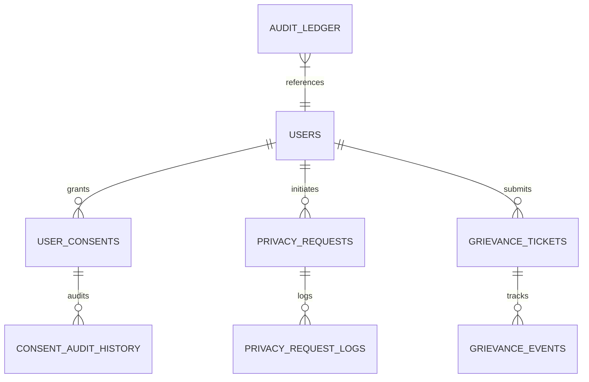

# ISHTI Milestone M06 — Database & Migration Plan (Revised)

**Document Reference:** `docs/M06_DATABASE_AND_MIGRATION_PLAN.md`  
**Milestone:** M06 — Core Backend Persistence, Distributed Invariants & Production Shielding  
**Repository:** `https://github.com/Sunder-Chauhan/Ishti-OS`  
**Target Migration Directory:** `supabase/migrations/`  
**Revision Date:** 19 November 2026  
**Lead Authors:** Database Architect, Application Security Engineer & Privacy Engineering Lead  

---

## 1. Scope Partitioning & Database Safety Principles

Milestone M06 introduces persistent, audited, and encrypted database entities into PostgreSQL 18 (hosted on Supabase).

### 1.1. Core M06 vs. Deferred Milestone Schemas (Correction 10)
In accordance with architectural review, database schemas are decoupled into focused milestones:
- **Core Milestone M06 Schemas (Persistence Baseline):**
  * Consent Management: `public.user_consents` and `public.consent_audit_history`.
  * Subject Rights & Erasure: `public.privacy_requests` and `public.privacy_request_logs`.
  * Tamper-Evident Audit: `public.audit_ledger` (with Merkle chaining and append-only trigger).
  * Grievance Redressal: `public.grievance_tickets` and `public.grievance_events`.
  * Distributed Lock Coordination: `public.rate_limit_coordination` (fallback unlogged lock table).
- **Milestone M07 Target Schemas (Deferred - Commerce & Tax):**
  * `public.financial_transactions`, `public.invoices`, `public.refund_records`, and `public.tax_configuration_rules`.
- **Milestone M08 Target Schemas (Deferred - Vedic Knowledge & AI):**
  * `public.scripture_catalog`, `public.canonical_verses`, `public.verse_translations`, and `pgvector` indexes.

### 1.2. Database Safety Invariants
1. **Zero Destructive Operations:** No `DROP TABLE`, `DROP COLUMN`, or `TRUNCATE` operations on existing M02/M03 tables.
2. **Strict RLS By Default:** Every newly created table must execute `ALTER TABLE <name> ENABLE ROW LEVEL SECURITY;` immediately following table creation.
3. **No Direct Anonymous Table Grants (Correction 4):** The PostgREST API `anon` role is granted **zero direct INSERT, UPDATE, or DELETE permissions**. Controlled anonymous intake executes exclusively through server-mediated RPC functions with strict parameter sanitization.
4. **Append-Only Immutability Defense-in-Depth (Correction 6):** Database triggers enforce append-only rules during normal operations (`prevent_audit_ledger_mutation`). Merkle hash chains and external WORM backups provide tamper-evidence against privileged database administrators.
5. **Nuanced Migration Rollback Architecture:** Forward DDL migrations are categorized by reversibility (reversible schema-only, data-preserving rollback, irreversible data transformation, destructive, backup restoration, forward-fix). Naive assumptions that every production change can be cleanly reversed with a down script are rejected; backup and restore verification is mandatory before any state-altering operations.

---

## 2. Core M06 Schema Definitions



### 2.1. Consent & Sovereign Preference Management (Workstream M06.2)

```sql
-- Table: public.user_consents
-- Purpose: Records active consent preferences per user under DPDP Act §6
CREATE TABLE public.user_consents (
    id UUID PRIMARY KEY DEFAULT gen_random_uuid(),
    user_id UUID NOT NULL REFERENCES auth.users(id) ON DELETE CASCADE,
    purpose_analytics BOOLEAN NOT NULL DEFAULT false,
    purpose_marketing BOOLEAN NOT NULL DEFAULT false,
    purpose_third_party_sync BOOLEAN NOT NULL DEFAULT false,
    purpose_spiritual_profiling BOOLEAN NOT NULL DEFAULT true,
    policy_version TEXT NOT NULL,
    consent_hash TEXT NOT NULL, -- SHA-256(user_id || purposes || policy_version || captured_at)
    captured_at TIMESTAMPTZ NOT NULL DEFAULT now(),
    ip_hash TEXT NOT NULL,
    user_agent_hash TEXT NOT NULL,
    updated_at TIMESTAMPTZ NOT NULL DEFAULT now(),
    CONSTRAINT uq_user_consent_user UNIQUE (user_id)
);

-- Table: public.consent_audit_history (Append-Only)
-- Purpose: Immutable history of consent grants, updates, and withdrawals under DPDP §6(4)
CREATE TABLE public.consent_audit_history (
    id UUID PRIMARY KEY DEFAULT gen_random_uuid(),
    consent_id UUID NOT NULL REFERENCES public.user_consents(id) ON DELETE CASCADE,
    user_id UUID NOT NULL REFERENCES auth.users(id) ON DELETE CASCADE,
    action TEXT NOT NULL CHECK (action IN ('GRANTED', 'WITHDRAWN', 'UPDATED')),
    previous_state JSONB,
    new_state JSONB NOT NULL,
    consent_hash TEXT NOT NULL,
    ip_hash TEXT NOT NULL,
    recorded_at TIMESTAMPTZ NOT NULL DEFAULT now()
);

CREATE INDEX idx_consent_audit_history_user ON public.consent_audit_history(user_id);
```

### 2.2. Subject Rights & Multi-Stage Erasure Engine (Workstream M06.3) (Correction 5)

```sql
-- Table: public.privacy_requests
-- Purpose: Tracks end-to-end multi-stage privacy workflows under DPDP Act §§11-13 & GDPR Art 17
CREATE TABLE public.privacy_requests (
    id UUID PRIMARY KEY DEFAULT gen_random_uuid(),
    user_id UUID NOT NULL REFERENCES auth.users(id) ON DELETE CASCADE,
    request_type TEXT NOT NULL CHECK (request_type IN ('ERASURE', 'SAR_EXPORT', 'RECTIFICATION')),
    status TEXT NOT NULL DEFAULT 'PENDING_VERIFICATION' CHECK (
        status IN (
            'PENDING_VERIFICATION',
            'VERIFIED',
            'RETENTION_EVALUATED',
            'PRIMARY_PURGED',
            'DEK_SHREDDED',
            'CACHES_PURGED',
            'VENDORS_NOTIFIED',
            'COMPLETED_WITH_EXCEPTIONS',
            'FULLY_COMPLETED',
            'REJECTED'
        )
    ),
    verification_token TEXT NOT NULL,
    verification_confirmed BOOLEAN NOT NULL DEFAULT false,
    verified_at TIMESTAMPTZ,
    
    -- Multi-Copy Tracking Fields
    primary_purged_at TIMESTAMPTZ,
    dek_shredded_at TIMESTAMPTZ,
    shredded_dek_fingerprint TEXT, -- Cryptographic proof that DEK was purged
    caches_purged_at TIMESTAMPTZ,
    vendors_notified_at TIMESTAMPTZ,
    
    -- Lawful Retention Documentation (Income-tax Act §62, IT Rules, etc.)
    retained_records_summary JSONB, -- Documents lawful retention exceptions
    backup_expiry_target_at TIMESTAMPTZ, -- Date when rolling database backups cycle out
    
    -- SAR Export Delivery
    export_archive_url TEXT,
    export_expires_at TIMESTAMPTZ,
    
    rejection_reason TEXT,
    created_at TIMESTAMPTZ NOT NULL DEFAULT now(),
    completed_at TIMESTAMPTZ
);

CREATE UNIQUE INDEX idx_unique_active_erasure 
ON public.privacy_requests (user_id) 
WHERE request_type = 'ERASURE' AND status NOT IN ('FULLY_COMPLETED', 'COMPLETED_WITH_EXCEPTIONS', 'REJECTED');
```

### 2.3. Tamper-Evident Audit Ledger (Workstream M06.4) (Correction 6)

```sql
-- Table: public.audit_ledger
-- Purpose: Cryptographically chained, append-only log of security and compliance events
CREATE TABLE public.audit_ledger (
    sequence_id BIGSERIAL PRIMARY KEY,
    event_id UUID NOT NULL UNIQUE DEFAULT gen_random_uuid(),
    event_timestamp TIMESTAMPTZ NOT NULL DEFAULT now(),
    actor_id UUID REFERENCES auth.users(id),
    actor_role TEXT NOT NULL DEFAULT 'anonymous', -- 'devotee', 'pandit', 'admin', 'anonymous_public'
    action_type TEXT NOT NULL, -- e.g. 'AUTH_LOGIN', 'CONSENT_UPDATE', 'GRIEVANCE_SUBMISSION'
    resource_type TEXT NOT NULL,
    resource_id TEXT,
    payload_hash TEXT NOT NULL, -- SHA-256(payload_json)
    previous_record_hash TEXT NOT NULL, -- Merkle chain link to preceding sequence_id
    record_hash TEXT NOT NULL -- SHA-256(sequence_id || timestamp || action || payload_hash || previous_record_hash)
);

-- BRIN Index for Append-Only Time-Series Performance
CREATE INDEX idx_audit_ledger_timestamp_brin ON public.audit_ledger USING BRIN (event_timestamp);

-- Database Trigger: Enforce Immutability during standard operations
CREATE OR REPLACE FUNCTION public.prevent_audit_ledger_mutation()
RETURNS TRIGGER AS $$
BEGIN
    RAISE EXCEPTION 'CRITICAL SECURITY VIOLATION: public.audit_ledger is append-only. UPDATE and DELETE are prohibited.'
    USING ERRCODE = '42501';
END;
$$ LANGUAGE plpgsql SECURITY DEFINER SET search_path = public, pg_temp;

CREATE TRIGGER trg_audit_ledger_immutable
BEFORE UPDATE OR DELETE ON public.audit_ledger
FOR EACH ROW EXECUTE FUNCTION public.prevent_audit_ledger_mutation();
```

### 2.4. Production Grievance Redressal & Anonymous Intake (Workstream M06.5) (Corrections 2 & 4)

```sql
-- Table: public.grievance_tickets
-- Purpose: Stores complaints and enforces IT Rules Rule 3(2) statutory timelines
CREATE TABLE public.grievance_tickets (
    id UUID PRIMARY KEY DEFAULT gen_random_uuid(),
    ticket_reference TEXT NOT NULL UNIQUE, -- 'ISHTI-GRV-YYYY-XXXX'
    complainant_user_id UUID REFERENCES auth.users(id), -- NULL for anonymous public intake
    complainant_email TEXT NOT NULL,
    complainant_phone TEXT,
    category TEXT NOT NULL CHECK (
        category IN (
            'CONTENT_IMPERSONATION_SEXUAL', -- Rule 3(2)(b): Action / takedown within 2 hours
            'SPECIFIED_REMOVAL_PROVISO',    -- Proviso to Rule 3(2)(a)(i): Resolution within 36 hours
            'COURT_GOVT_TAKEDOWN_ORDER',    -- Rule 3(1)(d): Removal / access disablement within 3 hours
            'PRIVACY_DATA_BREACH',          -- DPDP Act / IT Rules: 7d disposal
            'FRAUD_COMMERCE',               -- Consumer Protection / 7d disposal
            'PANDIT_CONDUCT',               -- Marketplace Quality / 7d disposal
            'EDITORIAL_FIRST_PARTY',        -- First-party content publisher issue
            'OTHER_FEEDBACK'
        )
    ),
    priority TEXT NOT NULL DEFAULT 'STANDARD' CHECK (priority IN ('STANDARD', 'EXPEDITED_RULE_3_2_B', 'CRITICAL_LEGAL')),
    status TEXT NOT NULL DEFAULT 'SUBMITTED' CHECK (status IN ('SUBMITTED', 'ACKNOWLEDGED', 'UNDER_INVESTIGATION', 'RESOLVED', 'REJECTED')),
    description TEXT NOT NULL,
    evidence_urls TEXT[],
    assigned_officer_id UUID REFERENCES auth.users(id),
    
    submitted_at TIMESTAMPTZ NOT NULL DEFAULT now(),
    
    -- Statutory Deadlines (Official IT Rules Updated 10 February 2026 including corrigendum)
    statutory_ack_deadline TIMESTAMPTZ NOT NULL,   -- submitted_at + 24 hours (or 1h for Rule 3(1)(d); 2h for Rule 3(2)(b))
    acknowledged_at TIMESTAMPTZ,
    statutory_disposal_deadline TIMESTAMPTZ NOT NULL, -- submitted_at + 7 days (or 2h for Rule 3(2)(b); 3h for Rule 3(1)(d); 36h for proviso)
    resolved_at TIMESTAMPTZ,
    
    -- Internal Operational Service-Level Targets (SLTs)
    internal_slt_ack_deadline TIMESTAMPTZ NOT NULL,      -- submitted_at + 12 hours (30m for Rule 3(2)(b) & Rule 3(1)(d))
    internal_slt_disposal_deadline TIMESTAMPTZ NOT NULL, -- submitted_at + 48 hours (1h for Rule 3(2)(b) & Rule 3(1)(d); 12h for 36h proviso)
    
    resolution_summary TEXT,
    rejection_reason TEXT
);

-- Table: public.grievance_events (Append-Only Event Sourcing)
CREATE TABLE public.grievance_events (
    id UUID PRIMARY KEY DEFAULT gen_random_uuid(),
    ticket_id UUID NOT NULL REFERENCES public.grievance_tickets(id) ON DELETE CASCADE,
    actor_id UUID REFERENCES auth.users(id), -- NULL for anonymous complainant update
    actor_role TEXT NOT NULL DEFAULT 'grievance_officer',
    event_type TEXT NOT NULL CHECK (
        event_type IN ('ACKNOWLEDGED', 'INTERNAL_NOTE', 'STATUS_CHANGE', 'COMMUNICATION_SENT', 'RESOLVED', 'REJECTED')
    ),
    event_details JSONB NOT NULL,
    created_at TIMESTAMPTZ NOT NULL DEFAULT now()
);

CREATE INDEX idx_grievance_tickets_status ON public.grievance_tickets(status);
CREATE INDEX idx_grievance_tickets_deadlines ON public.grievance_tickets(statutory_disposal_deadline);
```

### 2.5. Server-Mediated Anonymous Intake RPC Function (Correction 4)

```sql
-- Security Definer RPC: submit_anonymous_grievance
-- Accepts sanitized grievance payload from server action; ZERO direct client insert access
CREATE OR REPLACE FUNCTION public.submit_anonymous_grievance(
    p_complainant_email TEXT,
    p_complainant_phone TEXT,
    p_category TEXT,
    p_description TEXT,
    p_evidence_urls TEXT[],
    p_ip_hash TEXT,
    p_ticket_ref TEXT
)
RETURNS UUID AS $$
DECLARE
    v_ticket_id UUID;
    v_statutory_ack TIMESTAMPTZ;
    v_statutory_disposal TIMESTAMPTZ;
    v_internal_ack TIMESTAMPTZ;
    v_internal_disposal TIMESTAMPTZ;
BEGIN
    -- Input Length Sanitization
    IF length(p_complainant_email) > 255 OR length(p_description) > 4000 THEN
        RAISE EXCEPTION 'Payload field limits exceeded' USING ERRCODE = '22001';
    END IF;

    -- Dynamic Deadline Calculation based on Official IT Rules (Updated 10 February 2026 including corrigendum)
    IF p_category = 'CONTENT_IMPERSONATION_SEXUAL' THEN
        -- Rule 3(2)(b): Action / takedown within 2 hours; 1h internal SLT target (zero pause permitted)
        v_statutory_ack := now() + INTERVAL '2 hours';
        v_statutory_disposal := now() + INTERVAL '2 hours';
        v_internal_ack := now() + INTERVAL '30 minutes';
        v_internal_disposal := now() + INTERVAL '1 hour';
    ELSIF p_category = 'COURT_GOVT_TAKEDOWN_ORDER' THEN
        -- Rule 3(1)(d): Removal / disabling access within 3 hours from receipt of qualifying order/intimation (zero pause permitted)
        v_statutory_ack := now() + INTERVAL '1 hour';
        v_statutory_disposal := now() + INTERVAL '3 hours';
        v_internal_ack := now() + INTERVAL '30 minutes';
        v_internal_disposal := now() + INTERVAL '1 hour';
    ELSIF p_category = 'SPECIFIED_REMOVAL_PROVISO' THEN
        -- Proviso to Rule 3(2)(a)(i): Resolution within 36 hours (pause rules require counsel confirmation)
        v_statutory_ack := now() + INTERVAL '24 hours';
        v_statutory_disposal := now() + INTERVAL '36 hours';
        v_internal_ack := now() + INTERVAL '6 hours';
        v_internal_disposal := now() + INTERVAL '12 hours';
    ELSE
        -- Standard Intermediary Grievance under Rule 3(2)(a)(i): 24h ack, 7d disposal (Feb 2026 amendment; pause rules require counsel confirmation)
        v_statutory_ack := now() + INTERVAL '24 hours';
        v_statutory_disposal := now() + INTERVAL '7 days';
        v_internal_ack := now() + INTERVAL '12 hours';
        v_internal_disposal := now() + INTERVAL '48 hours';
    END IF;

    -- Insert Grievance Ticket
    INSERT INTO public.grievance_tickets (
        ticket_reference,
        complainant_user_id,
        complainant_email,
        complainant_phone,
        category,
        priority,
        status,
        description,
        evidence_urls,
        submitted_at,
        statutory_ack_deadline,
        statutory_disposal_deadline,
        internal_slt_ack_deadline,
        internal_slt_disposal_deadline
    ) VALUES (
        p_ticket_ref,
        NULL, -- Anonymous public intake
        p_complainant_email,
        p_complainant_phone,
        p_category,
        CASE WHEN p_category = 'CONTENT_IMPERSONATION_SEXUAL' THEN 'EXPEDITED_RULE_3_2_B' ELSE 'STANDARD' END,
        'SUBMITTED',
        p_description,
        p_evidence_urls,
        now(),
        v_statutory_ack,
        v_statutory_disposal,
        v_internal_ack,
        v_internal_disposal
    ) RETURNING id INTO v_ticket_id;

    -- Record Event
    INSERT INTO public.grievance_events (
        ticket_id,
        actor_id,
        actor_role,
        event_type,
        event_details
    ) VALUES (
        v_ticket_id,
        NULL,
        'anonymous_public',
        'STATUS_CHANGE',
        jsonb_build_object('status', 'SUBMITTED', 'ip_hash', p_ip_hash)
    );

    RETURN v_ticket_id;
END;
$$ LANGUAGE plpgsql SECURITY DEFINER SET search_path = public, pg_temp;

-- Revoke direct execution from public/anon; grant strictly to service_role
REVOKE EXECUTE ON FUNCTION public.submit_anonymous_grievance FROM PUBLIC;
REVOKE EXECUTE ON FUNCTION public.submit_anonymous_grievance FROM anon;
GRANT EXECUTE ON FUNCTION public.submit_anonymous_grievance TO service_role;
```

---

## 3. Row Level Security (RLS) Policy Specifications

### 3.1. Policy Matrix for Core M06

| Table | Target Role | Action | Policy Condition (`USING` / `WITH CHECK`) | Security Justification |
| :--- | :--- | :--- | :--- | :--- |
| `user_consents` | `anon` | ALL | `false` (No access) | Anonymous users have zero direct access to consent state. |
| `user_consents` | `authenticated` | SELECT | `auth.uid() = user_id` | Devotees can view their own sovereign consent records. |
| `user_consents` | `authenticated` | INSERT / UPDATE | `auth.uid() = user_id` | Devotees can update/withdraw their own consent preferences. |
| `consent_audit_history` | `authenticated` | SELECT | `auth.uid() = user_id OR public.is_admin()` | Devotees inspect their own history; admins audit. |
| `consent_audit_history` | `service_role` | INSERT | `true` | System services record immutable history upon consent change. |
| `privacy_requests` | `authenticated` | SELECT | `auth.uid() = user_id OR public.is_admin()` | Devotees monitor their own erasure/SAR status. |
| `privacy_requests` | `authenticated` | INSERT | `auth.uid() = user_id` | Devotees initiate their own privacy rights requests. |
| `audit_ledger` | `authenticated` | SELECT | `public.is_admin()` | Only authorized compliance administrators can inspect audit records. |
| `audit_ledger` | `service_role` | INSERT | `true` | System services append immutable audit events. |
| `grievance_tickets` | `anon` | ALL | `false` (No access) | External anonymous intake mediated exclusively through RPC. |
| `grievance_tickets` | `authenticated` | SELECT | `auth.uid() = complainant_user_id OR public.is_grievance_officer()` | Complainants view own tickets; Grievance Officers manage queue. |

---

## 4. Milestone M07 Deferred Schemas (Commerce & Tax Reference) (Correction 8)

The following tables are **deferred to Milestone M07** and will not be executed in Milestone M06:

```sql
-- Table: public.tax_configuration_rules (Milestone M07 Target - Configurable Tax Engine)
CREATE TABLE public.tax_configuration_rules (
    id UUID PRIMARY KEY DEFAULT gen_random_uuid(),
    jurisdiction TEXT NOT NULL DEFAULT 'IN_DOMESTIC',
    supply_model TEXT NOT NULL CHECK (supply_model IN ('PRINCIPAL_SUPPLIER', 'MARKETPLACE_ECO')),
    sac_code TEXT NOT NULL, -- e.g. '998439' (OIDAR) or '999799' (Religious/Personal)
    gst_rate_basis_points INTEGER NOT NULL DEFAULT 1800, -- 18.00%
    tcs_rate_basis_points INTEGER DEFAULT 50, -- 0.50% (CGST §52)
    tds_rate_basis_points INTEGER DEFAULT 10, -- 0.10% (IT Act §194-O / 2025 Act §393)
    tds_gross_threshold_paise BIGINT DEFAULT 50000000, -- ₹5,00,000 threshold
    effective_from TIMESTAMPTZ NOT NULL,
    effective_until TIMESTAMPTZ,
    ca_certification_reference TEXT NOT NULL, -- Formal CA sign-off document hash
    created_at TIMESTAMPTZ NOT NULL DEFAULT now()
);
```

---

## 5. Zero-Downtime Migration Sequence & Rollback Plan

### Sequential DDL File Plan (Milestone M06 Execution)
1. `supabase/migrations/20261120000001_m06_user_consents.sql`: Creates `public.user_consents` and `public.consent_audit_history` with RLS.
2. `supabase/migrations/20261120000002_m06_privacy_requests.sql`: Creates `public.privacy_requests` with multi-copy tracking fields and RLS.
3. `supabase/migrations/20261120000003_m06_audit_ledger.sql`: Creates `public.audit_ledger`, BRIN indexes, and `trg_audit_ledger_immutable`.
4. `supabase/migrations/20261120000004_m06_grievance_system.sql`: Creates `public.grievance_tickets`, `public.grievance_events`, and `submit_anonymous_grievance()` RPC.

## 5. Zero-Downtime Migration Sequence & Comprehensive Rollback Architecture

### 5.1. Sequential DDL File Plan (Milestone M06 Execution)
1. `supabase/migrations/20261120000001_m06_user_consents.sql`: Creates `public.user_consents` and `public.consent_audit_history` with RLS.
2. `supabase/migrations/20261120000002_m06_privacy_requests.sql`: Creates `public.privacy_requests` with multi-copy tracking fields and RLS.
3. `supabase/migrations/20261120000003_m06_audit_ledger.sql`: Creates `public.audit_ledger`, BRIN indexes, and `trg_audit_ledger_immutable`.
4. `supabase/migrations/20261120000004_m06_grievance_system.sql`: Creates `public.grievance_tickets`, `public.grievance_events`, and `submit_anonymous_grievance()` RPC.

### 5.2. Rigorous Migration Reversibility & Rollback Categorization
> [!CAUTION]
> **REJECTING NAIVE DOWN-SCRIPT ASSUMPTIONS:**  
> A naive paired `down/` script approach (e.g. `DROP TABLE ...`) is dangerous if executed in production once live data has been written. Dropping tables destroys active devotee records, breaks foreign key integrity, and corrupts audit chains. ISHTI categorizes all database changes into six distinct operational regimes:

| Migration Category | Definition & Technical Characteristics | Rollback Strategy | Production Safety Rules |
| :--- | :--- | :--- | :--- |
| **1. Reversible Schema-Only Changes** | Adding new tables, unlogged staging tables, standalone triggers, new nullable columns, or new RLS policies that do not alter pre-existing tables or rewrite table heaps. | **Safe Down Script:** Can be reversed cleanly via `supabase/migrations/down/` (e.g. `DROP TABLE IF EXISTS ...`, `DROP TRIGGER IF EXISTS ...`) if executed before application code writes production data. | Permitted in local and staging verification. In production, down scripts are permitted only during an active zero-traffic deployment window before traffic cutover. |
| **2. Data-Preserving Rollbacks** | Schema alterations where existing row data is preserved in temporary staging tables or dual-write columns during transition. | **Preservation Script:** Reverses schema pointers while migrating written rows back to pre-migration column structures without data truncation. | Requires pre-tested data migration backfill and reverse-copy procedures verified in staging. |
| **3. Irreversible Data Transformations** | Data modifications involving one-way transformations: column type casting, hash migrations, cryptographic key re-wrapping, DEK shredding, or data deduplication/consolidation. | **Cannot Be Reversed via Down Script:** A `down/` SQL script cannot mathematically reconstruct pre-transformation plaintext or destroyed keys once committed. | **Forward-fix only or point-in-time recovery.** Pre-transformation verification and cryptographic snapshot required prior to execution. |
| **4. Destructive Migrations** | Dropping existing production tables, dropping columns with historical data, `TRUNCATE`, or column shrinkage. | **No SQL Rollback Possible:** Down script cannot resurrect destroyed table contents. | **STRICTLY PROHIBITED in Milestone M06.** Any future destructive migration requires explicit founder sign-off, dual-operator authorization, and mandatory verified physical backup restoration prior to execution. |
| **5. Backup Restoration (Point-in-Time Recovery)** | For state-breaking failures, data corruption, or catastrophic schema corruption where forward-fixing is impossible. | **Disaster Recovery Restore:** Restore Supabase/PostgreSQL from WAL snapshot to point-in-time immediately preceding the faulty migration, then replay the **Deletion Tombstone Manifest** to uphold privacy erasures. | **Mandatory Backup & Restore Verification:** Before executing any state-altering production migration, operators must verify that a valid snapshot exists and test the restoration procedure. |
| **6. Forward-Fix Migrations (Preferred Production Strategy)** | Correcting minor bugs, missing indexes, faulty trigger logic, or check constraint mismatches discovered post-cutover. | **Release Migration $v_{N+1}$:** Apply an additive forward migration rather than attempting risky `down/` rollbacks on live, concurrent production databases. | Standard operational pattern for production maintenance. Down scripts are relegated to local developer sandbox resets. |

### 5.3. Pre-Migration Verification Protocol
Prior to applying any production DDL migration:
1. Confirm zero schema drift against base main schema.
2. Execute forward migration in a temporary local PostgreSQL 18 sandbox.
3. Test down script in sandbox to verify clean tear-down of schema-only changes.
4. Verify physical database backup availability and corroborate point-in-time recovery readiness.
5. In production, prefer forward-fixing ($v_{N+1}$) for all post-cutover corrections.
