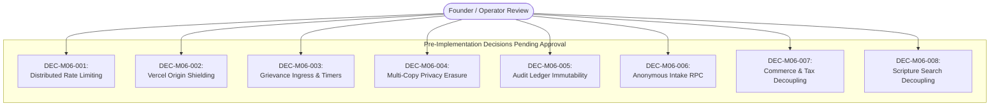

# ISHTI Milestone M06 — Architecture Decision Approval Packet (G0 Gate)

**Document Reference:** `docs/M06_G0_ARCHITECTURE_APPROVAL_PACKET.md`  
**Milestone:** M06 — Core Backend Persistence, Distributed Invariants & Production Shielding  
**Repository:** `https://github.com/Sunder-Chauhan/Ishti-OS`  
**Branch:** `feature/m05-trust-governance`  
**Date:** 19 November 2026  
**Auditor Roles:** Principal Software Architect, Application Security Engineer, Privacy Lead & Infrastructure Lead  

---

## 1. Executive Summary & Purpose

This Approval Packet presents the eight foundational architecture decisions for Milestone M06 for explicit founder/operator review and approval. 

In accordance with strict M06 G0 gate rules:
- **No decision is marked "APPROVED" merely because its technical recommendation is sound.**
- Every decision below is marked **`STATUS: PENDING OPERATOR APPROVAL`**.
- Milestone M06 implementation (including branch creation, schema migrations, and code changes) remains **strictly paused** until the operator reviews this packet and provides explicit written authorization.

---

## 2. Compact Decision Approval Sections

---

### DEC-M06-001: Distributed Rate Limiting & Concurrency Engine
- **Decision ID:** `DEC-M06-001`
- **Recommended Option:** **Upstash Redis Serverless Primary with Strict Fail-Closed Policy on Sensitive Routes**
  * Use Upstash Redis REST/TLS with atomic Lua sliding-window counters across all serverless instances.
  * Secondary PostgreSQL advisory locking limiter (`public.check_rate_limit()`) used strictly for local developer testing and CI.
  * If Upstash Redis is unreachable or times out (>150ms), **sensitive mutation routes (`/api/auth/otp`, `/api/commerce/checkout`, `/api/compliance/triage`, `/api/compliance/privacy-request`) MUST FAIL CLOSED (HTTP 503 `RATE_LIMIT_UNAVAILABLE`)**.
  * Zero silent local-memory fallback on sensitive endpoints.
  * Public read-only endpoints degrade gracefully to conservative local rate limiting (20 req/min).
- **Alternatives Rejected & Why:**
  1. *Universal Process-Local Fallback:* Rejected because concurrent requests across Vercel serverless replicas multiply allowable quotas, enabling distributed brute-force attacks.
  2. *Universal PostgreSQL Advisory Lock Limiting:* Rejected because opening database transactions for every incoming request saturates transaction connection poolers (PgBouncer) under high ingress spikes.
  3. *Self-Hosted Valkey Container:* Rejected for M06 baseline due to container OS patching and cluster management overhead during serverless application persistence phase.
- **Risks Accepted:** Sensitive mutation routes become temporarily unavailable (503) if Upstash Redis experiences a global outage.
- **Risks Still Open:** Requires verifying sub-millisecond REST latency from Vercel edge runtime to Upstash AWS `ap-south-1` region during Phase 2 benchmarking.
- **Owner:** Principal Software Architect & Application Security Engineer
- **Required Approval:** Founder / Engineering Lead
- **Status:** **`PENDING OPERATOR APPROVAL`**

---

### DEC-M06-002: Ingress Origin Shielding on Vercel Hosting
- **Decision ID:** `DEC-M06-002`
- **Recommended Option:** **Cloudflare CIDR Firewall Allowlisting + Cryptographic Shared Proxy Secret + Direct Host Header Protection**
  * Restrict Vercel incoming HTTP traffic strictly to Cloudflare's published IPv4 and IPv6 CIDR blocks via Vercel Firewall rules.
  * Cloudflare Transform Rules inject a 32-byte random secret header `x-ishti-proxy-secret` on origin pulls; Next.js middleware drops requests lacking the verified secret with HTTP 403.
  * Direct `*.vercel.app` domain bypass mitigated by inspecting the `Host` header in middleware and redirecting/rejecting unauthenticated direct access.
  * Explicitly note: A shared secret is an application-layer safeguard, **NOT equivalent to mutual TLS (mTLS)**. Full Cloudflare AOP client-cert verification is incompatible with standard Vercel Pro.
  * Containerized contingency: If Vercel origin shielding is compromised, migrate Next.js to Fly.io/ECS behind **Cloudflare Tunnel (`cloudflared`)** to close all inbound public ports.
- **Alternatives Rejected & Why:**
  1. *Cloudflare Authenticated Origin Pulls (AOP with mTLS):* Rejected as technically unsupported on standard Vercel Pro plan without costly Enterprise custom edge contracts.
  2. *Secret Header Alone:* Rejected because discovering the origin domain or IP allows direct bypass if firewall rules are absent.
- **Risks Accepted:** Origin shielding on Vercel relies on edge middleware execution and firewall rule maintenance rather than cryptographic network-layer mTLS handshake termination.
- **Risks Still Open:** Secret rotation requires a 90-day operational runbook supporting dual-secret acceptance windows in middleware.
- **Owner:** DevOps & Infrastructure Security Lead
- **Required Approval:** Founder / Infrastructure Lead
- **Status:** **`PENDING OPERATOR APPROVAL`**

---

### DEC-M06-003: Grievance Architecture & IT Rules Timeline Realignment
- **Decision ID:** `DEC-M06-003`
- **Recommended Option:** **Next.js Route Handler (`POST /api/compliance/triage`) with IT Rules Dual-Clock Timers (2h / 24h / 36h / 7d)**
  * Next.js Route Handler selected as the sole public intake interface over Server Actions due to REST standard contract, HTTP status codes, mobile app compatibility, and bounded stream reading.
  * Reconcile statutory deadlines to official IT Rules updated 10 February 2026:
    - *Rule 3(2)(b) Sexual Content / Impersonation:* **Action within 2 hours** (automated P0 alert).
    - *Proviso to Rule 3(2)(a)(i) Specified Removal Requests:* **Resolution within 36 hours**.
    - *Rule 3(1)(d) Court Orders / Govt Takedowns:* **Removal within 36 hours**.
    - *Rule 3(2)(a)(i) Ordinary Intermediary Grievance:* **24 hours acknowledgement; 7 days resolution/disposal** (reduced from 15d by Feb 2026 amendment).
    - *IT Act §69A Blocking Orders:* **Immediate confidential compliance**.
  * Decouple statutory deadlines from internal operational targets (SLTs: 12h ack, 48h resolution for standard complaints; 1h resolution for Rule 3(2)(b)).
- **Alternatives Rejected & Why:**
  1. *Server Actions for Public Ingress:* Rejected because Server Actions use React flight protocol serialization, preventing standard REST integration for mobile apps or external complainants.
  2. *Single 24h Blanket Timeline:* Rejected as legally incorrect; failed to meet the strict 2-hour takedown mandate for Rule 3(2)(b) content.
- **Risks Accepted:** The 2-hour window under Rule 3(2)(b) requires an active Grievance Officer on-call alerting rotation.
- **Risks Still Open:** Formal written opinion from Indian legal counsel required to verify applicability classifications before commercial launch.
- **Owner:** Legal Engineering Lead & Compliance Officer
- **Required Approval:** Founder & Legal Counsel
- **Status:** **`PENDING OPERATOR APPROVAL`**

---

### DEC-M06-004: Multi-Copy Privacy Erasure & Backup Retention Lifecycle
- **Decision ID:** `DEC-M06-004`
- **Recommended Option:** **15-Point Multi-Stage Erasure State Machine with Cryptographic DEK Shredding and 30-Day Backup Expiry Policy**
  * Reject equating key deletion with complete erasure. Execute an 8-stage state machine across all 15 personal data copies (primary DB, related tables, Kundli ciphertext, search indexes, vector embeddings, Redis caches, server logs, analytics, export files, storage buckets, database backups, vendor logs, job queues, push tokens, and KMS audit logs).
  * Cryptographically shred per-profile AES-256 Data Encryption Keys (DEKs), rendering Kundli ciphertext mathematically irrecoverable across all historical database backups.
  * Confirm that the **30-day backup expiry window is a technical operational policy choice, NOT a statutory deadline**. Immutable database backups rotate on a rolling 30-day lifecycle; disaster recovery restores replay the **Deletion Tombstone Manifest** archived in external WORM storage.
  * Document lawful retention exceptions (Income-tax Act, 2025 §62 7-year retention for financial books of account; IT Rules 3-year dispute records) in `public.privacy_requests.retained_records_summary`.
- **Alternatives Rejected & Why:**
  1. *Single-Table SQL DELETE:* Rejected because personal data remains lingering across caches, logs, backups, and vendor systems.
  2. *Immediate Backup Modification:* Rejected as technically impossible on PostgreSQL WAL snapshots without corrupting block integrity.
- **Risks Accepted:** Personal data remains in encrypted physical backups for up to 30 days until natural backup rollover occurs (protected by tombstone replay runbook).
- **Risks Still Open:** Requires legal counsel verification of the retention exception list.
- **Owner:** Privacy Engineering Lead & Cryptography Architect
- **Required Approval:** Founder & Legal Counsel
- **Status:** **`PENDING OPERATOR APPROVAL`**

---

### DEC-M06-005: Audit Ledger Immutability & Record-Category Retention Schedule
- **Decision ID:** `DEC-M06-005`
- **Recommended Option:** **8-Layer Defense-in-Depth Hierarchy (SHA-256 Merkle Chains + Daily Signed Roots + Cloudflare R2 Object Lock in Compliance Mode) with Statutory Retention Matrix**
  * Discontinue claims of "absolute immutability" via database triggers alone. Enforce an 8-layer integrity hierarchy: application semantics $\to$ SQL triggers $\to$ privilege separation $\to$ Merkle hash chaining $\to$ daily signed roots $\to$ secondary cloud account WORM Object Lock in Compliance Mode $\to$ automated verification daemons $\to$ disaster recovery tombstones.
  * Replace blanket 7-year retention with a statutory Record-Category Retention Matrix:
    - *Financial Books & Invoices:* **7 Years** (Income-tax Act, 2025 §62 / Rule 46).
    - *User Consent Records & History:* **Active Account + 3 Years** (DPDP Act §6).
    - *Grievance Records & Evidence:* **3 Years** (IT Rules / Limitation Act).
    - *ICT Security & Ingress Access Logs:* **180 Days** (CERT-In Directions).
    - *Ephemeral Debug Logs:* **14 to 30 Days** (Internal operational policy).
- **Alternatives Rejected & Why:**
  1. *Database Trigger Immutability Alone:* Rejected because database superusers (`postgres`) can bypass triggers via `ALTER TABLE ... DISABLE TRIGGER`.
  2. *Blanket 7-Year Retention:* Rejected because retaining personal user logs without statutory mandate violates DPDP Act §8(7) data minimization principles.
- **Risks Accepted:** Privileged database administrators can alter local records, but alterations are immediately detected via daily Merkle root discrepancy against external WORM storage.
- **Risks Still Open:** Requires provisioning an isolated secondary cloud account for Cloudflare R2 / AWS S3 WORM storage.
- **Owner:** Application Security Engineer & Legal Counsel
- **Required Approval:** Founder & Legal Counsel
- **Status:** **`PENDING OPERATOR APPROVAL`**

---

### DEC-M06-006: Server-Mediated Anonymous Public Intake & RPC Security
- **Decision ID:** `DEC-M06-006`
- **Recommended Option:** **Dedicated Route Handler with Zod Schema Bounds Calling Restricted `SECURITY DEFINER` RPC Granted Strictly to `service_role`**
  * Revoke all direct table INSERT/UPDATE/DELETE permissions from PostgREST `anon` and `public` roles (`REVOKE ALL ON public.grievance_tickets FROM anon, public`).
  * Anonymous public intake accepted exclusively via Route Handler `POST /api/compliance/triage`.
  * Route Handler validates input with Zod, caps payload at 32 KB, enforces Layer 1 IP rate limiting (3 req / 10 min), and calls `public.submit_anonymous_grievance` RPC using server-only `service_role`.
  * RPC is marked `SECURITY DEFINER` with fixed `search_path = public, pg_temp`; execution privilege is granted **STRICTLY TO `service_role`** (`REVOKE EXECUTE FROM PUBLIC, anon`).
  * Client never receives direct database access; service-role key is never exposed to the browser.
- **Alternatives Rejected & Why:**
  1. *Granting INSERT to anon in PostgREST:* Rejected as unsafe; exposes raw database schema to direct injection and unmetered spam floods.
  2. *Granting EXECUTE on RPC to anon:* Rejected because untrusted clients could invoke the RPC directly, bypassing Next.js rate limiting and Zod bounds.
- **Risks Accepted:** Serverless Next.js functions bear the computational overhead of payload parsing and rate limit enforcement prior to database insertion.
- **Risks Still Open:** Cloudflare Turnstile integration required if botnets coordinate distributed low-frequency spam floods.
- **Owner:** Application Security Engineer & Backend Architect
- **Required Approval:** Founder & Application Security Lead
- **Status:** **`PENDING OPERATOR APPROVAL`**

---

### DEC-M06-007: Scope Decoupling: Milestone M06 Persistence vs. Milestone M07 Commerce Engine
- **Decision ID:** `DEC-M06-007`
- **Recommended Option:** **Decouple Financial Accounting, Double-Entry Ledgers, and Tax Automation to Milestone M07 (Require Mandatory CA Written Sign-off Prior to Activation)**
  * Core Milestone M06 focuses strictly on essential persistence: rate limiting, consent, privacy erasure, audit ledger, grievance redressal, and origin shielding.
  * Milestone M07 implements double-entry financial ledgers, Razorpay webhook idempotency, and configurable tax rules (`public.tax_configuration_rules`).
  * Real automated tax withholding (0.5% GST TCS under §52; 0.1% TDS under Section 194-O / 2025 Act §393) and e-invoicing remains disabled until a practicing Chartered Accountant provides formal written certification.
- **Alternatives Rejected & Why:**
  1. *Implementing Financial Engine in M06:* Rejected because tax determinations, marketplace ECO contracts, and pandit commission splits require professional CA review that would delay core persistence.
- **Risks Accepted:** Marketplace booking mutations in M06 remain stubbed; commercial billing cannot occur until Milestone M07.
- **Risks Still Open:** Formal engagement of Chartered Accountant for written tax certification.
- **Owner:** Principal Software Architect, Founder & Chartered Accountant
- **Required Approval:** Founder & Chartered Accountant
- **Status:** **`PENDING OPERATOR APPROVAL`**

---

### DEC-M06-008: Scope Decoupling: Milestone M06 Persistence vs. Milestone M08 Scripture Search Engine
- **Decision ID:** `DEC-M06-008`
- **Recommended Option:** **Decouple Scripture Catalog Persistence, Scholar Workflows, and `pgvector` Semantic Search to Milestone M08**
  * Core Milestone M06 establishes user data persistence and security invariants.
  * Milestone M08 implements scripture catalog schemas, scholar curation workflows, Sanskrit full-text search, and `pgvector` hybrid embeddings following formal copyright attribution clearance.
- **Alternatives Rejected & Why:**
  1. *Implementing Scripture Search in M06:* Rejected because contemporary commentaries and translations require ongoing Vedic scholar copyright clearance (M05 seed for Rigveda 10.191.2 is marked `pending_peer_review` and `pending_clearance`).
- **Risks Accepted:** Public knowledge search remains static during M06.
- **Risks Still Open:** Formal copyright review of English/Hindi Vedic translations by qualified scholars.
- **Owner:** Principal Software Architect & Vedic Scholar
- **Required Approval:** Founder & Vedic Scholar
- **Status:** **`PENDING OPERATOR APPROVAL`**

---

## 3. Operator Approval Execution Sign-Off Block

| Decision Reference | Recommended Option Summary | Operator Verdict | Operator Signature / Initials | Date |
| :--- | :--- | :---: | :---: | :---: |
| **DEC-M06-001** | Upstash Redis Primary + Fail-Closed Sensitive Routes | `PENDING APPROVAL` | ____________________ | ______ |
| **DEC-M06-002** | Cloudflare CIDR Allowlisting + Shared Secret Header on Vercel | `PENDING APPROVAL` | ____________________ | ______ |
| **DEC-M06-003** | Route Handler `/api/compliance/triage` + 2h/24h/36h/7d IT Rules Timers | `PENDING APPROVAL` | ____________________ | ______ |
| **DEC-M06-004** | 15-Point Multi-Copy Erasure + DEK Shredding + 30d Backup Expiry Policy | `PENDING APPROVAL` | ____________________ | ______ |
| **DEC-M06-005** | 8-Layer Defense (Merkle Chains + R2 WORM) + Retention Matrix | `PENDING APPROVAL` | ____________________ | ______ |
| **DEC-M06-006** | Server-Mediated Ingress + `SECURITY DEFINER` RPC strictly for `service_role` | `PENDING APPROVAL` | ____________________ | ______ |
| **DEC-M06-007** | Decouple Commerce to M07 + Mandatory CA Written Certification | `PENDING APPROVAL` | ____________________ | ______ |
| **DEC-M06-008** | Decouple Scripture Catalog & `pgvector` Search to M08 | `PENDING APPROVAL` | ____________________ | ______ |

> [!NOTE]
> **NEXT ACTION:**
> The operator may grant approval by countersigning this block or by instructing the agent:
> *"I approve the M06 G0 Architecture Decision Approval Packet (DEC-M06-001 through DEC-M06-008). Proceed with creating branch `feature/m06-backend-persistence`."*
