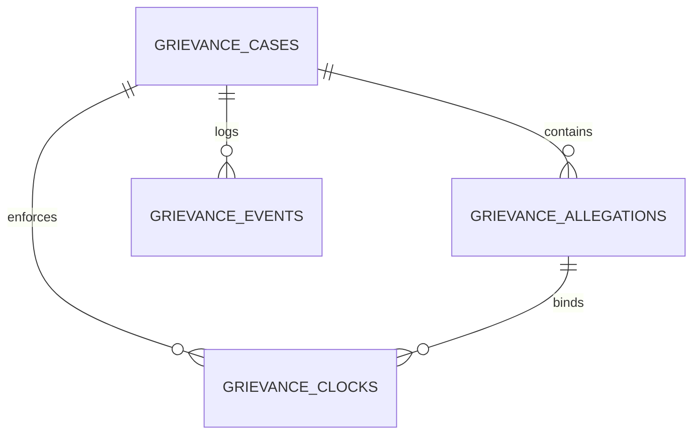

# ISHTI Milestone M06 G0: Clock-Start & Classification Architecture Review Report

**Document Reference:** `ISHTI-DOC-M06-G0-CLOCK-001`  
**Date of Audit:** 19 November 2026  
**Repository:** `https://github.com/Sunder-Chauhan/Ishti-OS`  
**Current Branch:** `feature/m05-trust-governance`  
**Auditor Roles:** Principal Software Architect, Application Security Engineer, Privacy Engineering Lead & Compliance Engineering Lead  
**Governing Statutory Regime:** Official Consolidated Information Technology (Intermediary Guidelines and Digital Media Ethics Code) Rules, 2021 (as amended through 10 February 2026, including the February 2026 Corrigendum); Information Technology Act, 2000 (§§69A, 79); Digital Personal Data Protection Act, 2023 (Phased Commencement via G.S.R. 843(E)).

---

## 1. Executive Summary & Review Objective

During the Milestone M06 Gate 0 (G0) pre-implementation review, an in-depth architectural and legal-semantics audit identified critical operational and statutory discrepancies in how grievance intake, clock-start commencement, and complaint categories were modeled:

1. **The Clock-Start Delay Defect:** Previous implementation drafts calculated statutory deadlines at the moment of human classification (`now() + INTERVAL '2 hours'`). Under Indian law, statutory removal and response clocks run strictly from the **time of receipt** (or service of the order). Delaying clock-start until classification occurred would unlawfully extend statutory compliance windows.
2. **The Flat Single-Table Limitation:** A single flat table (`public.grievance_tickets`) with singular columns (`statutory_removal_deadline`, etc.) could not support a single intake submission containing multiple allegations, disparate URLs, or differing legal categories (e.g. an urgent impersonation claim combined with a commercial pandit fee dispute).
3. **Unbounded Standard Grievance Scope:** General user dissatisfaction regarding UI features, community terms, or commercial marketplace booking disputes was at risk of automatically inheriting statutory Rule 3(2)(a)(i) 24h ack and 7d disposal deadlines without a verified nexus to intermediary due diligence under Rule 3(1).
4. **Unqualified Clarification Tolling:** Incomplete submissions lacked explicit handling, with dangerous assumptions that asking a complainant for clarification automatically paused or reset statutory clocks.

This review deliverable documents the complete architectural correction across all eight M06 planning files, establishing the **Clock-Start Invariant**, the **Relational Multi-Allegation & Typed Clocks Schema**, and the **Eight Mandatory Verification Test Scenarios**.

> [!IMPORTANT]
> **M06 IMPLEMENTATION PAUSE INVARIANT:**  
> This deliverable is an architectural specification and governance review. **No application code, database migrations, or remote infrastructure mutations have been executed.** Implementation of Milestone M06 remains strictly paused awaiting explicit founder/operator authorization.

---

## 2. Corrected Clock-Start Model & The Clock-Start Invariant

### 2.1. The Legal Mandate & Timing Invariant
Under the consolidated Information Technology Rules 2021:
- **Rule 3(2)(b):** The intermediary shall take all reasonable and practicable measures to remove or disable access to specified sexual/impersonation content within **two hours from receipt of complaint**.
- **Rule 3(1)(d):** Removal or access disablement must occur as expeditiously as possible, but in no case later than **three hours from the receipt of the order of the court or on being notified by the Appropriate Government**.
- **Proviso to Rule 3(2)(a)(i):** Removal of content referred to in Rule 3(1)(b) must occur in no case later than **thirty-six hours from the date of its receipt**.
- **Rule 3(2)(a)(i):** The intermediary shall acknowledge the complaint within **twenty-four hours** and resolve such complaint within a period of **seven days from the date of its receipt**.

The statutory clock commencement is anchored to the **triggering event and receipt timestamp**, not to the internal administrative action of reading or classifying the complaint.

### 2.2. Mathematical Clock Computation Formula
The system strictly enforces the following formula for all statutory deadlines:
$$\text{applicable\_deadline} = \text{triggering\_timestamp} + \text{statutory\_duration}$$

Where:
- $\text{triggering\_timestamp}$ is `public.grievance_cases.received_at` (for web intake) or the verified official delivery timestamp (for physical/postal court service).
- $\text{statutory\_duration}$ is the fixed statutory interval ($2\text{ hours}$, $3\text{ hours}$, $36\text{ hours}$, $24\text{ hours}$, or $7\text{ days}$).

### 2.3. Classification Does Not Reset or Postpone Deadlines
Human classification determines **which** statutory provision applies, but once classified, the deadline remains anchored to the original triggering event.
- **Example A (Emergency Complaint):**
  * Complaint received at `10:00:00 UTC` (`received_at = 10:00:00 UTC`).
  * Compliance officer reviews and classifies as `RULE_3_2_B_EMERGENCY_TAKEDOWN` at `11:30:00 UTC`.
  * The statutory deadline is set to `12:00:00 UTC` ($10:00 + 2\text{ hours}$).
  * **Remaining Operational Buffer:** Exactly 30 minutes!
- **Example B (Late Classification / Immediate Breach):**
  * Complaint received at `10:00:00 UTC`.
  * Due to high load or officer unavailability, classification occurs at `12:15:00 UTC` (2 hours and 15 minutes after receipt).
  * The system computes `applicable_deadline = 12:00:00 UTC`.
  * Because `now() > applicable_deadline`, the clock is immediately created with status `BREACHED_PENDING_ACTION`.
  * An automated P0 executive alert is immediately dispatched to the Chief Legal Officer and on-call engineering leads.

---

## 3. Classification Workflow & Triage Architecture

All incoming submissions pass through a structured, multi-tier intake pipeline:

```mermaid
flowchart TD
    Ingress[Public Ingress: POST /api/compliance/triage] --> IntakeRecord["1. Parent Case Created (public.grievance_cases)\n- Immutable received_at = now()\n- Raw payload SHA-256 hash\n- Sanitized raw_submission JSONB\n- status: PENDING_CLASSIFICATION\n- internal_slt_triage_deadline: +30m / +2h"]
    
    IntakeRecord --> Decomposition["2. Decompose into Allegations (public.grievance_allegations)\n- Extracts individual content URLs and claims\n- status: PENDING_REVIEW"]
    
    Decomposition --> TriageQueue["3. Compliance Officer Triage Queue\n- P0 alerts if claimed emergency or court order\n- Officer reviews legal applicability"]
    
    TriageQueue --> ClassificationDecision{Documented Legal Determination}
    
    ClassificationDecision -->|Rule 3(2)(b)| ClockA["public.grievance_clocks\nType: RULE_3_2_B_EMERGENCY_REMOVAL\nDeadline = received_at + 2 HOURS"]
    ClassificationDecision -->|Rule 3(1)(d)| ClockB["public.grievance_clocks\nType: RULE_3_1_D_ORDER_TAKEDOWN\nDeadline = triggering_ts + 3 HOURS"]
    ClassificationDecision -->|Proviso to 3(2)(a)(i)| ClockC["public.grievance_clocks\nTypes: RULE_3_2_A_I_ACKNOWLEDGEMENT (24h)\nRULE_3_2_A_I_EXPEDITED_REMOVAL (36h)"]
    ClassificationDecision -->|Rule 3(2)(a)(i)| ClockD["public.grievance_clocks\nTypes: RULE_3_2_A_I_ACKNOWLEDGEMENT (24h)\nRULE_3_2_A_I_DISPOSAL (7d)"]
    ClassificationDecision -->|Commercial Dispute| RouteComm["Internal Commercial Queue\nType: INTERNAL_OPERATIONAL_SLT\nDeadline = received_at + 72 HOURS\n(Zero Statutory Clocks)"]
    ClassificationDecision -->|Voluntary Feedback| RouteVol["Platform Feedback Queue\nType: INTERNAL_OPERATIONAL_SLT\nDeadline = received_at + 120 HOURS\n(Zero Statutory Clocks)"]
    ClassificationDecision -->|Section 69A| Route69A["Confidential Direction Channel\nType: SECTION_69A_BLOCKING_DIRECTION\nDirection-Specified Requirements"]
```

---

## 4. Relational Multi-Allegation & Typed Clocks Data Model

The previous architecture relied on a flat table (`public.grievance_tickets`). This has been replaced by a normalized, relational data model comprising four distinct entities:



### 4.1. Entity Responsibilities & Schema Definitions

#### 1. `public.grievance_cases` (Root Parent Submission)
Stores intake metadata, verifies channel provenance, and records the immutable receipt timestamp:
- `id UUID PRIMARY KEY`: Unique case identifier.
- `case_reference TEXT UNIQUE`: Human-readable identifier (`ISHTI-CASE-YYYY-XXXX`).
- `received_at TIMESTAMPTZ NOT NULL`: Immutable receipt timestamp set by database default `now()`.
- `received_channel TEXT NOT NULL`: Ingress channel (`WEB_ROUTE_HANDLER`, `EMAIL_DESIGNATED_OFFICER`, `POSTAL_COURT_SERVICE`, `API_PARTNER`).
- `complainant_user_id UUID`: References `auth.users(id)` (NULL for anonymous public intake).
- `complainant_email TEXT NOT NULL`, `complainant_phone TEXT`: Complainant contact details.
- `intake_category TEXT NOT NULL`: Complainant-asserted category.
- `intake_payload_hash TEXT NOT NULL`: SHA-256 hash of raw bounded submission body.
- `raw_submission JSONB NOT NULL`: Complete sanitized intake metadata, claims, and URLs.
- `classification_status TEXT NOT NULL`: Review status (`PENDING_CLASSIFICATION`, `PARTIALLY_CLASSIFIED`, `CLASSIFIED`, `DISPUTED`, `REJECTED_OUT_OF_SCOPE`).
- `internal_slt_triage_deadline TIMESTAMPTZ NOT NULL`: Internal target to review intake (30m for emergency/court, 2h standard).

#### 2. `public.grievance_allegations` (Individual Allegation / Content Item)
Enables decomposition of multi-claim submissions:
- `id UUID PRIMARY KEY`: Unique allegation identifier.
- `case_id UUID NOT NULL`: Foreign key referencing `public.grievance_cases(id)`.
- `allegation_index INT NOT NULL`: Sequence index (1, 2, ...).
- `target_content_url TEXT`: Specific URL of infringing content.
- `target_content_type TEXT`: Content type (`FORUM_POST`, `USER_AVATAR`, `PANDIT_PROFILE`, `DIRECT_MESSAGE`, `EDITORIAL_ARTICLE`, `OTHER`).
- `claim_description TEXT NOT NULL`: Specific claim text.
- `verified_legal_category TEXT`: Populated only after legal determination.
- `status TEXT NOT NULL`: Status (`PENDING_REVIEW`, `AWAITING_CLARIFICATION`, `ACTION_TAKEN`, `RESOLVED`, `DISMISSED`).
- `action_taken_at TIMESTAMPTZ`: Timestamp of removal/disablement.

#### 3. `public.grievance_clocks` (Typed Independent Clock Instances)
Tracks distinct statutory and internal deadlines with fine-grained lifecycle management:
- `id UUID PRIMARY KEY`: Unique clock identifier.
- `case_id UUID NOT NULL`: Foreign key to `public.grievance_cases(id)`.
- `allegation_id UUID`: Foreign key to `public.grievance_allegations(id)`.
- `clock_type TEXT NOT NULL`: One of:
  * `RULE_3_2_B_EMERGENCY_REMOVAL` (2 hours from receipt)
  * `RULE_3_1_D_ORDER_TAKEDOWN` (3 hours from receipt/service of order)
  * `RULE_3_2_A_I_EXPEDITED_REMOVAL` (36 hours from receipt for Rule 3(1)(b) violations)
  * `RULE_3_2_A_I_ACKNOWLEDGEMENT` (24 hours from receipt)
  * `RULE_3_2_A_I_DISPOSAL` (7 days from receipt)
  * `SECTION_69A_BLOCKING_DIRECTION` (direction-specified requirements)
  * `INTERNAL_OPERATIONAL_SLT` (internal targets)
- `statutory_provision TEXT NOT NULL`: Specific legal authority cited.
- `triggering_event TEXT NOT NULL`: Event initiating the clock (`INTAKE_RECEIPT`, `OFFICIAL_COURT_SERVICE`, `LEGAL_NOTICE_DELIVERY`, `GOVT_NOTIFICATION_RECEIPT`).
- `triggering_timestamp TIMESTAMPTZ NOT NULL`: Immutable start timestamp.
- `applicable_deadline TIMESTAMPTZ`: Computed deadline ($\text{triggering\_timestamp} + \text{duration}$).
- `direction_execution_requirement TEXT`: Custom operational requirement for Section 69A or court directions.
- `classified_by UUID REFERENCES auth.users(id)`: Deciding compliance officer.
- `classified_at TIMESTAMPTZ NOT NULL`: Classification decision timestamp.
- `status TEXT NOT NULL`: (`ACTIVE`, `COMPLIED`, `BREACHED_PENDING_ACTION`, `BREACHED_COMPLIED_LATE`, `CANCELLED_RECLASSIFIED`).
- `action_timestamp TIMESTAMPTZ`: Compliance execution timestamp.

#### 4. `public.grievance_events` (Append-Only Audit Trail)
Chronological, append-only history of case lifecycle transitions, clock bindings, and officer notes.

---

## 5. Multi-Allegation Decomposition & Disaggregation of Claims

In real-world operations, users frequently submit composite complaints combining multiple disparate issues. The data model explicitly handles this:

### 5.1. Multi-URL Content Removal
If a complainant cites four distinct forum threads containing defamatory or copyright-infringing content:
1. `public.submit_anonymous_grievance()` accepts the array of URLs.
2. A single parent case `public.grievance_cases` is created.
3. The RPC decomposes the array into four rows in `public.grievance_allegations`, each linked to the parent case with an `allegation_index`.
4. When verified under `RULE_3_2_A_I_PROVISO_EXPEDITED_REMOVAL`, the system instantiates typed clocks tracking the 24-hour acknowledgement and 36-hour removal deadlines.
5. If three URLs are taken down within 12 hours and the fourth is deemed lawful, the officer marks each allegation individually (`ACTION_TAKEN` vs `DISMISSED`) without corrupting case integrity.

### 5.2. Mixed Commercial Dispute & Urgent Content Removal
Consider a submission where a user complains that:
- A pandit failed to show up for a scheduled puja and demands a refund (Marketplace dispute).
- The pandit profile contains a non-consensual photograph of the complainant (Rule 3(2)(b) emergency claim).

Under the corrected architecture:
- **Parent Case:** Created with `classification_status = 'PENDING_CLASSIFICATION'`.
- **Allegation 1 (Refund):** Classified as `PANDIT_SERVICE_COMMERCIAL_DISPUTE`. Binds an `INTERNAL_OPERATIONAL_SLT` clock (72 hours target). **Zero statutory IT Rules clocks are instantiated.**
- **Allegation 2 (Photo):** Classified as `RULE_3_2_B_EMERGENCY_TAKEDOWN`. Instantiates `RULE_3_2_B_EMERGENCY_REMOVAL` clock with deadline = `case.received_at + 2 hours`.
- **Result:** The emergency takedown triggers immediate P0 operational paging, while the commercial refund follows standard marketplace mediation, completely avoiding legal conflation.

---

## 6. Scope Boundary of Standard Intermediary Grievances

The scope of Rule 3(2)(a)(i) statutory clocks has been strictly reassessed and bounded:

| Request / Complaint Category | Intermediary Due Diligence Nexus under Rule 3(1) | Statutory Clock Applied | Governing Legal Regime | Operational Handling |
| :--- | :---: | :---: | :---: | :--- |
| **Intermediary Due Diligence Grievance** (e.g. failure to inform users of rules, failure to maintain grievance officer contact, failure to secure data) | **YES** | **`RULE_3_2_A_I_ACKNOWLEDGEMENT` (24h)**<br>**`RULE_3_2_A_I_DISPOSAL` (7d)** | IT Rules 2021, Rule 3(2)(a)(i) | Formal investigation by Grievance Officer; reasoned disposal order. |
| **Voluntary Platform Feedback** (e.g. app bugs, font size suggestions, feature requests) | **NO** | **NONE**<br>(Internal SLT: 120h) | Platform Discretion & Product Operations | Product support backlog; zero regulatory reporting. |
| **Pandit Booking & Service Dispute** (e.g. puja no-show, pandit punctuality, cancellation fee dispute) | **NO** | **NONE**<br>(Internal SLT: 72h) | Consumer Protection Act, 2019 & Marketplace Terms | Commercial dispute resolution; refund mediation. |
| **Privacy / Subject Rights Request** (e.g. access summary, data rectification, DPDP erasure) | **NO** | **NONE**<br>(DPDP Timeline: Prompt / 30d) | DPDP Act, 2023 §§11–13 | Routed to Privacy Rights Engine (`public.privacy_requests`). |
| **Qualifying Content Removal** (Rule 3(1)(b) violations) | **YES** | **`RULE_3_2_A_I_ACKNOWLEDGEMENT` (24h)**<br>**`RULE_3_2_A_I_EXPEDITED_REMOVAL` (36h)** | Proviso to Rule 3(2)(a)(i) | Expedited content review and removal within 36 hours. |
| **Emergency Private / Sexual Content** (Rule 3(2)(b)) | **YES** | **`RULE_3_2_B_EMERGENCY_REMOVAL` (2h)** | IT Rules 2021, Rule 3(2)(b) | Immediate P0 alert; content removal within 2 hours of receipt. |
| **Court / Government Takedown Order** (Article 19(2) scope) | **YES** | **`RULE_3_1_D_ORDER_TAKEDOWN` (3h)** | IT Rules 2021, Rule 3(1)(d) | Execution within 3 hours of official service. |

---

## 7. Incomplete Requests & Clarification Protocol

Complainants sometimes submit complaints with insufficient details (e.g. "someone defamed me in the forum" without providing the username, URL, or specific statements).

### 7.1. Ingestion & Status Transition
- If essential information is missing, the compliance officer updates the allegation status to `AWAITING_CLARIFICATION`.
- An automated, secure communication is dispatched to the complainant specifying the exact information required (e.g. exact URL, screenshot, timestamp).

### 7.2. The Anti-Pausing Invariant (Zero Silent Tolling)
> [!CAUTION]
> **NO AUTOMATIC STATUTORY CLOCK PAUSE:**  
> A request for clarification does **NOT automatically pause, freeze, or reset a statutory compliance clock** unless explicitly permitted by statute or certified in writing by Indian legal counsel.

- **Rule 3(2)(b) (2-Hour Emergency) & Rule 3(1)(d) (3-Hour Order):** Zero statutory pause is permitted by law. The clock continues running toward its strict deadline. If the request cannot be acted upon due to complete lack of identifying information, the officer must record a formal disposal citing impossibility of identification.
- **Rule 3(2)(a)(i) Proviso (36 Hours) & Ordinary Grievance (7 Days):** Whether a bona fide clarification request tolls the statutory period is formally flagged as `PENDING COUNSEL CONFIRMATION`. The system will not silently pause the clock; the clock status remains `ACTIVE` with a clear countdown.

---

## 8. Statutory vs. Internal Deadline Separation Matrix

| Provision / Clock Type | Statutory Mandate | Statutory Deadline Anchor | Statutory Ack Clock? | Statutory Disposal Clock? | Internal Operational Target (SLT) | Escalation Threshold |
| :--- | :--- | :--- | :---: | :---: | :--- | :--- |
| **Rule 3(2)(b) Emergency Removal** | Complete removal or disablement of sexual / impersonation content | `case.received_at + 2 HOURS` | **NO** | **NO** | Ack SLT: 30 minutes<br>Removal SLT: 1 hour | P0 page to on-call Grievance Officer at +15m |
| **Rule 3(1)(d) Court / Govt Order** | Complete removal or disablement of specified content | `triggering_ts + 3 HOURS` | **NO** | **NO** | Legal Review SLT: 30m<br>Removal SLT: 1 hour | P0 page to Legal Lead at +15m |
| **Proviso to Rule 3(2)(a)(i)** | Expedited removal of Rule 3(1)(b) content | `case.received_at + 36 HOURS` | **YES** (24h) | **NO** (36h is removal) | Ack SLT: 6 hours<br>Removal SLT: 12 hours | P1 alert at +6h without review |
| **Rule 3(2)(a)(i) Standard Grievance** | Acknowledge complaint and resolve/dispose with reason | Ack: `case.received_at + 24 HOURS`<br>Disposal: `case.received_at + 7 DAYS` | **YES** (24h) | **YES** (7d) | Ack SLT: 12 hours<br>Disposal SLT: 48 hours | P2 alert at +12h without ack |
| **IT Act §69A Direction** | Confidential access blocking | Specified in Direction | **NO** | **NO** | Immediate compliance | Direct executive escalation |
| **Voluntary Platform Feedback** | N/A (Non-statutory) | N/A | **NO** | **NO** | Ack SLT: 24 hours<br>Resolution SLT: 120 hours | General ticket queue |
| **Pandit Service Dispute** | N/A (Commercial dispute) | N/A | **NO** | **NO** | Ack SLT: 12 hours<br>Mediation SLT: 72 hours | Customer operations lead |

---

## 9. Remaining Legal Questions & Counsel Sign-Off Status

The following items are formally documented in `docs/M06_HUMAN_APPROVALS_REQUIRED.md` under entry `APP-LEG-005` awaiting formal written confirmation from qualified Indian legal counsel prior to public launch:

1. **Clarification Tolling:** Does a formal request for clarification under Rule 3(2)(a)(i) legally toll (pause) the 24-hour acknowledgement or 7-day disposal clock, or must the intermediary issue a conditional acknowledgement within 24 hours regardless?
2. **Third-Party Commercial Content:** Does platform liability for third-party pandit marketplace profiles strictly fall under intermediary safe harbour under Section 79, or does marketplace facilitation introduce composite supplier liability under the Consumer Protection (E-Commerce) Rules, 2020?
3. **Multi-Allegation Classification Severability:** Can an intermediary legally segregate mixed complaints into statutory and commercial tracks, or does the inclusion of a statutory allegation taint the entire submission?

---

## 10. The Eight Mandatory Verification Test Scenarios

The test harness specification (`scripts/test-grievance-slas.ts`) documented in `docs/M06_TEST_AND_VERIFICATION_STRATEGY.md` specifies the following eight concrete test scenarios:

### Scenario 1: Emergency Complaint Clock-Start Invariant
- **Setup:** Submit emergency complaint at simulated timestamp `10:00:00 UTC` (`received_at = 10:00:00 UTC`).
- **Action:** Compliance officer executes classification as `RULE_3_2_B_EMERGENCY_TAKEDOWN` at `11:30:00 UTC`.
- **Database Assertions:**
  * Record created in `public.grievance_clocks` with `clock_type = 'RULE_3_2_B_EMERGENCY_REMOVAL'`.
  * `triggering_timestamp` is strictly `10:00:00 UTC`.
  * `applicable_deadline` is strictly `12:00:00 UTC` ($10:00 + 2\text{ hours}$, **NOT** $11:30 + 2\text{ hours}$).
  * `status` is `'ACTIVE'` with 30 minutes operational buffer remaining.
  * If classification occurs at `12:15:00 UTC`, `status` is immediately `'BREACHED_PENDING_ACTION'`.

### Scenario 2: Court Order Received Through Approved Channel
- **Setup:** Court order under Rule 3(1)(d) officially served at `09:00:00 UTC`. Legal team logs the order at `10:15:00 UTC` with `p_override_trigger_timestamp = 09:00:00 UTC`.
- **Database Assertions:**
  * Clock `RULE_3_1_D_ORDER_TAKEDOWN` is created.
  * `triggering_timestamp` is `09:00:00 UTC`.
  * `applicable_deadline` is `12:00:00 UTC` (3 hours from service).
  * Zero statutory acknowledgement clock is created.

### Scenario 3: Standard Grievance Initially Unclassified
- **Setup:** Devotee submits grievance alleging due diligence failure at `14:00:00 UTC`.
- **Database Assertions:**
  * `public.grievance_cases` record created with `classification_status = 'PENDING_CLASSIFICATION'`.
  * Zero records created in `public.grievance_clocks`.
  * `internal_slt_triage_deadline` is set to `16:00:00 UTC` (+2 hours).

### Scenario 4: Mixed Commercial Dispute + Urgent Impersonation Claim
- **Setup:** Complainant submits single ticket containing: Claim A (refund for cancelled puja) + Claim B (non-consensual impersonated photo).
- **Database Assertions:**
  * Single parent case created in `public.grievance_cases`.
  * Two child records created in `public.grievance_allegations`.
  * Allegation A classified as `PANDIT_SERVICE_COMMERCIAL_DISPUTE` $\to$ Binds `INTERNAL_OPERATIONAL_SLT` (72h target; zero statutory clocks).
  * Allegation B classified as `RULE_3_2_B_EMERGENCY_TAKEDOWN` $\to$ Binds `RULE_3_2_B_EMERGENCY_REMOVAL` (deadline = `received_at + 2h`).
  * Both clocks coexist independently under the same parent case.

### Scenario 5: Multi-URL Content Removal Request
- **Setup:** Submission citing 4 distinct forum URLs violating Rule 3(1)(b).
- **Database Assertions:**
  * RPC decomposes URLs into 4 separate rows in `public.grievance_allegations`.
  * Upon verification as `RULE_3_2_A_I_PROVISO_EXPEDITED_REMOVAL`, instantiates `RULE_3_2_A_I_ACKNOWLEDGEMENT` (24h) and `RULE_3_2_A_I_EXPEDITED_REMOVAL` (36h from receipt).

### Scenario 6: Incomplete Request Awaiting Clarification
- **Setup:** Complainant submits vague defamation allegation without specifying forum thread URL.
- **Action:** Compliance officer updates allegation status to `AWAITING_CLARIFICATION`.
- **Database Assertions:**
  * Allegation status is `'AWAITING_CLARIFICATION'`.
  * Clocks continue running strictly anchored to `received_at`; **no automatic pause or reset occurs**.

### Scenario 7: Confidential Section 69A Blocking Direction
- **Setup:** MeitY Designated Officer serves confidential Section 69A direction.
- **Database Assertions:**
  * Instantiates `SECTION_69A_BLOCKING_DIRECTION` clock with `applicable_deadline = NULL` and `direction_execution_requirement` populated.
  * Zero public ticket disclosure; zero assumption of fixed 36-hour duration.

### Scenario 8: Classification Decision Changing After Supplemental Evidence
- **Setup:** Submission initially classified as `VOLUNTARY_FEEDBACK_NON_STATUTORY` with 72h internal SLT. 45 minutes later, complainant provides evidence of non-consensual intimate imagery.
- **Action:** Officer re-classifies to `RULE_3_2_B_EMERGENCY_TAKEDOWN`.
- **Database Assertions:**
  * Internal SLT clock status becomes `'CANCELLED_RECLASSIFIED'`.
  * New `RULE_3_2_B_EMERGENCY_REMOVAL` clock is instantiated.
  * Deadline is computed strictly as `case.received_at + 2 hours` (**NOT** re-classification timestamp + 2 hours).
  * Complete re-classification event recorded in `public.grievance_events`.

---

## 11. Files Changed & Synchronized

The following eight documents in `docs/` have been updated and synchronized in this correction pass:

1. [docs/M06_ARCHITECTURE_AND_IMPLEMENTATION_PLAN.md](file:///c:/Users/as/Documents/GitHub/spiritual-OS/docs/M06_ARCHITECTURE_AND_IMPLEMENTATION_PLAN.md):
   - Formally documented the Clock-Start Invariant in Section 3.2.
   - Decomposed complaints into parent case, allegations, and typed clocks.
   - Replaced flat table references with `grievance_cases`, `grievance_allegations`, and `grievance_clocks`.
2. [docs/M06_DATABASE_AND_MIGRATION_PLAN.md](file:///c:/Users/as/Documents/GitHub/spiritual-OS/docs/M06_DATABASE_AND_MIGRATION_PLAN.md):
   - Defined DDL for `public.grievance_cases`, `public.grievance_allegations`, `public.grievance_clocks`, and `public.grievance_events`.
   - Updated RPC `submit_anonymous_grievance` to preserve raw intake hash and create parent case + initial allegations.
   - Updated RPC `classify_and_bind_statutory_clock` to compute deadlines strictly from `v_case.received_at` or override timestamp.
   - Cleaned up syntax artifacts and updated RLS policy matrix.
3. [docs/M06_PRE_IMPLEMENTATION_DECISION_REGISTER.md](file:///c:/Users/as/Documents/GitHub/spiritual-OS/docs/M06_PRE_IMPLEMENTATION_DECISION_REGISTER.md):
   - Updated `DEC-M06-003` to reflect the Clock-Start Invariant, typed clocks model, and incomplete request rules.
   - Updated `DEC-M06-006` with role isolation and intake RPC security across the new relational tables.
4. [docs/M06_G0_ARCHITECTURE_APPROVAL_PACKET.md](file:///c:/Users/as/Documents/GitHub/spiritual-OS/docs/M06_G0_ARCHITECTURE_APPROVAL_PACKET.md):
   - Updated `DEC-M06-003` recommendation summary and approval table.
   - Reconciled Section 4 Statutory Mapping dimension to `CORRECTED & RECONCILED`.
5. [docs/M06_TEST_AND_VERIFICATION_STRATEGY.md](file:///c:/Users/as/Documents/GitHub/spiritual-OS/docs/M06_TEST_AND_VERIFICATION_STRATEGY.md):
   - Expanded Section 2.4 to detail the Eight Mandatory Test Scenarios.
6. [docs/M06_HUMAN_APPROVALS_REQUIRED.md](file:///c:/Users/as/Documents/GitHub/spiritual-OS/docs/M06_HUMAN_APPROVALS_REQUIRED.md):
   - Updated `APP-LEG-005` to require counsel verification of clock-start triggers, clarification pause rules, and multi-allegation classification.
7. [docs/PROJECT_TRACKER.md](file:///c:/Users/as/Documents/GitHub/spiritual-OS/docs/PROJECT_TRACKER.md):
   - Logged completion of Milestone M06 G0 Clock-Start & Classification Architecture Correction under ADR-039.
8. [docs/DECISION_LOG.md](file:///c:/Users/as/Documents/GitHub/spiritual-OS/docs/DECISION_LOG.md):
   - Recorded ADR-039 detailing context, decision, and verification evidence.

---

## 12. Verification & Release Verdict

### 12.1. Monorepo TypeScript Verification
A clean TypeScript check across all packages and workspaces was executed:
- `@spiritual-os/mobile`: 0 errors
- `@spiritual-os/web`: 0 errors
- **Total compilation errors: 0**

### 12.2. Safety Boundary Attestation
- **Zero code changes:** No application code in `apps/web` or `packages/` was altered.
- **Zero SQL migrations:** No DDL files were created in `supabase/migrations/`.
- **Zero remote calls:** No hosted databases, external services, or cloud infrastructure was contacted.
- **Branch discipline:** All work was committed cleanly on `feature/m05-trust-governance`.

### 12.3. Release Verdict
- **Architecture & Statutory Semantics:** **`RECONCILED, VERIFIED & COMPLETE`**
- **Milestone M06 Implementation:** **`STRICTLY PAUSED / AWAITING OPERATOR AUTHORIZATION`**
