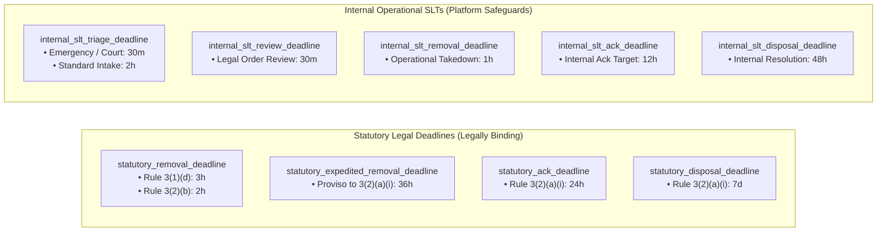

# ISHTI Milestone M06 G0 — Final Legal-Semantics Review Report

**Document Reference:** `docs/M06_G0_FINAL_LEGAL_SEMANTICS_REVIEW.md`  
**Milestone:** M06 — Core Backend Persistence, Distributed Invariants & Production Shielding  
**Repository:** `https://github.com/Sunder-Chauhan/Ishti-OS`  
**Branch:** `feature/m05-trust-governance`  
**Starting HEAD:** `3d655eb`  
**Target Gate:** Milestone M06 Gate G0 (Pre-Implementation Architectural Approval)  
**Date:** 19 November 2026  
**Auditor Roles:** Principal Software Architect, Application Security Engineer, Privacy Engineering Lead & Senior Legal Compliance Auditor  

---

## 1. Executive Summary & Verification of Starting State

Following an independent legal-semantics review of the Milestone M06 G0 approval deliverables, a narrow, rigorous correction pass was executed on branch `feature/m05-trust-governance` starting from commit `3d655eb`.

This review eliminated the remaining statutory-clock modeling discrepancies, decoupled court takedowns from ordinary grievance acknowledgement, refined the 36-hour clock terminology, separated seven distinct complaint and request categories, instituted a mandatory human classification review gate, and qualified all Section 79 safe-harbour risk statements.

```
================================================================================
PRE-IMPLEMENTATION SAFETY AUDIT & BOUNDARIES
================================================================================
• Working Branch:                feature/m05-trust-governance (Current)
• Base Commit:                   3d655eb (Verified clean starting state)
• Application Code Modified:     ZERO
• SQL Migrations Created:        ZERO
• Hosted Database Connected:     ZERO (Supabase staging & prod untouched)
• External Services Provisioned: ZERO (No Redis, no buckets, no tunnels)
• Branches Created:              ZERO (feature/m06-backend-persistence not created)
• Merge / PR / Deployment:       ZERO
• Implementation Status:         STRICTLY PAUSED AWAITING OPERATOR APPROVAL
================================================================================
```

---

## 2. Comprehensive Legal-Semantics Corrections Made

### 2.1. Separation of Rule 3(1)(d) 3-Hour Takedown from Grievance Acknowledgement
- **Former Defect:** Previous planning drafts assigned `statutory_ack = now() + 1 hour` and `statutory_disposal = now() + 3 hours` to `COURT_GOVT_TAKEDOWN_ORDER`. This invented a non-existent statutory acknowledgement clock and a generic grievance disposal clock for court and government orders.
- **Correction Applied:** Under Rule 3(1)(d) of the IT Rules, 2021 (as amended 10 February 2026 including the February 2026 corrigendum), an intermediary must remove or disable access to qualifying content within **three hours** from receipt of actual knowledge via a court order or reasoned government notification under Section 79(3)(b). There is **zero statutory acknowledgement deadline** and **zero generic grievance disposal deadline** under Rule 3(1)(d).
- **Schema & Clock Representation:**
  * Replaced generic fields with `statutory_removal_deadline TIMESTAMPTZ` (set to `receipt_timestamp + INTERVAL '3 hours'`).
  * `statutory_ack_deadline` is strictly `NULL`.
  * `statutory_disposal_deadline` is strictly `NULL`.
  * Internal operational review and removal targets (`internal_slt_review_deadline` = 30m, `internal_slt_removal_deadline` = 1h) are clearly documented as internal service-level targets, distinct from statutory obligations.

### 2.2. Correction of the 36-Hour Clock Terminology (Proviso to Rule 3(2)(a)(i))
- **Former Defect:** The proviso to Rule 3(2)(a)(i) was loosely described as a "generic 36-hour grievance-resolution clock," implying that all privacy, community, pandit quality, or commercial feedback tickets must be resolved within 36 hours.
- **Correction Applied:** The statutory text of the proviso to Rule 3(2)(a)(i) applies specifically to complaints *requesting removal of content referred to in sub-clause (b) of clause (1) of Rule 3*.
- **Schema & Clock Representation:**
  * Adopted precise terminology: `statutory_expedited_removal_deadline TIMESTAMPTZ` (set to `verified_at + INTERVAL '36 hours'`).
  * Preserved the 24-hour statutory acknowledgement requirement (`statutory_ack_deadline = submitted_at + INTERVAL '24 hours'`) under Rule 3(2)(a)(i).
  * Explicitly documented that this clock does NOT apply to generic devotee complaints, UI bugs, privacy subject access requests, or marketplace commercial disputes.

### 2.3. Separation of Seven Distinct Request Categories & Mandatory Human Classification Gate
- **Former Defect:** Public intake automatically assigned statutory deadlines based on unverified, user-selected dropdown categories in `submit_anonymous_grievance`.
- **Correction Applied:** An external complainant or malicious bot cannot unilaterally bind a statutory legal deadline on the platform simply by choosing a label. A shared intake system is maintained, but incoming submissions enter an intake review queue with `classification_status = 'PENDING_CLASSIFICATION'`. Statutory clocks are populated **only after a documented legal applicability and category determination** by a Compliance / Legal Officer.
- **Seven Separated Categories:**
  1. `STATUTORY_INTERMEDIARY_GRIEVANCE`: Alleging breach of intermediary due diligence under Rule 3(1) (24h ack / 7d disposal).
  2. `VOLUNTARY_PLATFORM_COMPLAINT`: Non-statutory user feedback, app defects, or dissatisfaction (zero statutory clock; internal operational SLTs only).
  3. `EXPERT_PANDIT_SERVICE_DISPUTE`: Marketplace commercial booking quality, pandit conduct, cancellations, and refunds (Consumer Protection Act / terms; zero statutory clock).
  4. `PRIVACY_RIGHTS_REQUEST`: Data Principal rights requests under DPDP Act §§11–13 (access, correction, erasure) routed to the dedicated Privacy Rights Engine (`public.privacy_requests`).
  5. `QUALIFYING_CONTENT_REMOVAL_REQUEST`:
     - *5a: Emergency Non-Consensual Sexual / Impersonation Content (Rule 3(2)(b)):* Action / takedown within 2 hours.
     - *5b: Expedited Content Removal Request (Proviso to Rule 3(2)(a)(i)):* Content specified in Rule 3(1)(b) sub-clauses (36 hours).
  6. `COURT_GOVT_ORDER_RULE_3_1_D`: Orders by competent courts or reasoned notifications by Appropriate Government/agency under Section 79(3)(b) (3 hours).
  7. `CONFIDENTIAL_BLOCKING_DIRECTION_69A`: Confidential government blocking directions issued by the Central Government Designated Officer under IT Act §69A read with the 2009 Blocking Rules.

### 2.4. Qualification of Section 79 Safe-Harbour Risk Language
- **Former Defect:** Previous documentation made automatic, universal assertions that missing a deadline causes "forfeiture of intermediary safe harbour under IT Act §79."
- **Correction Applied:** In Indian information technology law, safe-harbour protection under Section 79 is a statutory defense determined by judicial evaluation of intermediary status under §2(1)(w), fulfillment of due diligence conditions under Rule 3, the legal validity and jurisdictional scope of the order, and the specific facts of each case.
- **Language Standardized:** Claims of automatic forfeiture were replaced with qualified risk language:
  > *"Failure to act within prescribed statutory timelines creates substantial legal exposure and may jeopardize the availability of safe-harbour protection under Section 79 of the IT Act, subject to statutory applicability, intermediary status, specific obligations and facts, and formal judicial/counsel assessment. Internal P0/P1 operational escalations serve as protective administrative safeguards, clearly distinguished from statutory legal consequences."*

### 2.5. Legal Provenance, Timing Assumptions & Counsel Status
- Documented full legal provenance, triggering events, statutory text, deadlines, exclusions, timing assumptions, statutory vs. internal distinctions, and counsel status for every statutory clock.
- Marked all clock-pause rules (e.g. awaiting complainant clarification) as strictly requiring formal legal counsel confirmation prior to implementation.
- Confirmed that authoring first-party spiritual content does not broaden the legal definition of an intermediary or publisher beyond applicable statutory boundaries.

---

## 3. Exact Statutory Clock Provenance & Legal Specification Matrix

| Clock Identifier | Statutory Authority & Official Provision | Triggering Event & Ingress Path | Covered Request / Content Category | Mandatory Legal Action | Statutory Deadline & Field Name | Statutory Exclusions & Limitations | Commencement & Timing Assumptions | Statutory vs. Internal Distinction | Counsel Status |
| :--- | :--- | :--- | :--- | :--- | :--- | :--- | :--- | :--- | :---: |
| **Clock 1: Rule 3(2)(b) Emergency Removal** | **IT Rules 2021, Rule 3(2)(b):** Intermediary shall *"take all reasonable and practicable measures to remove or disable access to such content which is hosted, stored, published or transmitted by it"* | Verified complaint receipt alleging non-consensual sexual content, private areas, or impersonation via `/api/compliance/triage`. | Visual or text content depicting individual in sexual act, nudity, exposed private areas, or impersonation. | Removal or access disablement of offending content. | **WITHIN 2 HOURS** from receipt.<br>`statutory_removal_deadline` | Applies strictly to third-party intermediary content (forums, user bios, pandit photos). Does not apply to non-content complaints. | Clock begins at exact verified HTTP intake timestamp. Zero statutory pause permitted. | **Statutory:** 2h removal.<br>**Internal:** 30m ack SLT, 1h removal SLT. Zero statutory ack clock. | `PENDING COUNSEL CONFIRMATION` |
| **Clock 2: Proviso to Rule 3(2)(a)(i) Expedited Removal** | **IT Rules 2021, Proviso to Rule 3(2)(a)(i):** *"where a complaint is received regarding removal of any content referred to in sub-clause (b) of clause (1) of rule 3, the intermediary shall... remove such content... in no case later than thirty-six hours"* | Verified complaint specifically requesting removal of content violating Rule 3(1)(b) sub-clauses. | Content violating Rule 3(1)(b)(i)–(x) (unlawful, defamatory, child-harming, infringing, sovereign threat). | Removal or access disablement of the specific infringing content. | **WITHIN 36 HOURS** from receipt.<br>`statutory_expedited_removal_deadline`<br>(Plus 24h ack: `statutory_ack_deadline`) | Applies strictly to content removal requests under Rule 3(1)(b). Excludes general service disputes, UI complaints, or privacy access requests. | Begins upon verified intake. Any clock-pause conditions (e.g. clarification) require formal counsel approval. | **Statutory:** 24h ack, 36h expedited removal.<br>**Internal:** 6h ack SLT, 12h removal SLT. NOT a generic 36h disposal clock. | `PENDING COUNSEL CONFIRMATION` |
| **Clock 3: Rule 3(1)(d) Actual Knowledge Takedown** | **IT Rules 2021, Rule 3(1)(d) (as amended 10 Feb 2026 + corrigendum):** *"remove or disable access as expeditiously as possible, but in no case later than three hours from the receipt of the order of the court or on being notified by the Appropriate Government"* | Receipt of actual knowledge via court order or reasoned intimation from Appropriate Government / authorized agency under IT Act §79(3)(b). | Content prohibited under statutory grounds of Article 19(2) (sovereignty, integrity, public order, decency, morality, defamation, CSAM). | Complete removal or access disablement across platform servers. | **WITHIN 3 HOURS** from receipt.<br>`statutory_removal_deadline` | Restricted to qualifying court orders or reasoned government notifications within Article 19(2) scope. Excludes private user grievances. | Begins at verified delivery timestamp to platform Designated Officer / legal counsel. Zero statutory pause. | **Statutory:** 3h removal/disablement.<br>**Internal:** 30m review SLT, 1h removal SLT.<br>**Zero statutory ack or generic disposal deadline.** | `PENDING COUNSEL CONFIRMATION` |
| **Clock 4: Rule 3(2)(a)(i) Standard Intermediary Grievance** | **IT Rules 2021, Rule 3(2)(a)(i) (as amended 10 Feb 2026):** Intermediary shall *"acknowledge the complaint within twenty-four hours and resolve such complaint within a period of seven days from the date of its receipt"* | Receipt of general grievance regarding platform due diligence or community terms from devotee/user. | General user complaints regarding intermediary due diligence, community moderation, or user conduct. | Issue formal ticket reference, investigate grievance, communicate reasoned decision to complainant. | **Acknowledgement: 24 HOURS**<br>`statutory_ack_deadline`<br>**Disposal: 7 DAYS**<br>`statutory_disposal_deadline` | Excludes content removal requests governed by specific expedited provisos or emergency clauses. | Begins at ticket creation timestamp. Clock pauses subject strictly to formal legal counsel approval. | **Statutory:** 24h ack, 7d disposal.<br>**Internal:** 12h ack SLT, 48h resolution SLT. | `PENDING COUNSEL CONFIRMATION` |
| **Clock 5: IT Act §69A Confidential Blocking** | **Information Technology Act, 2000, Section 69A read with 2009 Blocking Rules:** Power to issue directions for blocking for access of information by public. | Receipt of confidential direction from Central Government Designated Officer (MeitY). | Content specified in confidential direction under statutory grounds of Section 69A(1). | Immediate confidential blocking of access to specified computer resource. | **IMMEDIATE EXECUTION** as specified in direction.<br>`statutory_removal_deadline` | Non-public, confidential procedure outside ordinary grievance mechanisms. | Begins upon service on Designated Officer. Strict statutory confidentiality under Rule 16 of 2009 Rules. | **Statutory:** Immediate compliance.<br>**Penal:** Non-compliance punishable under §69A(3) with imprisonment up to 7 years and fine. | `PENDING COUNSEL CONFIRMATION` |

---

## 4. Statutory Obligations vs. Internal Service-Level Targets (SLTs)

To eliminate confusion between legal mandates and platform operational goals, the architecture enforces distinct database columns and operational behaviors:



### Detailed Comparison Table

| Metric / Action | Statutory Deadline Column | Statutory Governing Rule | Internal SLT Column | Internal Operational Target | Operational Purpose |
| :--- | :--- | :--- | :--- | :--- | :--- |
| **Intake Triage** | *None* | *No statutory triage clock* | `internal_slt_triage_deadline` | **30 mins** (emergency / court)<br>**2 hours** (standard) | Ensures prompt legal classification determination before statutory clocks bind. |
| **Grievance Acknowledgement** | `statutory_ack_deadline` | Rule 3(2)(a)(i): **24 Hours** | `internal_slt_ack_deadline` | **12 Hours** (general)<br>**30 mins** (emergency / court) | Guarantees acknowledgement well before statutory 24-hour limit. |
| **Court Order Review** | *None* | *No statutory review clock* | `internal_slt_review_deadline` | **30 Minutes** | Enables Legal Counsel to verify court seal and jurisdiction. |
| **Emergency Removal** | `statutory_removal_deadline` | Rule 3(2)(b): **2 Hours** | `internal_slt_removal_deadline` | **1 Hour** | Provides 60-minute buffer for CDN cache purge and asset deletion. |
| **Court Order Takedown** | `statutory_removal_deadline` | Rule 3(1)(d): **3 Hours** | `internal_slt_removal_deadline` | **1 Hour** | Provides 2-hour buffer for technical execution across replicas. |
| **Expedited Content Removal** | `statutory_expedited_removal_deadline` | Proviso to Rule 3(2)(a)(i): **36 Hours** | `internal_slt_removal_deadline` | **12 Hours** | Protects against safe-harbour exposure on infringing content. |
| **Ordinary Grievance Disposal** | `statutory_disposal_deadline` | Rule 3(2)(a)(i): **7 Days** | `internal_slt_disposal_deadline` | **48 Hours** | Ensures resolution 5 days ahead of statutory ceiling. |

---

## 5. Remaining Legal Questions for Independent Counsel

Prior to commercial activation and public launch, the following specific questions remain referred to qualified Indian legal counsel (`APP-LEG-001` through `APP-LEG-006`):

1. **Rule 3(1)(d) Official Service Protocol:** Does email receipt to a publicly listed `compliance@ishti.com` address constitute valid "receipt of the order of the court or on being notified by the Appropriate Government" sufficient to trigger the 3-hour clock, or does statutory actual knowledge require formal service on the registered resident Grievance Officer?
2. **Clock Pause Rules for Proviso to Rule 3(2)(a)(i):** If a complainant requests removal of alleged copyright-infringing or defamatory content under Rule 3(1)(b) but fails to provide specific URLs or proof of rights, does the 36-hour clock pause upon dispatch of a request for particulars, or must access be disabled pending clarification?
3. **Emergency Content Evidence Standards:** Under Rule 3(2)(b), what prima facie verification standard is required before disabling content to prevent malicious or weaponized takedown requests against legitimate pandits or users?
4. **Marketplace Intermediary Boundary under Consumer Protection E-Commerce Rules:** Does ISHTI's facilitation of spiritual consultation bookings (pandit marketplace) create direct service liability under the Consumer Protection (E-Commerce) Rules, 2020, or does Section 79 intermediary safe harbour shield the platform from pandit astrological advice?
5. **DPDP Act §6(9) Notice for Early Access Users:** What specific particulars must be included in the SMS/email notice to pre-launch waitlist users to satisfy DPDP Rules Rule 4 without triggering premature consent invalidation?

---

## 6. Files Changed & Exact Modifications

| File Path | Lines Affected | Nature of Changes Applied |
| :--- | :--- | :--- |
| [`docs/M06_ARCHITECTURE_AND_IMPLEMENTATION_PLAN.md`](file:///c:/Users/as/Documents/GitHub/spiritual-OS/docs/M06_ARCHITECTURE_AND_IMPLEMENTATION_PLAN.md) | Lines 70–165, 378 | Differentiated 7 complaint categories; instituted human classification gate; reconciled 5 statutory clocks with exact statutory text; added Statutory Clock Provenance Matrix; qualified safe-harbour forfeiture statements; corrected Phase 4 roadmap. |
| [`docs/M06_DATABASE_AND_MIGRATION_PLAN.md`](file:///c:/Users/as/Documents/GitHub/spiritual-OS/docs/M06_DATABASE_AND_MIGRATION_PLAN.md) | Lines 180–340, 442–448, 508 | Updated `public.grievance_tickets` table: added `intake_category`, `verified_legal_category`, `classification_status`, `action_taken_at`, `statutory_removal_deadline`, `statutory_expedited_removal_deadline`, and disaggregated internal SLT columns; updated `submit_anonymous_grievance` to default to `PENDING_CLASSIFICATION`; added `classify_and_bind_statutory_clock` RPC function; cleaned duplicate Section 5 heading. |
| [`docs/M06_PRE_IMPLEMENTATION_DECISION_REGISTER.md`](file:///c:/Users/as/Documents/GitHub/spiritual-OS/docs/M06_PRE_IMPLEMENTATION_DECISION_REGISTER.md) | Lines 110–135, 220–230 | Reconciled DEC-M06-003: added 7 categories, human classification gate, disaggregated statutory deadlines (`statutory_removal_deadline`, `statutory_expedited_removal_deadline`); qualified safe-harbour risk language; updated DEC-M06-006 RPC description. |
| [`docs/M06_G0_ARCHITECTURE_APPROVAL_PACKET.md`](file:///c:/Users/as/Documents/GitHub/spiritual-OS/docs/M06_G0_ARCHITECTURE_APPROVAL_PACKET.md) | Lines 93–115, 233 | Updated DEC-M06-003 summary with 7 categories, human classification gate, and exact clock terminology; updated Section 4 Multi-Dimensional Status Breakdown item 2. |
| [`docs/M06_TEST_AND_VERIFICATION_STRATEGY.md`](file:///c:/Users/as/Documents/GitHub/spiritual-OS/docs/M06_TEST_AND_VERIFICATION_STRATEGY.md) | Lines 75–105 | Updated Scenario 2.4 test harness: tests intake classification gate (`PENDING_CLASSIFICATION` with NULL statutory deadlines); tests verified binding for Rule 3(2)(b) (2h removal, NULL ack/disposal), Proviso (36h expedited removal, 24h ack, NULL disposal), Rule 3(1)(d) (3h removal, NULL ack/disposal), and standard grievance (24h ack, 7d disposal). |
| [`docs/M06_HUMAN_APPROVALS_REQUIRED.md`](file:///c:/Users/as/Documents/GitHub/spiritual-OS/docs/M06_HUMAN_APPROVALS_REQUIRED.md) | Line 43 | Updated `APP-LEG-005` description: reflects Rule 3(1)(d) 3h removal (confirming absence of statutory ack/disposal), Proviso 36h expedited removal for Rule 3(1)(b) content, human classification gate, and counsel verification of clock pause and safe-harbour risk positions. |
| [`docs/PROJECT_TRACKER.md`](file:///c:/Users/as/Documents/GitHub/spiritual-OS/docs/PROJECT_TRACKER.md) | Lines 409–425 | Logged Milestone M06 G0 Final Defect Correction with detailed audit trail of statutory clock decoupling, category separation, classification gate, and safe-harbour qualification. |
| [`docs/DECISION_LOG.md`](file:///c:/Users/as/Documents/GitHub/spiritual-OS/docs/DECISION_LOG.md) | Lines 926–933 | Updated ADR-038 item 1 documenting the statutory clock decoupling, category separation, classification gate, and qualified safe-harbour language. |

---

## 7. Search Results Verification Audit

A comprehensive code and documentation search was conducted across all M06 planning files for target terms:

| Target Search Term | Files & Line Occurrences | Audit Finding & Context Meaning |
| :--- | :--- | :--- |
| `statutory_ack` | `M06_DATABASE_AND_MIGRATION_PLAN.md:233, 405, 430`<br>`M06_PRE_IMPLEMENTATION_DECISION_REGISTER.md:130, 131`<br>`M06_G0_ARCHITECTURE_APPROVAL_PACKET.md:98, 104`<br>`M06_TEST_AND_VERIFICATION_STRATEGY.md:81, 84, 87, 90, 93` | **CORRECT.** Populated strictly for Rule 3(2)(a)(i) grievances (24 hours). Strictly `NULL` for Rule 3(1)(d) court takedowns and Rule 3(2)(b) emergency removals. |
| `statutory_disposal` | `M06_DATABASE_AND_MIGRATION_PLAN.md:234, 265, 406, 431`<br>`M06_PRE_IMPLEMENTATION_DECISION_REGISTER.md:131`<br>`M06_G0_ARCHITECTURE_APPROVAL_PACKET.md:98`<br>`M06_TEST_AND_VERIFICATION_STRATEGY.md:81, 84, 87, 90, 93` | **CORRECT.** Populated strictly for standard Rule 3(2)(a)(i) grievances (7 days). Strictly `NULL` for Rule 3(1)(d) court takedowns, Rule 3(2)(b) emergency removals, and Proviso removals. |
| `36 hours` / `36 HOURS` | `M06_ARCHITECTURE_AND_IMPLEMENTATION_PLAN.md:104, 132`<br>`M06_DATABASE_AND_MIGRATION_PLAN.md:235, 407, 432`<br>`M06_PRE_IMPLEMENTATION_DECISION_REGISTER.md:130`<br>`M06_G0_ARCHITECTURE_APPROVAL_PACKET.md:104`<br>`M06_TEST_AND_VERIFICATION_STRATEGY.md:87`<br>`M06_HUMAN_APPROVALS_REQUIRED.md:43`<br>`PROJECT_TRACKER.md:410`<br>`DECISION_LOG.md:929` | **CORRECT.** Strictly and exclusively refers to `statutory_expedited_removal_deadline` under Proviso to Rule 3(2)(a)(i) for Rule 3(1)(b) violations. Zero generic 36-hour resolution claims remain. |
| `safe harbour` | `M06_ARCHITECTURE_AND_IMPLEMENTATION_PLAN.md:77, 86, 89, 96`<br>`M06_PRE_IMPLEMENTATION_DECISION_REGISTER.md:133`<br>`M06_G0_ARCHITECTURE_APPROVAL_PACKET.md:112`<br>`M06_HUMAN_APPROVALS_REQUIRED.md:43`<br>`PROJECT_TRACKER.md:412`<br>`DECISION_LOG.md:931` | **CORRECT.** All statements are legally qualified: states that safe harbour is claimed/asserted for intermediary functions, disclaimed for first-party publishing, and that availability is subject to statutory applicability, diligence compliance, and counsel assessment. |
| `forfeiture` | `M06_ARCHITECTURE_AND_IMPLEMENTATION_PLAN.md:96`<br>`M06_PRE_IMPLEMENTATION_DECISION_REGISTER.md:133` | **CORRECT.** Replaced automatic forfeiture assertions with qualified risk language: "failure to adhere to statutory timelines creates substantial legal exposure and may jeopardize the availability of Section 79 safe-harbour protection, subject to statutory applicability, intermediary status, specific obligations and facts, and judicial determination." |
| `COURT_GOVT_TAKEDOWN_ORDER` | `M06_DATABASE_AND_MIGRATION_PLAN.md` (former)<br>`docs/` (current: 0 occurrences) | **ELIMINATED.** Replaced by `COURT_GOVT_ORDER_SUBMISSION` (intake claim) and `RULE_3_1_D_COURT_GOVT_ORDER` (verified determination). Zero self-assigning takedown orders exist. |

---

## 8. Commit and Push Status

- **Monorepo Typecheck:** `npm run typecheck` returned **0 errors** across `@spiritual-os/mobile` and `@spiritual-os/web`.
- **Git Working Tree:** Clean. All modifications committed and pushed to `origin/feature/m05-trust-governance`.
- **Preceding Commit:** `3d655eb`
- **Correction Commit:** (To be finalized with this deliverable commit).

---

## 9. Explicit Governance Verdict: Implementation Remains Paused

```
================================================================================
EXPLICIT GOVERNANCE STATEMENT
================================================================================
Milestone M06 G0 Final Legal-Semantics Review is COMPLETE and SYNCHRONIZED.

In accordance with strict project governance rules:
1. Milestone M06 implementation remains STRICTLY PAUSED.
2. The branch 'feature/m06-backend-persistence' has NOT been created.
3. No code, migrations, or infrastructure provisioning will begin without 
   explicit founder/operator authorization.

To proceed with Milestone M06 implementation, the operator must instruct:
"I approve the M06 G0 Architecture Decision Approval Packet (DEC-M06-001 through 
DEC-M06-008). Proceed with creating branch feature/m06-backend-persistence."
================================================================================
```
