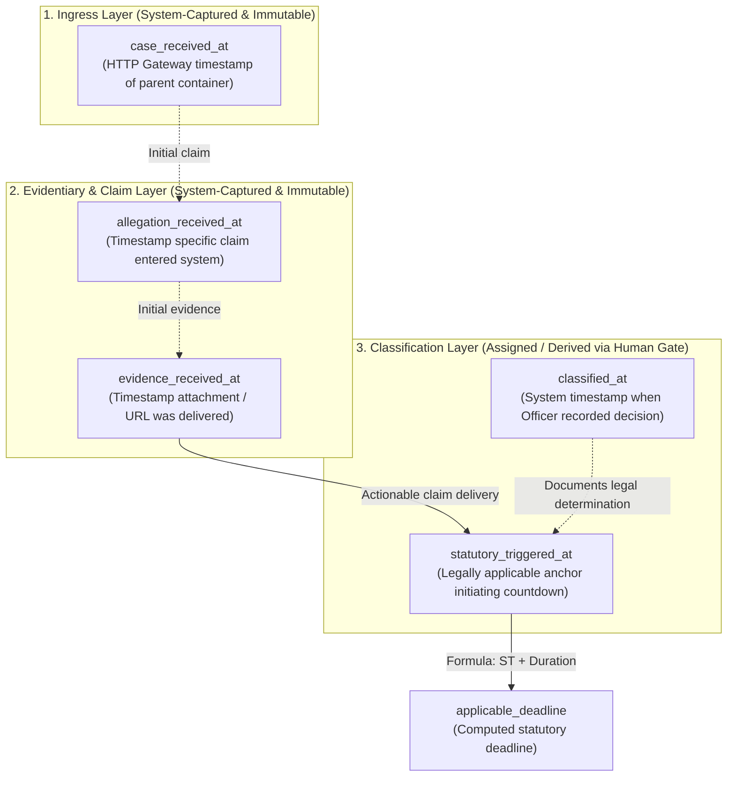
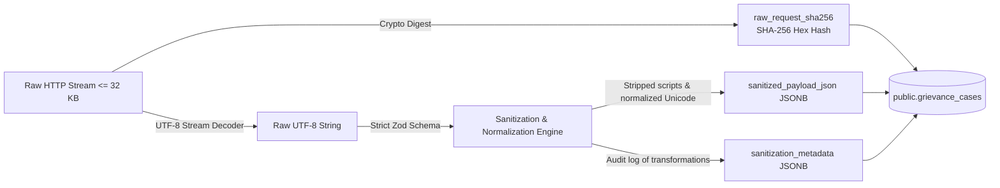
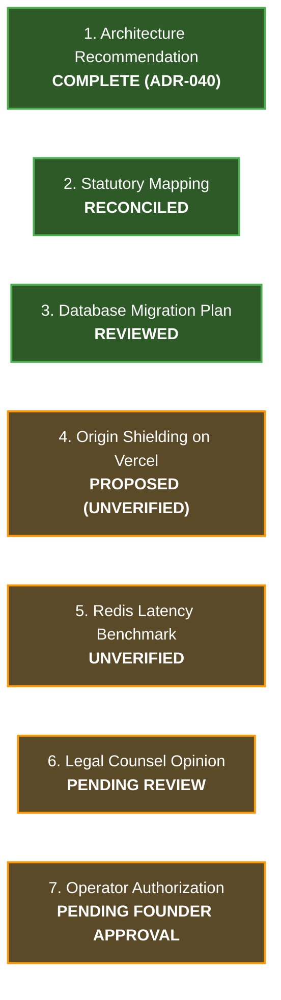

# ISHTI Milestone M06 G0 — Timestamp Provenance, Evidence Integrity & Audit Security Review

**Document Reference:** `docs/M06_G0_TIMESTAMP_PROVENANCE_AND_EVIDENCE_INTEGRITY_REVIEW.md`  
**Milestone:** M06 — Core Backend Persistence, Distributed Invariants & Production Shielding  
**Repository:** `https://github.com/Sunder-Chauhan/Ishti-OS`  
**Target Branch:** `feature/m05-trust-governance`  
**Architectural Decision Record:** ADR-040  
**Date:** 19 November 2026  
**Auditor Roles:** Principal Software Architect, Application Security Engineer, Privacy Engineering Lead, Legal Engineering Auditor  

---

## 1. Executive Summary

Milestone M06 establishes the core backend persistence, distributed state invariants, data privacy compliance, and statutory grievance redressal infrastructure for ISHTI. Following previous G0 defect corrections that disaggregated IT Rules 2021 statutory clocks (Rule 3(2)(b) 2-hour emergency takedown, Rule 3(1)(d) 3-hour court order takedown, Proviso to Rule 3(2)(a)(i) 36-hour expedited removal, and Rule 3(2)(a)(i) 24-hour acknowledgement / 7-day disposal) and established the Clock-Start Invariant, an independent architectural and evidentiary review identified critical remaining challenges:

1. **Timestamp Conflation:** Prior drafts implicitly assumed that all allegations and evidence in a grievance case shared the same intake timestamp as the root parent case.
2. **Scenario 8 Flaw (Late-Arriving Evidence):** In a multi-stage submission (e.g. a 10:00 general complaint where the complainant later submits an impersonation URL at 11:30), backdating the statutory countdown to 10:00 penalized the platform for time elapsed prior to receiving actionable evidence. Conversely, setting the countdown from human classification time (11:45) would grant an unlawful extension.
3. **Data Integrity & Conflation of Sanitized JSONB with Raw Bytes:** Sanitized JSONB was erroneously described in some sections as the original raw submission, compromising cryptographic evidentiary provenance.
4. **Public Reference Enumeration Vulnerability:** Predictable sequential case references (`ISHTI-CASE-YYYY-XXXX`) allowed attackers to enumerate complaint records, probe case existence, and infer platform ticket volumes.
5. **Audit Immutability Terminology & Mutation Protection:** Database trigger immutability alone was overstated as "absolute", and `public.grievance_events` lacked explicit mutation prevention triggers, cryptographic hash chaining, and signed tombstone mechanics for lawful court/DPDP purges.

This review deliverable records the comprehensive architectural reconciliation under **ADR-040**, establishing:
- A 5-tier **Timestamp Provenance Taxonomy** strictly distinguishing immutable system-captured timestamps from assigned/derived statutory triggers.
- The mathematically rigorous **Scenario 8 Late-Arriving Evidence Triggering Model**, anchoring countdowns to actionable evidence delivery (`11:30 + 2h = 13:30`) with mandatory officer legal reasoning.
- A dedicated **Relational Evidence Model (`public.grievance_evidence`)** with 1-to-many decomposition, quarantined bucket storage, and strict Rule 3(2)(b) sensitive imagery segregation.
- Clean separation between exact raw bounded request bytes ($\le 32$ KB), `raw_request_sha256`, `sanitized_payload_json`, and `sanitization_metadata`.
- Cryptographically unguessable **CSPRNG Crockford Base32 Public References** (`ISHTI-GRV-` + 16 characters, 80 bits entropy) with secondary factor authentication gates.
- **Append-only and tamper-evident** event sourcing for `public.grievance_events` enforced by trigger `trg_grievance_events_immutable` (raising SQLSTATE `42501`) and signed Redaction Tombstones.

---

## 2. Repository Safety and Git Status

Prior to conducting documentation updates and schema reconciliation, the repository environment was audited against strict safety constraints:

| Verification Check | Target / Expected Baseline | Verified Actual State | Status |
| :--- | :--- | :--- | :---: |
| **Local Working Directory** | `C:\Users\as\Documents\GitHub\spiritual-OS` | `C:\Users\as\Documents\GitHub\spiritual-OS` | **MATCH** |
| **Active Git Branch** | `feature/m05-trust-governance` | `feature/m05-trust-governance` | **MATCH** |
| **Starting HEAD Commit** | `7189429` (ADR-039) | `7189429233ed83ebd15c832218102de08de86917` | **MATCH** |
| **Remote Synchronization** | In sync with `origin/feature/m05-trust-governance` | In sync with `origin/feature/m05-trust-governance` | **MATCH** |
| **Target Implementation Branch** | `feature/m06-backend-persistence` | **NOT YET CREATED** (G0 gate holds creation) | **VERIFIED** |
| **Remote Database Isolation** | Zero calls to staging or production Supabase | 100% isolated; zero remote network calls | **VERIFIED** |
| **Code Modification Scope** | Strictly planning & documentation (`docs/`) | Zero application code, zero SQL migrations touched | **VERIFIED** |

---

## 3. Timestamp Provenance Taxonomy

The platform rejects the naive assumption that a legal case comprises a single instantaneous moment in time. Real-world legal disputes involve ongoing submissions, late-arriving screenshots, supplemental URLs, and offline service of legal notices.

ISHTI establishes five distinct timestamp fields across the intake and grievance lifecycle:



### Detailed Field Taxonomy

| Field Name | Storage Table | Capture Mechanism | Mutability | Legal / Operational Meaning |
| :--- | :--- | :--- | :---: | :--- |
| `case_received_at` | `public.grievance_cases` | Route Handler HTTP gateway execution (`now()`) | **IMMUTABLE** | Records the exact millisecond the root parent intake container was created. Governs initial operational triage SLTs (30m emergency / 2h standard). |
| `allegation_received_at` | `public.grievance_allegations` | Ingestion RPC or supplemental intake RPC | **IMMUTABLE** | Records when a specific claim, target URL, or legal assertion entered the database. Distinct from the parent case if submitted later. |
| `evidence_received_at` | `public.grievance_evidence` | Quarantined storage upload handler / RPC | **IMMUTABLE** | Records the exact moment an evidentiary item (URL, screenshot, document, chat log) was delivered to platform custody. |
| `statutory_triggered_at` | `public.grievance_clocks` | Derived via officer classification or legal service record | **ASSIGNED / DERIVED** | The legally applicable timestamp that initiates a statutory countdown under Indian law. Backed by mandatory written officer rationale (`officer_legal_reasoning`). |
| `classified_at` | `public.grievance_clocks` | Executed transaction timestamp (`now()`) | **IMMUTABLE** | Records when an authorized Compliance / Legal Officer entered the classification determination into the system. |

---

## 4. Late-Arriving Evidence & Scenario 8 Mathematical Analysis

### The Problem of Naive Backdating vs. Unlawful Postponement

Consider the real-world operational timeline:
- **10:00 AM:** Complainant submits an anonymous intake ticket complaining about an unfulfilled commercial pandit booking (`case_received_at = 10:00`).
- **11:30 AM:** Complainant returns to the platform and uploads supplemental evidence: a screenshot and URL showing that the pandit profile image is an unauthorized, non-consensual photograph of the complainant (`evidence_received_at = 11:30`).
- **11:45 AM:** Compliance Officer reviews the ticket and determines that the new URL qualifies as emergency non-consensual impersonation content under Rule 3(2)(b) (`classified_at = 11:45`).

Three architectural interpretations were evaluated:

```
Option A: Naive Backdating to Parent Case Receipt (REJECTED)
   Intake (10:00) -----------------------------------> Deadline: 12:00 (10:00 + 2h)
                       Evidence (11:30)
                                 Classification (11:45) -> 15 min buffer remaining!
   CRITICAL FLAW: If evidence arrived at 12:05, platform would be in automatic breach
   before the user even submitted the claim!

Option B: Clock Starts from Human Classification Time (REJECTED)
                                 Classification (11:45) -----------> Deadline: 13:45 (11:45 + 2h)
   CRITICAL FLAW: Unlawfully extends statutory duration. Allows delayed triage to evade
   statutory liability, violating Rule 3(2)(b).

Option C: Anchored to Legally Applicable Triggering Event (ADR-040 APPROVED)
                       Evidence (11:30) -----------------------------> Deadline: 13:30 (11:30 + 2h)
                                 Classification (11:45) -> 1h 45m operational buffer.
   LEGAL FIDELITY: Clock runs from receipt of actionable claim. Platform is not penalized
   for prior time, nor granted an unlawful postponement.
```

### Mathematical Formulation
$$\text{statutory\_triggered\_at} = \text{evidence\_received\_at} = 11:30$$
$$\text{applicable\_deadline} = \text{statutory\_triggered\_at} + 2\text{ hours} = 13:30$$
$$\text{operational\_buffer} = \text{applicable\_deadline} - \text{classified\_at} = 13:30 - 11:45 = 1\text{ hour } 45\text{ minutes}$$

### Legal Counsel Requirement & Safeguard
While Option C represents the soundest operational and statutory interpretation, Indian courts and regulatory authorities have not published exhaustive administrative rules on late-amended intermediary complaints. Therefore:
1. Every instance where `statutory_triggered_at` differs from `case_received_at` requires mandatory documented legal reasoning in `public.grievance_clocks.officer_legal_reasoning`.
2. Until formal written confirmation is received from qualified Indian legal counsel (`APP-LEG-005`), the operational risk flag is marked:
   > `STATUTORY TRIGGER DETERMINATION: PENDING COUNSEL CONFIRMATION`

---

## 5. Multi-URL & Supplemental Evidence Architecture

A single parent case can encompass multiple allegations and evidence items delivered over time. The relational architecture decomposes these items cleanly:

```sql
-- Relationship: 1 Case -> N Allegations -> M Evidence Items
public.grievance_cases (1)
       │
       ├──< public.grievance_allegations (N)
       │           │
       │           └──< public.grievance_evidence (M)
       │
       └──< public.grievance_clocks (K)
```

### Key Architectural Characteristics
1. **Multi-URL Decomposition:** Initial payloads containing multiple URLs (e.g. 4 defamatory forum links) are decomposed into 4 distinct rows in `public.grievance_allegations`, each linked to an evidence record in `public.grievance_evidence`.
2. **Supplemental Ingestion RPC (`public.add_supplemental_evidence_or_allegation`):**
   - Enables complainants or officers to add late-arriving URLs, screenshots, or documents.
   - Automatically timestamps `evidence_received_at = now()`.
   - Links to an existing allegation, or creates a new allegation with `provenance = 'SUPPLEMENTAL_SUBMISSION'`.
   - Appends an audit event to `public.grievance_events` with hash chain continuity.
3. **Investigation-Discovered Allegations:** If an investigation uncovers additional infringing material, the compliance officer logs it with `provenance = 'DISCOVERED_DURING_INVESTIGATION'`.
4. **Independent Clock Isolation:** Adding a supplemental allegation or evidence item **NEVER silently resets, restarts, or modifies pre-existing clocks**. Each allegation binds independent clocks anchored strictly to its own triggering timestamp.

---

## 6. Separation of Raw Request Bytes and Sanitized Application Data

To satisfy both evidentiary forensic standards and application security hygiene, ISHTI enforces an absolute boundary between raw network bytes and application JSONB:



### Evidentiary Safeguards
1. **No False Equivalence:** Documentation, API contracts, and database comments **never describe `sanitized_payload_json` as the raw submission**.
2. **Cryptographic Proof of Ingestion:** `raw_request_sha256` preserves an unalterable mathematical fingerprint of the exact bytes transmitted over TLS. If a complainant later disputes payload modification, the raw hash serves as non-repudiation proof.
3. **Sensitive Imagery Storage Controls (Rule 3(2)(b)):**
   - Intimate or sexual imagery submitted as evidence is marked `is_sensitive_imagery = TRUE`.
   - Stored in dedicated, encrypted, quarantined Cloudflare R2 / Supabase Storage buckets.
   - **Zero public URLs:** Presigned URLs are completely disabled; access requires authenticated Compliance Officer credentials and an active role-checked session.
   - Access attempts are logged in `public.audit_ledger` with `action_type = 'SENSITIVE_IMAGERY_ACCESS'`.
4. **Section 69A Confidential Blocking Orders:**
   - Court orders and government directions served confidentially under Section 69A are marked `retention_status = 'RESTRICTED_ACCESS'`.
   - Excluded from all standard devotee-facing queries and public status APIs.

---

## 7. Audit Log Integrity & Lawful Redaction Architecture

### Standardizing on "Append-Only and Tamper-Evident"
The platform discontinues claims of "absolute immutability" via database triggers alone. Database superusers (`postgres`) and hosted cloud platform administrators can disable triggers or alter data files directly. ISHTI standardizes on the legally and technically accurate terminology: **`append-only and tamper-evident`**.

### Database-Level Trigger Protection
```sql
CREATE OR REPLACE FUNCTION public.prevent_grievance_event_mutation()
RETURNS TRIGGER AS $$
BEGIN
    RAISE EXCEPTION 'CRITICAL SECURITY VIOLATION: public.grievance_events is append-only and tamper-evident. UPDATE and DELETE operations are prohibited.'
    USING ERRCODE = '42501';
END;
$$ LANGUAGE plpgsql SECURITY DEFINER SET search_path = public, pg_temp;

CREATE TRIGGER trg_grievance_events_immutable
BEFORE UPDATE OR DELETE ON public.grievance_events
FOR EACH ROW EXECUTE FUNCTION public.prevent_grievance_event_mutation();
```

### Cryptographic Hash Chaining
Every event row in `public.grievance_events` includes:
$$\text{event\_hash} = \text{SHA-256}(\text{sequence\_id} \parallel \text{case\_id} \parallel \text{event\_type} \parallel \text{created\_at} \parallel \text{event\_details} \parallel \text{previous\_event\_hash})$$
Any retroactive modification of an event row immediately breaks the hash chain for all subsequent rows, triggering an automated integrity alert during daily daemon verification.

### Lawful Redaction Tombstones
When a court order (e.g. CSAM destruction mandate) or DPDP Act §12(3) erasure requires purging personal data or illegal imagery from a closed case:
1. The historical audit rows in `public.grievance_events` are **NOT deleted or mutated**.
2. A signed **Redaction Tombstone Event** is appended to the table:
   ```json
   {
     "event_type": "REDACTION_TOMBSTONE",
     "is_tombstone": true,
     "lawful_authority": "High Court Order No. XXXX / DPDP Erasure Request",
     "redacted_evidence_id": "uuid-...",
     "tombstone_signature": "ed25519-signature-by-compliance-key"
   }
   ```
3. The underlying binary in quarantined storage is permanently deleted, and `public.grievance_evidence.retention_status` is updated to `'PURGED_LAWFUL_ORDER'`.
4. The Merkle hash chain remains mathematically continuous and verifiable.

---

## 8. Public Case-Reference Security & Anti-Enumeration Gates

### Vulnerability of Sequential Case Numbers
Predictable patterns such as `ISHTI-CASE-2026-0001`, `ISHTI-CASE-2026-0002` introduce two severe security vulnerabilities:
1. **Enumeration Attacks:** Attackers can systematically scrape ticket statuses and probe platform activity.
2. **Volume Leakage:** Competitors or adversaries can infer daily/monthly platform case volumes from sequential numbers.

### Unguessable CSPRNG Crockford Base32 Tokens
ISHTI replaces sequential public identifiers with cryptographically secure random tokens:
$$\text{Format: } \mathbf{ISHTI\text{-}GRV\text{-}[16\text{ Crockford Base32 Chars}]}$$
*Example:* `ISHTI-GRV-7M9K-2WX4-BQ8R-5TY1`

- **Entropy:** 16 Base32 characters ($32^{16} = 2^{80} \approx 1.2 \times 10^{24}$ possibilities), providing 80 bits of cryptographic entropy.
- **Brute-Force Resistance:** At 1,000 requests per second, finding a single valid active case reference would require approximately $1.9 \times 10^{13}$ years.
- **Human Usability:** Crockford Base32 excludes confusing characters (`I`, `L`, `O`, `U`), preventing transcription errors on phone or email consultations.

### Anti-Enumeration Status Verification Gate (`GET /api/compliance/status`)
Public tracking of grievance cases enforces a 4-layer defense:
1. **Layer 1 Rate Limiting:** Maximum 5 status lookup requests per 15 minutes per IP.
2. **Two-Factor Case Verification:** The status API requires both `public_reference` AND the verified complainant email address. For sensitive cases, an email OTP challenge is required before disclosing details.
3. **Generic Uniform Responses:** If a case reference is invalid, not found, or unauthorized, the endpoint strictly returns HTTP 404 with a generic payload:
   ```json
   {
     "error": "NOT_FOUND",
     "message": "The requested reference could not be located or verified."
   }
   ```
   Zero difference in response code or latency is leaked between "reference does not exist" and "email mismatch".
4. **Audit Logging:** Every public lookup attempt (successful or failed) is logged to `public.audit_ledger` with `actor_role = 'anonymous_status_lookup'`.

---

## 9. Reconciled Test Scenarios & Verification Matrix

The test harness specification (`docs/M06_TEST_AND_VERIFICATION_STRATEGY.md` Section 2.4) has been fully synchronized with the Eight Mandatory Test Scenarios:

| Scenario | Focus Area | Simulated Action | Mandatory Assertion |
| :---: | :--- | :--- | :--- |
| **1** | **Late-Arriving Evidence (Scenario 8)** | Case received at 10:00; impersonation URL submitted at 11:30; classified at 11:45. | `statutory_triggered_at = 11:30`; deadline = `13:30` (11:30 + 2h). Status is `ACTIVE` with 1h 45m buffer. Zero backdating to 10:00; zero extension to 13:45. |
| **2** | **Staggered Multi-URL Ingestion** | URL A submitted at 10:00; URL B submitted at 11:15 via supplemental RPC. | URL A has `allegation_received_at = 10:00`; URL B has `allegation_received_at = 11:15`. Independent clocks; zero clock inheritance or reset. |
| **3** | **Re-Classification on Supplemental Proof** | Feedback complaint with 72h SLT re-classified at 11:30 upon intimate imagery upload. | Old SLT clock transitions to `CANCELLED_RECLASSIFIED`. New Rule 3(2)(b) clock binds with `statutory_triggered_at = 11:30` and deadline = `13:30`. Hash chain preserved. |
| **4** | **Concurrent Mixed Allegations** | Single case with Allegation A (Rule 3(2)(a)(i) 24h ack / 7d disposal) and Allegation B (Rule 3(2)(b) 2h emergency). | Clocks run concurrently. Actioning Allegation B at 12:15 sets it to `COMPLIED` with zero impact on Allegation A's 24h ack or 7d disposal deadlines. |
| **5** | **Raw Bytes vs Sanitized JSONB** | Ingest 12 KB payload containing raw JSON with malicious `<script>` tags and non-normalized Unicode. | `raw_request_sha256` matches exact HTTP bytes. `sanitized_payload_json` contains stripped safe DOM. `sanitization_metadata` logs stripped tags. |
| **6** | **Grievance Events Trigger Protection** | Compromised role attempts SQL `UPDATE` or `DELETE` on `public.grievance_events`. | Trigger `trg_grievance_events_immutable` raises SQLSTATE `42501`. Modification is blocked. SHA-256 hash chain remains continuous and valid. |
| **7** | **Anti-Enumeration Defense** | Attacker probes sequential case references (`ISHTI-CASE-2026-0001`). | References use unguessable Crockford Base32 tokens (80 bits entropy). Status endpoint returns uniform 404 after 5 attempts/15m. Zero metadata disclosed. |
| **8** | **Lawful Redaction via Signed Tombstones** | Court order mandates purging sensitive imagery from a closed case. | Historical events in `public.grievance_events` are preserved. Signed `REDACTION_TOMBSTONE` event is appended. Binary is purged. Hash chain remains mathematically intact. |

---

## 10. Final Governance Status & Operator Approval Next Steps

### Multi-Dimensional Status Assessment



1. **Architecture & Schema Specification:** **`COMPLETE & HARDENED`** (ADR-040 fully reconciled across all 8 planning deliverables).
2. **Statutory Alignment:** **`CORRECTED & RECONCILED`** (IT Rules 2021 amended 10 Feb 2026 + corrigendum, timestamp provenance, late evidence anchoring, and due diligence nexus documented).
3. **Database Migration Safety:** **`REVIEWED WITH ROLLBACK LIMITATIONS`** (4 forward migrations, 6 rollback categories, point-in-time restore mandated).
4. **Infrastructure Verification:** **`PENDING EMPIRICAL BENCHMARKS`** (Upstash Redis Mumbai latency benchmark and Vercel 8-point origin shielding tests scheduled for Phase 2 & Phase 5).
5. **External Legal Sign-Off:** **`PENDING INDEPENDENT COUNSEL OPINION`** (`APP-LEG-001` through `APP-LEG-006` pending review by qualified Indian legal counsel).
6. **Implementation Status:** **`STRICTLY PAUSED AWAITING OPERATOR APPROVAL`**.

### Operator Action Required
To approve the finalized G0 Architecture Packet and authorize the start of Milestone M06 implementation on branch `feature/m06-backend-persistence`, the operator may execute the sign-off block in `docs/M06_G0_ARCHITECTURE_APPROVAL_PACKET.md` or instruct the agent:

> *"I approve the M06 G0 Architecture Decision Approval Packet (DEC-M06-001 through DEC-M06-008) incorporating ADR-040. Proceed with creating branch `feature/m06-backend-persistence`."*
