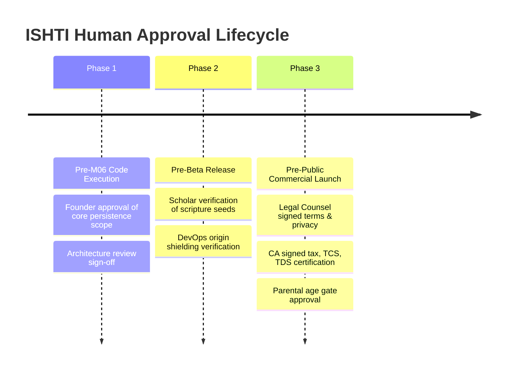

# ISHTI Milestone M06 — Human Approvals & Statutory Sign-Off Registry (Revised)

**Document Reference:** `docs/M06_HUMAN_APPROVALS_REQUIRED.md`  
**Milestone:** M06 — Core Backend Persistence, Distributed Invariants & Production Shielding  
**Repository:** `https://github.com/Sunder-Chauhan/Ishti-OS`  
**Revision Date:** 19 November 2026  
**Auditor Roles:** Governance & Compliance Lead, Legal Engineering Auditor  

---

## 1. Executive Summary & Governance Gate

In accordance with ISHTI governance principles, automated code tests and engineering benchmarks cannot substitute for **statutory legal certifications, professional tax opinions, and executive business determinations**.

This registry establishes the formal human approval gates required prior to executing Milestone M06 code and transitioning to commercial operations.

> [!CRITICAL]
> **COMMERCIAL RELEASE BLOCKER:**
> The ISHTI application must **NOT** accept commercial transactions, process live payments, or onboard external devotees until all "Pre-Public Launch" certifications below are signed by qualified professionals and archived in `docs/legal/signed/`.

---

## 2. Formal Sign-Off Registry

### 2.1. Founder & Executive Leadership Approvals

| Approval ID | Decision Scope | Current Baseline Specification | Status | Blocking Level |
| :--- | :--- | :--- | :---: | :---: |
| **APP-EXEC-001** | **Cancellation & Refund Policy Tiers** | >24h: 100% refund; 12–24h: 50% refund; <4h: 0% refund (pandit retained fee). | `PENDING FOUNDER REVIEW` | Pre-Public Launch |
| **APP-EXEC-002** | **Commercial Fee Structure** | Platform facilitation commission on marketplace pandit bookings (e.g. 15% - 20%). | `PENDING FOUNDER REVIEW` | Pre-Public Launch (Milestone M07) |
| **APP-EXEC-003** | **Product Monetization Boundaries** | Daily Panchang and basic Astro charts: Free; In-depth Kundli PDF and Pandit Consultations: Paid. | `PENDING FOUNDER REVIEW` | Pre-Beta |
| **APP-EXEC-004** | **Pandit Accreditation Criteria** | Minimum years of Vedic practice, identity KYC verification, background check requirements. | `PENDING FOUNDER REVIEW` | Pre-Beta |
| **APP-EXEC-005** | **Scope Partitioning & Deferrals** | Approving core M06 scope (persistence baseline) and deferring commerce to M07 and scriptures to M08. | `APPROVED BY ARCHITECT` | Pre-M06 Code Execution |

### 2.2. Legal Counsel Sign-Offs (Indian Law Advocate)

| Approval ID | Statutory Domain | Legal Baseline Requirement | Status | Blocking Level |
| :--- | :--- | :--- | :---: | :---: |
| **APP-LEG-001** | **Terms of Service & Disclaimer Enforceability** | Comprehensive review of `TERMS_OF_SERVICE.md`. Enforceability of religious disclaimers under Consumer Protection Act, 2019 (disclaiming fortune-telling guarantees). | `PENDING COUNSEL REVIEW` | Pre-Public Launch |
| **APP-LEG-002** | **DPDP §6(9) & Rule 4 Notice Compliance** | Validating notice form and manner for personal data collected prior to commencement, pursuant to DPDP Rules, 2025 Rule 4 (commenced 13 Nov 2026). | `PENDING COUNSEL REVIEW` | Pre-Public Launch |
| **APP-LEG-003** | **DPDP 18-Month Engineering Controls** | Review of pre-launch technical controls for DPDP Act §§3–5, 6, 8, 9, 11–13 (scheduled for 13 May 2027), ensuring no claims of premature legal compliance. | `PENDING COUNSEL REVIEW` | Pre-Public Launch |
| **APP-LEG-004** | **Parental Consent Gate Mechanism** | Review and approval of the verifiable parental consent mechanism under DPDP Act §9 for users under 18 years of age. | `PENDING COUNSEL REVIEW` | Pre-Public Launch |
| **APP-LEG-005** | **IT Act §79 Intermediary Classification & Timelines** | Formal opinion classifying community forums as Intermediary and platform-authored content as Editorial; verifying IT Rules Rule 3(2) timelines under 10 Feb 2026 amendments: 2h Rule 3(2)(b) emergency action, 36h proviso resolution, 36h Rule 3(1)(d) order removal, and 24h ack / 7d disposal under Rule 3(2)(a)(i). | `PENDING COUNSEL REVIEW` | Pre-Public Launch |
| **APP-LEG-006** | **Statutory Retention Exceptions Matrix** | Approval of lawful retention exceptions (Income-tax Act §62, IT Rules, dispute defense) overriding statutory erasure requests under DPDP Act §12(3). | `PENDING COUNSEL REVIEW` | Pre-Public Launch |

### 2.3. Chartered Accountant / Tax Advisor Certifications

| Approval ID | Tax / Statutory Domain | CA Certification Requirement | Status | Blocking Level |
| :--- | :--- | :--- | :---: | :---: |
| **APP-TAX-001** | **GST SAC Code Classification** | Formally certify whether ISHTI digital subscriptions fall under SAC 998439 (OIDAR services) and pandit consultations fall under SAC 999799 (religious/personal services). | `PENDING CA REVIEW` | Pre-Public Launch (Milestone M07) |
| **APP-TAX-002** | **Marketplace GST TCS (§52 CGST Act)** | Formally verify 0.5% TCS deduction rate (0.25% CGST + 0.25% SGST) and state GST registration requirements for Electronic Commerce Operators. | `PENDING CA REVIEW` | Pre-Public Launch (Milestone M07) |
| **APP-TAX-003** | **Marketplace TDS (§194-O / 2025 Act §393)** | Formally certify 0.1% TDS withholding rate on marketplace transactions and the ₹5,00,000 threshold for individual pandits under Section 393(4) Serial 11. | `PENDING CA REVIEW` | Pre-Public Launch (Milestone M07) |
| **APP-TAX-004** | **Mandatory Pre-Automation Certification** | Mandatory written sign-off confirming tax configuration rules before any automated withholding or invoicing code is activated in Milestone M07. | `PENDING CA REVIEW` | Pre-Public Launch (Milestone M07) |
| **APP-TAX-005** | **Books of Account 7-Year Retention Scope** | Formally verify the boundary of the 7-year retention mandate under Income-tax Act, 2025 §62 / Rule 46, ensuring it does not force unlawful retention of user personal profiles. | `PENDING CA REVIEW` | Pre-Public Launch |

### 2.4. Infrastructure & Security Sign-Offs

| Approval ID | Operational Domain | Security Verification Requirement | Status | Blocking Level |
| :--- | :--- | :--- | :---: | :---: |
| **APP-OPS-001** | **Ingress Origin Shielding Verification** | Execute automated origin bypass penetration test verifying that direct requests lacking `x-ishti-proxy-secret` or outside Cloudflare CIDRs return HTTP 403. | `PENDING DEVOPS REVIEW` | Pre-Beta |
| **APP-OPS-002** | **Distributed Rate Limiter Fail-Closed Test** | Execute chaos test verifying that severed Redis connectivity causes sensitive mutation routes to fail closed (HTTP 503) without falling back to local memory. | `PENDING SRE REVIEW` | Pre-M06 Merge |
| **APP-OPS-003** | **External WORM Bucket Object Lock Verification** | Verify that the secondary cloud account holding audit ledger archives enforces AWS S3 / Cloudflare R2 Object Lock in Compliance Mode. | `PENDING SEC REVIEW` | Pre-Public Launch |

---

## 3. Human Approval Gate Milestones

### Sign-off Archive Procedure
When each human approval is obtained:
1. The physical or digitally signed PDF must be placed in `docs/legal/signed/`.
2. The corresponding entry in this registry must be updated with the document hash, signatory name, professional registration number (e.g. Bar Council / ICAI Membership No.), and date of signature.
3. The status will transition from `PENDING` to `CERTIFIED / SIGNED`.
