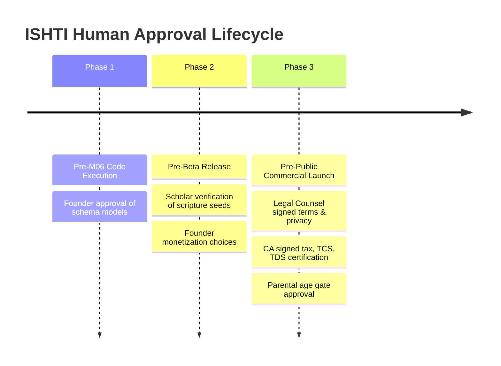

# ISHTI Milestone M06 — Human Approvals & Statutory Sign-Off Registry

**Document Reference:** `docs/M06_HUMAN_APPROVALS_REQUIRED.md`  
**Milestone:** M06 — Backend Persistence, Distributed Invariants & Production Infrastructure  
**Repository:** `https://github.com/Sunder-Chauhan/Ishti-OS`  
**Date:** 19 November 2026  
**Auditor Roles:** Governance & Compliance Lead, Legal Engineering Auditor  

---

## 1. Executive Summary & Governance Gate

In accordance with ISHTI governance principles, automated code tests and engineering benchmarks cannot substitute for **statutory legal certifications, professional tax opinions, and executive business determinations**.

This registry establishes the formal human approval gates required prior to executing Milestone M06 code and transitioning to commercial operations.

> [!CRITICAL]
> **COMMERCIAL RELEASE BLOCKER:**
> The ISHTI application must **NOT** accept commercial transactions, process live payments, or onboard external devotees until all "Pre-Public Launch" certifications below are signed by qualified professionals and archived in `docs/legal/signed/`.

---

## 2. Formal Sign-Off Registry

### 2.1. Founder & Executive Leadership Approvals

| Approval ID | Decision Scope | Current Baseline Specification | Status | Blocking Level |
| :--- | :--- | :--- | :---: | :---: |
| **APP-EXEC-001** | **Cancellation & Refund Policy Tiers** | >24h: 100% refund; 12–24h: 50% refund; <4h: 0% refund (pandit retained fee). | `PENDING FOUNDER REVIEW` | Pre-Public Launch |
| **APP-EXEC-002** | **Commercial Fee Structure** | Platform facilitation commission on marketplace pandit bookings (e.g. 15% - 20%). | `PENDING FOUNDER REVIEW` | Pre-Public Launch |
| **APP-EXEC-003** | **Product Monetization Boundaries** | Daily Panchang and basic Astro charts: Free; In-depth Kundli PDF and Pandit Consultations: Paid. | `PENDING FOUNDER REVIEW` | Pre-Beta |
| **APP-EXEC-004** | **Pandit Accreditation Criteria** | Minimum years of Vedic practice, identity KYC verification, background check requirements. | `PENDING FOUNDER REVIEW` | Pre-Beta |

### 2.2. Legal Counsel Sign-Offs (Indian Law Advocate)

| Approval ID | Statutory Domain | Legal Baseline Requirement | Status | Blocking Level |
| :--- | :--- | :--- | :---: | :---: |
| **APP-LEG-001** | **Terms of Service & Disclaimer Enforceability** | Comprehensive review of `TERMS_OF_SERVICE.md`. Enforceability of religious disclaimers under Consumer Protection Act, 2019 (disclaiming fortune-telling guarantees). | `PENDING COUNSEL REVIEW` | Pre-Public Launch |
| **APP-LEG-002** | **DPDP Act & Rules Compliance Notice** | Review of `PRIVACY_POLICY.md` and notice structure under DPDP Rules, 2025 Rule 4 and Section 6. Validating unbundled consent purposes. | `PENDING COUNSEL REVIEW` | Pre-Public Launch |
| **APP-LEG-003** | **Parental Consent Gate Mechanism** | Review and approval of the verifiable parental consent mechanism under DPDP Act §9 for users under 18 years of age. | `PENDING COUNSEL REVIEW` | Pre-Public Launch |
| **APP-LEG-004** | **Intermediary Safe Harbour (§79 IT Act)** | Verification of Grievance Redressal Mechanism compliance under IT Rules, 2021 (Rule 3(2) 24h acknowledgement and 7d resolution windows). | `PENDING COUNSEL REVIEW` | Pre-Public Launch |
| **APP-LEG-005** | **Cross-Border Data Transfer Framework** | Verification of Standard Contractual Clauses (SCCs) for cross-border hosting of European/Global devotee data under GDPR Art 46. | `PENDING COUNSEL REVIEW` | Pre-Beta |

### 2.3. Chartered Accountant / Tax Advisor Certifications

| Approval ID | Tax / Statutory Domain | CA Certification Requirement | Status | Blocking Level |
| :--- | :--- | :--- | :---: | :---: |
| **APP-TAX-001** | **GST SAC Code Classification** | Formally certify whether ISHTI digital subscriptions fall under SAC 998439 (OIDAR services) and pandit consultations fall under SAC 999799 (religious/personal services). | `PENDING CA REVIEW` | Pre-Public Launch |
| **APP-TAX-002** | **Marketplace GST TCS (§52 CGST Act)** | Formally verify 0.5% TCS deduction rate (0.25% CGST + 0.25% SGST) and state GST registration requirements for Electronic Commerce Operators. | `PENDING CA REVIEW` | Pre-Public Launch |
| **APP-TAX-003** | **Marketplace TDS (§194-O / 2025 Act §393)** | Formally certify 0.1% TDS withholding rate on marketplace transactions and the ₹5,00,000 threshold for individual pandits under Section 393(4) Serial 11. | `PENDING CA REVIEW` | Pre-Public Launch |
| **APP-TAX-004** | **Statutory Retention of Financial Books** | Formally verify the boundary of the 7-year retention mandate under Income-tax Act, 2025 §62 / Rule 46, ensuring it does not force unlawful retention of user personal data. | `PENDING CA REVIEW` | Pre-Public Launch |
| **APP-TAX-005** | **Tax Invoicing Format Compliance** | Verify that generated PDF tax invoices satisfy all mandatory particulars under Rule 46 of the CGST Rules, 2017. | `PENDING CA REVIEW` | Pre-Public Launch |

### 2.4. Vedic & Sanskrit Scholar Certifications

| Approval ID | Content Domain | Scholarly Verification Requirement | Status | Blocking Level |
| :--- | :--- | :--- | :---: | :---: |
| **APP-SCH-001** | **Scriptural Provenance & Authenticity** | Review and verify Sanskrit Devanagari text, Samhita recension, and Pada-patha accuracy for initial scripture catalog seeds. | `PENDING SCHOLAR REVIEW` | Pre-Beta |
| **APP-SCH-002** | **Translation Copyright Clearance** | Verify that English and Hindi translations are strictly within the public domain (e.g. Griffith 1896, Max Müller 1879) or formally licensed from copyright holders. | `PENDING SCHOLAR REVIEW` | Pre-Beta |
| **APP-SCH-003** | **Ephemeris & Ayanamsha Alignment** | Verify that planetary longitude calculations match Lahiri (Chitra Paksha) Ayanamsha standards recognized by the Rastriya Panchang. | `PENDING SCHOLAR REVIEW` | Pre-Beta |

---

## 3. Human Approval Gate Milestones

### Sign-off Archive Procedure
When each human approval is obtained:
1. The physical or digitally signed PDF must be placed in `docs/legal/signed/`.
2. The corresponding entry in this registry must be updated with the document hash, signatory name, professional registration number (e.g. Bar Council / ICAI Membership No.), and date of signature.
3. The status will transition from `PENDING` to `CERTIFIED / SIGNED`.
