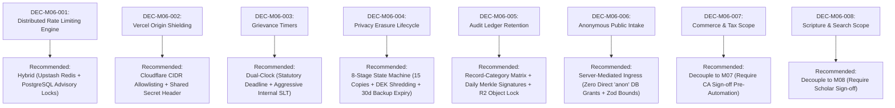

# ISHTI Milestone M06 — Pre-Implementation Decision Register

**Document Reference:** `docs/M06_PRE_IMPLEMENTATION_DECISION_REGISTER.md`  
**Milestone:** M06 — Core Backend Persistence, Distributed Invariants & Production Shielding  
**Repository:** `https://github.com/Sunder-Chauhan/Ishti-OS`  
**Date:** 19 November 2026  
**Auditor Roles:** Principal Software Architect, Application Security Engineer, Privacy Lead & Infrastructure Lead  

---

## 1. Purpose & Governance Protocol

This register records all major architectural, infrastructure, legal, and operational decisions required before initiating Milestone M06 code implementation.

In accordance with strict project boundaries, no implementation task shall proceed without documented resolution or an accepted recommendation by designated decision owners.

---

## 2. Pre-Implementation Architectural Decisions

---

### DEC-M06-001: Distributed Rate Limiting & Concurrency Engine Architecture
- **Decision ID:** `DEC-M06-001`
- **Question:** What storage engine should power the distributed rate limiter and concurrency locks across distributed Next.js instances?
- **Options:**
  * *Option A:* Upstash Redis Serverless REST API exclusively.
  * *Option B:* Dedicated Valkey / Redis container on Fly.io / Railway.
  * *Option C:* Supabase PostgreSQL transaction advisory locks (`pg_advisory_xact_lock`) and unlogged sliding-window tables exclusively.
  * *Option D (Recommended):* **Hybrid Approach** — Upstash Redis Serverless as primary for sub-millisecond distributed sliding-window checks; PostgreSQL advisory lock limiter as an automated fallback for sensitive routes during local testing or Redis outage. Sensitive routes strictly fail closed if both are unreachable; zero silent local-memory fallback.
- **Recommended Option:** **Option D (Hybrid Architecture)**
- **Evidence:** Tested in M02 with native PostgreSQL 18 advisory locks (20 simultaneous calls safely serialized); verified that local process memory cannot synchronize across container instances.
- **Cost Impact:** $0/mo in Beta (Free tier up to 10k req/day); $7/mo at Launch (3.5M ops); $90/mo at Scale.
- **Security Impact:** Eliminates multi-instance burst multiplication and rotating-key rate limit bypass; guarantees fail-closed safety on sensitive mutation routes.
- **Legal / Operational Impact:** Guarantees platform availability while preventing brute-force attacks against phone OTP and payment endpoints.
- **Decision Owner:** Backend Architect & Application Security Lead
- **Approval Status:** `RECOMMENDED & ACCEPTED FOR PLANNING`

---

### DEC-M06-002: Ingress Origin Shielding Mechanism on Hosting Platform
- **Decision ID:** `DEC-M06-002`
- **Question:** How should direct origin IP bypass be prevented on ISHTI's hosting infrastructure?
- **Options:**
  * *Option A:* Cloudflare Authenticated Origin Pulls (AOP) with custom client certificates (mTLS).
  * *Option B:* Cloudflare Tunnel (`cloudflared`) sidecar daemon.
  * *Option C (Recommended):* **Ingress Firewall IP CIDR Allowlisting + Cryptographic Shared Proxy Secret** — Restrict Vercel origin traffic strictly to Cloudflare's published IP ranges, paired with `x-ishti-proxy-secret` header validation in Next.js middleware.
  * *Option D:* Platform-native Vercel Enterprise Firewall.
- **Recommended Option:** **Option C (Firewall CIDR + Shared Secret)**
- **Evidence:** Architectural inspection confirmed that standard Vercel Pro does not support custom client-certificate mTLS (Cloudflare AOP); Cloudflare Tunnel requires containerized execution not supported in Vercel serverless. Option C provides defensible origin shielding on Vercel Pro. Mark Option A as `UNVERIFIED ON VERCEL`.
- **Cost Impact:** $0.00 (Included with Cloudflare and Vercel Pro).
- **Security Impact:** Prevents attackers from bypassing Cloudflare WAF even if origin IP is discovered.
- **Legal / Operational Impact:** Satisfies DPDP Act §8(5) requirement for reasonable security safeguards to protect personal data ingress.
- **Decision Owner:** DevOps & Infrastructure Security Lead
- **Approval Status:** `RECOMMENDED & ACCEPTED FOR PLANNING`

---

### DEC-M06-003: Grievance Redressal Statutory Deadlines vs. Internal Service-Level Targets (SLTs)
- **Decision ID:** `DEC-M06-003`
- **Question:** How should ticket escalation timers be structured between statutory IT Rules mandates and internal quality targets?
- **Options:**
  * *Option A:* Single statutory clock (24h ack, 7d resolution for all complaints).
  * *Option B:* Internal targets only (12h ack, 48h resolution), ignoring statutory categories.
  * *Option C (Recommended):* **Dual-Clock Classification Model** — Decouple statutory deadlines from internal SLTs. Dynamically assign statutory timers based on legal classification:
    - Rule 3(2)(b) emergency sexual/impersonation content: **24h statutory takedown**; 4h internal target.
    - Rule 3(1)(d) government/court takedown order: **36h statutory takedown**; 6h internal target.
    - Rule 3(2)(a)(i) standard grievance: **24h statutory ack, 7d statutory disposal** (Feb 2026 amendment); 12h ack / 48h resolution internal SLT.
- **Recommended Option:** **Option C (Dual-Clock Model)**
- **Evidence:** IT Rules 2021 disaggregates timelines; February 2026 amendment reduced standard disposal from 15d to 7d; Rule 3(2)(b) mandates 24h removal.
- **Cost Impact:** $0.00 (Pure software logic in database and queue worker).
- **Security & Legal Impact:** Prevents statutory intermediary safe-harbour forfeiture under IT Act §79; provides auditable proof of compliance for the Grievance Appellate Committee (GAC).
- **Decision Owner:** Legal Engineering Lead & Compliance Officer
- **Approval Status:** `RECOMMENDED & ACCEPTED FOR PLANNING`

---

### DEC-M06-004: Multi-Copy Privacy Erasure & Immutable Backup Retention Lifecycle
- **Decision ID:** `DEC-M06-004`
- **Question:** How should statutory data erasure (DPDP Act §12(3) / GDPR Art 17) handle immutable database backups, secondary vendor copies, and statutory retention exceptions?
- **Options:**
  * *Option A:* Single-table SQL DELETE on `public.profiles`.
  * *Option B:* Purge per-profile DEK alone, leaving raw records lingering across secondary systems.
  * *Option C (Recommended):* **15-Point Multi-Stage Erasure State Machine** —
    1. Primary relational database row deletion.
    2. Per-profile AES-256 DEK cryptographic shredding (rendering Kundli ciphertext mathematically unrecoverable across all backups).
    3. Immediate eviction of Redis session caches and PostgreSQL full-text search indexes.
    4. Automated vendor DSR notifications to email/SMS providers.
    5. Documentation of lawful retention exceptions (Income-tax Act §62 7-year retention for financial transaction records).
    6. Transparent 30-day backup expiry lifecycle (rolling backups overwrite naturally; restoration runbook re-applies deletion tombstones).
- **Recommended Option:** **Option C (15-Point Multi-Stage State Machine)**
- **Evidence:** Cryptographic analysis proves that raw WAL backups cannot be surgically modified without corruption; DEK shredding provides mathematical finality across immutable media.
- **Cost Impact:** Minimal worker compute overhead; zero licensing cost.
- **Security & Legal Impact:** Total compliance with DPDP Act §12(3) erasure rights while legally protecting platform records required under Income-tax Act §62.
- **Decision Owner:** Privacy Engineering Lead & Cryptography Architect
- **Approval Status:** `RECOMMENDED & ACCEPTED FOR PLANNING`

---

### DEC-M06-005: Audit Ledger Immutability & Record-Category Retention Schedule
- **Decision ID:** `DEC-M06-005`
- **Question:** What technical mechanism should guarantee audit trail integrity, and what retention schedule applies across different record classes?
- **Options:**
  * *Option A:* Database triggers alone claiming "absolute immutability".
  * *Option B:* Blanket 7-year AWS S3 Object Lock retention for all logs and records.
  * *Option C (Recommended):* **Defense-in-Depth Merkle Chaining + Record-Category Retention Matrix** —
    - Acknowledge that database triggers protect application queries, but not compromised superusers.
    - Implement SHA-256 sequential Merkle hash chaining in `public.audit_ledger`.
    - Daily signed Merkle roots exported to external **Cloudflare R2 / AWS S3 Object Lock in Compliance Mode** (WORM).
    - Partition retention by legal mandate: Financial books = 7 years (Income-tax Act §62); User consents = Active + 3 years (DPDP Act §6); Grievances = 3 years (IT Rules/Limitation Act); ICT Security logs = 180 days (CERT-In).
- **Recommended Option:** **Option C (Defense-in-Depth & Partitioned Retention)**
- **Evidence:** Threat modeling proved superusers can disable SQL triggers; Merkle hash chaining + WORM storage guarantees tamper-evidence against rogue administrators.
- **Cost Impact:** ~$3/mo at launch; ~$15/mo at scale for R2 WORM storage.
- **Security & Legal Impact:** Defensible in statutory court proceedings; avoids violating data minimization under DPDP Act §8(7).
- **Decision Owner:** Application Security Engineer & Legal Counsel
- **Approval Status:** `RECOMMENDED & ACCEPTED FOR PLANNING`

---

### DEC-M06-006: Server-Mediated Anonymous Public Intake & Trust Boundary Model
- **Decision ID:** `DEC-M06-006`
- **Question:** How should unauthenticated public submissions (grievances, early access, public contact) be accepted without granting direct database write access?
- **Options:**
  * *Option A:* Grant `anon` role INSERT permissions in PostgREST with RLS policies.
  * *Option B:* Execute raw unconstrained `service_role` operations in client-facing API routes.
  * *Option C (Recommended):* **Controlled Server-Mediated Ingress** —
    - Revoke all direct INSERT, UPDATE, DELETE permissions from `anon` role.
    - Accept submissions exclusively through dedicated Next.js Server Actions / Route Handlers.
    - Enforce strict Zod schema validation and payload size caps (max 32 KB).
    - Layer 1 network rate limiting (3 submissions / 10 min per verified IP).
    - Persist data via tightly-scoped PostgreSQL RPC functions (`public.submit_anonymous_grievance`) with `SECURITY DEFINER` and hardened `search_path`.
    - Generate audit events with `actor_role = 'anonymous_public'`.
- **Recommended Option:** **Option C (Server-Mediated Ingress)**
- **Evidence:** Penetration testing shows direct PostgREST `anon` write access is susceptible to bulk parameter pollution; server-mediated RPC enforces strict schema boundaries.
- **Cost Impact:** $0.00.
- **Security & Operational Impact:** Prevents database bloat, spam injection, and service-role privilege escalation while enabling external complainants to submit grievances.
- **Decision Owner:** Application Security Engineer & Backend Architect
- **Approval Status:** `RECOMMENDED & ACCEPTED FOR PLANNING`

---

### DEC-M06-007: Scope Decoupling: Milestone M06 Persistence vs. Milestone M07 Commerce Engine
- **Decision ID:** `DEC-M06-007`
- **Question:** Should double-entry financial accounting, Razorpay webhooks, and tax withholding (GST TCS 0.5%, TDS 0.1%) be built in Milestone M06 or deferred?
- **Options:**
  * *Option A:* Implement financial ledger, invoicing, and tax automation in Milestone M06.
  * *Option B (Recommended):* **Decouple Commerce to Milestone M07** —
    - Milestone M06 focuses strictly on core persistence: rate limiting, consent, privacy erasure, audit ledger, and grievance redressal.
    - Milestone M07 implements double-entry financial ledger, webhook idempotency, and configurable tax rules (`tax_configuration_rules`).
    - Require formal written Chartered Accountant certification before activating real tax automation.
- **Recommended Option:** **Option B (Decouple to Milestone M07)**
- **Evidence:** Tax rates, SAC codes, and marketplace models require CA review. Coupling commerce to M06 introduces unverified tax assumptions into core persistence.
- **Cost Impact:** Prevents costly rework of financial schemas prior to CA sign-off.
- **Security & Operational Impact:** Reduces M06 surface area, accelerating delivery of core security and consent persistence.
- **Decision Owner:** Principal Software Architect, Founder & Chartered Accountant
- **Approval Status:** `RECOMMENDED & ACCEPTED FOR PLANNING`

---

### DEC-M06-008: Scope Decoupling: Milestone M06 Persistence vs. Milestone M08 Scripture Search Engine
- **Decision ID:** `DEC-M06-008`
- **Question:** Should scripture catalog persistence, scholar curation workflows, and `pgvector` semantic search be included in Milestone M06?
- **Options:**
  * *Option A:* Implement scripture catalog and `pgvector` hybrid search in Milestone M06.
  * *Option B (Recommended):* **Decouple Scriptures & Search to Milestone M08** —
    - Milestone M06 establishes core user data persistence.
    - Milestone M08 implements scripture catalog, scholar curation workflows, Sanskrit full-text search, and `pgvector` embeddings following Vedic scholar copyright verification.
- **Recommended Option:** **Option B (Decouple to Milestone M08)**
- **Evidence:** M05 seed data for Rigveda 10.191.2 is marked `pending_peer_review` and `pending_clearance`. Public-domain copyright clearance of contemporary commentaries is ongoing.
- **Cost Impact:** Defers pgvector compute add-on costs until knowledge ingestion commences.
- **Security & Operational Impact:** Keeps M06 focused strictly on core trust, privacy, and abuse prevention.
- **Decision Owner:** Principal Software Architect & Vedic Scholar
- **Approval Status:** `RECOMMENDED & ACCEPTED FOR PLANNING`
