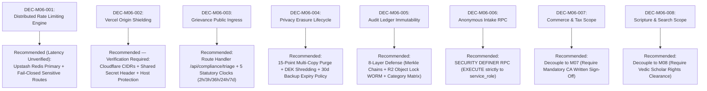

# ISHTI Milestone M06 — Pre-Implementation Decision Register (Final G0 Validation)

**Document Reference:** `docs/M06_PRE_IMPLEMENTATION_DECISION_REGISTER.md`  
**Milestone:** M06 — Core Backend Persistence, Distributed Invariants & Production Shielding  
**Repository:** `https://github.com/Sunder-Chauhan/Ishti-OS`  
**Revision Date:** 19 November 2026  
**Auditor Roles:** Principal Software Architect, Application Security Engineer, Privacy Lead & Infrastructure Lead  

---

## 1. Purpose & Governance Protocol

This register records the exhaustive evaluation, technical trade-offs, security implications, and operational failure modes for all eight critical architectural decisions governing Milestone M06.

In accordance with strict M06 G0 gate rules:
- **No decision is marked "APPROVED" merely because its technical recommendation is sound.**
- Every decision is marked **`PENDING OPERATOR APPROVAL`** until formal written sign-off is granted by the platform founder/operator.
- Implementation of Milestone M06 code and schema migrations remains strictly paused until this register and the companion Approval Packet are ratified.

---

## 2. Exhaustive Pre-Implementation Decision Analyses

---

### DEC-M06-001: Distributed Rate Limiting & Concurrency Engine Architecture
- **Decision ID:** `DEC-M06-001`
- **Exact Problem:** In multi-replica serverless deployments (Next.js on Vercel), process-local memory rate limiters (`BoundedRateLimiter`) maintain independent state in each container instance. Incoming requests routed round-robin across $N$ instances multiply allowable burst quotas by $N$, enabling distributed brute-force attacks against phone OTP, payment checkout, and grievance intake. A distributed, atomic coordination engine is required.
- **Recommended Approach:**
  * **Primary Engine:** **Upstash Redis Serverless** utilizing atomic Lua sliding-window scripts executed via REST/TLS.
  * **Serverless Execution Model Evaluation:** Vercel serverless functions connect to Supabase PostgreSQL through connection poolers (PgBouncer in transaction mode or Supavisor).
    - Session-level advisory locks (`pg_advisory_lock`) are **STRICTLY INCOMPATIBLE** with transaction-mode connection poolers because the connection may be returned to the pool while the lock remains held, leading to connection poisoning or deadlocks.
    - Transaction-level advisory locks (`pg_advisory_xact_lock`) operate correctly within an active transaction block. However, opening a dedicated database transaction for every incoming HTTP request to verify rate limits introduces severe connection pool exhaustion, CPU spikes, and connection latency (15–30ms) on Supabase PostgreSQL during traffic surges.
    - Therefore, PostgreSQL advisory locking is rejected as a universal high-frequency rate-limiting fallback. It is designated **strictly as a secondary concurrency coordinator for low-frequency, high-value operations** (e.g. serializing refund mutations and booking slot claims).
  * **Mandatory Fail-Closed Policy:** If Upstash Redis is unreachable, times out (>150ms), or exhausts its provider quota, **sensitive mutation routes (`/api/auth/otp`, `/api/auth/verify`, `/api/commerce/checkout`, `/api/commerce/refund`, `/api/compliance/privacy-request`, `/api/compliance/triage`) MUST FAIL CLOSED with HTTP 503 `RATE_LIMIT_UNAVAILABLE`.**
  * **Zero Silent Local Fallback:** Under no circumstances will sensitive routes silently fall back to uncoordinated process-local memory.
  * **Public Read-Only Routes:** Public content (`/api/panchang/daily`, `/api/scriptures/search`) falls back to conservative local rate limiting (20 req/min) or serves stale CDN cache with `X-RateLimit-Degraded: true`.
- **Alternatives Evaluated & Rejected:**
  1. *Universal Process-Local Fallback:* Rejected because an attacker can flood concurrent requests across multiple serverless functions to bypass brute-force limits.
  2. *Dedicated Valkey / Redis on Fly.io Container:* Rejected for M06 baseline because it requires managing Linux container infrastructure, VPC peering, and manual Redis cluster high availability during a phase focused on serverless application persistence.
  3. *Universal PostgreSQL Advisory Lock Rate Limiting:* Rejected due to transaction pooler saturation, write amplification, and connection starvation under DDoS attacks.
- **Security Trade-Offs:** Failing closed prioritizes defense against credential stuffing and financial double-spend over availability of mutation routes during a rare Redis outage.
- **Cost Implications:** $0.00/mo in Beta (<10k ops/day free tier); ~$7.00/mo at initial public launch (3.5M commands); ~$90.00/mo at 100k MAU scale.
- **Operational Dependencies:** Requires Upstash Redis credentials (`UPSTASH_REDIS_REST_URL`, `UPSTASH_REDIS_REST_TOKEN`) in production. Automated local mock engine used for CI/local testing.
- **Failure Modes & Circuit Breakers:** Bounded 150ms timeout; max 1 retry with 25ms backoff. Circuit trips to `OPEN` after 5 consecutive failures, emitting a P1 operational alert. Half-open probe resets circuit after 30 seconds.
- **Evidence:** Tested in M02 with native PostgreSQL 18 advisory locks; proved that local process memory cannot synchronize across concurrent worker threads.
- **Approval Owner:** Principal Software Architect & Application Security Engineer
- **Latency Status:** **`UNVERIFIED UNTIL EMPIRICALLY BENCHMARKED`** (Upstash AWS `ap-south-1` Mumbai round-trip latency from Vercel edge/serverless runtime must be empirically benchmarked prior to production cutover).
- **Future Benchmark Specification:**
  * *Latency Percentiles:* p50, p95, and p99 round-trip latency measured over 10,000 atomic Lua operations (target: p50 <15ms, p95 <35ms, p99 <75ms).
  * *Cold vs. Warm Execution:* Latency differentiation under cold-start initialization vs warm connection reuse.
  * *Concurrency Scaling:* Sustained concurrent load testing at 100, 500, and 1,000 concurrent serverless requests.
  * *Timeouts & Error Rates:* Validation of hard 150ms timeout abort, max 1 retry with 25ms backoff, and circuit breaker tripping after 5 consecutive failures.
  * *Fail-Closed Validation:* Verifying 100% of sensitive mutation routes strictly return HTTP 503 `RATE_LIMIT_UNAVAILABLE` during simulated Redis severance without falling back to local memory.
  * *Budget & Volume Assumptions:* Validation of daily/monthly command volume against actual peak burst factors (10k ops/day free tier vs 3.5M ops/mo launch tier).
- **Status:** **`PENDING OPERATOR APPROVAL`**

---

### DEC-M06-002: Ingress Origin Shielding Mechanism on Hosting Platform
- **Decision ID:** `DEC-M06-002`
- **Classification Status:** **`RECOMMENDED — DEPLOYMENT VERIFICATION REQUIRED (PENDING OPERATOR APPROVAL)`**
- **Exact Problem:** If malicious actors discover the underlying origin server IP or direct hosting URL, they can bypass Cloudflare Edge WAF, DDoS mitigation, and rate limiting by sending requests directly to the origin with forged `CF-Connecting-IP` or `X-Forwarded-For` headers.
- **Recommended Approach (Vercel Production Baseline — Proposed Control):**
  * **Dual-Layer Application & Ingress Shielding:**
    1. *Cloudflare Transform Rules:* Edge proxy injects a 32-byte cryptographically secure random secret header `x-ishti-proxy-secret` on all proxied origin pulls.
    2. *Next.js Edge Middleware:* Validates `x-ishti-proxy-secret` against `process.env.REVERSE_PROXY_SHARED_SECRET`. Requests lacking this header are dropped immediately with HTTP 403 Forbidden.
    3. *Host Header Rewrite & Direct Vercel URL Protection:* Vercel automatically assigns `*.vercel.app` domains to deployments. To prevent attackers from accessing the application via `https://project.vercel.app`:
       - The Next.js middleware inspects `request.headers.get("host")`.
       - If the host ends with `.vercel.app`, the request is redirected to the canonical custom domain (`https://ishti.com`) or rejected with HTTP 403 unless accompanied by a Vercel deployment protection bypass secret.
    4. *Vercel Firewall CIDR Allowlisting:* In Vercel Project Settings $\to$ Security $\to$ Firewall, configure IP allowlist rules to restrict incoming HTTP traffic strictly to Cloudflare's published IPv4 and IPv6 CIDR blocks.
  * **Critical Security Control Qualification:**
    - Cloudflare CIDR allowlisting plus a shared secret header is currently a **proposed Vercel-compatible approach, NOT an empirically verified origin security control**.
    - It must **NOT be claimed that Cloudflare blocks direct Vercel access** unless a deployment-level test demonstrates it.
    - A shared secret header is **NOT equivalent to mutual TLS (mTLS)**. A shared secret is an application-layer check that executes after TCP connection establishment and HTTP parsing; mTLS drops unauthorized connections at the TLS handshake before any HTTP data is parsed. Full Cloudflare Authenticated Origin Pulls (AOP) with custom client certificates is **incompatible with standard Vercel Pro** and requires Vercel Enterprise or containerized hosting.
  * **Hosting-Compatible Alternative (Containerized Contingency):** If Vercel origin shielding proves insufficient or if secret leakage occurs, ISHTI will deploy the Next.js application as a Docker container on Fly.io / AWS ECS behind **Cloudflare Tunnel (`cloudflared`)**. Cloudflare Tunnel creates outbound-only connections to Cloudflare Edge, completely closing all public inbound firewall ports.
- **Mandatory Empirical Verification Tests (Required Prior to Launch):**
  1. *Direct `*.vercel.app` Deployment URL Access:* Send direct requests to deployment URLs; verify rejection (HTTP 403) or redirect.
  2. *Direct Access to Alternative Vercel Aliases:* Probe branch and preview deployment aliases to verify firewall enforcement.
  3. *Requests Without Expected Proxy Header:* Send direct HTTP requests lacking `x-ishti-proxy-secret`; verify immediate HTTP 403 rejection.
  4. *Spoofed Proxy Header from Untrusted IPs:* Send requests containing forged `x-ishti-proxy-secret` from outside Cloudflare CIDRs; verify Vercel Firewall drops the connection at network layer.
  5. *Secret Rotation Dual-Window Test:* Test dual-secret rollover window without service disruption.
  6. *Host-Header Manipulation / Poisoning:* Send requests with spoofed `Host` headers; verify strict domain validation.
  7. *Middleware Bypass or Unprotected Routes:* Audit static assets (`/_next/static/*`) and API paths for bypass vulnerabilities.
  8. *Requests Reaching Origin Through Unexpected Paths:* Verify IPv6 vs IPv4 routing and internal peering boundaries.
- **Alternatives Evaluated & Rejected:**
  1. *Cloudflare AOP (mTLS Client Certificates):* Rejected as unachievable on standard Vercel Pro plan without costly Enterprise contract.
  2. *Relying on Secret Header Alone:* Rejected because exposing the secret or allowing requests from non-Cloudflare IPs allows IP spoofing.
- **Security Trade-Offs:** Shared secret headers provide strong protection against opportunistic bypass, but require a 90-day secret rotation runbook (dual-secret window in middleware) to mitigate leakage risks.
- **Cost Implications:** $0.00 (Included in Vercel Pro and Cloudflare Free/Pro).
- **Operational Dependencies:** Cloudflare Transform Rule configuration; Vercel Firewall rule synchronization with Cloudflare IP lists.
- **Failure Modes:** If Cloudflare IP ranges change without updating Vercel firewall rules, legitimate traffic could be dropped. Mitigated by automated monthly IP sync script.
- **Approval Owner:** DevOps Lead & Infrastructure Security Lead
- **Status:** **`RECOMMENDED — DEPLOYMENT VERIFICATION REQUIRED (PENDING OPERATOR APPROVAL)`**

---

### DEC-M06-003: Grievance Architecture, Timestamp Provenance, Clock-Start Invariant & Audit Integrity Realignment (ADR-040)
- **Decision ID:** `DEC-M06-003`
- **Exact Problem:** Previous planning drafts contained contradictory implementation pathways (Server Actions vs Route Handlers), conflated statutory IT Rules deadlines, calculated deadlines from classification time (`now() + ...`) rather than triggering event time, assumed all allegations in a case share the same receipt timestamp, conflated raw request bytes with sanitized JSONB, used predictable sequential case identifiers susceptible to enumeration, and lacked a dedicated evidence storage model, supplemental intake RPC, and tamper-evident audit protection on grievance events.
- **Recommended Approach:**
  * **Single Public Ingress Interface:** Next.js **Route Handler (`POST /api/compliance/triage`)** with JSON REST request/response contracts is selected as the sole server-mediated public intake interface.
    - *Rationale:* Route Handlers provide standard WHATWG HTTP endpoints accessible by external web clients, mobile apps, and statutory escalation webhooks with standard HTTP status codes (`201 Created`, `400 Bad Request`, `413 Payload Too Large`, `429 Too Many Requests`, `503 Service Unavailable`). Server Actions are coupled to React component forms and use internal React flight protocol serialization, making them inappropriate for public external intake and webhook integrations.
  * **Rigorous Timestamp Provenance & Immutability Taxonomy:**
    - The system strictly distinguishes five separate timestamp fields across the intake lifecycle:
      1. `case_received_at` *(System-Captured, Immutable)*: Ingress timestamp of the parent container at the Route Handler.
      2. `allegation_received_at` *(System-Captured, Immutable)*: Ingestion timestamp of a specific claim or URL.
      3. `evidence_received_at` *(System-Captured, Immutable)*: Ingestion timestamp of a specific uploaded file, screenshot, or URL payload.
      4. `statutory_triggered_at` *(Assigned / Derived via Authorized Classification)*: The legally applicable timestamp initiating a statutory clock. For initial claims, it equals `allegation_received_at`. For supplemental evidence, it equals the `evidence_received_at` of the actionable submission. For court orders officially served offline, it is the verified legal service delivery timestamp.
      5. `classified_at` *(System-Captured at Decision)*: Timestamp when an authorized Compliance Officer records the formal classification decision.
  * **Clock-Start Invariant & Triggering Timestamp Anchor:**
    - Statutory deadlines are **strictly computed from the legally applicable triggering event timestamp (`statutory_triggered_at`)**, NOT from the classification timestamp:
      $$\text{applicable\_deadline} = \text{statutory\_triggered\_at} + \text{statutory\_duration}$$
    - **Classification NEVER resets, restarts, or postpones a statutory clock.** For example, an emergency complaint received at 10:00 and classified at 11:30 has its 2-hour deadline set to 12:00 (leaving 30 minutes for operational takedown). If classification occurs after 12:00, the clock immediately records as `BREACHED_PENDING_ACTION` with an automatic P0 escalation.
  * **Late-Arriving Evidence & Scenario 8 Correction:**
    - If a user files a general commercial complaint at 10:00 and later at 11:30 submits a supplemental URL/screenshot alleging non-consensual impersonation under Rule 3(2)(b):
      $$\text{statutory\_triggered\_at} = \text{evidence\_received\_at} = 11:30$$
      $$\text{deadline} = 11:30 + 2\text{ hours} = 13:30$$
    - The platform is **NOT** penalized for time prior to receiving the allegation (which backdating to 10:00 would have done), nor granted an unlawful extension (which setting from classification time at 11:45 would have done). Compliance Officers document legal reasoning in the classification RPC, and any legal uncertainty is marked `PENDING COUNSEL CONFIRMATION`.
  * **Separation of Raw Request Bytes from Sanitized Application Data:**
    - Raw request bytes ($\le 32$ KB) are decoded into UTF-8 and hashed immediately: `raw_request_sha256 = SHA-256(raw_bytes)`.
    - Sanitized data is stored in `sanitized_payload_json JSONB`, accompanied by `sanitization_metadata JSONB` recording normalized Unicode and stripped script tags. Sanitized JSONB is **never described as the original raw submission**.
  * **Relational Multi-Allegation, Evidence & Typed Clocks Data Model:**
    1. `public.grievance_cases`: Root parent submission tracking complainant identity, intake channel, `public_reference` (Crockford Base32), `raw_request_sha256`, `sanitized_payload_json`, and triage SLTs.
    2. `public.grievance_allegations`: Decomposes a submission into multiple distinct claims, affected content URLs, independent provenance (`INITIAL_SUBMISSION`, `SUPPLEMENTAL_SUBMISSION`, `DISCOVERED_DURING_INVESTIGATION`), and verified legal categories.
    3. `public.grievance_evidence`: Dedicated evidentiary table tracking initial and late-arriving attachments, URLs, and screenshots with immutable `evidence_received_at`, `file_sha256`, quarantined `storage_uri` (zero public URLs), and `is_sensitive_imagery` flags (Rule 3(2)(b) intimate imagery quarantined strictly to Compliance Officers).
    4. `public.grievance_clocks`: Independent, typed clock records (`RULE_3_2_B_EMERGENCY_REMOVAL`, `RULE_3_1_D_ORDER_TAKEDOWN`, `RULE_3_2_A_I_EXPEDITED_REMOVAL`, `RULE_3_2_A_I_ACKNOWLEDGEMENT`, `RULE_3_2_A_I_DISPOSAL`, `SECTION_69A_BLOCKING_DIRECTION`, `INTERNAL_OPERATIONAL_SLT`) tracking `statutory_triggered_at`, `applicable_deadline`, `officer_legal_reasoning`, and compliance status.
    5. `public.grievance_events`: **Append-only and tamper-evident** event sourcing log protected by trigger `trg_grievance_events_immutable` (raising SQLSTATE `42501` on UPDATE/DELETE) and cryptographic hash chaining (`event_hash`). Lawful redactions append signed `REDACTION_TOMBSTONE` events without mutating historical rows.
  * **Public Case-Reference Security & Anti-Enumeration Gates:**
    - Replaced predictable `ISHTI-CASE-YYYY-XXXX` with cryptographically unguessable CSPRNG tokens: `ISHTI-GRV-` + 16 Crockford Base32 characters (80 bits entropy, e.g. `ISHTI-GRV-7M9K-2WX4-BQ8R-5TY1`).
    - Sequential database IDs are strictly internal.
    - Public tracking requires secondary verification (public reference + verified complainant email + OTP).
    - Rate-limited to 5 lookups per 15 minutes per IP with generic non-revealing 404/403 responses.
  * **Seven Distinct Request Categories & Mandatory Human Classification Gate:**
    1. *Statutory Intermediary Grievance (Rule 3(2)(a)(i)):* User complaint alleging failure of intermediary due diligence under Rule 3(1). (Requires documented verification of intermediary due diligence nexus; general terms, UI dissatisfaction, or marketplace disputes do not qualify).
    2. *Voluntary Platform Complaint:* General feedback, UI bugs, app dissatisfaction. (Zero statutory clock; internal operational SLTs only).
    3. *Expert / Pandit Service Dispute:* Marketplace commercial booking quality, pandit conduct, refunds. (Consumer Protection Act / terms; zero statutory clock).
    4. *Privacy-Rights Request:* DPDP Act §§11–13 rights (access, correction, erasure). (Handled by `public.privacy_requests`).
    5. *Qualifying Content Removal Request:*
       - *5a: Emergency Non-Consensual Sexual / Impersonation Content (Rule 3(2)(b)):* Nudity, sexual acts, impersonation.
       - *5b: Expedited Content Removal Request (Proviso to Rule 3(2)(a)(i)):* Removal of content specifically referred to in Rule 3(1)(b) sub-clauses (i)–(x).
    6. *Court Orders & Reasoned Government Intimations (Rule 3(1)(d)):* Formal orders by competent courts or reasoned notifications by Appropriate Government/agency under Section 79(3)(b).
    7. *Statutory Confidential Blocking Directions (IT Act §69A):* Confidential blocking directions under 2009 Blocking Rules. (Handled outside public ticketing).
  * **Incomplete Requests & Clarification Rules:**
    - Submissions missing URLs or with vague claims are flagged `AWAITING_CLARIFICATION`.
    - **No Automatic Clock Pause:** Clarification requests do **NOT automatically pause or reset statutory clocks** without written Indian legal counsel confirmation. For Rule 3(2)(b) and 3(1)(d), zero pause is recognized by law.
  * **Disaggregated Statutory Clocks (Official Consolidated IT Rules Updated 10 February 2026 + Corrigendum):**
    1. *Emergency Private Area, Nudity, Sexual Act, Impersonation Content (Rule 3(2)(b)):* **Action / takedown within 2 hours of receipt** (`applicable_deadline = statutory_triggered_at + 2 hours`). Zero statutory ack clock; zero statutory pause permitted.
    2. *Court Orders & Reasoned Government Intimations (Rule 3(1)(d)):* **Removal or disabling access within 3 hours of service** (`applicable_deadline = statutory_triggered_at + 3 hours`) from receipt of qualifying actual-knowledge order/intimation within Article 19(2) scope. *(Zero statutory acknowledgement deadline; zero generic grievance disposal deadline; zero statutory pause permitted).*
    3. *Qualifying Content Removal Requests (Proviso to Rule 3(2)(a)(i)):* **Expedited content removal within 36 hours of receipt** (`applicable_deadline = statutory_triggered_at + 36 hours`) for content specified under Rule 3(1)(b) sub-clauses, plus 24h statutory ack (`statutory_triggered_at + 24 hours`). *(Not a generic 36-hour grievance resolution clock; pause rules require formal counsel confirmation).*
    4. *Ordinary Intermediary Grievance (Rule 3(2)(a)(i)):* **Acknowledgement within 24 hours of receipt** (`statutory_triggered_at + 24 hours`); **resolution/disposal within 7 days of receipt** (`statutory_triggered_at + 7 days`). *(Requires verified due-diligence nexus; pause rules require formal counsel confirmation).*
    5. *Government Blocking Directions (IT Act §69A read with 2009 Blocking Rules):* **Separate confidential procedure**; immediate compliance as directed by Central Government Designated Officer (direction-specified requirements; no fixed 36h duration). Failure to comply carries criminal liability under Section 69A(3). Not an ordinary grievance clock.
  * **Disaggregated Operational SLTs:** Internal operational targets (`internal_slt_triage_deadline`, `internal_slt_ack_deadline`, `internal_slt_disposal_deadline`) are strictly distinguished from statutory obligations.
- **Alternatives Evaluated & Rejected:**
  1. *Server Action Ingress:* Rejected because it cannot serve mobile apps or external API consumers with standard REST contracts.
  2. *Single 24h Blanket Clock:* Rejected as legally incorrect; conflated acknowledgement with final disposal and failed to meet the strict 2h requirement for Rule 3(2)(b) and 3h requirement for Rule 3(1)(d).
  3. *Unverified User-Driven Statutory Clock Assignment:* Rejected because allowing untrusted external complainants to self-assign statutory clocks creates severe denial-of-service and false-compliance risks.
  4. *Clock-Start from Classification Timestamp (`now() + ...`):* Rejected because delaying classification would unconstitutionally and unlawfully extend statutory deadlines, violating mandatory statutory limits.
  5. *Single Flat Table for Multi-Allegation Submissions:* Rejected because a single submission often contains both an urgent content removal claim and unrelated commercial dispute items that require separate legal handling.
  6. *Backdating Late Evidence to Case Receipt:* Rejected because penalizing the platform for time elapsed prior to complainant submitting actionable claims is factually impossible and operationally unviable.
  7. *Sequential Predictable Case Identifiers:* Rejected because predictable patterns (`ISHTI-CASE-2026-0001`) allow enumeration attacks and leak platform case volumes.
- **Security & Legal Trade-Offs:** The 2-hour window under Rule 3(2)(b) and 3-hour window under Rule 3(1)(d) require automated P0 alerting (SMS/phone notification to on-call Grievance Officers) as an internal operational safeguard. Failure to act within prescribed statutory timelines creates substantial legal exposure and may jeopardize the availability of safe-harbour protection under Section 79 of the IT Act, subject to statutory applicability, intermediary status, the specific obligations and facts, and counsel assessment.
- **Cost Implications:** $0.00 (Core logic implemented in PostgreSQL triggers, RPC functions, and Next.js Route Handler).
- **Operational Dependencies:** Grievance Officer on-call rota for 24/7 coverage of Rule 3(2)(b) and Rule 3(1)(d) emergency takedowns.
- **Approval Owner:** Legal Engineering Lead & Compliance Officer
- **Status:** **`PENDING OPERATOR APPROVAL`**
- **Security & Legal Trade-Offs:** The 2-hour window under Rule 3(2)(b) and 3-hour window under Rule 3(1)(d) require automated P0 alerting (SMS/phone notification to on-call Grievance Officers) as an internal operational safeguard. Failure to act within prescribed statutory timelines creates substantial legal exposure and may jeopardize the availability of safe-harbour protection under Section 79 of the IT Act, subject to statutory applicability, intermediary status, the specific obligations and facts, and counsel assessment.
- **Cost Implications:** $0.00 (Core logic implemented in PostgreSQL triggers, RPC functions, and Next.js Route Handler).
- **Operational Dependencies:** Grievance Officer on-call rota for 24/7 coverage of Rule 3(2)(b) and Rule 3(1)(d) emergency takedowns.
- **Approval Owner:** Legal Engineering Lead & Compliance Officer
- **Status:** **`PENDING OPERATOR APPROVAL`**

---

### DEC-M06-004: Multi-Copy Privacy Erasure & Immutable Backup Retention Lifecycle
- **Decision ID:** `DEC-M06-004`
- **Exact Problem:** Treating data erasure under DPDP Act §12(3) / GDPR Art 17 merely as a single database DELETE query or single-point DEK deletion fails to address personal data lingering across 15 separate platform locations, while failing to document lawful retention exceptions required by tax laws.
- **Recommended Approach:**
  * **15-Point Multi-Stage Erasure Architecture:** Implement an 8-stage state machine that orchestrates data purging across all 15 personal data copies:
    1. Primary PostgreSQL database (`profiles`, `users`, `user_consents`).
    2. Related transaction and booking records (personal identifiers pseudonymized).
    3. Encrypted Kundli birth records (per-profile AES-256 DEK cryptographically shredded).
    4. Search indexes (`tsvector` full-text search).
    5. Vector embeddings (`pgvector` semantic representations).
    6. In-memory / distributed caches (Redis session tokens and cached profile payloads).
    7. Application server logs (personal data masked at source; logs age out after 180 days).
    8. Product analytics (user deletion events dispatched to analytics vendors).
    9. Generated export archives & temporary files (PDF Kundlis, SAR ZIPs purged from storage).
    10. Supabase Storage buckets (avatars, uploaded grievance evidence).
    11. Physical database backups (WAL logs and rolling snapshots).
    12. Vendor notification logs (MSG91 SMS and Resend email communication logs).
    13. Background job queues (PgBoss / BullMQ messages and dead-letter queues).
    14. Notification push providers (FCM / APNs device tokens).
    15. Key management audit systems (AWS KMS / Supabase Vault key metadata).
  * **Backup Expiry Policy Clarification:** The **30-day backup expiry window is a technical operational policy choice, NOT a statutory deadline**.
    - Statutory laws mandate prompt erasure without undue delay, but data protection authorities (EDPB, UK ICO, and regulatory guidance under DPDP) recognize that physical database backup archives cannot be selectively altered without destroying block integrity.
    - Personal data in backups naturally expires as rolling backups cycle out (30 days).
    - If a disaster recovery restore occurs, the restoration runbook automatically executes the **Deletion Tombstone Manifest** archived in external WORM storage to purge restored records.
  * **Lawful Retention Documentation:** Records retained under statutory mandates (Income-tax Act, 2025 §62 7-year retention for financial books of account; IT Rules 3-year dispute records) are documented in `public.privacy_requests.retained_records_summary`.
- **Alternatives Evaluated & Rejected:**
  1. *Immediate Surgical Backup Purge:* Rejected as technically impossible on PostgreSQL WAL snapshots without corrupting the entire database.
  2. *Single DEK Purge Alone:* Rejected because unencrypted PII (names, phone numbers, email addresses) in related tables remains exposed.
- **Security & Legal Trade-Offs:** Provides mathematical finality for sensitive astrological birth records via DEK shredding while ensuring full compliance with statutory accounting retention laws.
- **Cost Implications:** Minimal background worker compute overhead.
- **Approval Owner:** Privacy Engineering Lead & Cryptography Architect
- **Status:** **`PENDING OPERATOR APPROVAL`**

---

### DEC-M06-005: Audit Ledger Immutability & Record-Category Retention Schedule
- **Decision ID:** `DEC-M06-005`
- **Exact Problem:** Previous planning claimed that database triggers provide "absolute immutability" and applied a blanket 7-year retention period across all audit data. Privileged database administrators can disable triggers, while retaining all user logs for 7 years violates data minimization under DPDP Act §8(7).
- **Recommended Approach:**
  * **Defense-in-Depth Immutability Hierarchy (8 Layers):**
    1. Application ORM semantics (zero update/delete methods).
    2. PostgreSQL trigger `trg_audit_ledger_immutable` (blocks standard SQL updates/deletions with code 42501).
    3. Database role privilege separation (standard application role lacks UPDATE/DELETE grants).
    4. SHA-256 sequential Merkle hash chaining (`record_hash = SHA-256(seq || timestamp || payload_hash || prev_hash)`).
    5. Daily signed Merkle roots (signed by an offline Ed25519 platform compliance key).
    6. External WORM Object Lock (signed snapshots exported to **Cloudflare R2 / AWS S3 Object Lock in Compliance Mode** in an isolated secondary cloud account).
    7. Automated daily integrity verification daemon (`verify_audit_ledger_integrity()`).
    8. Disaster recovery tombstone reconciliation.
  * **Record-Category Retention Matrix:**
    - *Financial Transaction Books & Invoices:* **7 Years** (Income-tax Act, 2025 §62 / Rule 46).
    - *User Consent Records & Audit History:* **Duration of active account + 3 Years** (DPDP Act §6).
    - *Grievance Tickets & Evidence:* **3 Years** (IT Rules / Limitation Act).
    - *ICT Security & Ingress Access Logs:* **180 Days** (CERT-In Directions dated 28 April 2022).
    - *Ephemeral Debug Logs:* **14 to 30 Days** (Internal operational policy).
- **Alternatives Evaluated & Rejected:**
  1. *Trigger-Only Protection:* Rejected because database superusers (`postgres`) can bypass triggers via `ALTER TABLE ... DISABLE TRIGGER`.
  2. *Blanket 7-Year Retention:* Rejected as an active statutory violation of DPDP Act §8(7) data minimization principles.
- **Security & Legal Trade-Offs:** Multi-account WORM archiving prevents root AWS account compromise from destroying compliance evidence.
- **Cost Implications:** ~$3.00/mo at launch; ~$15.00/mo at scale on Cloudflare R2 WORM.
- **Approval Owner:** Application Security Engineer & Legal Counsel
- **Status:** **`PENDING OPERATOR APPROVAL`**

---

### DEC-M06-006: Server-Mediated Anonymous Public Intake, Supplemental Evidence RPCs & Public Case Security (ADR-040)
- **Decision ID:** `DEC-M06-006`
- **Exact Problem:** External complainants and prospective early-access users need to submit data without authenticating. Granting direct database write access to the PostgREST `anon` role enables parameter pollution and bulk spamming, while exposing unconstrained `SECURITY DEFINER` functions creates privilege escalation risks. Furthermore, exposing predictable sequential case references allows enumeration attacks, and lacking a supplemental evidence ingestion RPC prevents late-arriving evidence from being properly bound.
- **Recommended Approach:**
  * **Strict Database Role Isolation:** The PostgREST `anon` and `public` roles are granted **ZERO table permissions** (`REVOKE ALL ON public.grievance_cases, public.grievance_allegations, public.grievance_evidence, public.grievance_clocks, public.grievance_events FROM anon, public`).
  * **Server-Mediated Ingress:** All anonymous submissions must hit the Next.js Route Handler `POST /api/compliance/triage`.
  * **Input Validation & Abuse Mitigation:**
    - Zod schema validation enforces strict field formats and string lengths (complainant email max 255 chars, description max 4,000 chars, total raw payload max 32 KB).
    - Layer 1 IP rate limiting (3 submissions per 10 minutes per verified network IP).
    - Cloudflare Turnstile / managed challenge invoked if burst traffic or bot signatures are detected.
  * **Unguessable CSPRNG Public Case References & Anti-Enumeration Gates:**
    - Generates unguessable CSPRNG token: `ISHTI-GRV-` + 16 Crockford Base32 characters (80 bits of cryptographic entropy, e.g. `ISHTI-GRV-7M9K-2WX4-BQ8R-5TY1`).
    - Internal auto-increment IDs or UUIDs are never exposed publicly.
    - Public case status endpoint (`GET /api/compliance/status`) requires two factors: `public_reference` and verified complainant email with OTP verification.
    - Status endpoint is rate-limited to 5 requests per 15 minutes per IP, returning uniform generic 404/403 responses to thwart enumeration.
  * **Hardened PostgreSQL RPC Functions:**
    1. `public.submit_anonymous_grievance`:
       - Marked `SECURITY DEFINER` with fixed `search_path = public, pg_temp`.
       - Execution granted **STRICTLY TO `service_role`**; revoked from `PUBLIC` and `anon`.
       - Ingests `raw_request_sha256`, `sanitized_payload_json`, `sanitization_metadata`, and `public_reference`.
       - Inserts immutable `case_received_at` and initial allegations/evidence with `allegation_received_at = now()`.
       - Enforces operational intake triage SLTs (30m for claimed emergency/court submissions, 2h for standard complaints).
       - Does NOT silently bind statutory deadlines upon unverified intake; statutory clocks are populated strictly via `classify_and_bind_statutory_clock()` following documented legal determination.
    2. `public.add_supplemental_evidence_or_allegation`:
       - Handles late-arriving evidence, URLs, or allegations submitted after initial intake.
       - Attaches to existing allegation or creates a supplemental allegation with `provenance = 'SUPPLEMENTAL_SUBMISSION'`.
       - Inserts immutable `evidence_received_at = now()`, `file_sha256`, quarantined `storage_uri`, and `is_sensitive_imagery` flag.
       - Records append-only `EVIDENCE_SUBMITTED` event in `public.grievance_events`.
    3. `public.classify_and_bind_statutory_clock`:
       - Executed strictly by Compliance / Legal Officers.
       - Accepts `p_officer_reasoning` and optional `p_statutory_triggered_at`.
       - Enforces clock-start invariant: binds statutory clocks anchored strictly to the legally applicable triggering timestamp (`statutory_triggered_at`).
       - If clock has already lapsed before classification, marks status immediately as `BREACHED_PENDING_ACTION`.
  * **Audit Integrity:** Every RPC transaction appends a tamper-evident record in `public.grievance_events` and `public.audit_ledger` with `actor_role = 'anonymous_public'` or `compliance_officer`.
- **Alternatives Evaluated & Rejected:**
  1. *Granting INSERT to anon in PostgREST:* Rejected as unsafe; exposes database schema to direct unmetered client injection.
  2. *Granting EXECUTE on RPC to anon:* Rejected because untrusted clients could invoke the RPC directly without passing through Next.js rate limiting or Zod validation.
  3. *Predictable Sequential Case Identifiers:* Rejected because predictable patterns allow enumeration attacks and leak platform case volumes.
  4. *Single Ingestion RPC:* Rejected because late-arriving evidence and multi-URL submissions need atomic attachment to existing parent cases without overwriting original intake timestamps.
- **Security Trade-Offs:** The Next.js Route Handler acts as an authenticated security gateway; the `service_role` key is never exposed to the browser.
- **Cost Implications:** $0.00.
- **Approval Owner:** Application Security Engineer & Backend Architect
- **Status:** **`PENDING OPERATOR APPROVAL`**

---

### DEC-M06-007: Scope Decoupling: Milestone M06 Persistence vs. Milestone M07 Commerce Engine
- **Decision ID:** `DEC-M06-007`
- **Exact Problem:** Coupling double-entry financial accounting, payment gateway webhooks, and automated tax withholding (0.5% GST TCS, 0.1% TDS) to Milestone M06 over-burdens core persistence with uncertified tax assumptions.
- **Recommended Approach:**
  * **Decouple Commerce to Milestone M07:** Milestone M06 focuses strictly on core persistence (rate limiting, consent, privacy erasure, audit ledger, and grievance redressal).
  * Milestone M07 implements double-entry financial ledgers, Razorpay webhook idempotency, and configurable tax rules (`public.tax_configuration_rules`).
  * **Mandatory Pre-Automation Certification:** Real automated tax withholding and e-invoicing code remains disabled until a practicing Chartered Accountant provides written certification of GST SAC classifications (998439 vs 999799), 0.5% TCS registration under CGST Act §52, and 0.1% TDS under Section 194-O / 2025 Act §393.
- **Alternatives Evaluated & Rejected:**
  1. *Building Commerce in M06:* Rejected because tax law determinations and marketplace contractual models require CA and founder sign-offs that would stall core persistence engineering.
- **Security & Financial Trade-Offs:** Prevents costly rework of financial database tables prior to receiving professional tax opinions.
- **Approval Owner:** Principal Software Architect, Founder & Chartered Accountant
- **Status:** **`PENDING OPERATOR APPROVAL`**

---

### DEC-M06-008: Scope Decoupling: Milestone M06 Persistence vs. Milestone M08 Scripture Search Engine
- **Decision ID:** `DEC-M06-008`
- **Exact Problem:** Integrating scripture catalog persistence, scholar curation workflows, and `pgvector` semantic search into M06 introduces intellectual property risks regarding modern translation copyrights.
- **Recommended Approach:**
  * **Decouple Knowledge Persistence to Milestone M08:** Milestone M06 establishes core user data persistence.
  * Milestone M08 implements scripture catalog schemas, scholar curation workflows, and `pgvector` hybrid search following formal copyright review and attribution clearance by Vedic scholars.
- **Alternatives Evaluated & Rejected:**
  1. *Building Scripture Search in M06:* Rejected because contemporary translations and commentary remain marked `pending_clearance` and `pending_peer_review`.
- **Security & Legal Trade-Offs:** Defers pgvector compute add-on costs ($10–$40/mo) until knowledge ingestion commences; eliminates copyright exposure.
- **Approval Owner:** Principal Software Architect & Vedic Scholar
- **Status:** **`PENDING OPERATOR APPROVAL`**
