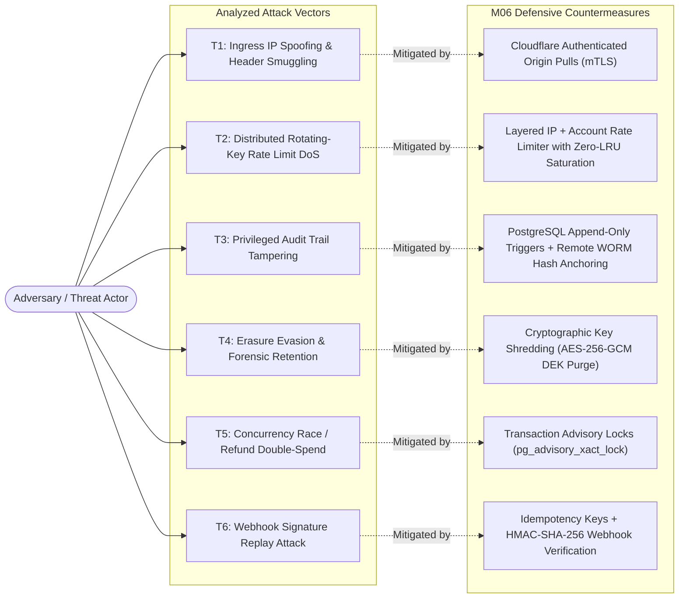

# ISHTI Milestone M06 — Security & Failure Mode Plan

**Document Reference:** `docs/M06_SECURITY_AND_FAILURE_MODE_PLAN.md`  
**Milestone:** M06 — Backend Persistence, Distributed Invariants & Production Infrastructure  
**Repository:** `https://github.com/Sunder-Chauhan/Ishti-OS`  
**Date:** 19 November 2026  
**Auditor Roles:** Principal Application Security Engineer, Infrastructure Security Lead  

---

## 1. Threat Modeling for Distributed Backend Systems



### Detailed Threat Analysis & Mitigation Strategies

1. **Threat T1: Ingress IP Header Spoofing & Origin Bypass**
   - *Attack:* Adversary discovers origin server IP and bypasses Cloudflare WAF, sending direct requests with spoofed `CF-Connecting-IP` or forged `X-Forwarded-For` headers.
   - *Mitigation:* Enforce **Cloudflare Authenticated Origin Pulls (AOP)** at the server/ALB level via client certificate authentication (mTLS). Direct connections without valid Cloudflare certificates are dropped at the TLS handshake.
2. **Threat T2: Distributed Rotating-Key Abuse**
   - *Attack:* Attacker rotates unauthenticated cookies, user-agents, or bearer tokens to evade rate limiting.
   - *Mitigation:* Layer 1 rate limiter relies exclusively on verified network IP (collapsing untrusted direct connections to a single bounded bucket). Layer 2 verifies session credentials. Layer 3 binds limits to internal user ID (`auth.uid()`).
3. **Threat T3: Audit Trail Tampering by Compromised Administrators**
   - *Attack:* A compromised database superuser or rogue employee executes `DELETE FROM public.audit_ledger` or alters timestamps to conceal fraud.
   - *Mitigation:* Database trigger `trg_audit_ledger_immutable` blocks all `UPDATE` and `DELETE` queries. SHA-256 Merkle chain anchors previous record hashes. Daily signed cryptographic digests are archived to external **AWS S3 Object Lock (Compliance Mode)** or Cloudflare R2 WORM storage.
4. **Threat T4: Incomplete Data Erasure & Forensics Vulnerability**
   - *Attack:* When a devotee exercises DPDP §12(3) erasure, raw birth data remains recoverable in unencrypted database replicas or backups.
   - *Mitigation:* Astrological birth records are encrypted with AES-256-GCM using per-profile keys. Upon erasure confirmation, the user's Data Encryption Key (DEK) is permanently purged (**cryptographic shredding**). Even if historical database backups exist, the underlying ciphertext is mathematically impossible to decrypt.
5. **Threat T5: Refund Concurrency & Double-Spend**
   - *Attack:* Devotee rapidly submits simultaneous cancellation requests across multiple browser tabs to trigger multiple refunds for a single booking.
   - *Mitigation:* Refund requests acquire a PostgreSQL transaction-level advisory lock (`pg_advisory_xact_lock(hashtext('refund:' || booking_id))`). The booking status is transitioned to `REFUND_PENDING` before external payment gateway APIs are invoked.
6. **Threat T6: Payment Webhook Replay & Falsification**
   - *Attack:* Adversary captures a valid Razorpay `payment.captured` payload and replays it to credit unauthorized services.
   - *Mitigation:* Webhook payloads are verified using HMAC-SHA-256 with `RAZORPAY_WEBHOOK_SECRET`. Webhook event IDs are inserted into `public.payment_webhook_events` with a unique constraint, rejecting duplicate deliveries.

---

## 2. Fail-Open vs. Fail-Closed Decision Matrix

When backend dependencies (Redis cache, database connection pools, third-party APIs) experience outages or latency spikes, system endpoints must exhibit deterministic, policy-defined failure behavior:

| Route / System Component | Failure Condition | Target Behavior | HTTP Response | Justification |
| :--- | :--- | :--- | :--- | :--- |
| **Public Scripture & Panchang (`GET /api/scriptures/...`)** | Distributed Redis Cache Unreachable | **Fail-Open (Degraded)** | `200 OK` (with `X-Degraded: true`) | Read-only public spiritual content poses zero security risk. System falls back to local in-memory cache or direct database read. |
| **Ingress Rate Limiter (`checkRateLimit`)** | Distributed Redis Cache Unreachable | **Fail-Open (Local Fallback)** | Depends on Route | Falls back to local `BoundedRateLimiter` with safe saturation quota preservation. Prevents full platform outage while preserving abuse mitigation. |
| **Auth & Session Ingress (`POST /api/auth/otp`)** | Supabase Auth API Unreachable / Timeout | **Fail-Closed** | `503 Service Unavailable` | Never permit unauthenticated or assumed access to user profiles. Fails safe. |
| **Payment Webhook Ingress (`POST /api/webhooks/razorpay`)** | Database Connection Exhausted | **Fail-Closed (Retryable)** | `500 Internal Error` | Returning 5xx signals Razorpay to re-attempt delivery with exponential backoff, preventing lost transaction records. |
| **Grievance Triage (`POST /api/compliance/triage`)** | Database Insert Failure | **Fail-Closed (Emergency Backup)** | `503 Service Unavailable` | Logs payload to local encrypted disk spool (`/spool/grievance/`) to prevent loss of statutory complainant communications, while returning retry status. |
| **Kundli Birth Data Decryption (`POST /api/kundli/decrypt`)** | Context-Bound AAD Hash Mismatch | **Fail-Closed** | `403 Forbidden` | Cryptographic tampering or cross-user transplantation attempt detected. Halts immediately and records security alert. |
| **Statutory Data Erasure (`POST /api/compliance/privacy-request`)** | Cryptographic Key Shredder Worker Failure | **Fail-Closed** | `500 Internal Error` | Erasure request remains in `PENDING` state until shredding is mathematically verified; never mark completed prematurely. |

---

## 3. Secrets Management & Zero-Downtime Rotation Runbooks

### 3.1. Secret Classification Taxonomy

| Secret Name | Scope | Security Level | Rotation Interval | Storage Location |
| :--- | :--- | :--- | :--- | :--- |
| `SUPABASE_SERVICE_ROLE_KEY` | Server-Only | Critical | 90 Days | Vercel Environment / Infisical |
| `KUNDLI_ENCRYPTION_KEY_V1` | Server-Only | Critical | 180 Days | Server Secrets / AWS KMS |
| `RATE_LIMIT_HMAC_SECRET` | Server-Only | High | 90 Days | Server Secrets |
| `RAZORPAY_WEBHOOK_SECRET` | Server-Only | Critical | 180 Days | Razorpay Dashboard & Server Secrets |
| `REVERSE_PROXY_SHARED_SECRET`| Infrastructure | High | 90 Days | Cloudflare / Edge Ingress |

### 3.2. Zero-Downtime Envelope Key Rotation Procedure (Kundli Encryption)

To rotate `KUNDLI_ENCRYPTION_KEY` without corrupting existing encrypted astrological birth data:
1. **Provision New Key Version:** Generate `KUNDLI_ENCRYPTION_KEY_V2` (32 cryptographically secure random bytes).
2. **Deploy Dual-Key Application Configuration:**
   - Configure application with `ACTIVE_KEY_VERSION=2`, `KUNDLI_ENCRYPTION_KEY_V2`, and retain `KUNDLI_ENCRYPTION_KEY_V1`.
3. **Write Path (Encryption):** All new or updated Kundli profiles encrypt using Key Version 2, binding AAD to `...:v2`.
4. **Read Path (Decryption):** The decryptor checks the ciphertext prefix (`v1` or `v2`) and selects the appropriate decryption key.
5. **Background Re-encryption Migration:** Run a controlled batch job (`scripts/rotate-kundli-keys.ts`) that reads `v1` records, re-encrypts with `v2`, and updates the record atomically.
6. **Retire Old Key:** Once zero `v1` records remain in the database, safely remove `KUNDLI_ENCRYPTION_KEY_V1` from environment variables.

---

## 4. Origin Shielding & Ingress Verification Architecture

To eliminate the risk of direct-origin bypass (GAP-M05-002), production deployments must strictly adhere to the following network topology:

```
[ Internet ] 
     │
     ▼
[ Cloudflare Edge Network ]
  • DDoS Mitigation (L3/L4/L7)
  • WAF Ruleset & Rate Limiting
  • Authenticated Origin Pulls (Client mTLS Certificate)
     │
     ▼ (Encrypted HTTPS with mTLS Handshake)
[ ISHTI Ingress Controller / ALB ]
  • SSL Client Verification: ssl_verify_client on;
  • ssl_client_certificate /etc/ssl/cloudflare.crt;
  • Reject any connection lacking Cloudflare signature (403 Forbidden)
     │
     ▼ (Internal VPC Network)
[ Next.js App Router Container ]
  • TRUSTED_PROXY_STRATEGY="cloudflare"
  • CF-Connecting-IP is cryptographically guaranteed authentic
```

---

## 5. Incident Response & Disaster Recovery Runbooks

### 5.1. Database Corruption / Audit Chain Breach Recovery
1. **Detection:** Daily audit verification cron job detects a hash mismatch between `record_hash` and `previous_record_hash` in `public.audit_ledger`.
2. **Containment:** System immediately elevates to Severity P0. Automated alert dispatched to Security and Infrastructure leads.
3. **Forensic Isolation:** Create an immediate snapshot of the active PostgreSQL database instance.
4. **Reconstruction:** Download the most recent cryptographically signed compliance manifest from the immutable WORM bucket (AWS S3 Object Lock). Identify the exact sequence ID where the divergence occurred.
5. **Remediation:** Restore from validated physical backup and replay signed transaction logs. Issue formal statutory report to the Data Protection Board if unauthorized data alteration is confirmed.
