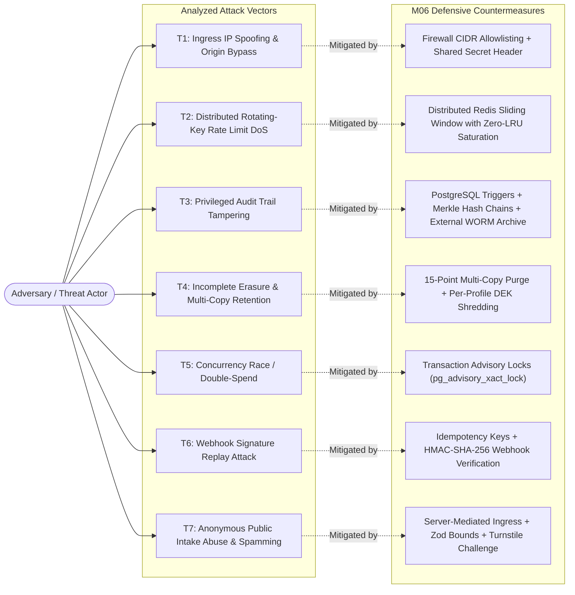
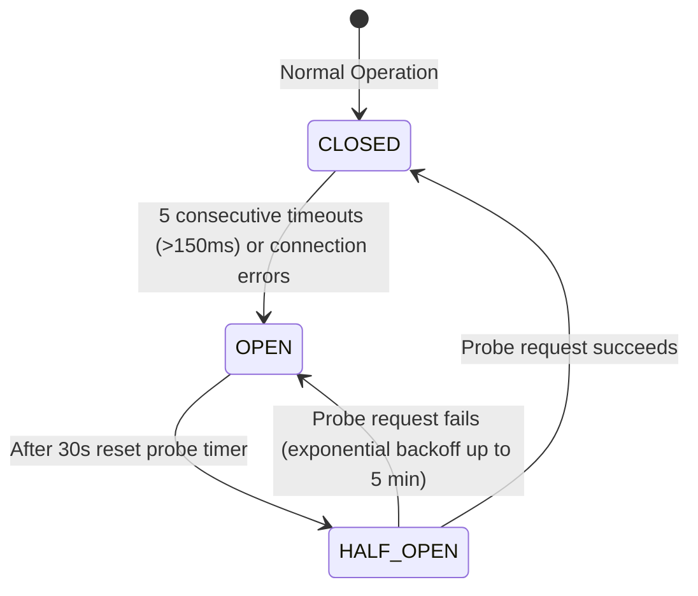

# ISHTI Milestone M06 — Security & Failure Mode Plan (Revised)

**Document Reference:** `docs/M06_SECURITY_AND_FAILURE_MODE_PLAN.md`  
**Milestone:** M06 — Core Backend Persistence, Distributed Invariants & Production Shielding  
**Repository:** `https://github.com/Sunder-Chauhan/Ishti-OS`  
**Revision Date:** 19 November 2026  
**Auditor Roles:** Principal Application Security Engineer, Infrastructure Security Lead & Privacy Engineering Lead  

---

## 1. Threat Modeling for Distributed Backend Systems

### Detailed Threat Analysis & Mitigation Strategies

1. **Threat T1: Ingress IP Header Spoofing & Direct Origin Bypass (Correction 7)**
   - *Attack:* Adversary discovers origin server IP and bypasses Cloudflare edge, sending requests directly to the origin with forged `CF-Connecting-IP` or `X-Forwarded-For` headers.
   - *Mitigation:* Because Vercel Pro does not support custom mTLS client certificates (Cloudflare AOP), ISHTI enforces **Ingress Firewall IP CIDR Allowlisting** (restricting origin TCP traffic strictly to Cloudflare's published IP ranges) combined with **Cryptographic Shared Proxy Secret Validation** (`x-ishti-proxy-secret` injected by Cloudflare Transform Rules and validated in Next.js middleware). Direct connections lacking verified secret headers or arriving from unauthorized IPs are dropped with HTTP 403.
2. **Threat T2: Distributed Rotating-Key Rate Limit Abuse**
   - *Attack:* Attacker rotates unauthenticated cookies, user-agents, or bearer tokens to evade rate limiting.
   - *Mitigation:* Layer 1 rate limiter relies exclusively on verified network IP from trusted ingress. Layer 2 verifies session credentials via `@supabase/ssr`. Layer 3 binds limits to verified user ID (`auth.uid()`). Active quotas are preserved upon saturation; unmapped keys are rejected.
3. **Threat T3: Privileged Audit Trail Tampering (Correction 6)**
   - *Attack:* A compromised database superuser or rogue administrator executes SQL updates/deletions on audit history to conceal unauthorized activity.
   - *Mitigation:* Database triggers (`trg_audit_ledger_immutable`) block application updates. Merkle hash chaining ensures that any manual tampering in the raw database breaks the cryptographic hash of all subsequent entries. Daily signed Merkle roots are exported to an **isolated secondary cloud account with AWS S3 / Cloudflare R2 Object Lock in Compliance Mode** (immutable WORM).
4. **Threat T4: Incomplete Data Erasure & Forensic Retention (Correction 5)**
   - *Attack:* Personal data remains lingering across database replicas, search indexes, application logs, caches, and backups after an erasure request is confirmed.
   - *Mitigation:* ISHTI executes an 8-stage erasure state machine across all 15 personal data repositories. Sensitive astrological birth records are destroyed via **cryptographic shredding** of the per-profile AES-256 Data Encryption Key (DEK). Caches and indexes are flushed synchronously; immutable rolling database backups cycle out naturally on a verified 30-day window.
5. **Threat T5: Concurrency Race & Double-Spend**
   - *Attack:* Devotee rapidly submits concurrent cancellation requests across multiple browser tabs to trigger multiple refunds for a single booking.
   - *Mitigation:* Transaction-level advisory lock (`pg_advisory_xact_lock(hashtext('refund:' || booking_id))`) serializes processing. The booking status transitions to `REFUND_PENDING` atomically before payment gateway APIs are invoked.
6. **Threat T6: Payment Webhook Replay & Falsification**
   - *Attack:* Adversary captures a valid Razorpay webhook payload and replays it to credit unauthorized services.
   - *Mitigation:* Webhook payloads are verified using HMAC-SHA-256 with `RAZORPAY_WEBHOOK_SECRET`. Webhook event IDs are inserted into `public.payment_webhook_events` with a unique constraint, rejecting duplicate deliveries.
7. **Threat T7: Anonymous Public Intake Abuse & Spamming (Correction 4)**
   - *Attack:* Malicious actors flood public grievance forms or early-access endpoints with garbage data or bot submissions to exhaust database storage or trigger false SLA alerts.
   - *Mitigation:* Zero direct database access (`anon` role has no INSERT grants). All submissions are mediated by server actions enforcing strict Zod validation, payload size caps (max 32 KB), and Layer 1 IP throttling (3 req / 10 min). Cloudflare Turnstile challenges are invoked if burst patterns are detected.

---

## 2. Distributed Rate Limiter Failure Policy & Circuit Breaker (Correction 3)

### 2.1. Fail-Open vs. Fail-Closed Route Matrix
When distributed cache dependencies (Upstash Redis) experience outages, latency spikes, or network partitions, endpoints must exhibit deterministic, security-first failure behavior. 

**Silent fallback to process-local memory on sensitive mutation routes is strictly prohibited.**

| Route / System Component | Upstream Failure Condition | Mandatory Failure Policy | HTTP Response Code | Security & Operational Rationale |
| :--- | :--- | :--- | :--- | :--- |
| **Auth & Session Mutation (`/api/auth/otp`, `/api/auth/verify`)** | Redis Unreachable / Timeout | **FAIL CLOSED** | `503 Service Unavailable` (`RATE_LIMIT_UNAVAILABLE`) | Falling back to local memory allows distributed brute-force attacks against phone OTPs. |
| **Financial Transactions (`/api/commerce/checkout`, `/api/commerce/refund`)** | Redis Unreachable / Timeout | **FAIL CLOSED** (Optional DB Lock Fallback) | `503 Service Unavailable` | Prevents unmetered checkout spamming and booking slot race conditions. |
| **Statutory Data Erasure (`/api/compliance/privacy-request`)** | Redis Unreachable / Timeout | **FAIL CLOSED** | `503 Service Unavailable` | Sensitive compliance workflows require verified transactional identity. |
| **Grievance Triage (`/api/compliance/triage`)** | Redis Unreachable / Timeout | **FAIL CLOSED** (Emergency Disk Spool) | `503 Service Unavailable` (Spool written) | Protects intake queue from bot exhaustion while spooling valid submissions to encrypted disk buffer for ingestion. |
| **Kundli Birth Data Decryption (`/api/kundli/decrypt`)** | Redis Unreachable / Timeout | **FAIL CLOSED** | `503 Service Unavailable` | High-cost cryptographic compute endpoint; fails safe to prevent CPU exhaustion. |
| **Public Scripture & Panchang (`/api/scriptures/...`, `/api/panchang/...`)** | Redis Unreachable / Timeout | **FAIL OPEN (DEGRADED)** | `200 OK` (with `X-RateLimit-Degraded: true`) | Public spiritual content carries zero exploit risk. Falls back to conservative local rate limiter (20 req/min) or serves stale CDN cache. |

### 2.2. Distributed Cache Failure Scenarios & Circuit Breaker Behavior

1. **Scenario A: Connection Refused / Outage**
   - Circuit breaker trips to `OPEN` after 5 consecutive failures.
   - Dispatches immediate **Severity P1 alert** to infrastructure on-call engineers.
   - Sensitive mutation routes reject requests immediately with HTTP 503 without waiting for timeouts.
   - Public read routes enter degraded local-rate-limited mode.
2. **Scenario B: Latency Spikes & Timeout**
   - Distributed rate limiter queries enforce a hard **150ms timeout**.
   - If Redis does not reply within 150ms, the request aborts the cache check and records a circuit failure.
   - Maximum of **1 retry** permitted with an immediate 25ms backoff.
3. **Scenario C: Inconsistent Results / Cluster Replication Lag**
   - Redis EVAL scripts execute atomically on primary Redis instances.
   - Sliding-window calculations utilize server timestamps (`redis.call('TIME')`) rather than client clocks to eliminate drift.
4. **Scenario D: Upstash Provider Rate-Limit Hit**
   - If Upstash daily request caps are reached, the system transitions to the secondary database-native rate limiter (`public.check_rate_limit()` using PostgreSQL advisory locks) for sensitive routes.

---

## 3. Comprehensive Multi-Copy Privacy Erasure Architecture (Correction 5)

Data erasure under DPDP Act §12(3) and GDPR Article 17 requires systemic purging across all platform layers. Equating key deletion with complete erasure is rejected.

### 3.1. Per-User Data Encryption Key (DEK) Lifecycle & Shredding

```mermaid
flowchart TD
    subgraph Key Creation [1. Key Provisioning]
        KMS["Platform Key Management (AWS KMS / Supabase Vault)"]
        Gen["Generate 32-byte CSPRNG Key (DEK)"]
        Wrap["Wrap DEK with Master KEK: AES-256-KeyWrap"]
        Store["Store Encrypted DEK in public.kundli_encryption_keys"]
        KMS --> Gen --> Wrap --> Store
    end

    subgraph Key Usage [2. Operational Encryption]
        Req["Decryption Request + Context AAD"]
        Unwrap["Unwrap DEK in Ephemeral Memory"]
        Decrypt["AES-256-GCM Decrypt Kundli Birth Data"]
        Zero["Zeroize DEK in Memory"]
        Req --> Unwrap --> Decrypt --> Zero
    end

    subgraph Key Shredding [3. Statutory Erasure Execution]
        ErasureReq["Confirmed Erasure Request (2FA Verified)"]
        PurgeDEK["Hard Delete Encrypted DEK from Table"]
        PurgeCache["Purge DEK from Redis Memory Caches"]
        RecordFingerprint["Record Cryptographic Shredding Fingerprint in Audit Log"]
        Irrecoverable["Ciphertext in DB & All Historical Backups Mathematically Irrecoverable"]
        ErasureReq --> PurgeDEK --> PurgeCache --> RecordFingerprint --> Irrecoverable
    end
```

### 3.2. Backup Expiry & Disaster Recovery Handling
1. **Immutable Backup Reality:** Physical database WAL logs and automated Supabase backups are immutable snapshots. They cannot be selectively edited to remove individual user rows without corrupting database block structures.
2. **Rolling Expiry Window:** Backups rotate on a strict **30-day rolling window**. After 30 days, old backup archives are permanently overwritten.
3. **Restoration Runbook with Deletion Tomberstones:** If a disaster recovery event requires restoring a database from a 14-day-old backup:
   - The restoration procedure must automatically replay the **Deletion Tombstone Manifest** archived in the external WORM storage.
   - The restoration script immediately re-executes cascading deletions and re-shreds DEKs for all users who invoked erasure prior to the backup restoration point.

---

## 4. Ingress Shielding & Hosting Compatibility (Correction 7)

### 4.1. Platform Compatibility Audit
| Hosting Platform | Cloudflare AOP (mTLS Client Certs) | Cloudflare Tunnel (`cloudflared`) | IP CIDR Allowlisting | Shared Secret Header | Recommendation for ISHTI |
| :--- | :---: | :---: | :---: | :---: | :--- |
| **Vercel Pro (Current Web Host)** | **INCOMPATIBLE** (Requires Enterprise) | **INCOMPATIBLE** (Serverless runtime) | **SUPPORTED** (Vercel Firewall Rules) | **SUPPORTED** (Next.js Middleware) | **Enforce IP CIDR + Shared Secret Header** |
| **AWS ALB / ECS / Fly.io (Container Host)** | **SUPPORTED** (Custom SSL verify client) | **SUPPORTED** (Sidecar daemon) | **SUPPORTED** (Security Groups) | **SUPPORTED** (Reverse Proxy) | **Transition to Cloudflare Tunnel / AOP upon containerization** |

### 4.2. Ingress Defense-in-Depth Specification (Vercel Production)
1. **Cloudflare Transform Rules:** Inject custom random 32-byte header `x-ishti-proxy-secret` on all edge requests forwarded to the origin.
2. **Next.js Ingress Verifier:** In `compliance-session-verifier.ts`, validate that `x-ishti-proxy-secret` strictly matches `process.env.REVERSE_PROXY_SHARED_SECRET`. Requests lacking this header are dropped immediately with HTTP 403.
3. **Vercel Firewall Rules:** Restrict incoming HTTP/HTTPS connections strictly to Cloudflare's published IPv4 and IPv6 CIDR blocks.
4. **Mark as UNVERIFIED:** Full mutual TLS (mTLS) client certificate verification remains marked as **`UNVERIFIED ON VERCEL`** and will be prototyped if infrastructure transitions to containerized ECS/Fly.io.
