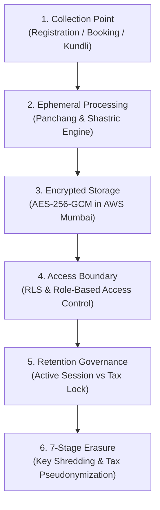
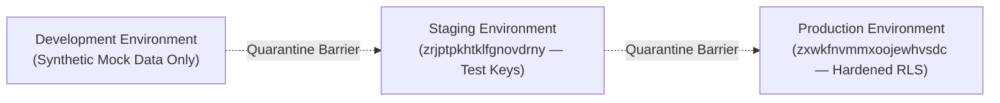

# ISHTI — Personal Data Inventory & Lifecycle Governance

**Document Reference:** `docs/legal/ISHTI_DATA_INVENTORY_AND_LIFECYCLE.md`  
**Milestone:** M05 — Legal, Privacy & Trust Foundation  
**Version:** 1.0.0  
**Last Updated:** 2026-11-17  
**Governance Standard:** RECORD OF PROCESSING ACTIVITIES (ROPA) — DPDP ACT §8 / GDPR ART. 30  

---

## 1. Executive Purpose & Governance Invariants

Under the **Digital Personal Data Protection Act, 2023** (DPDP Act) and the **General Data Protection Regulation** (GDPR), a Data Fiduciary must maintain an exhaustive, verifiable inventory of all personal data collected, its precise business purpose, statutory legal basis, cryptographic protections, access boundaries, retention triggers, and deletion protocols.

### Core Lifecycle Invariants Enforced:
1. **Purpose Specification:** Personal data is collected solely for specified, lawful purposes and never processed in a manner incompatible with those purposes (DPDP Act §6).
2. **Data Minimization:** Optional attributes (e.g. gotra, kuladevi, birth time) are strictly voluntary unless strictly necessary for a specific ritual or Shastric calculation.
3. **Contextual Sacred Encryption:** Astrological birth details are protected by server-side AES-256-GCM authenticated envelope encryption with tenant-bound AAD tags.
4. **Segregation of Accounting Records:** Mandatory statutory tax retention (7 years under Income-tax Act, 2025; 8 financial years under Companies Act, 2013) applies **exclusively to financial transaction logs and invoices**, never to devotional chats, prayer intentions, or birth charts.
5. **Truth in Deletion:** Deletion requests scrub active application records, shred devotee encryption keys, and pseudonymize financial records to `ANON-USER-DELETED`. Backups are disclosed as overwritten in rolling 30-day disaster recovery cycles.

---

## 2. Personal Data Inventory & Processing Lifecycle

| Field ID | Data Field & Category | Collection Point (UI / API) | Business Purpose & Processing Scope | Statutory Legal Basis | Storage Location & Encryption Status | Processing Vendors & Subprocessors | Authorized RBAC Roles | Statutory Retention Trigger | Retention Period & Justification | Deletion Method & Proof | Cross-Border Transfer Status |
| :--- | :--- | :--- | :--- | :--- | :--- | :--- | :--- | :--- | :--- | :--- | :--- |
| **DATA-01** | **Mobile Telephone Number** *(Identity & Contact)* | Phone OTP Modal (`/components/auth/AuthModal.tsx`) | Devotee authentication, session recovery, booking confirmations | Consent (DPDP §6(1)); Contractual Necessity | `public.profiles` table; plaintext indexed for lookup | Supabase (Database); Twilio/Gupshup (SMS Delivery) | Devotee (Self); `platform_admin` | Account Deletion Request | Retained while account active; deleted upon Stage 1–4 erasure | Database `DELETE` cascade; unlinked from bookings | In-Country (AWS ap-south-1 Mumbai) |
| **DATA-02** | **Devotee Full Name & Display Alias** | Profile Setup (`/profile`) | Platform personalization, greeting, consultation booking identity | Consent (DPDP §6(1)) | `public.profiles.full_name`; standard storage | Supabase Cloud | Devotee (Self); Consulting Pandit (during session) | Account Deletion Request | Retained while account active; deleted upon erasure | Overwritten with `ANON-USER-DELETED` in bookings | In-Country |
| **DATA-03** | **Date, Time & Coordinates of Birth** *(Sacred Astrological Data)* | Kundli Input Form (`/astro`) | Generation of Rashi, Nakshatra, Bhavas, Graha Spashta ephemerides | Explicit Consent (`kundli_astrology`) | `public.kundli_profiles` (Ciphertext fields: `dob_encrypted`, `tob_encrypted`, `lat_long_encrypted`) — **AES-256-GCM Authenticated Envelope Encryption** | Supabase Cloud (Storage); Local server memory during calculation | Devotee (Self); Assigned Pandit (explicit booking only) | Devotee chart deletion request or account closure | Active during user session; immediate shredding upon deletion request | **ASTRO_KEY_SHREDDING:** Ciphertext records and tenant-bound AAD tags purged; server master key unlinks | In-Country (Server decryption in ephemeral memory only) |
| **DATA-04** | **Sampradaya Tradition & Devotional Preferences** *(Religious Data)* | Profile Preferences (`/profile`) | Recommending appropriate festival Muhurtas, temple traditions, and Vedic rituals | Explicit Consent (GDPR Art. 9(2)(a); DPDP §6) | `public.profiles.sampradaya`; standard storage | Supabase Cloud | Devotee (Self) | Account Deletion Request | Retained while account active; deleted upon request | Immediate database deletion | In-Country |
| **DATA-05** | **Puja Sankalpa & Family Member Names** *(Sacred Ritual Intentions)* | Puja Booking Flow (`/puja`) | Transmission to officiating Acharya for recitation during sacred ritual Sankalpa | Contractual Performance (Booking Agreement) | `public.booking_requests.sankalpa_notes`; encrypted storage | Supabase Cloud | Devotee (Self); Officiating Pandit | Completion of ritual + 30 days dispute window | 30 days post-ritual fulfillment | Purged from booking records after 30 days | In-Country |
| **DATA-06** | **Financial Transaction Records & Invoices** *(Commercial Tax Data)* | Payment Checkout (`/profile/refunds`) | Payment reconciliation, GST statutory compliance, Income Tax audits, refunds | **Legal Obligation (Statutory Mandate)**: - Income-tax Act, 2025 §62 - Companies Act, 2013 §128 | `public.payment_transactions`; locked append-only storage | Supabase Cloud; Razorpay / Cashfree | `platform_admin`; Finance / Statutory Auditors | End of financial year in which transaction occurred | **7 Tax Years** (Income-tax Act 2025 §62 / Rule 46); **8 Financial Years** (Companies Act 2013 §128) | **Pseudonymization Only:** Personal profile references redacted to `ANON-USER-DELETED`; financial record preserved | In-Country (Daily electronic backup in India under Rule 46(8)) |
| **DATA-07** | **Spiritual AI Conversational Queries** *(User-Generated Queries)* | Conversational Assistant (`/bhakti`) | Providing contextually relevant Shastric guidance and scriptural verse citations | Explicit Consent (`spiritual_ai`) | Ephemeral server session; optional local device caching | Google Cloud (Gemini API inference) | Devotee (Self); Zero Human Review | Immediate query fulfillment or session close | Zero server-side retention; local browser storage cleared upon sign-out | Instantaneous memory purge; zero model retraining retention | Cross-Border Transit (Encrypted TLS transit for inference; zero vendor storage) |
| **DATA-08** | **Grievance Ticket Submissions & Evidence** *(Statutory Redressal Records)* | Grievance Portal (`/legal/grievance`) | Redressal of devotee complaints under IT Rules 2021 & Consumer Protection Rules | Legal Obligation (IT Rules 2021 Rule 3(2)) | `public.grievance_tickets`; access-controlled | Supabase Cloud | Complainant; Statutory Grievance Officer | Final resolution of grievance / GAC appeal closure | **3 Years** following final disposal (Limitation Act / Evidence preservation) | Secure archival and cryptographic purge | In-Country |
| **DATA-09** | **Compliance Audit Trail Hash Chain** *(Tamper-Evident Evidence)* | Administrative Operations (`audit-trail.ts`) | Evidentiary proof of compliance, access authorization, and incident response | Legal Obligation (CERT-In Directions 2022 / DPDP §8) | SHA-256 hash-chained ledger; planned Cloud Storage Object Lock (WORM) | Supabase Cloud / Cloudflare | `platform_admin`; Regulatory Auditors | Event creation timestamp | **5 Years** (CERT-In 180-day minimum; 5-year regulatory audit standard) | WORM storage retention lock expiration | In-Country |

---

## 3. Data Environment Segregation

To prevent cross-contamination and accidental data leakage, ISHTI enforces absolute isolation across environments:

1. **Local Development:** Zero real personal data. All test suites operate against synthetic, mock, or isomorphic test fixtures.
2. **Staging Environment (`zrjptpkhtklfgnovdrny`):** Strictly disposable sandbox. No real devotees, live credit cards, or actual birth details.
3. **Production Environment (`zxwkfnvmmxoojewhvsdc`):** Quarantined until commercial clearance. Hardened Row-Level Security, database connection pooling via Supabase, and encrypted backups.
4. **Disaster Recovery Snapshots:** Rolling database snapshots are encrypted at rest with AWS KMS and overwritten on a strict **30-day retention cycle**. Devotees exercising their right to erasure are notified that while active data is purged immediately, rolling backup archives naturally expire and overwrite within 30 days.
