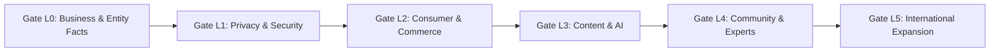

# ISHTI — Legal & Regulatory Launch Gates Checklist

**Document Reference:** `docs/legal/ISHTI_LEGAL_LAUNCH_CHECKLIST.md`  
**Milestone:** M05 — Legal, Privacy & Trust Foundation  
**Version:** 1.0.0  
**Last Updated:** 2026-11-17  
**Governance Standard:** HARD STOP RELEASE GATING  
**Status:** ALL GATES OPEN / PENDING OPERATIONAL EVIDENCE  

---

## 1. Executive Protocol & Hard-Stop Policy

To guarantee that ISHTI is **legally prepared by design, not merely equipped with legal documents**, the platform enforces a strict sequential gate progression:

> [!CRITICAL]
> **HARD-STOP RULE:**
> A launch gate CANNOT be marked `COMPLETE` or `APPROVED` merely because policy files, architecture documents, or UI mockups exist in the repository.
> 
> Progression through each gate requires **verified documentary evidence**, a **named responsible person**, an **executed legal contract or statutory filing**, and **formal written approval from qualified legal counsel**.
> 
> If a single blocker remains in a gate, that gate remains `BLOCKED` or `IN_PROGRESS`, and commercial traffic through that capability is strictly prohibited.

---

## 2. Launch Gates Audit Matrix

### Gate L0 — Business & Entity Facts
*Mandatory clearance required before onboarding external beta users or engaging third-party contractors.*

| Checklist Item | Description | Evidence Required | Responsible Person | Technical Dependency | Legal Counsel Requirement | Current Status | Remaining Blockers |
| :--- | :--- | :--- | :--- | :--- | :--- | :---: | :--- |
| **L0.1** | Corporate Entity Incorporation | Certificate of Incorporation (COI) from MCA under Companies Act, 2013 | Platform Promoters | None | Corporate Counsel Sign-Off | **BLOCKED** | Company not yet incorporated. |
| **L0.2** | Intellectual Property Assignment | Executed Deeds of IP Assignment transferring all code, designs, and domain names from all founders and contributors to the corporate entity | Individual Contributors & Entity | None | IP Counsel Review & Stamp Duty Payment | **BLOCKED** | IP assignments not executed. |
| **L0.3** | PAN, TAN & Bank Accounts | Corporate PAN card, TAN allotment letter, active corporate bank account in India | Finance Lead | None | Chartered Accountant | **BLOCKED** | Awaiting corporate formation. |
| **L0.4** | Corporate Identity Placeholders | Replace all `[LEGAL_REVIEW_REQUIRED: ...]` entity name and postal address placeholders in policy files | Engineering Lead | Corporate details | Verification of clean git diff | **BLOCKED** | Awaiting L0.1 COI. |
| **L0.5** | Comprehensive Cyber & D&O Insurance | Executed Commercial Cyber Liability Insurance policy schedule | Board of Directors | Risk Assessment | Corporate Insurance Broker | **BLOCKED** | Policy not yet underwritten. |

**Gate L0 Verdict:** **BLOCKED — CORPORATE INCORPORATION REQUIRED**

---

### Gate L1 — Privacy & Security
*Mandatory clearance required before collecting, processing, or storing real user personal data.*

| Checklist Item | Description | Evidence Required | Responsible Person | Technical Dependency | Legal Counsel Requirement | Current Status | Remaining Blockers |
| :--- | :--- | :--- | :--- | :--- | :--- | :---: | :--- |
| **L1.1** | Personal Data Inventory & ROPA | Comprehensive data lifecycle inventory mapping purposes, legal bases, storage locations, and retention rules | Executed `ISHTI_DATA_INVENTORY_AND_LIFECYCLE.md` | Privacy Lead | DPO / Data Privacy Counsel | **IN_PROGRESS** | Technical inventory drafted; live data flow audit required in M06. |
| **L1.2** | Verified Consent Governance | Unbundled consent registry with cryptographic SHA-256 evidence hashing; optional purposes defaulting to false | Production database consent audit logs; test suite results | Engineering Lead | Privacy Counsel Review of Consent Notice copy | **IN_PROGRESS** | Architecture verified locally; backend persistence required in M06. |
| **L1.3** | Minor & Child Data Governance | Verifiable parental consent mechanism for minors under 18; strict ban on tracking/behavioral profiling | Working guardian phone OTP flow; age declaration logs | Product Lead | Privacy Counsel Sign-Off under DPDP Act §9 | **BLOCKED** | Minor governance flow pending M06 implementation. |
| **L1.4** | Statutory Grievance Redressal | Resident Grievance Officer appointed; 24-hour acknowledgement and 7-day resolution SLAs operational | Written Officer Appointment Resolution; ticketing dispatch logs | Appointed Grievance Officer | Tech / Intermediary Counsel Sign-Off | **BLOCKED** | Grievance Officer not yet appointed by entity. |
| **L1.5** | CERT-In 6-Hour Incident Protocol | Automated incident triage operational; 24/7 on-call escalation protocol; NTP synchronized with NPL | Time-stamped test submission log; NTP monitoring report | CISO / Security Architect | Security Compliance Review | **IN_PROGRESS** | Triage tested locally; NTP & 24/7 rotation pending cloud deployment. |
| **L1.6** | Cloud Vendor DPAs Executed | Signed Data Processing Agreements with Supabase Inc. (AWS Mumbai) and hosting providers | Executed DPA contracts with standard clauses | Infrastructure Lead | Privacy Counsel Review | **BLOCKED** | Awaiting corporate entity formation. |

**Gate L1 Verdict:** **BLOCKED — GRIEVANCE OFFICER APPOINTMENT & DPA EXECUTION REQUIRED**

---

### Gate L2 — Consumer & Commercial Operations
*Mandatory clearance required before initiating payment processing or billing commercial services.*

| Checklist Item | Description | Evidence Required | Responsible Person | Technical Dependency | Legal Counsel Requirement | Current Status | Remaining Blockers |
| :--- | :--- | :--- | :--- | :--- | :--- | :---: | :--- |
| **L2.1** | GST Registration, SAC Classification & TCS Setup | Active GSTIN registration; verified SAC classification (999799, 998439) with 18% GST calculation; setup 0.5% TCS deduction mechanism under CGST Act §52 if operating as an ECO marketplace (Notification No. 15/2024-Central Tax) | GST Registration Certificate (REG-06); CA-approved tax classification memo; sample tax invoice | Tax Lead | Chartered Accountant Review | **BLOCKED** | Awaiting corporate entity formation and CA review. |
| **L2.2** | Payment Aggregator Merchant Agreement | Executed merchant onboarding agreement with RBI-authorized Payment Aggregator (Razorpay/Cashfree) | Executed Merchant Service Agreement; sandbox pass receipt | Commercial Lead | Fintech Legal Review | **BLOCKED** | Entity KYC required by payment aggregator. |
| **L2.3** | Commercial Refund Tiers Approved | Founder-approved cancellation tiers (24h/50%/0%) and Pandit No-Show 100% guarantee | Formally signed Commercial Policy Decision memo | Head of Operations | Consumer Protection Counsel | **BLOCKED** | Founder sign-off required on refund policy. |
| **L2.4** | Elimination of Dark Patterns | Zero false urgency, zero pre-ticked add-on boxes, transparent pricing breakdown at checkout | Design system token review; checkout screen audit | UX Lead | Consumer Protection Counsel | **APPROVED LOCALLY** | Verified in architecture; must be preserved in production. |
| **L2.5** | Prohibition of Supernatural Healing Claims | Puja and astrological remedial listings strictly filtered for prohibited medical cure promises | Blacklist filter configuration; ritual disclaimer audit | Compliance Lead | Drug & Magic Remedies Legal Review | **APPROVED LOCALLY** | Architecture verified; ongoing content review required. |

**Gate L2 Verdict:** **BLOCKED — GSTIN & PAYMENT AGGREGATOR MERCHANT CONTRACTS REQUIRED**

---

### Gate L3 — Content, AI & Scripture Governance
*Mandatory clearance required before enabling public scripture reading or spiritual AI conversations.*

| Checklist Item | Description | Evidence Required | Responsible Person | Technical Dependency | Legal Counsel Requirement | Current Status | Remaining Blockers |
| :--- | :--- | :--- | :--- | :--- | :--- | :---: | :--- |
| **L3.1** | Canonical Scripture Rights Clearance | Every scripture verse in database verified as public domain or supported by written translation license | Executed `ISHTI_CONTENT_RIGHTS_REGISTER.md` with source editions | Head of Scriptural Curation | Copyright Counsel Sign-Off | **IN_PROGRESS** | Public domain texts identified; modern editions marked pending review. |
| **L3.2** | Grounded RAG AI Architecture | Spiritual AI assistant restricted to retrieval over verified canonical verses; strict zero-hallucination guard | Benchmark accuracy test suite; hallucination rate < 0.1% | AI Engineering Lead | Vedic Scholar Peer Review | **BLOCKED** | RAG vector pipeline pending M06 implementation. |
| **L3.3** | Mandatory In-UI AI Disclaimers | Every AI-generated output visibly labeled as synthetic guidance, explicitly stating it is not divine revelation | UI component snapshot; user testing verification | Frontend Lead | Consumer / IT Act Counsel | **APPROVED LOCALLY** | Component `<AIGeneratedDisclaimer />` drafted. |
| **L3.4** | Enterprise AI Zero-Retention Terms | Executed enterprise agreement with Google Cloud / LLM vendor confirming prompts are not retained for training | Signed Enterprise API Terms / DPA addendum | Infrastructure Lead | Technology Counsel Review | **BLOCKED** | Enterprise cloud contract pending incorporation. |
| **L3.5** | Synthetic Media Disclosures | AI-generated devotional images and audio watermarked with C2PA metadata and visible attribution | Manifest inspection report; image audit | Media Producer | MeitY AI Advisory Counsel Review | **BLOCKED** | Generative media engine pending future milestone. |

**Gate L3 Verdict:** **BLOCKED — RAG PIPELINE & SCRIPTURE TRANSLATION LICENSING REQUIRED**

---

### Gate L4 — Community & Expert Marketplace
*Mandatory clearance required before opening public community posting or paid pandit consultations.*

| Checklist Item | Description | Evidence Required | Responsible Person | Technical Dependency | Legal Counsel Requirement | Current Status | Remaining Blockers |
| :--- | :--- | :--- | :--- | :--- | :--- | :---: | :--- |
| **L4.1** | Pandit Independent Contractor Agreement | Executed marketplace agreements with all onboarded pandits disclaiming employment and prohibiting guarantees | Executed Pandit Onboarding Contracts | Vendor Manager | Labor & Commercial Counsel | **BLOCKED** | Pandit onboarding agreement pending execution in M06. |
| **L4.2** | Expert Credential & Lineage Verification | Rigorous operational verification of pandit pathshala lineages or university diplomas | Verified credential archive; verification audit logs | Head of Pandit Relations | Consumer Protection Counsel | **BLOCKED** | Verification operations pending M06 rollout. |
| **L4.3** | Automated Content Moderation & BNS §299 | Automated Devanagari/English filters intercepting sectarian hate speech, caste slurs, or communal incitement | Filter rule definitions; false-positive test results | Community Lead | Criminal & Media Legal Review | **BLOCKED** | Live moderation engine pending M06 implementation. |
| **L4.4** | 36-Hour Unlawful Takedown Mechanism | Protocol and tool for disabling access to illegal content within 36 hours of government/court orders | Incident response runbook; test takedown receipt | Grievance Officer | Intermediary Counsel Sign-Off | **IN_PROGRESS** | Architectural runbook formulated; live tool pending M06. |

**Gate L4 Verdict:** **BLOCKED — PANDIT CONTRACTS & LIVE MODERATION REQUIRED**

---

### Gate L5 — International Expansion
*Mandatory clearance required before marketing or enabling transactions for specific foreign jurisdictions.*

| Checklist Item | Description | Evidence Required | Responsible Person | Technical Dependency | Legal Counsel Requirement | Current Status | Remaining Blockers |
| :--- | :--- | :--- | :--- | :--- | :--- | :---: | :--- |
| **L5.1** | Schedule B (EU/UK GDPR) Compliance | Article 9 explicit consent for religious data; executed Standard Contractual Clauses with Indian entity | Signed SCCs; verified Article 9 consent logs | International Legal Lead | EU/UK Privacy Counsel Review | **IN_PROGRESS** | Schedule B drafted; SCC execution pending entity formation. |
| **L5.2** | Schedule C (US & California) Compliance | Notice at Collection; CCPA/CPRA sensitive personal information opt-out; enforceable arbitration terms | Cal. Civ. Code compliance audit report | US Counsel | California State Privacy Counsel | **IN_PROGRESS** | Schedule C drafted; counsel sign-off required. |
| **L5.3** | Cross-Border Currency & Remittance | RBI-compliant export transaction reporting for inward foreign currency remittances | Authorized Dealer bank outward certificate; Stripe export account | Finance Lead | FEMA / RBI Regulatory Counsel | **BLOCKED** | Awaiting AD bank account and international payment gateway. |

**Gate L5 Verdict:** **BLOCKED — INTERNATIONAL PAYMENT GATEWAY & SCC EXECUTION REQUIRED**

---

## 3. Summary of Launch Gate Approvals

| Gate | Scope | Status | Technical Readiness | Legal / Operational Readiness |
| :--- | :--- | :---: | :---: | :---: |
| **Gate L0** | Business & Entity Facts | **BLOCKED** | 100% | 0% (Unincorporated) |
| **Gate L1** | Privacy & Security | **BLOCKED** | 90% (Local tests pass) | 25% (Awaiting Officer & DPA) |
| **Gate L2** | Consumer & Commerce | **BLOCKED** | 95% (Arithmetic verified) | 20% (Awaiting GSTIN & PG) |
| **Gate L3** | Content & AI | **BLOCKED** | 50% (Seeds marked draft) | 20% (Awaiting Licensing & RAG) |
| **Gate L4** | Community & Experts | **BLOCKED** | 60% (Grievance ready) | 10% (Awaiting Contracts) |
| **Gate L5** | International Expansion | **BLOCKED** | 80% (Schedules drafted) | 15% (Awaiting SCCs & FEMA) |

### Formal Declaration:
No gate is approved for live commercial deployment. ISHTI remains in **controlled development and local architectural verification status**.
