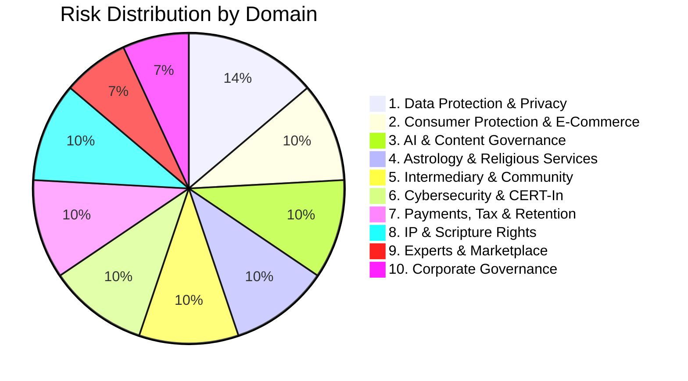

# ISHTI — Comprehensive Legal & Regulatory Risk Register

**Document Reference:** `docs/legal/ISHTI_LEGAL_RISK_REGISTER.md`  
**Milestone:** M05 — Legal, Privacy & Trust Foundation  
**Version:** 1.0.0  
**Last Updated:** 2026-11-17  
**Governance Classification:** FORMAL RISK LEDGER  
**Review Frequency:** Bi-weekly during pre-launch; monthly post-launch  

---

## 1. Executive Summary & Exposure Methodology

This risk register evaluates the legal, regulatory, intellectual property, financial, and operational exposures across all product domains of **ISHTI** (Puja, Astro, Bhakti, Panchang, Experts, Community, AI).

### Exposure Assessment Methodology
To prevent catastrophic financial underestimation while avoiding misleading alarmism, all penalties and financial liabilities are assessed using a **three-tier exposure model**:

1. **Maximum Statutory Ceiling:** The absolute statutory maximum fine or civil penalty prescribed in the legislation (e.g., DPDP Act §33: up to ₹250 crore per breach; CPA 2019 §21: up to ₹50 lakh for misleading advertisement).
2. **Realistic Enforcement Exposure:** The probable administrative sanction, regulatory penalty, or settlement range calculated on proportionality, business size, absence of prior infractions, and prompt self-reporting.
3. **Collateral & Operational Exposure:** Civil consumer compensation, legal defense counsel fees, expert witness costs, payment aggregator account freezes, business interruption, and brand damage.

---

## 2. Risk Severity & Likelihood Matrix

| Likelihood \ Severity | Low | Medium | High | Critical |
| :--- | :---: | :---: | :---: | :---: |
| **High** | Medium | High | Critical | Critical |
| **Medium** | Low | Medium | High | Critical |
| **Low** | Low | Low | Medium | High |

- **Critical:** Regulatory injunction, criminal proceedings, license revocation, statutory penalty > ₹1 crore, or fatal brand damage.
- **High:** Formal regulatory inquiry, class action / consumer forum litigation, statutory penalty ₹10 lakh–₹1 crore, payment gateway suspension.
- **Medium:** Individual consumer dispute, formal legal notice, fine < ₹10 lakh, temporary operational disruption.
- **Low:** Minor technical non-compliance easily remedied without statutory sanction.

---

## 3. Comprehensive Risk Ledger (Across 10 Regulatory Domains)

---

### Domain 1: Data Protection & Privacy (DPDP Act, 2023 / GDPR / CCPA)

#### RISK-DP-01: Processing Personal Data Without Demonstrable Unbundled Consent
- **Domain:** Data Protection & Privacy
- **Feature Affected:** User onboarding, Kundli generation, Phone OTP registration (`/profile/consent`, `/astro`)
- **Legal Source:** Digital Personal Data Protection Act, 2023 (Act No. 22 of 2023), Section 6(1) & 6(2); GDPR (Regulation (EU) 2016/679) Article 7.
- **Applicability:** Confirmed (India, global diaspora).
- **Risk Description:** Bundling consent for distinct processing activities (e.g. bundling basic account creation with AI chat logging, third-party marketing, or expert directory profiling) or pre-ticking consent boxes.
- **Trigger:** Devotee complaint to Data Protection Board of India (DPBI) or regulatory inquiry following a dispute.
- **Consequence:** Administrative fine under DPDP Act Schedule (Item 1: failure to take reasonable security safeguards up to ₹250 crore; Item 2: failure to notify breach up to ₹200 crore; Item 4: other non-compliance up to ₹50 crore).
- **Financial Exposure:**
  - *Max Statutory Penalty:* Up to ₹50,000,000 (₹50 crore) under DPDP Act §33(1) for general non-compliance.
  - *Realistic Enforcement Range:* ₹5,00,000 to ₹25,00,000 for early-stage platform taking immediate corrective action.
  - *Collateral Exposure:* Legal representation fees (₹5,00,000–₹15,00,000), reputation loss.
- **Severity:** High | **Likelihood:** Medium (if marketing and spiritual consents are bundled)
- **Prevention Control:** Implement unbundled 6-purpose consent registry (`apps/web/lib/consent/consent-registry.ts`) where optional purposes (`spiritual_ai`, `marketing_updates`) default to `false` (opt-in). Generate cryptographic SHA-256 evidence hashes.
- **Evidence to Retain:** Server-side immutable consent logs recording: Devotee ID, Purpose ID, Version, Action (GRANTED/WITHDRAWN), ISO timestamp, and SHA-256 evidence hash.
- **Owner:** Privacy Engineering Lead / Appointed DPO
- **Status:** Mitigated Locally (Backend persistence pending M06)
- **Deadline:** Before Beta User Registration

---

#### RISK-DP-02: Failure to Implement Mandatory Verifiable Parental Consent for Children
- **Domain:** Data Protection & Privacy
- **Feature Affected:** Kundli birth chart generation for minors/infants, children's naming rituals (`/astro`, `/puja`)
- **Legal Source:** DPDP Act, 2023, Section 9(1) (mandatory verifiable parental consent) and Section 9(2) (strict bar on tracking/behavioral monitoring of children); COPPA (15 U.S.C. §6501); GDPR Article 8.
- **Applicability:** Confirmed (Indian minors under 18 years; US minors under 13).
- **Risk Description:** Parents generating birth charts for newborn children or minors without verified parental consent mechanism, or platform serving behavioral tracking/recommendations based on a child's Kundli.
- **Trigger:** Processing personal data of an individual under 18 years without verified guardian consent.
- **Consequence:** Statutory penalty under DPDP Act Schedule (Item 3: non-fulfillment of obligations in respect of children up to ₹200 crore).
- **Financial Exposure:**
  - *Max Statutory Penalty:* Up to ₹2,000,000,000 (₹200 crore).
  - *Realistic Enforcement Range:* ₹10,00,000 to ₹50,00,000 plus mandatory deletion order.
  - *Collateral Exposure:* Regulatory scrutiny of all platform records.
- **Severity:** Critical | **Likelihood:** High (parents routinely request Kundli generation for infants)
- **Prevention Control:**
  1. Add explicit age-declaration step during profile creation.
  2. For profiles under 18, require verified parent/guardian declaration checkbox with OTP confirmation sent to guardian's phone number.
  3. Strictly disable all behavioral profiling, advertising, and marketing recommendations for minor profiles.
- **Evidence to Retain:** Guardian consent record with verified phone OTP timestamp and parent relationship declaration.
- **Owner:** Engineering Lead / Legal Counsel
- **Status:** Open (Requires Dedicated Minor Governance Flow in M06)
- **Deadline:** Before Public Launch

---

#### RISK-DP-03: Mischaracterization of Cryptographic Architecture ("Zero-Knowledge" vs. Server Encryption)
- **Domain:** Data Protection & Privacy / Consumer Protection
- **Feature Affected:** Encrypted Kundli storage (`/astro`, `kundli-encryption.ts`)
- **Legal Source:** Consumer Protection Act, 2019, Section 2(28) (Misleading Advertisement) and Section 2(47) (Unfair Trade Practice); DPDP Act §8(5).
- **Applicability:** Confirmed.
- **Risk Description:** Marketing or documenting Kundli storage as "zero-knowledge encrypted" when the platform backend retains master keys and performs server-side decryption for astrology calculations.
- **Trigger:** Technical audit, consumer complaint, or discovery during litigation revealing platform can decrypt birth data.
- **Consequence:** CCPA notice for misleading claims, penalty up to ₹10 lakh (first offense) or ₹50 lakh (subsequent) under CPA §21, consumer fraud claims.
- **Financial Exposure:**
  - *Max Statutory Penalty:* ₹50,00,000 under CPA 2019 §21.
  - *Realistic Enforcement Range:* ₹2,00,000 to ₹5,00,000 fine plus mandatory corrective advertising.
- **Severity:** Medium | **Likelihood:** Low (after M05 remediation)
- **Prevention Control:** Maintain strict technical accuracy in all documentation and UI: label architecture as "Server-Side Authenticated AES-256-GCM Envelope Encryption with Context-Bound AAD". Strictly prohibit marketing team from using "Zero-Knowledge" or "End-to-End Encrypted".
- **Evidence to Retain:** Verified UI copy audits, cryptographic design documentation.
- **Owner:** Product Marketing Lead / Security Architect
- **Status:** Mitigated (Corrected in M05 UI & Documentation)
- **Deadline:** Continuous

---

#### RISK-DP-04: Cross-Border Processing of Diaspora Religious Data Without Valid Transfer Mechanism
- **Domain:** Data Protection & Privacy
- **Feature Affected:** EU/UK/US diaspora devotees accessing platform, AWS hosting in Mumbai, US-based AI models (`/legal/privacy`, `/bhakti`)
- **Legal Source:** GDPR (Regulation (EU) 2016/679) Chapter V (Articles 44–49), Article 9 (Special Category Data); DPDP Act §16 (Restricted countries blacklist).
- **Applicability:** Confirmed for international devotees.
- **Risk Description:** Transferring religious preference or astrological data of EU/UK residents to Indian servers or US AI vendors without Standard Contractual Clauses (SCCs) or explicit Article 49 derogation.
- **Trigger:** Complaint to an EU Data Protection Authority (e.g. CNIL, DPC Ireland, BfDI).
- **Consequence:** Fines under GDPR Article 83(5) (up to €20M or 4% global turnover), cross-border data transfer suspension order.
- **Financial Exposure:**
  - *Max Statutory Penalty:* Up to €20,000,000 or 4% of worldwide turnover.
  - *Realistic Enforcement Range:* Formal warning or order to execute SCCs for low-volume early-stage platform.
  - *Collateral Exposure:* International legal defense costs (€25,000–€75,000).
- **Severity:** High | **Likelihood:** Medium
- **Prevention Control:**
  1. Rely on Article 49(1)(a) explicit consent for international devotees registering directly on the Indian platform.
  2. Execute Standard Contractual Clauses (Module 2/3) with all non-Indian subprocessors.
  3. Author jurisdiction-specific Schedule B for EU/UK devotees in Terms of Service.
- **Evidence to Retain:** Executed SCCs, signed Data Processing Agreements with cloud hosting and AI vendors.
- **Owner:** International Legal Counsel / DPO
- **Status:** Counsel Review Required
- **Deadline:** Before Enabling International Marketing

---

### Domain 2: Consumer Protection & E-Commerce

#### RISK-CP-01: Prohibited Dark Patterns in Consultation Booking & Subscription Renewals
- **Domain:** Consumer Protection
- **Feature Affected:** Pandit consultation booking, Muhurta consultation scheduling, payment checkout (`/experts`, `/profile/refunds`)
- **Legal Source:** Guidelines for Prevention and Regulation of Dark Patterns, 2023 (issued by CCPA on 30 Nov 2023 under Consumer Protection Act 2019 §18); CPA 2019 §2(47).
- **Applicability:** Confirmed (All Indian consumers).
- **Risk Description:** Employing false urgency ("Only 1 Pandit slot left!"), basket sneaking (automatically adding dakshina or prasad to cart), confirm shaming ("No, I do not want divine blessings"), or disguised subscription renewals.
- **Trigger:** Consumer complaint on National Consumer Helpline (NCH) or CCPA suo-motu investigation.
- **Consequence:** CCPA investigation under §19, penalty up to ₹10 lakh, mandatory refund of all collected amounts, public censure.
- **Financial Exposure:**
  - *Max Statutory Penalty:* ₹10,00,000 per violation; up to ₹50,00,000 for repeated non-compliance.
  - *Realistic Enforcement Range:* ₹1,00,000 to ₹5,00,000 plus required UI redesign.
- **Severity:** High | **Likelihood:** Low (Architecture forbids dark patterns)
- **Prevention Control:** Enforce architectural ban on countdown timers, fake scarcity badges, pre-checked add-on boxes, and manipulative cancel buttons. Ensure checkout total displays all taxes, fees, and honorariums with 100% itemized transparency.
- **Evidence to Retain:** Design system audit records, checkout flow screenshots.
- **Owner:** UX Lead / Product Manager
- **Status:** Mitigated by Architecture
- **Deadline:** Continuous

---

#### RISK-CP-02: Non-Disclosure of Marketplace Seller / Pandit Identity and Qualifications
- **Domain:** Consumer Protection
- **Feature Affected:** Verified Pandit & Acharya directory (`/experts`)
- **Legal Source:** Consumer Protection (E-Commerce) Rules, 2020, Rule 5(3) and Rule 6 (Obligations of marketplace e-commerce entities).
- **Applicability:** Confirmed.
- **Risk Description:** Facilitating paid expert consultations without disclosing the legal name, geographic address, customer grievance contact, and verified credentials of the consulting pandit.
- **Trigger:** Devotee receives poor consultation and files a complaint against ISHTI for deficiency of service.
- **Consequence:** Joint and several liability with the pandit under E-Commerce Rules Rule 6, consumer court award of compensation.
- **Financial Exposure:**
  - *Max Statutory Penalty:* Compensation awarded by District/State Consumer Disputes Redressal Commission (₹50,000–₹5,00,000 per dispute).
  - *Realistic Enforcement Range:* Refund + compensation (₹10,000–₹50,000) plus litigation defense costs.
- **Severity:** Medium | **Likelihood:** Medium
- **Prevention Control:** Display comprehensive expert profile cards showing verified name, Vedic lineage/institution, language fluency, years of practice, and platform verification badge status. Provide direct dispute resolution mechanism.
- **Evidence to Retain:** Pandit onboarding KYC documents, identity verification logs.
- **Owner:** Operations Lead / Vendor Manager
- **Status:** Open (Awaiting Onboarding Workflow in M06)
- **Deadline:** Before Booking First Paid Consultation

---

#### RISK-CP-03: Unenforceable or Unfair Cancellation & Refund Clauses
- **Domain:** Consumer Protection
- **Feature Affected:** Cancellation fee calculations, refund policy (`/legal/refunds`, `cancellation-calculator.ts`)
- **Legal Source:** Consumer Protection Act, 2019, Section 2(46) (Unfair Contract) and Section 2(47); Consumer Protection (E-Commerce) Rules 2020 Rule 5(3)(e).
- **Applicability:** Confirmed.
- **Risk Description:** Enforcing total non-refundability on consultation cancellations made well in advance (>24 hours) or deducting arbitrary "platform processing fees" without prior contractual disclosure.
- **Trigger:** Devotee files consumer forum complaint challenging a 100% forfeiture clause.
- **Consequence:** Clause declared void by Consumer Forum; platform ordered to refund full fee with 12% interest and punitive damages.
- **Financial Exposure:**
  - *Max Statutory Penalty:* Punitive damages awarded by consumer commission (₹25,000–₹1,00,000 per case).
  - *Realistic Enforcement Range:* Full refund + legal costs (₹15,000–₹30,000).
- **Severity:** Medium | **Likelihood:** Medium
- **Prevention Control:** Implement tiered refund policy: 100% refund for >24h cancellations, 50% for 4–24h cancellations, and 100% full refund under Pandit No-Show Guarantee. Default gateway fee deduction to 0% until aggregator contract terms are formally settled.
- **Evidence to Retain:** Timestamps of cancellation request, automated calculation logs.
- **Owner:** Commercial Lead / Consumer Counsel
- **Status:** Mitigated Locally (Awaiting Founder Sign-Off on Tiers)
- **Deadline:** Before Commercial Launch

---

### Domain 3: AI, Automation & Generated Content

#### RISK-AI-01: Hallucinatory Misattribution of AI Output as Authenticated Divine Scripture
- **Domain:** AI & Content Governance
- **Feature Affected:** Spiritual conversational AI, automated Vedic Q&A (`/bhakti`, `/astro`)
- **Legal Source:** Information Technology Act, 2000, Section 79(2)(c) & IT Rules 2021 Rule 3(1)(b)(v) (misinformation); Consumer Protection Act 2019 §2(28); IPC §295A / Bharatiya Nyaya Sanhita (BNS) §299 (outraging religious feelings).
- **Applicability:** Confirmed.
- **Risk Description:** AI conversational model hallucinating non-existent Sanskrit shlokas, inventing false Vedic injunctions, or attributing modern personal commentary to sacred Shastras.
- **Trigger:** Devotee or religious scholar publicizes a fabricated verse generated by ISHTI; viral social media outrage or criminal complaint under BNS §299.
- **Consequence:** Criminal FIR against promoters, loss of intermediary immunity under IT Act §79, brand destruction.
- **Financial Exposure:**
  - *Max Statutory Penalty:* Criminal prosecution of directors (imprisonment up to 3 years under BNS §299); unlimited civil defamation / damages.
  - *Realistic Enforcement Range:* Urgent legal counsel intervention, mandatory public retraction, complete AI service suspension.
  - *Collateral Exposure:* Immediate operational crisis (₹25,00,000+).
- **Severity:** Critical | **Likelihood:** High (inherent LLM hallucination risk)
- **Prevention Control:**
  1. Architect strict RAG (Retrieval-Augmented Generation) pipeline anchored ONLY to peer-reviewed, rights-cleared canonical scripture databases.
  2. Implement mandatory UI badge: `<AIGeneratedDisclaimer />` on every conversational turn explicitly stating: "AI Spiritual Assistant — Interpretative guidance only. Not authenticated divine revelation."
  3. Include direct links to canonical verses and primary Sanskrit sources.
- **Evidence to Retain:** System prompt templates, retrieval source attribution logs, safety guardrail test suites.
- **Owner:** AI Engineering Lead / Chief Spiritual Scholar
- **Status:** Blocked (Requires M06 RAG Pipeline & Scholar Peer-Review)
- **Deadline:** Before Public AI Beta

---

#### RISK-AI-02: Non-Compliance with MeitY AI Advisories & Synthetic Media Labeling
- **Domain:** AI & Content Governance
- **Feature Affected:** AI-generated deities, synthetic chanting audio, generative stotras (`/bhakti`)
- **Legal Source:** MeitY AI Advisory (No. e-Gov/AI/2024 dated March 1, 2024 and amended March 15, 2024); IT Rules 2021 Rule 3(1)(b) as amended; EU AI Act (Regulation (EU) 2024/1689) Article 50.
- **Applicability:** Confirmed.
- **Risk Description:** Generating synthetic audio chants or AI-rendered sacred images without prominent visual watermarking or metadata disclosing that the content is synthetically generated.
- **Trigger:** Government audit or user complaint regarding deepfake audio of famous singers or Acharyas.
- **Consequence:** Intermediary due diligence breach, blocking order under IT Act §69A, regulatory notice from MeitY.
- **Financial Exposure:**
  - *Max Statutory Penalty:* Service blocking under IT Act §69A; criminal liability for impersonation.
  - *Realistic Enforcement Range:* Notice to comply within 24 hours plus mandatory content takedown.
- **Severity:** High | **Likelihood:** Medium
- **Prevention Control:** Embed visible and cryptographic provenance tags (e.g. C2PA standards or clear visual watermarks: "AI-Generated Spiritual Art") on all synthetic visual and audio outputs. Prohibit voice cloning of living or historical spiritual leaders without certified estate authorization.
- **Evidence to Retain:** C2PA manifest metadata, generation audit logs.
- **Owner:** AI Lead / Media Producer
- **Status:** Open (Requires Media Engine Architecture)
- **Deadline:** Before Enabling Generative Media

---

#### RISK-AI-03: Devotee Personal Data Retention & Training Leakage by Third-Party AI Providers
- **Domain:** AI & Content Governance / Privacy
- **Feature Affected:** Spiritual conversational assistant (`/bhakti`, Gemini API integration)
- **Legal Source:** DPDP Act, 2023, Section 8(1) (Fiduciary responsibility for data processors); GDPR Article 28.
- **Applicability:** Confirmed.
- **Risk Description:** Devotees sharing intimate personal prayers, health crises, or marital troubles in AI chat, which are subsequently retained by third-party model providers for foundation model retraining.
- **Trigger:** Devotee private prayer appearing in public model completion or data breach at AI vendor.
- **Consequence:** Severe personal data breach, DPBI investigation, gross breach of fiduciary trust.
- **Financial Exposure:**
  - *Max Statutory Penalty:* Up to ₹250 crore under DPDP Act §33 for failure to secure personal data.
  - *Realistic Enforcement Range:* ₹25,00,000 to ₹1,00,000,000 depending on scale.
  - *Collateral Exposure:* Complete loss of community confidence.
- **Severity:** Critical | **Likelihood:** Medium (if standard consumer API keys are used)
- **Prevention Control:**
  1. Mandate zero-data-retention enterprise tier for Gemini API / Google Cloud Vertex AI where prompts and completions are explicitly exempt from vendor logging and training.
  2. Implement client-side PII stripping before sending prompts to LLM (scrub names, phone numbers, exact addresses).
- **Evidence to Retain:** Executed Google Enterprise Cloud DPA with zero-retention confirmation.
- **Owner:** Security Architect / Infrastructure Lead
- **Status:** Open (Requires Enterprise Cloud Account in M06)
- **Deadline:** Before Live AI Endpoint Activation

---

### Domain 4: Astrology, Religious & Spiritual Services

#### RISK-RS-01: Violation of Drugs & Magic Remedies Act by Promising Supernatural Healing
- **Domain:** Religious & Spiritual Services
- **Feature Affected:** Puja bookings for specific health remedies, Kundli dosha remedies (`/puja`, `/astro`)
- **Legal Source:** The Drugs and Magic Remedies (Objectionable Advertisements) Act, 1954, Sections 3, 4, and 7; Consumer Protection Act 2019 §2(28).
- **Applicability:** Confirmed (All Indian operations).
- **Risk Description:** Promoting pujas, yajnas, gemstones, or astrology consultations with claims that they cure cancer, diabetes, infertility, heart disease, or guarantee male progeny.
- **Trigger:** Advertisement or pandit listing promising specific medical cure through ritual; complaint by medical association or health department.
- **Consequence:** Cognizable criminal offense under Section 7: imprisonment up to 6 months (first conviction) or 1 year (subsequent), with or without fine; seizure of advertising material.
- **Financial Exposure:**
  - *Max Statutory Penalty:* Criminal imprisonment of founders/directors; fine determined by magistrate.
  - *Realistic Enforcement Range:* Criminal arrest risk, urgent bail proceedings (₹5,00,000+), permanent reputational damage.
- **Severity:** Critical | **Likelihood:** Medium (if pandits are allowed unmonitored text listings)
- **Prevention Control:**
  1. Enforce strict platform content filter rejecting all health, medical cure, fertility, and disease keywords in puja descriptions.
  2. Mandatory disclaimer on all ritual pages: "Pujas, prayer rituals, and astrology are sacred cultural and devotional practices. They are NOT a substitute for professional medical, legal, or psychological advice."
  3. Contractually bar pandits from making medical or progeny claims.
- **Evidence to Retain:** Prohibited keyword list, automated moderation audit logs.
- **Owner:** Compliance Lead / Medical Legal Advisor
- **Status:** Mitigated in Architecture (Requires Operational Moderation in M06)
- **Deadline:** Before Launching Paid Puja Bookings

---

#### RISK-RS-02: Criminal Exposure Under Hate Speech / Outraging Religious Feelings Provisions
- **Domain:** Religious & Spiritual Services
- **Feature Affected:** Satsang discussion boards, community commentary, pandit debates (`/community`)
- **Legal Source:** Bharatiya Nyaya Sanhita, 2023 (BNS), Section 299 (Deliberate and malicious acts intended to outrage religious feelings), Section 302 (Uttering words with deliberate intent to wound religious feelings); IPC §295A / §153A.
- **Applicability:** Confirmed.
- **Risk Description:** Users or pandits posting sectarian insults, derogatory remarks against specific sampradayas, castes, or other religious traditions, triggering communal complaints.
- **Trigger:** Hostile sectarian debate in community forums; police complaint lodged in any Indian jurisdiction.
- **Consequence:** Criminal FIR against platform intermediaries and individual posters, summons to directors.
- **Financial Exposure:**
  - *Max Statutory Penalty:* Non-bailable criminal offense (imprisonment up to 3 years); legal defense across multiple states.
  - *Realistic Enforcement Range:* Substantial criminal litigation costs (₹10,00,000–₹30,00,000).
- **Severity:** Critical | **Likelihood:** High (if unmoderated user comments are permitted)
- **Prevention Control:**
  1. Implement automated Devanagari and English keyword filters intercepting offensive, casteist, or communal terminology.
  2. Adopt Community Dignity Charter (सद्भाव संहिता) as binding condition for community participation.
  3. Enforce pre-moderation or rapid post-moderation with 36-hour takedown response.
- **Evidence to Retain:** Moderation queue logs, user suspension records, content removal audit trail.
- **Owner:** Community Moderation Lead / Grievance Officer
- **Status:** Open (Requires M06 Moderation Service)
- **Deadline:** Before Opening Public Community Posting

---

#### RISK-RS-03: Exploitative or Fear-Based Commercial Upselling (Dosha Exploitation)
- **Domain:** Religious & Spiritual Services / Consumer Protection
- **Feature Affected:** Kundli calculation, Dosha analysis, Pandit remedial consultation (`/astro`, `/experts`)
- **Legal Source:** Consumer Protection Act, 2019, Section 2(47) (Unfair Trade Practice); Maharashtra Prevention and Eradication of Human Sacrifice and other Inhuman, Evil and Aghori Practices and Black Magic Act, 2013 (where applicable).
- **Applicability:** Confirmed.
- **Risk Description:** Pandits or automated algorithms instilling psychological fear of imminent death, financial bankruptcy, or widowhood due to "Kaal Sarp Dosha" or "Manglik Dosha" to coerce devotees into purchasing expensive rituals.
- **Trigger:** Devotee or family member files cheating (BNS §318) or consumer fraud complaint after spending thousands on fear-induced pujas.
- **Consequence:** Police investigation, media scandal, criminal fraud charges against pandit and platform promoters.
- **Financial Exposure:**
  - *Max Statutory Penalty:* Full restitution of funds, punitive damages, criminal liability for conspiracy.
  - *Realistic Enforcement Range:* Full refund, potential settlement (₹1,00,000–₹10,00,000).
- **Severity:** High | **Likelihood:** High (common industry malpractice among commercial astrologers)
- **Prevention Control:**
  1. Architect `/astro` dosha explanations with calm, philosophical, non-fatalistic framing: doshas represent energetic tendencies, not deterministic curses.
  2. Mystery shopping and secret client audits of pandit consultations to detect fear-mongering.
  3. Immediate delisting of any pandit found using fear tactics.
- **Evidence to Retain:** Consultation recordings (with consent), expert quality audit scores.
- **Owner:** Head of Vedic Astrological Quality
- **Status:** Architecture Formulated (Operational auditing required)
- **Deadline:** Before Onboarding First Commercial Astrologer

---

### Domain 5: Community, UGC & Intermediary Obligations

#### RISK-INT-01: Loss of Intermediary Safe Harbour Due to Delayed Grievance Resolution
- **Domain:** Intermediary & Community
- **Feature Affected:** Statutory grievance redressal portal (`/legal/grievance`, `grievance-service.ts`)
- **Legal Source:** Information Technology Act, 2000, Section 79; Information Technology (Intermediary Guidelines and Digital Media Ethics Code) Rules, 2021 (as amended February 2026), Rule 3(2).
- **Applicability:** Confirmed (All Indian operations).
- **Risk Description:** Failing to acknowledge a grievance within **24 hours** or failing to resolve/communicate disposal within **7 days**, or failing to take down unlawful content within **36 hours** of receiving a government/court order under Rule 3(1)(d).
- **Trigger:** Complainant files appeal with Grievance Appellate Committee (GAC) or High Court writ petition citing statutory default.
- **Consequence:** Immediate loss of Section 79 safe-harbour immunity; ISHTI becomes legally liable as a publisher for all defamatory or infringing user posts.
- **Financial Exposure:**
  - *Max Statutory Penalty:* Total loss of intermediary protection; vicarious liability for user copyright/defamation claims (millions of rupees).
  - *Realistic Enforcement Range:* Adverse GAC order requiring immediate compliance plus legal defense costs (₹2,00,000–₹5,00,000).
- **Severity:** Critical | **Likelihood:** Medium (if grievance queue is staffed by informal manual checks)
- **Prevention Control:**
  1. Automated ticketing engine (`apps/web/lib/compliance/grievance-service.ts`) calculating statutory SLA deadlines (24h ack, 7d resolve).
  2. Implement automated escalation alerts at 12 hours (ack warning) and 5 days (resolution warning).
  3. Appoint dedicated resident Grievance Officer with monitored inbox.
- **Evidence to Retain:** Timestamped dispatch receipts of acknowledgement and disposal emails, ticket audit trail.
- **Owner:** Statutory Grievance Officer / Operations Lead
- **Status:** Mitigated Locally (Backend persistence pending M06)
- **Deadline:** Before Public Launch

---

#### RISK-INT-02: Non-Compliance with CERT-In 6-Hour Cybersecurity Reporting Window
- **Domain:** Cybersecurity & Incident Response
- **Feature Affected:** Server logging, security operations console (`/profile/compliance`, `security-governance.ts`)
- **Legal Source:** CERT-In Directions (No. 20(3)/2022-CERT-In dated 28 April 2022) issued under IT Act, 2000 Section 70B(6).
- **Applicability:** Confirmed (All entities in India).
- **Risk Description:** Failing to report a designated cybersecurity incident (e.g. unauthorized database access, ransomware, data breach, compromised admin account) to CERT-In within **6 hours** of noticing or being brought to notice.
- **Trigger:** Cyber attack or database leak discovered publicly before CERT-In notification.
- **Consequence:** Penalty under IT Act §70B(7) (imprisonment up to 1 year and/or fine up to ₹1,00,000 per violation), regulatory scrutiny, public disclosure.
- **Financial Exposure:**
  - *Max Statutory Penalty:* Criminal liability for directors; fine up to ₹1,00,000.
  - *Realistic Enforcement Range:* Regulatory compliance audit, legal defense costs (₹2,00,000–₹10,00,000).
- **Severity:** High | **Likelihood:** Medium (if incident escalation protocols are undefined)
- **Prevention Control:**
  1. Implement automated incident triage engine (`apps/web/lib/compliance/security-governance.ts`) that automatically computes the 6-hour CERT-In containment deadline for CRITICAL and HIGH severity events.
  2. Maintain 24/7 incident response escalation protocol with pre-drafted CERT-In reporting templates.
- **Evidence to Retain:** Incident timeline log, time-stamped CERT-In incident submission ticket numbers.
- **Owner:** Chief Information Security Officer (CISO) / Security Architect
- **Status:** Mitigated Locally (Automated triage tested in Gate 5)
- **Deadline:** Before Staging Production Deployment

---

#### RISK-INT-03: Failure to Synchronize System Clocks with National Physical Laboratory (NPL/NIC)
- **Domain:** Cybersecurity & Incident Response
- **Feature Affected:** Production database, server logging, audit trail (`audit-trail.ts`)
- **Legal Source:** CERT-In Directions 2022, Direction 2(i) (Mandatory clock synchronization with NPL or NIC NTP servers).
- **Applicability:** Confirmed.
- **Risk Description:** Cloud servers running unsynchronized UTC/local clocks, leading to log time-drift that impairs forensic analysis during cyber incident investigations.
- **Trigger:** CERT-In forensic audit following a reported security incident.
- **Consequence:** Non-compliance citation under IT Act §70B(7).
- **Financial Exposure:** Regulatory warning, fine up to ₹1,00,000.
- **Severity:** Low | **Likelihood:** Medium (common cloud misconfiguration)
- **Prevention Control:** Configure production containers and host environments to synchronize NTP against `time.nplindia.org` or `samay.nic.in` alongside standard cloud provider NTP.
- **Evidence to Retain:** NTP configuration files, system clock offset monitoring logs.
- **Owner:** DevOps / Cloud Infrastructure Lead
- **Status:** Open (Requires M06 Production Deployment Configuration)
- **Deadline:** Prior to Production Cloud Launch

---

### Domain 7: Payments, Taxation & Financial Compliance

#### RISK-TAX-01: Misclassification of Income Tax Record Retention Obligations
- **Domain:** Payments & Taxation
- **Feature Affected:** Data retention matrix, account deletion orchestrator (`retention-matrix.ts`, `deletion-orchestrator.ts`)
- **Legal Source:** Income-tax Act, 2025 (Act No. 6 of 2025, effective 1 April 2026), Section 62 and Income-tax Rules, 2026 Rule 46 (7 tax years); Income-tax Act, 1961 Section 44AA / Rule 6F (6 years from assessment year) for prior periods; Companies Act, 2013 Section 128 (8 financial years).
- **Applicability:** Confirmed.
- **Risk Description:** Either prematurely purging commercial invoice records upon devotee deletion request (violating tax audit laws) OR retaining personal devotional data indefinitely under the false pretext of tax compliance.
- **Trigger:** Income tax reassessment notice or DPBI inquiry regarding excessive data retention.
- **Consequence:** Tax penalty under Income Tax Act for failure to keep books of account (₹25,000–₹1,00,000+ disallowance of expenses); DPDP Act penalty for violating data minimization.
- **Financial Exposure:** Tax reassessment penalties + DPBI fines.
- **Severity:** High | **Likelihood:** Medium
- **Prevention Control:** Implement strict architectural segregation:
  1. Financial invoices, payment transaction IDs, and GST records locked for statutory 7 years (Income-tax Act 2025) and 8 financial years (Companies Act 2013).
  2. Generic personal data (devotional chats, birth charts, search history) deleted immediately upon request. Commercial records pseudonymized to `ANON-USER-DELETED`.
- **Evidence to Retain:** Statutory Retention Schedule Matrix (`apps/web/lib/privacy/retention-matrix.ts`), deletion logs showing field-level redaction.
- **Owner:** Chief Financial Officer / Tax Counsel
- **Status:** Architecture Reconciled & Tested in Gate 3
- **Deadline:** Before Processing First Real Payment

---

#### RISK-TAX-02: Failure to Deduct TCS / TDS on Pandit Consultation Payouts
- **Domain:** Payments & Taxation
- **Feature Affected:** Expert consultation billing, payout disbursement (`/experts`, `/profile/refunds`)
- **Legal Source:** CGST Act, 2017 Section 52 (Tax Collection at Source by e-commerce operators at 1%); Income-tax Act, 1961 Section 194J / Section 194-O (1% TDS on e-commerce participants); Income-tax Act, 2025.
- **Applicability:** Confirmed (If operating as marketplace facilitating expert payments).
- **Risk Description:** Disbursing gross consultation fees to pandits without deducting and remitting 1% TCS under GST and 1% TDS under Section 194-O.
- **Trigger:** GST or Income Tax departmental audit of platform bank statements.
- **Consequence:** Recovery of tax from platform promoters, interest under CGST Act §50, penalty under §122.
- **Financial Exposure:**
  - *Max Statutory Penalty:* 100% of tax not collected, plus 18% annual interest.
  - *Realistic Enforcement Range:* Tax arrears + interest + penalties (₹5,00,000–₹20,00,000).
- **Severity:** High | **Likelihood:** High (common startup oversight)
- **Prevention Control:**
  1. Require PAN and bank details during pandit onboarding.
  2. Implement automated settlement calculator deducting 1% TCS and applicable TDS before crediting pandit account.
  3. File monthly Form GSTR-8 returns.
- **Evidence to Retain:** Monthly TCS/TDS deposit challans, GSTR-8 filing receipts.
- **Owner:** Finance Lead / Chartered Accountant
- **Status:** Open (Requires Financial Engine in M06)
- **Deadline:** Before First Paid Consultation Disbursement

---

### Domain 8: Intellectual Property & Religious Content Rights

#### RISK-IP-01: Ingestion of Copyright-Protected Modern Translations into AI RAG Corpus
- **Domain:** Intellectual Property
- **Feature Affected:** Canonical scripture reader, Bhakti AI assistant (`/bhakti`, `supabase/migrations/`)
- **Legal Source:** Copyright Act, 1957 (Act No. 14 of 1957), Section 2(o), Section 14, and Section 51 (Infringement); Section 52 (Fair dealing does NOT cover commercial AI training/RAG).
- **Applicability:** Confirmed.
- **Risk Description:** Assuming ancient Sanskrit texts are public domain and inadvertently scraping modern copyrighted English/Hindi translations (e.g. Gita Press commentaries, Motilal Banarsidass editions, ISKCON translations) into the platform RAG vector database.
- **Trigger:** Cease-and-desist letter or commercial copyright lawsuit filed by prominent religious publisher.
- **Consequence:** Interim injunction freezing platform operations, statutory damages, seizure of databases under Copyright Act §64, criminal penalties under §63 (imprisonment up to 3 years and fine up to ₹2,00,000).
- **Financial Exposure:**
  - *Max Statutory Penalty:* Substantial civil damages (₹25,00,000–₹1,00,000,000) or settlement demands; criminal liability for directors.
  - *Realistic Enforcement Range:* Urgent mandatory database purging, legal defense fees (₹10,00,000+), publisher licensing fees.
- **Severity:** Critical | **Likelihood:** High (if scraping without rights clearance)
- **Prevention Control:**
  1. Enforce strict Content Rights Register (`docs/legal/ISHTI_CONTENT_RIGHTS_REGISTER.md`).
  2. Restrict public texts strictly to verified public domain sources (e.g. Ralph T.H. Griffith 1896 for Rigveda; Max Müller 1879 for Upanishads) or commissioned original modern translations with full copyright assignment.
  3. Prohibit ingestion of modern commentaries without written commercial license.
- **Evidence to Retain:** Content provenance ledger recording: Work Title, Sanskrit Source, Edition, Translator, Publication Year, Public Domain Expiry Date, License Agreement.
- **Owner:** IP Counsel / Head of Scriptural Curation
- **Status:** Mitigated in Architecture (All seeds marked pending_peer_review)
- **Deadline:** Before Production RAG Vectorization

---

#### RISK-IP-02: Trademark Infringement and Sacred Brand Dilution
- **Domain:** Intellectual Property
- **Feature Affected:** Platform brand, logo assets, mobile app icon (`apps/web/public/brand/`)
- **Legal Source:** Trade Marks Act, 1999 (Act No. 47 of 1999), Section 29 (Infringement) and Section 9 (Absolute grounds for refusal of registration).
- **Applicability:** Confirmed.
- **Risk Description:** Attempting to trademark generic religious terms (e.g. "Panchang", "Kundli", "Puja") or using brand names confusingly similar to established religious trusts/apps.
- **Trigger:** Trademark opposition by prior mark owner or rejection by Trade Marks Registry under §9.
- **Consequence:** Inability to protect brand; rebranding costs; trademark infringement litigation.
- **Financial Exposure:**
  - *Max Statutory Penalty:* Injunction + accounts of profits.
  - *Realistic Enforcement Range:* Rebranding expenses (₹5,00,000–₹15,00,000) and lost app store search equity.
- **Severity:** Medium | **Likelihood:** Medium
- **Prevention Control:**
  1. File trademark applications for distinctive composite mark: "ISHTI" wordmark and the unique flame/sacred vessel device logo under Nice Classes 9, 38, 41, and 45.
  2. Avoid claiming exclusive trademark rights over generic Shastric terms.
- **Evidence to Retain:** Trademark search reports, formal trademark filing receipts (TM-A).
- **Owner:** Trademark Attorney / Corporate Founders
- **Status:** Open (Requires Formal TM-A Filings)
- **Deadline:** Prior to Public App Store Release

---

### Domain 9: Employment, Experts & Marketplace Contracts

#### RISK-EMP-01: Reclassification of Independent Pandits as Platform Employees
- **Domain:** Employment & Marketplace Contracts
- **Feature Affected:** Pandit directory, booking payouts (`/experts`)
- **Legal Source:** Industrial Relations Code, 2020; Code on Social Security, 2020; Indian Contract Act, 1872.
- **Applicability:** Confirmed.
- **Risk Description:** Exercising excessive behavioral control over pandits (mandating fixed hours, exclusive platform work, branded clothing, script reading) leading labor authorities or courts to classify them as employees or gig workers requiring mandatory benefits.
- **Trigger:** Disgruntled pandit filing a complaint for wrongful termination or claiming provident fund (EPF) and gratuity.
- **Consequence:** Retrospective liability for EPF, ESIC, and social security cess, plus penalties.
- **Financial Exposure:**
  - *Max Statutory Penalty:* Retrospective statutory contributions + 100% damages under EPF Act.
  - *Realistic Enforcement Range:* Financial settlement + legal fees (₹3,00,000–₹10,00,000).
- **Severity:** Medium | **Likelihood:** Medium
- **Prevention Control:**
  1. Draft comprehensive Pandit Marketplace Agreement explicitly defining relationship as principal-to-principal independent contractor.
  2. Allow pandits complete autonomy over consultation fees, availability schedule, and non-exclusive work.
  3. Platform acts strictly as a technology facilitator and collection agent.
- **Evidence to Retain:** Executed Pandit Marketplace Agreements with clear contractor clauses.
- **Owner:** Labor & Commercial Counsel / Operations Lead
- **Status:** Open (Requires Standard Agreement Execution in M06)
- **Deadline:** Before Onboarding Pandits

---

### Domain 10: Corporate Governance & Contracts

#### RISK-CORP-01: Commercial Launch Without Formal Corporate Incorporation
- **Domain:** Corporate Governance
- **Feature Affected:** Entire platform, all legal policies, bank accounts
- **Legal Source:** Companies Act, 2013, Section 3 & Section 447; Indian Contract Act, 1872.
- **Applicability:** Confirmed.
- **Risk Description:** Launching public commercial transactions while operating as an unincorporated association, exposing individual founders to unlimited joint and several personal liability for all contracts, data breaches, and disputes.
- **Trigger:** Any legal claim, dispute, tax notice, or data breach occurring before incorporation.
- **Consequence:** Direct attachment of personal assets of individual founders; inability to enforce contracts.
- **Financial Exposure:** Unlimited personal liability of promoters.
- **Severity:** Critical | **Likelihood:** High (if launched without incorporation)
- **Prevention Control:**
  1. Complete formal incorporation of Private Limited Company under Companies Act, 2013.
  2. Execute formal IP assignment transferring all software, designs, and domains to the company.
  3. Open corporate bank account.
- **Evidence to Retain:** Certificate of Incorporation (COI), PAN, TAN, executed IP Assignment Agreement.
- **Owner:** Platform Founders / Company Secretary
- **Status:** Blocked (Requires Founder Action in Gate L0)
- **Deadline:** Mandatory Pre-Requisite to Commercial Beta

---

#### RISK-CORP-02: Absence of Comprehensive Cyber Liability & E&O Insurance
- **Domain:** Corporate Governance / Risk Transfer
- **Feature Affected:** Infrastructure, sensitive data processing, payment escrow
- **Legal Source:** Corporate prudence; Companies Act §166 (Duties of Directors).
- **Applicability:** Confirmed.
- **Risk Description:** Operating a platform holding religious, birth, and payment data without cyber liability and errors & omissions (E&O) insurance coverage.
- **Trigger:** Major cyber attack, ransomware event, or accidental personal data breach.
- **Consequence:** Immediate platform insolvency due to forensic costs, regulatory fines, and legal defense expenses.
- **Financial Exposure:** Total balance sheet exposure for all liabilities.
- **Severity:** High | **Likelihood:** Medium
- **Prevention Control:** Secure commercial Cyber Liability Insurance policy (covering forensic investigation, crisis management, DPBI fines where insurable, and third-party liabilities) with minimum ₹5 crore coverage.
- **Evidence to Retain:** Executed Insurance Policy Schedule and premium receipts.
- **Owner:** Chief Financial Officer / Board of Directors
- **Status:** Open
- **Deadline:** Prior to Public Commercial Launch

---

## 4. Consolidated Risk Summary & Prioritization Matrix

| Risk ID | Domain | Severity | Likelihood | Pre-Launch Gate | Current Technical Status |
| :--- | :--- | :---: | :---: | :---: | :--- |
| **RISK-CORP-01** | Corporate Governance | **Critical** | High | **Gate L0** | **BLOCKED: Awaiting Founder Incorporation** |
| **RISK-DP-01** | Data Privacy | **High** | Medium | **Gate L1** | **Mitigated Locally (Backend in M06)** |
| **RISK-DP-02** | Children's Privacy | **Critical** | High | **Gate L1** | **Open (Requires Minor Flow in M06)** |
| **RISK-DP-03** | Privacy Claims | **Medium** | Low | **Gate L1** | **Mitigated in M05 UI & Documentation** |
| **RISK-DP-04** | Cross-Border Transfer | **High** | Medium | **Gate L5** | **Counsel Review Required** |
| **RISK-CP-01** | Dark Patterns | **High** | Low | **Gate L2** | **Mitigated by Architecture** |
| **RISK-CP-02** | Seller Disclosures | **Medium** | Medium | **Gate L4** | **Open (Requires M06 Directory KYC)** |
| **RISK-CP-03** | Refund Clauses | **Medium** | Medium | **Gate L2** | **Mitigated Locally (Awaiting Founder Sign-Off)** |
| **RISK-AI-01** | AI Hallucinations | **Critical** | High | **Gate L3** | **Blocked (Requires M06 RAG Pipeline)** |
| **RISK-AI-02** | Synthetic Media | **High** | Medium | **Gate L3** | **Open (Requires Media Engine Safeguards)** |
| **RISK-AI-03** | AI Data Leakage | **Critical** | Medium | **Gate L3** | **Open (Requires Enterprise Cloud Account)** |
| **RISK-RS-01** | Magic Remedies | **Critical** | Medium | **Gate L2** | **Mitigated in Architecture** |
| **RISK-RS-02** | Religious Offense | **Critical** | High | **Gate L4** | **Open (Requires M06 Moderation Service)** |
| **RISK-RS-03** | Fear-Based Upsells | **High** | High | **Gate L2** | **Architecture Formulated** |
| **RISK-INT-01** | Intermediary SLAs | **Critical** | Medium | **Gate L1** | **Mitigated Locally (Backend in M06)** |
| **RISK-INT-02** | CERT-In 6-Hour | **High** | Medium | **Gate L1** | **Mitigated Locally (Tested in Gate 5)** |
| **RISK-INT-03** | NTP Synchronization | **Low** | Medium | **Gate L1** | **Open (Requires Cloud NTP Setup)** |
| **RISK-TAX-01** | Tax Retention | **High** | Medium | **Gate L2** | **Architecture Reconciled & Tested** |
| **RISK-TAX-02** | TCS / TDS Deduction | **High** | High | **Gate L2** | **Open (Requires Financial Engine in M06)** |
| **RISK-IP-01** | Scripture Copyright | **Critical** | High | **Gate L3** | **Mitigated in Architecture** |
| **RISK-IP-02** | Trademark Protection | **Medium** | Medium | **Gate L0** | **Open (Requires TM-A Filings)** |
| **RISK-EMP-01** | Pandit Reclassification | **Medium** | Medium | **Gate L4** | **Open (Requires Agreement in M06)** |
| **RISK-CORP-02** | Cyber Insurance | **High** | Medium | **Gate L0** | **Open** |

---

*This risk register must be formally reviewed by the Board of Directors and retained in the platform governance repository.*
