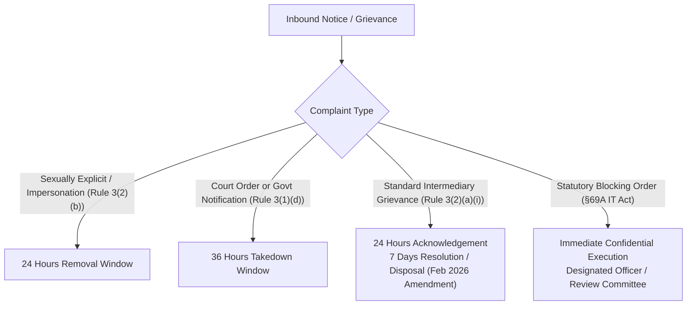

# ISHTI — Statutory & Regulatory Applicability Matrix

**Document Reference:** `docs/legal/ISHTI_REGULATORY_APPLICABILITY_MATRIX.md`  
**Milestone:** M05 — Legal, Privacy & Trust Foundation  
**Version:** 1.1.0  
**Last Updated:** 2026-11-18  
**Governance Classification:** STATUTORY COMPLIANCE AUDIT  
**Research Standard:** Official Gazette, Ministry Notifications & Primary Government Sources Only  

---

## 1. Statutory Applicability Overview

This matrix establishes the precise legal applicability of Indian central enactments, government notifications, ministerial directions, tax statutes, and extraterritorial foreign regulations to the **ISHTI Spiritual Ecosystem**.

### Research Quality Principles Enforced:
1. **Primary Sources Only:** Every provision cites the official Gazette of India, ministry notification, or statutory portal.
2. **Temporal Precision & Phased Commencement:** Distinguishes enacted statutes, gazetted commencement dates, transitional phases, and proposed bills.
3. **DPDP Act & Rules Phased Schedule (Gazette Notification G.S.R. 843(E)):** Strictly reconciled against Gazette Notification G.S.R. 843(E) dated 13 November 2025. Proactively implements engineering controls for future-commencing provisions without misrepresenting future statutory deadlines as current statutory violations:
   - **Immediate Commencement (13 November 2025):** Act Sections 18–26 (Data Protection Board establishment, composition, qualifications, terms, salaries, vacancies, proceedings), Section 35 (Power to call for information), Sections 38–43 (Good faith protection, bar of jurisdiction, Central Government rulemaking powers), and Section 44 specified parts. DPDP Rules 2025: Rules 1, 2, and 17–21.
   - **12-Month Commencement (13 November 2026):** Act Section 6(9) (Notice for personal data processed prior to commencement of the Act) and Section 27(1)(d) (Power of Board to inquire upon reference from Central or State Government). DPDP Rules 2025: Rule 4 (Form and manner of notice for pre-existing personal data).
   - **18-Month Commencement (13 May 2027):** Act Sections 3–5 (Application of Act, Grounds for processing personal data, Notice accompanying consent requests), Section 6(1)–(8) and 6(10) (Consent requirements and mechanisms), Sections 7–17 (Certain legitimate uses, General obligations of Data Fiduciary §8, Children's data §9, SDF obligations §10, Rights of Data Principal §§11–13, Right to nominate §14, Duties of Data Principal §15, Cross-border transfer §16, Exemptions §17), Section 27 (Powers of the Board, except clause (d)), Sections 28–34 (Penalties, Adjudication, Appellate Tribunal), Sections 36, 37, and Section 44(2) (Repeal of Section 43A of the Information Technology Act, 2000). DPDP Rules 2025: Rules 3, 5–16, 22, 23.
4. **IT Rules Deadlines Disaggregation:** Disaggregates intermediary obligations into distinct statutory windows: 24-hour grievance acknowledgement (Rule 3(2)(a)(i)), 7-day complaint disposal (Rule 3(2)(a)(i) as amended February 2026), 24-hour removal for non-consensual sexually explicit content / impersonation (Rule 3(2)(b)), 36-hour takedown upon court order or government notification (Rule 3(1)(d)), and Section 69A blocking directions under the 2009 Blocking Rules.
5. **Operating Model & GST TCS Recalibration:** Differentiates principal supplier vs. marketplace operator (ECO) roles. Corrects the TCS rate under CGST Act §52 to **0.5%** (0.25% CGST + 0.25% SGST, or 0.5% IGST) effective 10 July 2024 pursuant to Notification No. 15/2024-Central Tax.
6. **Marketplace TDS Recalibration (0.1%):** Corrects e-commerce marketplace TDS under former Income-tax Act, 1961 Section 194-O from 1% to **0.1%**, as reduced effective 1 October 2024 by the Finance (No. 2) Act, 2024. For tax years commencing 1 April 2026 under the Income-tax Act, 2025, the 0.1% deduction is mapped to the corresponding 2025 Act provisions with Section 536 transitional treatment and the ₹5,00,000 threshold for individuals/HUFs under §194-O(2). Marked **CA REVIEW REQUIRED**.
7. **Income Tax & Accounting Scope:** Notes that books of account retention under the Income-tax Act, 2025 (§62 & Rule 46) and Income-tax Act, 1961 (§44AA & Rule 6F) applies specifically to persons carrying on business or profession exceeding statutory turnover/income thresholds, not universally across devotee personal data.
8. **Extraterritorial Boundary Rigour:** Reconciles GDPR Article 3(2) (mere accessibility from the EU does not constitute targeting under Recital 23), clarifies that birth coordinates do not per se constitute Article 9 religious data unless processing reveals religious beliefs, bars Article 49 derogations as routine cross-border transfer solutions, updates CCPA gross-revenue threshold to $26.625 million (2026 inflation adjustment), and maps EU AI Act Article 50 transparency obligations.
9. **Statutory Officers & Startups:** Clarifies that Data Protection Officers (DPOs) are statutorily mandatory only for Significant Data Fiduciaries (SDFs) notified under DPDP Act §10, and distinguishes private closed testing from commercial launch requirements.

---

## 1.1 DPDP Statutory & Regulatory Commencement Schedule (G.S.R. 843(E))

The following tables establish the binding commencement schedule of the DPDP Act, 2023 and DPDP Rules, 2025 under Ministry of Electronics and Information Technology (MeitY) Gazette Notification G.S.R. 843(E) dated 13 November 2025:

### Table A: DPDP Act, 2023 Commencement Phases

| Phase | Statutory Effective Date | Statutory Provisions Commenced | Scope & Governance Description | Status for ISHTI Launch |
| :--- | :--- | :--- | :--- | :--- |
| **Phase 1: Immediate** | **13 November 2025** | **Sections 18–26, 35, 38–43, and Section 44 specified parts** | Establishment, composition, terms, and procedural framework of Data Protection Board of India; Central Government rulemaking and direction powers. | **COMMENCED** (Regulatory infrastructure operational) |
| **Phase 2: 12 Months** | **13 November 2026** | **Section 6(9) & Section 27(1)(d)** | Section 6(9): Obligation to give notice for personal data processed prior to commencement of Act. Section 27(1)(d): Board power to inquire on reference from Central/State Government. | **COMMENCING 13 NOV 2026** (Pre-launch notice architecture prepared) |
| **Phase 3: 18 Months** | **13 May 2027** | **Sections 3–5, Section 6(1)–(8) & (10), Sections 7–17, Section 27 (except clause (d)), Sections 28–34, 36, 37, and Section 44(2)** | Full fiduciary regime commences: Grounds for processing (§§3–5); Consent mechanisms (§6); General obligations & security (§8); Children's data protection (§9); SDF obligations (§10); Principal rights (§§11–13); Nomination & duties (§§14–15); Cross-border transfer (§16); Exemptions (§17); Penalties & appeals (§§28–34); Repeal of IT Act §43A (§44(2)). | **COMMENCING 13 MAY 2027** (Implemented in M05 as pre-launch engineering controls; NOT a current statutory violation) |

### Table B: DPDP Rules, 2025 Commencement Schedule

| Phase | Rules Effective Date | Rules Commenced | Scope & Regulatory Content | Status for ISHTI Launch |
| :--- | :--- | :--- | :--- | :--- |
| **Phase 1: Immediate** | **13 November 2025** | **Rules 1, 2, 17, 18, 19, 20, 21** | Short title, definitions, terms of office of Board members, resignation, inquiry proceedings, and Board operational regulations. | **COMMENCED** |
| **Phase 2: 12 Months** | **13 November 2026** | **Rule 4** | Form and manner of intimating notice for personal data collected/processed prior to commencement of Act. | **COMMENCING 13 NOV 2026** |
| **Phase 3: 18 Months** | **13 May 2027** | **Rules 3, 5, 6, 7, 8, 9, 10, 11, 12, 13, 14, 15, 16, 22, 23** | Notice specifications (Rule 3); Consent manager registration (Rule 5); Security safeguards (Rule 6); Breach intimation (Rule 7); Minor parental verification (Rule 8); SDF assessment (Rules 9–10); SAR response procedures (Rules 11–13); Grievance timelines (Rules 14–16); Cross-border transfer restrictions (Rule 22); Appeals (Rule 23). | **COMMENCING 13 MAY 2027** (Pre-launch engineering baseline) |

---

## 2. Master Statutory Applicability Matrix

| Matrix ID | Legislation / Regulatory Instrument | Specific Section / Rule / Direction | Official Source URL & Gazette Citation | Publication / Commencement Date | Current Legal Status | Applicability to ISHTI | ISHTI Feature / Activity Affected | Required Engineering & Governance Action | Evidence Required for Audit | Counsel / CA Sign-off Requirement |
| :--- | :--- | :--- | :--- | :--- | :--- | :--- | :--- | :--- | :--- | :--- |
| **STAT-01** | **Digital Personal Data Protection Act, 2023** (Act No. 22 of 2023) | Section 6(1)–(8), (10) & Section 6(9) (Consent & Notice Requirements) | `https://www.meity.gov.in/content/digital-personal-data-protection-act-2023` Gazette Notification G.S.R. 843(E) | Enacted: 11 Aug 2023 12-mo: 13 Nov 2026 (§6(9)) 18-mo: 13 May 2027 (§6(1)–(8), (10)) | **Commencing 13 May 2027 (18 Months)** [Section 6(9) Commencing 13 Nov 2026 (12 Months)] | **PRE-LAUNCH ENGINEERING CONTROL** | User onboarding, Phone OTP, Kundli generation, consent center (`/profile/consent`) | Provide notice in clear language with itemized purposes; unbundle consent; store consent evidence hashes in tamper-evident structure. Proactively built in M05 ahead of 18-month statutory enforcement. | Cryptographic SHA-256 consent logs with timestamp, purpose ID, and user ID. | **COUNSEL REVIEW REQUIRED** |
| **STAT-02** | **Digital Personal Data Protection Act, 2023** (Act No. 22 of 2023) | Section 8 (General Obligations of Data Fiduciary; §8(5) Security Safeguards & §8(6) Breach Notification) | `https://www.meity.gov.in/content/digital-personal-data-protection-act-2023` Gazette Notification G.S.R. 843(E) DPDP Rules, 2025 (Rules 6 & 7) | Enacted: 11 Aug 2023 18-mo: 13 May 2027 | **Commencing 13 May 2027 (18 Months)** | **PRE-LAUNCH ENGINEERING CONTROL** | All database storage, encrypted fields, incident response (`/profile/compliance`) | Implement authenticated encryption (AES-256-GCM); prepare Board and Data Principal breach notification mechanisms. Proactively implemented in M05; statutory enforcement commences 13 May 2027. | Encryption key rotation records, incident triage response logs, CERT-In/DPDP escalation procedures. | **COUNSEL REVIEW REQUIRED** |
| **STAT-03** | **Digital Personal Data Protection Act, 2023** (Act No. 22 of 2023) | Section 9 (Processing of Personal Data of Children & Persons with Disability) | `https://www.meity.gov.in/content/digital-personal-data-protection-act-2023` Gazette Notification G.S.R. 843(E) DPDP Rules, 2025 (Rule 8) | Enacted: 11 Aug 2023 18-mo: 13 May 2027 | **Commencing 13 May 2027 (18 Months)** | **PRE-LAUNCH ENGINEERING CONTROL** | Minor Kundli birth charts (`/astro`), naming rituals (`/puja`) | Mandate verifiable parental consent before processing minor data; strictly prohibit tracking/behavioral profiling or targeted ads. Pre-launch architectural requirement before public onboarding. | Guardian phone OTP verification record; parental relationship declaration log. | **COUNSEL REVIEW REQUIRED** |
| **STAT-04** | **Digital Personal Data Protection Act, 2023** (Act No. 22 of 2023) | Section 11, 12, 13 (Data Principal Rights: Access, Correction, Erasure, Grievance Redressal) | `https://www.meity.gov.in/content/digital-personal-data-protection-act-2023` Gazette Notification G.S.R. 843(E) DPDP Rules, 2025 (Rules 11–16) | Enacted: 11 Aug 2023 18-mo: 13 May 2027 | **Commencing 13 May 2027 (18 Months)** | **PRE-LAUNCH ENGINEERING CONTROL** | SAR export (`export-service.ts`), 7-stage deletion (`deletion-orchestrator.ts`), grievance portal | Provide self-service JSON export; execute 7-stage deletion with statutory retention locks; provide accessible grievance redressal. Proactively engineered in M05 ahead of statutory enforcement. | Downloadable SAR JSON packages; field-level deletion audit logs; grievance tickets. | **COUNSEL REVIEW REQUIRED** |
| **STAT-05** | **Digital Personal Data Protection Act, 2023** (Act No. 22 of 2023) | Section 10 (Significant Data Fiduciary Obligations) | `https://www.meity.gov.in/content/digital-personal-data-protection-act-2023` Gazette Notification G.S.R. 843(E) DPDP Rules, 2025 (Rules 9–10) | Enacted: 11 Aug 2023 18-mo: 13 May 2027 | **Commencing 13 May 2027 (18 Months) & Conditional on Government Notification** | **CONDITIONALLY APPLICABLE (NOT MANDATORY FOR EARLY-STAGE STARTUP)** | Corporate governance, DPO appointment, independent audit, DPIA | Assess user volume, sensitivity of religious data, and risk of harm; DPO is statutory ONLY for notified SDFs; voluntarily appoint privacy lead. Criteria pending central government notification. | SDF threshold tracking log, Data Protection Impact Assessment (DPIA) template. | **COUNSEL REVIEW REQUIRED** |
| **STAT-06** | **Information Technology Act, 2000** (Act No. 21 of 2000) & **IT Rules, 2021** | Section 79 & Rule 3(2)(a)(i) (Grievance Redressal Mechanism — 24h Ack, 7d Disposal) | `https://www.meity.gov.in/content/information-technology-intermediary-guidelines-and-digital-media-ethics-code-rules-2021` Gazette Notification Feb 2026 | Enacted: 25 Feb 2021 Amended: Feb 2026 | **In Force (Current Enforceable Law)** | **APPLIES AS INTERMEDIARY FOR UGC** | Community discussion boards, pandit listings, devotee reviews (`/legal/grievance`) | Acknowledge complaints within **24 hours**; resolve/dispose within **7 days**; provide Grievance Appellate Committee (GAC) appeal route (`gac.gov.in`). | Time-stamped ticketing logs; automated SLA dispatch receipts; Grievance Officer designation. | **COUNSEL REVIEW REQUIRED** |
| **STAT-07** | **Information Technology (Intermediary Guidelines) Rules, 2021** | Rule 3(1)(d) (36-Hour Court / Appropriate Government Order Takedown) | `https://www.meity.gov.in/content/information-technology-intermediary-guidelines-and-digital-media-ethics-code-rules-2021` | Enacted: 25 Feb 2021 | **In Force** | **APPLIES AS INTERMEDIARY FOR UGC** | User-generated posts, comments, reviews (`/community`) | Takedown unlawful content within **36 hours** upon receiving actual knowledge via court order or Appropriate Government notification. | Takedown order compliance log with exact UTC/IST timestamp of disabling access. | **COUNSEL REVIEW REQUIRED** |
| **STAT-08** | **Information Technology (Intermediary Guidelines) Rules, 2021** | Rule 3(2)(b) (24-Hour Removal for Sexually Explicit Content / Impersonation) | `https://www.meity.gov.in/content/information-technology-intermediary-guidelines-and-digital-media-ethics-code-rules-2021` | Enacted: 25 Feb 2021 | **In Force** | **APPLIES AS INTERMEDIARY FOR UGC** | Community media uploads, profile avatars, user comments | Remove or disable access within **24 hours** of receipt of complaint regarding non-consensual nudity, sexual acts, or impersonation. | Expedited triage log; moderation queue receipts. | **COUNSEL REVIEW REQUIRED** |
| **STAT-09** | **Information Technology Act, 2000** | Section 69A & Blocking Rules, 2009 | `https://www.meity.gov.in/content/blocking-rules-2009` | Enacted: 2000 Rules: 27 Oct 2009 | **In Force** | **APPLIES UPON STATUTORY DIRECTION** | Entire platform access, content routing | Comply strictly and confidentially with directions issued by the Designated Officer / Review Committee under IT Act §69A. | Confidential statutory compliance register; Designated Officer liaison protocol. | **COUNSEL REVIEW REQUIRED** |
| **STAT-10** | **CERT-In Directions under IT Act §70B(6)** | Direction No. 20(3)/2022-CERT-In, Directions 2(i) & 2(v) | `https://www.cert-in.org.in/directions2022.jsp` | Issued: 28 Apr 2022 In Force: 28 Jun 2022 | **In Force** | **APPLIES NOW** | Cloud infrastructure, server logging, incident triage (`security-governance.ts`) | Synchronize system clocks with NPL/NIC NTP; report 20 specified cyber incidents to CERT-In within **6 hours**; retain system logs for 180 days within India. | NTP synchronization monitoring logs; CERT-In reporting escalation dispatch receipts; log retention configuration. | **COUNSEL REVIEW REQUIRED** |
| **STAT-11** | **Consumer Protection Act, 2019** & **E-Commerce Rules, 2020** | Sections 2(28), 2(47) & Rules 5, 6 of E-Commerce Rules | `https://consumeraffairs.nic.in/acts-and-rules/consumer-protection` | Rules: 23 Jul 2020 Amended: 2021 | **In Force** | **APPLIES NOW** | Consultation bookings, puja services, pricing disclosures (`/legal/terms`, `/experts`) | Disclose corporate identity, registered address, customer care, Grievance Officer, itemized pricing, transparent refund terms; avoid deceptive practices. | Public footer disclosures; verified vendor profiles; itemized checkout receipts. | **COUNSEL REVIEW REQUIRED** |
| **STAT-12** | **Guidelines for Prevention and Regulation of Dark Patterns, 2023** | Guidelines 4, 5, 6 & Annexure 1 (Specified Dark Patterns) | `https://consumeraffairs.nic.in/sites/default/files/Dark_Patterns_Guidelines_2023.pdf` | Notified: 30 Nov 2023 | **In Force** | **APPLIES NOW** | UI design system, consultation booking checkout, cancellation flows | Strictly eliminate false urgency, basket sneaking, confirm shaming, forced action, and subscription traps. | UI design system tokens; checkout flow audit screenshots; automated test suites. | **COUNSEL REVIEW REQUIRED** |
| **STAT-13** | **The Drugs and Magic Remedies (Objectionable Advertisements) Act, 1954** | Sections 3, 4, 7 (Prohibition of Misleading Advertisements for Cures) | `https://www.indiacode.nic.in/handle/123456789/1515` | Enacted: 30 Apr 1954 | **In Force** | **APPLIES NOW** | Puja ritual listings, Kundli remedial descriptions (`/puja`, `/astro`) | Prohibit all claims that pujas, rituals, or gemstones cure diseases, disorders, fertility, or guarantee male children. | Moderation blacklist filters; prominent non-medical spiritual disclaimers on ritual pages. | **COUNSEL REVIEW REQUIRED** |
| **STAT-14** | **Bharatiya Nyaya Sanhita, 2023** (Act No. 45 of 2023) | Section 299 & 302 (Deliberate Outraging of Religious Feelings & Defamation) | `https://www.mha.gov.in/en/commoncontent/the-bharatiya-nyaya-sanhita-2023` | Enacted: 25 Dec 2023 In Force: 1 Jul 2024 | **In Force** | **APPLIES NOW** | Satsang boards, user comments, AI scriptural answers (`/community`, `/bhakti`) | Implement strict content moderation filtering insults against sampradayas, sacred symbols, or deities; prompt takedown. | Community Dignity Charter; automated keyword filter logs; moderation action reports. | **COUNSEL REVIEW REQUIRED** |
| **STAT-15** | **Copyright Act, 1957** (Act No. 14 of 1957) | Sections 14, 51, 52 (Economic Rights, Infringement, Fair Dealing) | `https://copyright.gov.in/Documents/CopyrightRules1957.pdf` | Enacted: 4 Jun 1957 | **In Force** | **APPLIES NOW** | Bhakti scripture library, audio stotras, AI RAG vector corpus (`/bhakti`) | Distinguish public domain Sanskrit texts from copyrighted modern translations/commentaries; clear all modern edition rights. | Content Rights Register; license agreements for modern translations; public domain verification records. | **COUNSEL REVIEW REQUIRED** |
| **STAT-16** | **Income-tax Act, 2025** (Act No. 6 of 2025) & **Income-tax Rules, 2026** | Section 62 & Rule 46 (Mandatory 7-Year Retention of Books of Account) | `https://incometaxindia.gov.in` | Enacted: 2025 Effective: 1 Apr 2026 | **Commencing 1 Apr 2026** | **APPLIES TO BUSINESS RECORDS EXCEEDING TURNOVER THRESHOLDS** | Accounting database, transaction ledger, retention matrix (`retention-matrix.ts`) | Preserve financial books of account, invoices, and payment logs for **7 tax years**; maintain daily electronic backup in India. Applies to business accounting records, NOT all user personal data. | Immutable invoice archive; daily encrypted backup verification logs in Indian cloud region. | **CA REVIEW REQUIRED** |
| **STAT-17** | **Income-tax Act, 1961** (Act No. 43 of 1961) | Section 44AA & Rule 6F (Transitional Retention for Assessment Years Prior to 1 Apr 2026) | `https://incometaxindia.gov.in` Preserved under §536 of 2025 Act | Enacted: 1961 | **In Force (Transitional Savings)** | **APPLIES TRANSITIONALLY TO QUALIFYING BUSINESSES** | Pre-2026 financial transaction logs, platform invoices | Retain financial records relating to assessment years prior to 1 April 2026 for **6 years from the end of the relevant assessment year**. | Transitional tax archive ledger; audit trail. | **CA REVIEW REQUIRED** |
| **STAT-18** | **Income-tax Act, 1961 / 2025** | Section 194-O (TDS on E-Commerce Transactions — 0.1%) / Section 194J (Professional Fees) | `https://incometaxindia.gov.in` Finance (No. 2) Act, 2024 / Income-tax Act, 2025 | Rate reduced to 0.1%: 1 Oct 2024 2025 Act: 1 Apr 2026 | **In Force (0.1% Rate)** | **APPLIES UPON PAYOUTS TO EXPERTS/PANDITS** | Pandit marketplace payouts, expert consultations | Deduct **0.1% TDS** under former §194-O (as amended by Finance (No. 2) Act, 2024 effective 1 Oct 2024) or Income-tax Act, 2025 equivalent on gross marketplace sales, subject to ₹5,00,000 threshold for individuals/HUFs under §194-O(2); deduct under §194J if retaining experts as professional contractors. Section 536 transitional savings apply. | TDS challans, Form 26Q quarterly returns, Form 16A certificates. | **CA REVIEW REQUIRED** |
| **STAT-19** | **Central Goods and Services Tax Act, 2017** (Act No. 12 of 2017) | Section 24(x) (Mandatory Registration) & Section 52 (Tax Collection at Source — 0.5%) | `https://cbic-gst.gov.in` Notification No. 15/2024-Central Tax (10 July 2024) | Enacted: 12 Apr 2017 Rate Reduction: 10 Jul 2024 | **In Force** | **APPLIES AS ECO COLLECTING CONSIDERATION** | Payment billing, consultation checkout, expert settlement | Obtain GST registration; collect and remit **0.5% TCS** (0.25% CGST + 0.25% SGST, or 0.5% IGST) on net taxable supplies of third-party pandits; issue GST-compliant invoices. (Principal sales subject to regular forward charge, not TCS). | Form GSTR-8 monthly return filings; TCS deposit challans; GST tax invoices. | **CA REVIEW REQUIRED** |
| **STAT-20** | **Payment and Settlement Systems Act, 2007** & **RBI PA/PG Guidelines** | Circular DPSS.CO.PD.No.1810/02.14.008/2019-20 | `https://www.rbi.org.in` | Guidelines: 17 Mar 2020 | **In Force** | **APPLIES VIA PAYMENT AGGREGATOR** | Payment gateway integration (Razorpay/Stripe), escrow accounts | Integrate only with RBI-authorized Payment Aggregators; operate strictly as sub-merchant/marketplace without handling escrow funds directly. | Executed merchant agreement with authorized PA; nodal escrow account reconciliation reports. | **CA REVIEW REQUIRED** |
| **STAT-21** | **Companies Act, 2013** (Act No. 18 of 2013) | Section 128 (Books of Account to be Kept by Company — 8 Financial Years) | `https://www.mca.gov.in/Ministry/pdf/CompaniesAct2013.pdf` | Enacted: 29 Aug 2013 | **In Force** | **APPLIES POST-INCORPORATION** | Corporate financial records, statutory registers | Maintain books of account and vouchers for not less than **8 financial years** immediately preceding a financial year. Closed-group prototype testing does not trigger this obligation until corporate incorporation. | Corporate financial accounting ledger; statutory auditor certificates. | **CA REVIEW REQUIRED** |
| **STAT-22** | **General Data Protection Regulation (GDPR)** (Regulation (EU) 2016/679) | Article 3(2) (Extraterritoriality), Article 9 (Special Category), Article 46 (SCCs) | `https://eur-lex.europa.eu/eli/reg/2016/679/oj` EDPB Guidelines 2/2018 | In Force: 25 May 2018 | **In Force** | **APPLIES ONLY IF TARGETING EU DATA SUBJECTS** | International devotees accessing platform from EU/UK | Mere accessibility $\ne$ targeting (Recital 23). If targeting EU devotees, obtain explicit Article 9(2)(a) consent when processing reveals religious beliefs; execute Standard Contractual Clauses (SCCs) for cross-border transfers (Art 49 consent barred as routine mechanism). | Signed Standard Contractual Clauses (SCCs); Transfer Impact Assessment (TIA); explicit consent logs. | **COUNSEL REVIEW REQUIRED** |
| **STAT-23** | **California Consumer Privacy Act (CCPA/CPRA)** (Cal. Civ. Code §1798.100 et seq.) | Cal. Civ. Code §1798.140(d) & §1798.140(ae) | `https://oag.ca.gov/privacy/ccpa` | Enacted: 2018 Amended: 2020 | **In Force** (Threshold: **$26.625M** gross revenue [2026 CPI adjustment] or 100k consumers) | **CONDITIONALLY APPLICABLE (CURRENTLY EXEMPT BY SCALE)** | California devotees accessing platform | Monitor statutory thresholds ($26.625M annual revenue or 100k California consumers/households); if applicable, provide Notice at Collection and Right to Limit Use of Sensitive Personal Information. | Annual threshold audit records; Notice at Collection documentation. | **COUNSEL REVIEW REQUIRED** |
| **STAT-24** | **EU AI Act** (Regulation (EU) 2024/1689) | Article 50 (Transparency Obligations for Providers & Deployers of AI) | `https://eur-lex.europa.eu/eli/reg/2024/1689/oj` | Entered into force: 1 Aug 2024 Applicable: Phased (2025–2027) | **In Force (Phased Application)** | **APPLIES IF SERVING EU USERS WITH AI** | Spiritual conversational AI assistant (`/bhakti`) | Spiritual conversational AI is non-high-risk; comply with Article 50 transparency: inform users in a clear manner that they are interacting with an AI system; disclose synthetic outputs. | In-UI AI disclosure banner; system prompt transparency documentation. | **COUNSEL REVIEW REQUIRED** |

---

## 3. Disaggregated IT Rules & Takedown SLAs

### SLA Disaggregation Summary:
1. **Rule 3(2)(a)(i) Acknowledgement:** Within **24 hours** from receipt of grievance.
2. **Rule 3(2)(a)(i) Resolution/Disposal:** Within **7 days** from receipt of grievance (reflecting the amended February 2026 rules).
3. **Rule 3(2)(b) Emergency Removal:** Within **24 hours** for content depicting non-consensual nudity, sexual acts, or impersonation.
4. **Rule 3(1)(d) Takedown:** Within **36 hours** upon receiving actual knowledge via court order or Appropriate Government notification.
5. **Section 69A IT Act Directions:** Executed pursuant to confidential statutory blocking orders issued by the Designated Officer under the 2009 Blocking Rules.

---

## 4. Operating Model & Tax Matrix (Principal vs. Marketplace)

| Operating Model | Legal Structure | GST Forward Charge | CGST Act §52 TCS (0.5%) | Income Tax TDS (§194-O / §194J) | Invoicing Responsibility | Sign-off Required |
| :--- | :--- | :--- | :--- | :--- | :--- | :--- |
| **A. Principal Supplier** | ISHTI sells its own digital content, subscriptions, automated kundli reports | Applicable (ISHTI pays GST directly) | **NOT APPLICABLE** (No third-party supplier) | Not applicable on own sales | ISHTI issues tax invoice to devotee | **CA REVIEW REQUIRED** |
| **B. Marketplace (ECO)** | ISHTI facilitates booking of independent pandits/astrologers and collects fee | Applicable on ISHTI's platform commission | **APPLIES: 0.5% TCS** on net value of taxable supplies (Notification 15/2024) | **APPLIES: 0.1% TDS under §194-O / 2025 Act equivalent** on gross sales (exemption threshold ₹5L for individuals/HUFs) | Pandit invoices devotee for ritual; ISHTI invoices pandit for commission | **CA REVIEW REQUIRED** |
| **C. Pure Directory / Listing** | ISHTI lists pandits; devotee contacts and pays pandit directly outside app | Applicable only on pandit listing subscription | **NOT APPLICABLE** (ISHTI does not collect consideration) | Not applicable | Pandit invoices devotee directly | **CA REVIEW REQUIRED** |

---

## 5. Strategic Legal Boundaries & Corporate Gates

1. **Private Prototype Testing:**
   - Closed-group private testing involving founders, advisors, and uncompensated testers does not require prior corporate incorporation or GST registration.
   - However, no commercial payments may be accepted, no public onboarding may occur, and no third-party pandit payouts may be processed prior to formal corporate incorporation and GST registration.
2. **Data Protection Officer (DPO):**
   - A DPO is statutorily mandatory under DPDP Act §10 ONLY if ISHTI is designated as a Significant Data Fiduciary (SDF) by the Central Government.
   - At current stage, ISHTI designates an internal Privacy Lead and a statutory Grievance Officer (under IT Rules Rule 3(2)).
3. **Independent Review Standards:**
   - All legal classifications remain `COUNSEL REVIEW REQUIRED` or `CA REVIEW REQUIRED`.
   - Technical implementations provide verifiable architecture and audit trails; they do NOT constitute legal certification or statutory compliance declarations.
