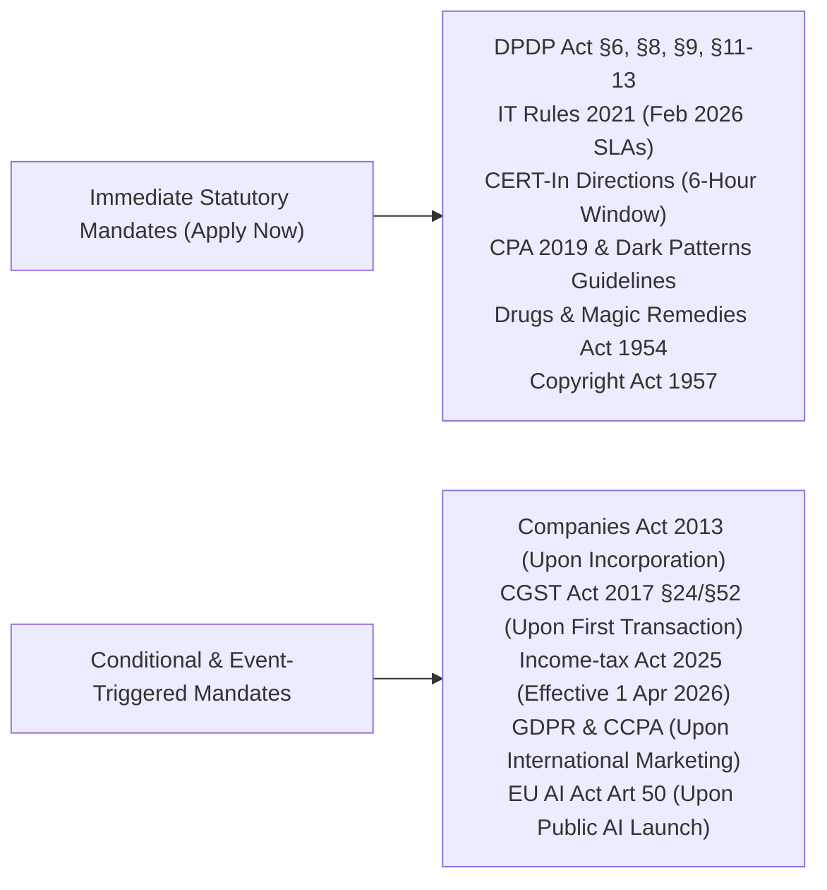

# ISHTI — Statutory & Regulatory Applicability Matrix

**Document Reference:** `docs/legal/ISHTI_REGULATORY_APPLICABILITY_MATRIX.md`  
**Milestone:** M05 — Legal, Privacy & Trust Foundation  
**Version:** 1.0.0  
**Last Updated:** 2026-11-17  
**Governance Classification:** STATUTORY COMPLIANCE AUDIT  
**Research Standard:** Official Gazette & Primary Government Sources Only  

---

## 1. Statutory Applicability Overview

This matrix establishes the precise legal applicability of Indian central enactments, government notifications, ministerial directions, and extraterritorial foreign regulations to the **ISHTI Spiritual Ecosystem**.

### Research Quality Principles Enforced:
1. **Primary Sources Only:** Every provision cites the official Gazette of India, ministry notification, or statutory portal.
2. **Temporal Precision:** Differentiates enacted statutes, gazetted commencement dates, transitional phases, and proposed bills.
3. **Phased DPDP Commencement:** Accounts for the Central Government's phased commencement schedule under Notification G.S.R. 843(E) dated 13 November 2025.
4. **Income Tax Modernization:** Integrates the Income-tax Act, 2025 (effective 1 April 2026) alongside Section 536 transitional savings for earlier assessment years.
5. **Amended IT Rules:** Reflects the February 2026 intermediary amendments establishing 24-hour grievance acknowledgement and 7-day resolution.

---

## 2. Master Statutory Applicability Matrix

| Matrix ID | Legislation / Regulatory Instrument | Specific Section / Rule / Direction | Official Source URL & Gazette Citation | Publication / Commencement Date | Current Legal Status | Applicability to ISHTI | ISHTI Feature / Activity Affected | Required Engineering & Governance Action | Evidence Required for Audit | Counsel Sign-off Requirement |
| :--- | :--- | :--- | :--- | :--- | :--- | :--- | :--- | :--- | :--- | :--- |
| **STAT-01** | **Digital Personal Data Protection Act, 2023** (Act No. 22 of 2023) | Section 6 (Consent & Notice) | `https://www.meity.gov.in/content/digital-personal-data-protection-act-2023` Gazette Notification G.S.R. 843(E) | Enacted: 11 Aug 2023 Commencement Notification: 13 Nov 2025 | **Commenced / In Force** (Phased: 1-year timeline for §6(9)) | **APPLIES NOW** | User onboarding, Phone OTP, Kundli generation, consent center (`/profile/consent`) | Provide notice in clear language with itemized purposes; unbundle consent; store consent evidence hashes. | Cryptographic SHA-256 consent logs with timestamp, purpose ID, and user ID. | **COUNSEL REVIEW REQUIRED** |
| **STAT-02** | **Digital Personal Data Protection Act, 2023** (Act No. 22 of 2023) | Section 8(5) & 8(6) (Reasonable Security Safeguards & Breach Notification) | `https://www.meity.gov.in/content/digital-personal-data-protection-act-2023` | Enacted: 11 Aug 2023 | **Commenced / In Force** | **APPLIES NOW** | All database storage, encrypted fields, incident response (`/profile/compliance`) | Implement authenticated encryption (AES-256-GCM); notify Board and Data Principals upon personal data breach. | Encryption key rotation records, incident triage response logs. | **COUNSEL REVIEW REQUIRED** |
| **STAT-03** | **Digital Personal Data Protection Act, 2023** (Act No. 22 of 2023) | Section 9 (Processing of Personal Data of Children) | `https://www.meity.gov.in/content/digital-personal-data-protection-act-2023` | Enacted: 11 Aug 2023 | **Commenced / In Force** | **APPLIES NOW** | Infant/minor Kundli birth charts (`/astro`), naming rituals (`/puja`) | Mandate verifiable parental consent before processing minor data; strictly prohibit tracking/behavioral profiling. | Guardian phone OTP verification record; parental relationship declaration. | **COUNSEL REVIEW REQUIRED** |
| **STAT-04** | **Digital Personal Data Protection Act, 2023** (Act No. 22 of 2023) | Section 11, 12, 13 (Data Principal Rights: Access, Correction, Erasure, Grievance) | `https://www.meity.gov.in/content/digital-personal-data-protection-act-2023` | Enacted: 11 Aug 2023 | **Commenced / In Force** | **APPLIES NOW** | SAR export (`export-service.ts`), 7-stage deletion (`deletion-orchestrator.ts`), grievance portal | Provide self-service JSON export; execute 7-stage deletion with statutory retention locks; provide grievance redressal. | Downloadable SAR JSON packages; field-level deletion audit logs; grievance tickets. | **COUNSEL REVIEW REQUIRED** |
| **STAT-05** | **Digital Personal Data Protection Act, 2023** (Act No. 22 of 2023) | Section 10 (Significant Data Fiduciary Obligations) | `https://www.meity.gov.in/content/digital-personal-data-protection-act-2023` | Enacted: 11 Aug 2023 | **Conditional** (Awaiting notification of criteria by Central Govt) | **CONDITIONALLY APPLICABLE** | Corporate governance, DPO appointment, periodic audits | Assess user volume, sensitivity of religious data, and risk of harm; voluntarily appoint resident DPO if volume surges. | DPO appointment resolution, Data Protection Impact Assessment (DPIA) reports. | **COUNSEL REVIEW REQUIRED** |
| **STAT-06** | **Information Technology Act, 2000** (Act No. 21 of 2000) & **IT Rules, 2021** (Amended Feb 2026) | Section 79 (Safe Harbour) & Rule 3(2) (Grievance Redressal Mechanism) | `https://www.meity.gov.in/content/information-technology-intermediary-guidelines-and-digital-media-ethics-code-rules-2021` Gazette Notification Feb 2026 | Enacted: 25 Feb 2021 Amended: Feb 2026 | **In Force (Current Enforceable Law)** | **APPLIES NOW** | Community discussion boards, pandit listings, review forums (`/legal/grievance`) | Acknowledge complaints within **24 hours**; resolve within **7 days**; provide GAC appeal link (`gac.gov.in`). | Time-stamped ticketing logs; automated SLA dispatch receipts; Grievance Officer designation. | **COUNSEL REVIEW REQUIRED** |
| **STAT-07** | **Information Technology (Intermediary Guidelines) Rules, 2021** | Rule 3(1)(d) (36-Hour Unlawful Content Removal Window) | `https://www.meity.gov.in/content/information-technology-intermediary-guidelines-and-digital-media-ethics-code-rules-2021` | Enacted: 25 Feb 2021 | **In Force** | **APPLIES NOW** | All user-generated posts, comments, reviews (`/community`) | Takedown unlawful content within **36 hours** of receiving court order or government notification under §69A. | Takedown order compliance log with exact UTC/IST timestamp of disabling access. | **COUNSEL REVIEW REQUIRED** |
| **STAT-08** | **CERT-In Directions under IT Act §70B(6)** | Direction No. 20(3)/2022-CERT-In, Directions 2(i) & 2(v) | `https://www.cert-in.org.in/directions2022.jsp` | Issued: 28 Apr 2022 In Force: 28 Jun 2022 | **In Force** | **APPLIES NOW** | Cloud infrastructure, logging, incident triage (`security-governance.ts`) | Synchronize clocks with NPL/NIC NTP; report 20 specified cyber incidents to CERT-In within **6 hours**; retain logs for 180 days. | NTP synchronization monitoring logs; CERT-In reporting escalation dispatch receipts. | **COUNSEL REVIEW REQUIRED** |
| **STAT-09** | **Consumer Protection Act, 2019** (Act No. 35 of 2019) & **E-Commerce Rules, 2020** | Sections 2(28), 2(47) & Rules 5, 6 of E-Commerce Rules | `https://consumeraffairs.nic.in/acts-and-rules/consumer-protection` | Rules notified: 23 Jul 2020 Amended: 2021 | **In Force** | **APPLIES NOW** | Consultation bookings, puja services, pricing disclosures (`/legal/terms`, `/experts`) | Disclose corporate identity, registered address, customer care, Grievance Officer, itemized pricing, transparent refund terms. | Public footer disclosures; verified vendor profiles; itemized checkout receipts. | **COUNSEL REVIEW REQUIRED** |
| **STAT-10** | **Guidelines for Prevention and Regulation of Dark Patterns, 2023** | Guidelines 4, 5, 6 & Annexure 1 (Specified Dark Patterns) | `https://consumeraffairs.nic.in/sites/default/files/Dark_Patterns_Guidelines_2023.pdf` | Notified: 30 Nov 2023 | **In Force** | **APPLIES NOW** | UI design system, consultation booking checkout, cancellation flows | Strictly eliminate false urgency, basket sneaking, confirm shaming, forced action, and subscription traps. | UI design system tokens; checkout flow audit screenshots; automated test suites. | **COUNSEL REVIEW REQUIRED** |
| **STAT-11** | **The Drugs and Magic Remedies (Objectionable Advertisements) Act, 1954** | Sections 3, 4, 7 (Prohibition of Misleading Advertisements for Cures) | `https://www.indiacode.nic.in/handle/123456789/1515` | Enacted: 30 Apr 1954 | **In Force** | **APPLIES NOW** | Puja ritual listings, Kundli remedial descriptions (`/puja`, `/astro`) | Prohibit all claims that pujas, rituals, or gemstones cure diseases, disorders, fertility, or guarantee male children. | Moderation blacklist filters; prominent non-medical spiritual disclaimers on ritual pages. | **COUNSEL REVIEW REQUIRED** |
| **STAT-12** | **Bharatiya Nyaya Sanhita, 2023** (Act No. 45 of 2023) | Section 299 & 302 (Outraging Religious Feelings & Defamation) | `https://www.mha.gov.in/en/commoncontent/the-bharatiya-nyaya-sanhita-2023` | Enacted: 25 Dec 2023 In Force: 1 Jul 2024 | **In Force** | **APPLIES NOW** | Satsang boards, user comments, AI scriptural answers (`/community`, `/bhakti`) | Implement strict content moderation filtering insults against sampradayas, sacred symbols, or deities; prompt takedown. | Community Dignity Charter; automated keyword filter logs; moderation action reports. | **COUNSEL REVIEW REQUIRED** |
| **STAT-13** | **Copyright Act, 1957** (Act No. 14 of 1957) | Sections 14, 51, 52 (Economic Rights, Infringement, Fair Dealing) | `https://copyright.gov.in/Documents/CopyrightRules1957.pdf` | Enacted: 4 Jun 1957 | **In Force** | **APPLIES NOW** | Bhakti scripture library, audio stotras, AI RAG vector corpus (`/bhakti`) | Distinguish public domain Sanskrit texts from copyrighted modern translations/commentaries; clear all modern edition rights. | Content Rights Register; license agreements for modern translations; public domain verification records. | **COUNSEL REVIEW REQUIRED** |
| **STAT-14** | **Income-tax Act, 2025** (Act No. 6 of 2025) & **Income-tax Rules, 2026** | Section 62 & Rule 46 (Mandatory 7-Year Retention of Books of Account & Daily Backup) | `https://incometaxindia.gov.in` | Enacted: 2025 Effective: 1 Apr 2026 | **Commencing 1 Apr 2026** | **APPLIES FROM 1 APR 2026** | Accounting database, transaction ledger, retention matrix (`retention-matrix.ts`) | Preserve financial books of account, invoices, and payment logs for **7 tax years**; maintain daily electronic backup in India. | Immutable invoice archive; daily encrypted backup verification logs in Indian AWS region. | **COUNSEL REVIEW REQUIRED** |
| **STAT-15** | **Income-tax Act, 1961** (Act No. 43 of 1961) | Section 44AA & Rule 6F (Transitional Retention for Assessment Years Prior to 1 Apr 2026) | `https://incometaxindia.gov.in` Preserved under §536 of 2025 Act | Enacted: 1961 | **In Force (Transitional Savings)** | **APPLIES TRANSITIONALLY** | Pre-2026 financial transaction logs, platform invoices | Retain financial records relating to assessment years prior to 1 April 2026 for **6 years from the end of the relevant assessment year**. | Transitional tax archive ledger; audit trail. | **COUNSEL REVIEW REQUIRED** |
| **STAT-16** | **Companies Act, 2013** (Act No. 18 of 2013) | Section 128 (Books of Account to be Kept by Company — 8 Financial Years) | `https://www.mca.gov.in/Ministry/pdf/CompaniesAct2013.pdf` | Enacted: 29 Aug 2013 | **In Force** | **APPLIES POST-INCORPORATION** | Corporate financial records, statutory registers | Maintain books of account and vouchers for not less than **8 financial years** immediately preceding a financial year. | Corporate financial accounting ledger; auditor reconciliation certificates. | **COUNSEL REVIEW REQUIRED** |
| **STAT-17** | **Central Goods and Services Tax Act, 2017** (Act No. 12 of 2017) | Section 24(x) (Mandatory Registration) & Section 52 (Tax Collection at Source) | `https://cbic-gst.gov.in` | Enacted: 12 Apr 2017 | **In Force** | **APPLIES UPON FIRST TRANSACTION** | Payment billing, consultation checkout, expert settlement | Obtain GST registration; collect and remit 1% TCS on marketplace expert payouts; issue GST-compliant tax invoices. | Form GSTR-8 monthly return filings; TCS deposit challans; GST tax invoices. | **COUNSEL REVIEW REQUIRED** |
| **STAT-18** | **Payment and Settlement Systems Act, 2007** (Act No. 51 of 2007) & **RBI PA/PG Guidelines** | Circular DPSS.CO.PD.No.1810/02.14.008/2019-20 | `https://www.rbi.org.in` | Guidelines issued: 17 Mar 2020 | **In Force** | **APPLIES VIA PAYMENT AGGREGATOR** | Payment gateway integration (Razorpay/Stripe), escrow accounts | Integrate only with RBI-authorized Payment Aggregators; operate strictly as sub-merchant/marketplace without handling escrow funds directly. | Executed merchant agreement with authorized PA; nodal escrow account reconciliation reports. | **COUNSEL REVIEW REQUIRED** |
| **STAT-19** | **General Data Protection Regulation (GDPR)** (Regulation (EU) 2016/679) | Article 3(2) (Extraterritoriality) & Article 9 (Special Category Data) | `https://eur-lex.europa.eu/eli/reg/2016/679/oj` | In Force: 25 May 2018 | **In Force** | **APPLIES TO EU/UK RESIDENTS** | International devotees accessing platform from EU/UK | Obtain explicit Article 9(2)(a) consent for processing religious beliefs; execute SCCs with non-EEA subprocessors; author Schedule B. | Consent records with Article 9 explicit consent flag; executed Standard Contractual Clauses. | **COUNSEL REVIEW REQUIRED** |
| **STAT-20** | **California Consumer Privacy Act (CCPA/CPRA)** (Cal. Civ. Code §1798.100 et seq.) | Cal. Civ. Code §1798.140(ae) (Sensitive Personal Information) | `https://oag.ca.gov/privacy/ccpa` | Enacted: 2018 Amended: 2020 | **In Force** (Threshold: $26.625M gross revenue or 100k consumers) | **CONDITIONALLY APPLICABLE** | California devotees accessing platform | Provide Notice at Collection; support Right to Limit Use of Sensitive Personal Information; author Schedule C. | Notice at collection screenshots; California consumer rights intake logs. | **COUNSEL REVIEW REQUIRED** |
| **STAT-21** | **EU AI Act** (Regulation (EU) 2024/1689) | Article 50 (Transparency Obligations for Providers & Deployers of AI) | `https://eur-lex.europa.eu/eli/reg/2024/1689/oj` | Entered into force: 1 Aug 2024 Applicable: Phased (2025–2027) | **In Force (Phased Application)** | **APPLIES TO EU USERS INTERACTING WITH AI** | Spiritual conversational AI assistant (`/bhakti`) | Inform users in a clear manner that they are interacting with an AI system; disclose synthetic outputs. | In-UI AI disclosure banner; system prompt transparency documentation. | **COUNSEL REVIEW REQUIRED** |

---

## 3. Applicability Determination & Action Tracking

### Critical Operational Takeaways:
1. **Immediate Pre-Launch Engineering Blockers:**
   - DPDP §9 minor consent verification flow must be completed before launching live public registration.
   - CERT-In 6-hour incident escalation must be operational before cloud staging deployment.
   - IT Rules 24-hour acknowledgement and 7-day resolution SLAs must be backed by a resident Grievance Officer.
2. **Immediate Founder Corporate Blockers:**
   - Incorporation of corporate entity and execution of IP assignments must be completed prior to accepting beta users.
   - GST registration and payment aggregator merchant agreements must be executed prior to processing commercial transactions.
3. **Formal Legal Advice:**
   - Every entry in this matrix marked `COUNSEL REVIEW REQUIRED` must be reviewed by qualified Indian legal counsel prior to commercial gate clearance.
