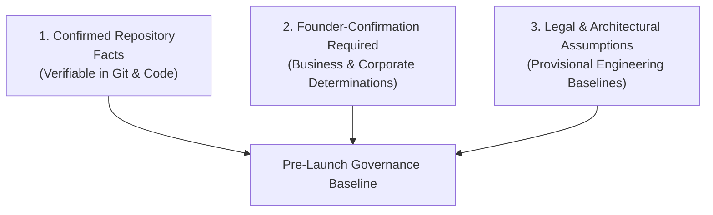

# ISHTI — Legal Facts Required from Platform Founders

**Document Reference:** `docs/legal/LEGAL_FACTS_REQUIRED.md`  
**Milestone:** M05 — Legal, Privacy & Trust Foundation  
**Version:** 1.0.0-draft  
**Last Updated:** 2026-11-17  
**Governance Classification:** CRITICAL FOUNDATIONAL REQUIREMENT  
**Status:** AWAITING FOUNDER CONFIRMATION  

---

## 1. Executive Statement & Purpose

ISHTI is being designed and engineered with legal and regulatory preparedness built into its architecture. However, software engineering cannot substitute for authoritative corporate, commercial, and operational facts that only the founders and promoters can determine.

This document identifies the missing business facts that materially alter the legal classification of ISHTI, determine statutory jurisdiction, trigger specific licensing requirements, and establish corporate liability boundaries.

> [!CRITICAL]
> **No legal policy, Terms of Service, Privacy Notice, or commercial agreement published by ISHTI can be considered legally operative or binding until the corporate identity, statutory officers, and commercial terms in this register are formally resolved, executed by the founders, and reviewed by qualified Indian legal counsel.**

---

## 2. Classification of Facts

To ensure total transparency and avoid conflating technical assumptions with corporate reality, all facts are partitioned into three distinct classes:

- **Class A — Confirmed Repository Facts:** Technical realities verifiable directly from the codebase, repository history, and Git commit tree.
- **Class B — Founder-Confirmation Required:** Business, financial, contractual, and corporate facts that must be confirmed by the founders.
- **Class C — Legal & Architectural Assumptions:** Provisional baselines adopted by the engineering team to build safeguards, explicitly pending counsel sign-off.

---

## 3. Class A: Confirmed Repository Facts

The following facts are verified within the local codebase as of Git commit `fda55a8219c95c374b0cb8f21959ee5eb72ca12f`:

| Fact ID | Repository Finding | Source Location | Legal Implication |
| :--- | :--- | :--- | :--- |
| **FACT-A-01** | Application features 6 primary product modules: Puja rituals, Kundli astrology, Bhakti scripture, Panchang calendar, Expert pandit directory, and Community satsang circles. | `apps/web/app/` (`/puja`, `/astro`, `/bhakti`, `/panchang`, `/experts`, `/community`) | Platform spans consumer e-commerce, religious content, professional services intermediary, and user-generated community features. |
| **FACT-A-02** | User authentication is architected around India-first Phone OTP with `@supabase/ssr` server cookies. | `apps/web/app/components/auth/AuthModal.tsx`, `apps/web/lib/supabase/` | Captures mobile telephone numbers, triggering telecommunications privacy and DPDP Act personal data obligations. |
| **FACT-A-03** | Astrological birth data (Date, Time, Place of Birth) is encrypted using server-side AES-256-GCM envelope encryption with context-bound AAD. | `apps/web/lib/crypto/kundli-encryption.ts` | Technical safeguard satisfies DPDP Act §8(5) reasonable security safeguards; however, it is NOT client-side zero-knowledge encryption as the server holds master decryption keys. |
| **FACT-A-04** | All 10 legal policies are explicitly marked `status: "LEGAL_REVIEW"` and `effectiveDate: "Pending Formal Legal Review"`. | `apps/web/lib/policy/policy-registry.ts` | Prevents premature claims of enforceable contractual terms before incorporation and counsel approval. |
| **FACT-A-05** | Production database (`zxwkfnvmmxoojewhvsdc`) and staging database (`zrjptpkhtklfgnovdrny`) are strictly quarantined and uncontacted. | Root repository policy, `DECISION_LOG.md` | Zero live user data has been collected or processed on hosted infrastructure. |
| **FACT-A-06** | Integer minor-unit arithmetic is used for financial calculations with 0% proposed payment gateway deduction. | `apps/web/lib/commerce/cancellation-calculator.ts` | Protects against IEEE-754 floating-point rounding errors in commercial transactions; fee deductions remain an unapproved proposal. |
| **FACT-A-07** | Scriptural verses (Rigveda 10.191.2) cite Ralph T.H. Griffith (1896) translation with peer-review flags. | `supabase/migrations/20261114000000_initial_schema.sql` | Identifies 19th-century public domain English translation while flagging modern commentary rights as pending clearance. |

---

## 4. Class B: Founder Confirmations Required

The platform founders must resolve and provide written instructions for the following critical items:

### Category B1: Corporate Entity & Formation

| Field | Current Placeholder in Code | Founder Decision Required | Impact of Delay |
| :--- | :--- | :--- | :--- |
| **B1.1 Legal Entity Name** | `[LEGAL_REVIEW_REQUIRED: Registered Corporate Entity Name, e.g. ISHTI Spiritual Technologies Private Limited]` | Provide exact registered corporate name under Companies Act, 2013 or LLP Act, 2008. Note: Closed-group private testing with founders and uncompensated early testers is permissible prior to incorporation; however, public launch and commercial monetization strictly require incorporation. | Without incorporation, personal liability attaches to individual founders for all platform liabilities and disputes. |
| **B1.2 Corporate Structure** | None (Assumed Private Limited Company) | Confirm entity type: Private Limited Company, One Person Company (OPC), or Limited Liability Partnership (LLP). | Affects equity vesting, director liability, GST threshold, and FDI compliance for diaspora investment. |
| **B1.3 Registered Office Address** | `[LEGAL_REVIEW_REQUIRED: Registered Postal Address, India]` | Provide official registered physical address in India. | Required under Consumer Protection (E-Commerce) Rules, 2020 Rule 5(1) and Companies Act §12. |
| **B1.4 Corporate Identification Number (CIN)** | `[LEGAL_REVIEW_REQUIRED: CIN]` | Provide 21-digit CIN issued by Registrar of Companies (ROC). | Statutory disclosure required on letterheads, notices, and public commercial website footers under Companies Act §12(3)(c). |
| **B1.5 Intellectual Property Ownership** | Code committed under individual Git accounts | Confirm executed Deed of Assignment transferring all code, logos, designs, and domain names from individual founders/contractors to the corporate entity. | Critical risk: Without executed IP assignments, individual contributors retain statutory copyright under Copyright Act, 1957 §17. |

---

### Category B2: Taxation & Statutory Registrations

| Field | Current Placeholder in Code | Founder Decision Required | Impact of Delay |
| :--- | :--- | :--- | :--- |
| **B2.1 GSTIN Registration** | `[LEGAL_REVIEW_REQUIRED: GSTIN]` | Provide 15-digit Goods and Services Tax Identification Number (GSTIN). [CA REVIEW REQUIRED] | Under CGST Act, 2017 §24(x), e-commerce operators must register for GST irrespective of turnover threshold before commencing commercial operations. |
| **B2.2 GST Service Classification (SAC Codes)** | Assumed 18% standard rate | Confirm SAC classifications with chartered accountant: [CA REVIEW REQUIRED] - SAC 999799 (Other miscellaneous services including religious services) - SAC 998439 (Online audio-visual content access) - SAC 998314 (IT support & digital platform facilitation) | Misclassification risks retrospective tax demands, interest under §50, and 100% penalty under §122. |
| **B2.3 Tax Collection at Source (TCS Rate: 0.5%)** | Not implemented | Confirm operating model with CA: If ISHTI operates as an e-commerce operator (ECO) facilitating third-party pandit services and collecting consideration under CGST Act §52, a **0.5% TCS deduction** (0.25% CGST + 0.25% SGST, or 0.5% IGST, pursuant to Notification No. 15/2024-Central Tax effective 10 July 2024) is mandatory. [CA REVIEW REQUIRED] | Failure to collect and deposit 0.5% TCS attracts 18% interest under §50 and penalties under §122. |
| **B2.4 Permanent Account Number (PAN) & TAN** | None | Provide Corporate PAN and Tax Deduction Account Number (TAN) for TDS deductions on expert consultations under Income-tax Act, 2025 **Section 393(1), Table Serial No. 8(v)** (**0.1% TDS** on gross e-commerce sales) with individual/HUF exemption up to ₹5 lakh under **Section 393(4), Table Serial No. 11**, or former Section 194-O (Finance (No. 2) Act, 2024; Section 536 transitional treatment) or Section 394 / former §194J (professional fees). [CA REVIEW REQUIRED] | Inability to issue TDS certificates (Form 16A/16B) to pandits. |
| **B2.5 Operating Model & Invoicing Architecture** | Marketplace vs Principal Supplier | Decide whether ISHTI acts as: (A) Principal Supplier (selling its own digital content; regular forward-charge GST, no TCS), (B) Marketplace ECO (facilitating independent pandits and collecting fee; 0.5% TCS applies), or (C) Pure Listing Directory (devotees pay pandits directly outside app; no TCS). [CA REVIEW REQUIRED] | Invoicing structure, tax compliance, and liability exposure are fundamentally determined by this choice. |

---

### Category B3: Statutory Officer Appointments

| Field | Current Placeholder in Code | Founder Decision Required | Impact of Delay |
| :--- | :--- | :--- | :--- |
| **B3.1 Statutory Grievance Officer** | `[LEGAL_REVIEW_REQUIRED: Appointed Officer Name]` | Formally designate an individual resident in India as the Grievance Officer under IT Rules 2021 Rule 3(2) and Consumer Protection (E-Commerce) Rules 2020 Rule 5(4). | Mandatory statutory requirement; non-compliance eliminates IT Act §79 safe-harbour defense. |
| **B3.2 Grievance Officer Contact Details** | `grievance-officer@ishti.in`, `[LEGAL_REVIEW_REQUIRED: Grievance Desk Postal Address]` | Provide dedicated direct telephone number, postal address, and monitored escalation inbox. | IT Rules mandate published contact details on platform homepage. |
| **B3.3 Data Protection Officer (DPO)** | `[LEGAL_REVIEW_REQUIRED: Appointed DPO Name or Office]` | Note: A DPO is statutorily mandatory under DPDP Act §10 ONLY if ISHTI is designated as a Significant Data Fiduciary (SDF) by the Central Government. Confirm whether ISHTI voluntarily designates an internal Privacy Lead at this early stage. | Early-stage startups are not mandated to appoint a statutory DPO unless notified as an SDF. |
| **B3.4 Chief Compliance Officer (CCO)** | None | Confirm whether user volumes exceed 50 lakh registered users (Significant Social Media Intermediary threshold under IT Rules 2021 Rule 2(1)(v)), triggering mandatory 24x7 CCO and Nodal Contact Person. | Operational failure to appoint CCO risks loss of intermediary status. |

---

### Category B4: Commercial, Billing & Refund Approvals

| Field | Current Placeholder in Code | Founder Decision Required | Impact of Delay |
| :--- | :--- | :--- | :--- |
| **B4.1 Commercial Refund Policy** | Proposed 24h (100%), 4–24h (50%), <4h (0%) cancellation tiers | Formally approve or adjust the proposed cancellation tiers for live expert consultations. | Consumer Protection Act §2(47) prohibits unfair contract terms; tiers must balance user rights with expert scheduling commitments. |
| **B4.2 Gateway Fee Deductions** | `0%` default proposed | Confirm commercial decision: Does ISHTI absorb payment gateway fees upon refund, or deduct actual non-recoverable processor fees (if permitted by consumer law)? | Aggregator terms generally do NOT refund gateway transaction fees upon refund. |
| **B4.3 Pandit No-Show Guarantee** | 100% full refund + zero deduction | Formally approve Pandit No-Show policy: Will devotee receive 100% immediate refund, service credit, or complimentary reschedule? | Directly impacts platform financial reserves and cash escrow. |
| **B4.4 Digital Content Withdrawal Waiver** | EU CRD Art. 16(m) immediate download waiver | Confirm whether digital downloads (e.g. customized Kundli PDF reports, audio stotras) require explicit opt-in waiver of 14-day cooling-off rights before download begins. | Mandatory under EU Directive 2011/83/EU to prevent post-download chargeback abuse. |

---

### Category B5: Vendor & Processor Contracts

| Field | Current Placeholder in Code | Founder Decision Required | Impact of Delay |
| :--- | :--- | :--- | :--- |
| **B5.1 Cloud Database & Hosting** | Supabase (`zrjptpkhtklfgnovdrny`, `zxwkfnvmmxoojewhvsdc`), Vercel (planned) | Formally execute enterprise Data Processing Agreement (DPA) with Supabase Inc. (AWS ap-south-1 Mumbai region) and Vercel Inc. | Required under DPDP Act §8(1) (Fiduciary remains liable for processor acts) and GDPR Article 28. |
| **B5.2 Payment Aggregator (India)** | Razorpay sandbox credentials present in staging environment | Formally execute Merchant Agreement with Razorpay Software Private Limited or Cashfree Payments India Private Limited. | Cannot accept live Indian INR UPI, card, or netbanking payments without executed merchant KYC. |
| **B5.3 International Payment Processor** | None (Stripe planned) | Confirm provider for international diaspora payments (USD, EUR, GBP, AED, SGD) and execute international merchant agreement. | Non-resident credit card processing requires RBI-compliant export transaction reporting. |
| **B5.4 SMS & WhatsApp Gateway** | Twilio sandbox placeholders | Formally execute agreement with DLT-registered SMS provider in India (e.g. Twilio, Gupshup, Exotel) with TRAI-approved template headers. | Indian telecom regulations (TRAI TCCCPR 2018) mandate distributed ledger registration for all commercial/transactional SMS templates. |
| **B5.5 AI Model Provider** | None (Gemini API planned) | Formally review and execute Google Cloud / Google AI Enterprise Terms ensuring user conversational prompts and birth data are NOT logged for public model training. | Critical confidentiality risk: Consumer AI terms typically grant model training rights over prompt inputs. |

---

### Category B6: Expert (Pandit / Acharya) Engagement Terms

| Field | Current Placeholder in Code | Founder Decision Required | Impact of Delay |
| :--- | :--- | :--- | :--- |
| **B6.1 Legal Nature of Relationship** | Assumed Independent Contractor / Marketplace Model | Confirm whether pandits are independent marketplace service providers or platform contractors/employees. | Misclassification risks labor claims, mandatory provident fund (EPF), and ESIC liabilities. |
| **B6.2 Commission & Platform Service Fee** | None | Determine platform fee percentage (e.g. 15%–25%) deducted from devotee consultation payments. | Commercial terms must be incorporated into Pandit Onboarding Agreement. |
| **B6.3 Qualification & Lineage Verification** | Directory UI displays pathshala lineages | Establish operational verification standard: Will ISHTI require verified diplomas from Sanskrit universities (e.g. Rashtriya Sanskrit Sansthan, Sampurnanand) or self-declared traditional lineage? | False certification claims violate Consumer Protection Act §2(28) (Misleading Advertisement). |
| **B6.4 Absolute Prohibition of Guarantees** | Code includes disclaimer notices | Mandate binding contractual clause in Pandit Agreement prohibiting pandits from guaranteeing medical, financial, or supernatural outcomes, or instilling fear of doshas (e.g. Kaal Sarp, Manglik) for commercial upsells. | Protects platform from vicarious liability under Drugs & Magic Remedies Act 1954 and Consumer Protection Act 2019. |

---

## 5. Class C: Legal & Architectural Assumptions

Pending founder confirmation and formal counsel review, the technical team has implemented the following provisional safeguards:

1. **Dual-Jurisdiction Intermediary Grievance SLA:** Grievance ticketing automatically enforces 24-hour acknowledgement and 7-day resolution under the February 2026 amendments to IT Rules 2021 Rule 3(2), with a 36-hour escalation window for court/government removal orders under Rule 3(1)(d).
2. **Contextual Classification of Religious Data:** Astrological birth data and devotional preferences are treated as sensitive personal data requiring authenticated AES-256-GCM envelope encryption, unbundled consent, and independent access control.
3. **Statutory Retention Matrix:** Financial transaction and invoice records are preserved for 7 years under Income-tax Act, 2025 §62 / Rule 46 and 8 financial years under Companies Act, 2013 §128. Generic user personal data (chat logs, devotional preferences) is segregated and scrubbed upon deletion request.
4. **Zero-Knowledge Clarification:** Public disclaimers explicitly state that birth charts are protected by server-side envelope encryption, avoiding false claims of client-side zero-knowledge secrecy.
5. **No Supernatural Outcomes Doctrine:** Technical design strictly excludes features that simulate deterministic predictions, life expectancy forecasts, medical diagnostic remedies, or fear-based ritual upselling.

---

## 6. Founder Action Item Sign-Off Sheet

| Item No. | Required Action | Responsible Founder | Target Resolution Date | Legal Counsel Reviewer |
| :--- | :--- | :--- | :--- | :--- |
| 1 | Incorporate Corporate Entity & execute IP Assignment | | Before Beta Launch | Corporate Counsel |
| 2 | Execute Payment Aggregator Merchant Contracts | | Before First Commercial Transaction | Fintech / Commercial Counsel |
| 3 | Formally Appoint Statutory Grievance Officer & DPO | | Before Public Launch | Tech / Media Regulatory Counsel |
| 4 | Finalize & Approve Commercial Refund Tiers | | Before Beta Launch | Consumer Protection Counsel |
| 5 | Clear Modern Scripture Translation Rights | | Before Ingesting Scripture RAG | IP / Copyright Counsel |

*This document must be signed and countersigned by all platform promoters prior to commercial gate clearance.*
